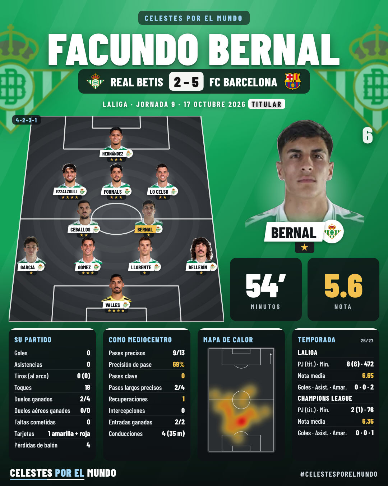
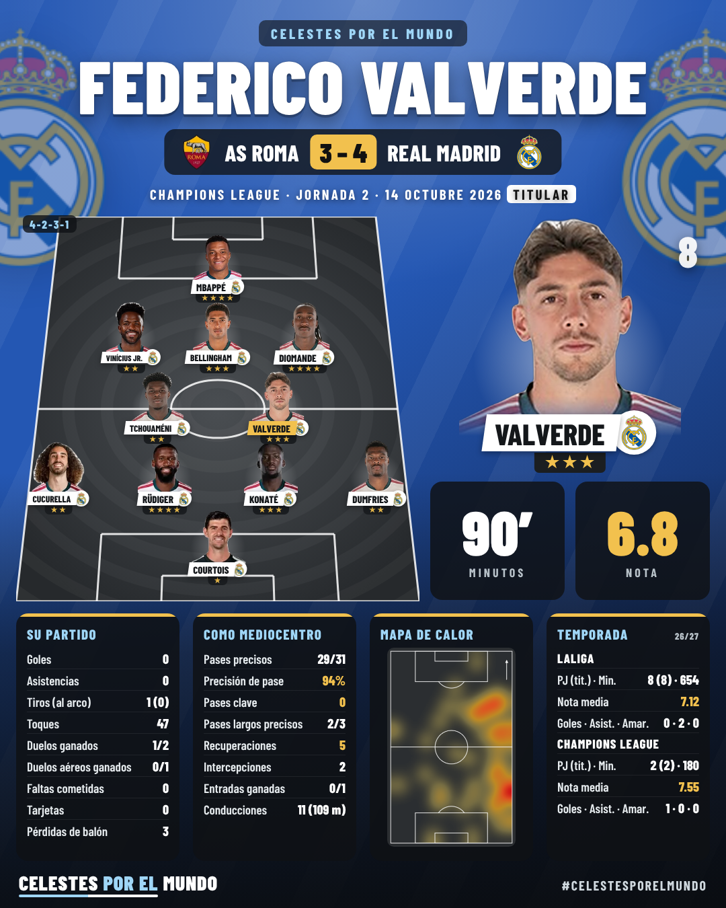
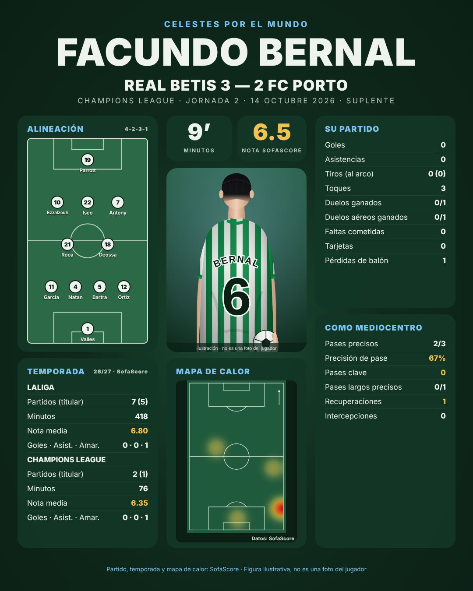
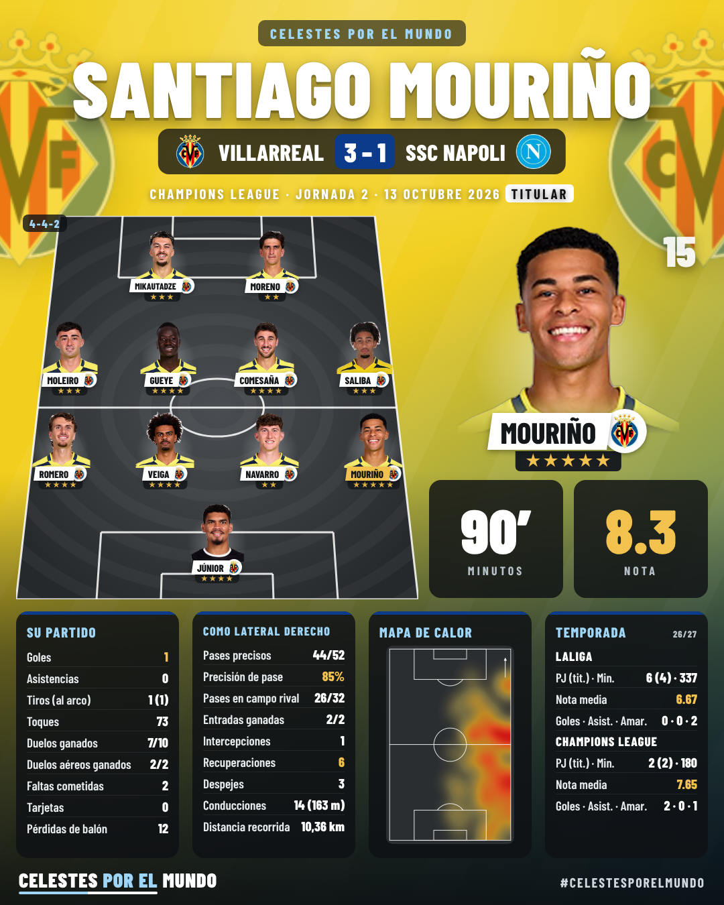
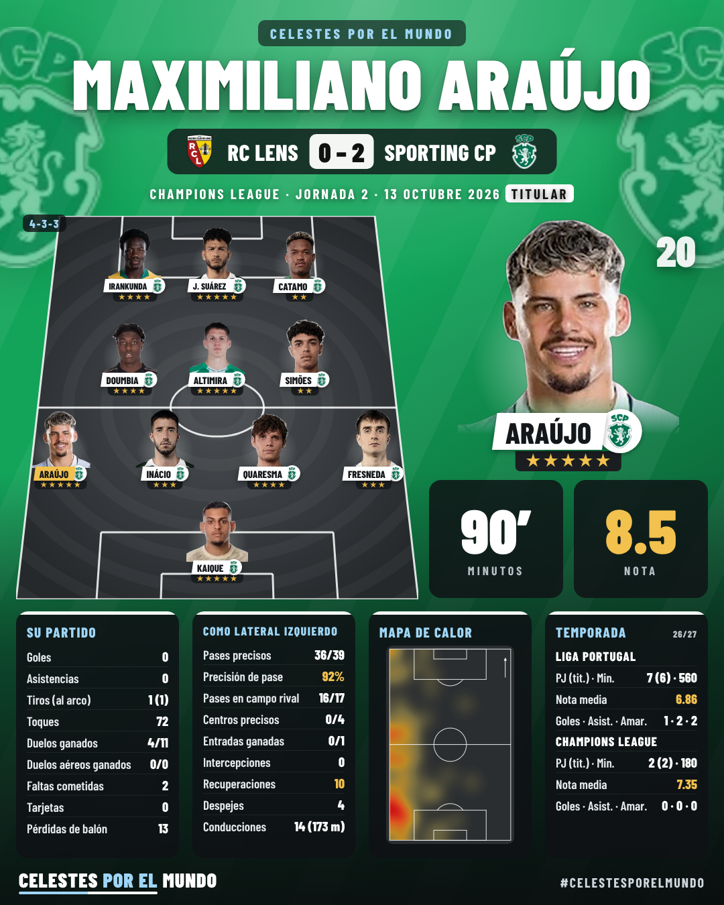
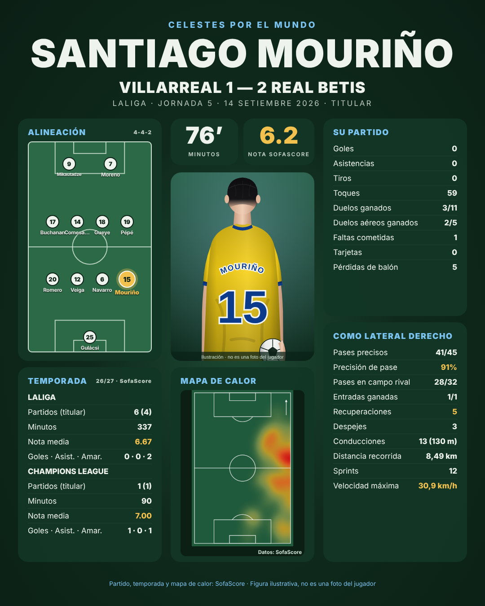

# Celestes por el mundo · infografías

Todos los días a las 18:30 (hora de Uruguay) una tarea programada de Claude revisa si **Valverde, Bentancur, Bernal, Mouriño, Araújo, Cáceres, Boselli, Satriano, Petit, Facundo González, Álvaro Rodríguez y Juan Manuel Rodríguez** jugaron hoy o ayer
y arma una infografía por cada partido, la revisa y la guarda acá. Corre en la nube: no depende de ninguna computadora prendida. **No publica nada**: la publicación la hacés vos.

Cuando hay infografías nuevas (o un error), se abre un aviso en [Issues](../../issues) y GitHub te manda un mail.
Si a las 23:30 la revisión del día no llegó, GitHub también abre un aviso.
Cerrá el aviso cuando la publiques o la descartes.

**Última revisión:** 2026-10-17 18:26-03:00 (hora de Uruguay) · fechas 2026-10-16, 2026-10-17

- Valverde: sin partido hoy ni ayer
- **Bernal** jugó 54' (titular, nota 5.6, de mediocentro) en Real Betis 2-5 FC Barcelona · LaLiga
- Mouriño: no jugó en Villarreal 0-0 Elche (suplente sin entrar)
- Araújo: sin partido hoy ni ayer

## Últimas infografías (6 en total, todas en [`salida/`](salida))

<table>
<tr><td align="center" valign="top" width="33%"> FACUNDO BERNAL · Real Betis 2-5 FC Barcelona 2026-10-17 · <a href="salida/Bernal_RealBetis-FCBarcelona_2026-10-17_copy.txt">texto del posteo</a></td><td align="center" valign="top" width="33%"> FEDERICO VALVERDE · AS Roma 3-4 Real Madrid 2026-10-14 · <a href="salida/Valverde_ASRoma-RealMadrid_2026-10-14_copy.txt">texto del posteo</a></td><td align="center" valign="top" width="33%"> FACUNDO BERNAL · Real Betis 3-2 FC Porto 2026-10-14 · <a href="salida/Bernal_RealBetis-FCPorto_2026-10-14_copy.txt">texto del posteo</a></td></tr>
<tr><td align="center" valign="top" width="33%"> SANTIAGO MOURIÑO · Villarreal 3-1 SSC Napoli 2026-10-13 · <a href="salida/Mourino_Villarreal-SSCNapoli_2026-10-13_copy.txt">texto del posteo</a></td><td align="center" valign="top" width="33%"> MAXIMILIANO ARAÚJO · RC Lens 0-2 Sporting CP 2026-10-13 · <a href="salida/Araujo_RCLens-SportingCP_2026-10-13_copy.txt">texto del posteo</a></td><td align="center" valign="top" width="33%"> Mourino Villarreal-Betis 2026-09-14 2026-09-14</td></tr>
</table>

## Cómo se usa

- **Correrlo ahora o para una fecha puntual:** en Claude, abrí la tarea programada *Infografías Celestes por el mundo* y usá *Run now*, o pedíselo a Claude en un chat (por ejemplo: "armá la de Mouriño del 13/10").
- SofaScore no le responde a los servidores de GitHub, por eso los datos se bajan desde la nube de Claude y GitHub solo guarda, muestra y avisa.
- **Sumar o sacar jugadores:** editá [`automatizacion/jugadores.json`](automatizacion/jugadores.json) (cómo, en [`automatizacion/AGENTE.md`](automatizacion/AGENTE.md)).
- **Qué ya se procesó:** [`automatizacion/procesados.json`](automatizacion/procesados.json). Si borrás una línea, ese partido se vuelve a armar.
- Los mapas de calor quedan en [`mapas/`](mapas) y las figuras en [`salida/fotos/`](salida/fotos).

Datos: SofaScore. Las figuras son ilustraciones, no fotos de los jugadores.
