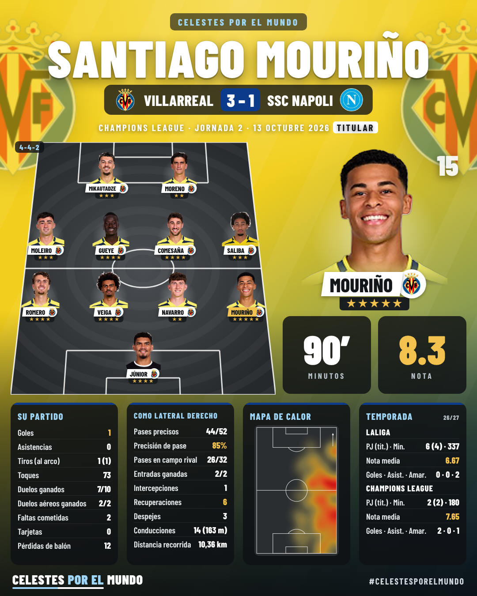

Mouriño jugó 90' (titular, nota 8.3) en Villarreal 3-1 SSC Napoli; infografía lista

@tuscxm

## Quién jugó
- **Mouriño** jugó 90' (titular, nota 8.3, de lateral derecho) en Villarreal 3-1 SSC Napoli · UEFA Champions League

## Mouriño · Villarreal 3-1 SSC Napoli

[Abrir la imagen en tamaño completo](https://github.com/tuscxm/celestes-por-el-mundo/blob/main/salida/Mourino_Villarreal-SSCNapoli_2026-10-13.png)

Texto para el posteo:
```
🇺🇾 SANTIAGO MOURIÑO · Villarreal 3-1 SSC Napoli
⏱ 90' · ⭐ 8.3 (SofaScore)
1 gol · 44/52 pases · 7 duelos ganados · 6 recuperaciones
#CelestesPorElMundo #Uruguay #Villarreal
```

---
No se publicó nada en Instagram. Cerrá este aviso cuando la publiques o la descartes.