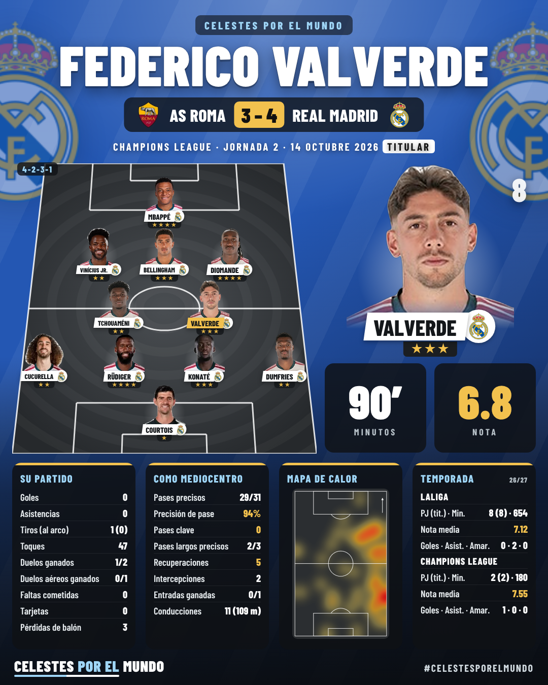
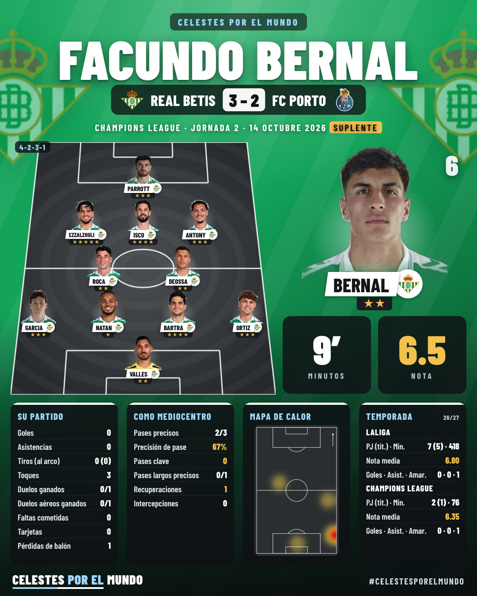
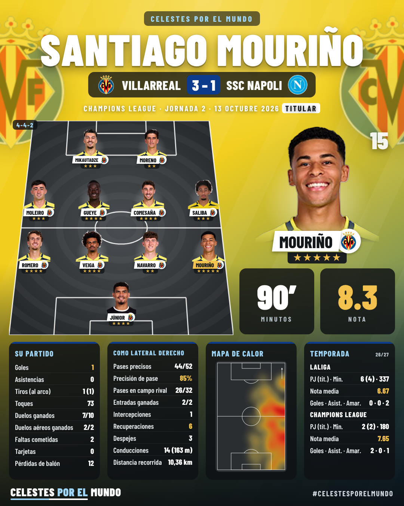
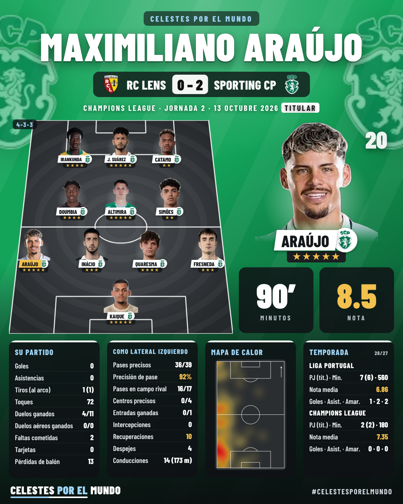

Valverde jugó 90' (titular, nota 6.8) en AS Roma 3-4 Real Madrid; Bernal jugó 9' (suplente, nota 6.5) en Real Betis 3-2 FC Porto; Mouriño jugó 90' (titular, nota 8.3) en Villarreal 3-1 SSC Napoli; Araújo jugó 90' (titular, nota 8.5) en RC Lens 0-2 Sp

@tuscxm

## Quién jugó
- **Valverde** jugó 90' (titular, nota 6.8, de mediocentro) en AS Roma 3-4 Real Madrid · UEFA Champions League
- **Bernal** jugó 9' (suplente, nota 6.5, de mediocentro) en Real Betis 3-2 FC Porto · UEFA Champions League
- **Mouriño** jugó 90' (titular, nota 8.3, de lateral derecho) en Villarreal 3-1 SSC Napoli · UEFA Champions League
- **Araújo** jugó 90' (titular, nota 8.5, de lateral izquierdo) en RC Lens 0-2 Sporting CP · UEFA Champions League

## Avisos
- Bernal: Entró de suplente: no aparece en la cancha del once inicial
- Bernal: Jugó solo 9 minutos: hay pocos datos, revisar si vale la pena publicarla

## Valverde · AS Roma 3-4 Real Madrid

[Abrir la imagen en tamaño completo](https://github.com/tuscxm/celestes-por-el-mundo/blob/main/salida/Valverde_ASRoma-RealMadrid_2026-10-14.png)

Texto para el posteo:
```
🇺🇾 FEDERICO VALVERDE · AS Roma 3-4 Real Madrid
⏱ 90' · ⭐ 6.8
29/31 pases · 1 duelo ganado · 5 recuperaciones
#CelestesPorElMundo #Uruguay #RealMadrid
```

## Bernal · Real Betis 3-2 FC Porto

[Abrir la imagen en tamaño completo](https://github.com/tuscxm/celestes-por-el-mundo/blob/main/salida/Bernal_RealBetis-FCPorto_2026-10-14.png)

Texto para el posteo:
```
🇺🇾 FACUNDO BERNAL · Real Betis 3-2 FC Porto
⏱ 9' · ⭐ 6.5
2/3 pases · 1 recuperación
#CelestesPorElMundo #Uruguay #RealBetis
```

## Mouriño · Villarreal 3-1 SSC Napoli

[Abrir la imagen en tamaño completo](https://github.com/tuscxm/celestes-por-el-mundo/blob/main/salida/Mourino_Villarreal-SSCNapoli_2026-10-13.png)

Texto para el posteo:
```
🇺🇾 SANTIAGO MOURIÑO · Villarreal 3-1 SSC Napoli
⏱ 90' · ⭐ 8.3
1 gol · 44/52 pases · 7 duelos ganados · 6 recuperaciones
#CelestesPorElMundo #Uruguay #Villarreal
```

## Araújo · RC Lens 0-2 Sporting CP

[Abrir la imagen en tamaño completo](https://github.com/tuscxm/celestes-por-el-mundo/blob/main/salida/Araujo_RCLens-SportingCP_2026-10-13.png)

Texto para el posteo:
```
🇺🇾 MAXIMILIANO ARAÚJO · RC Lens 0-2 Sporting CP
⏱ 90' · ⭐ 8.5
36/39 pases · 4 duelos ganados · 10 recuperaciones
#CelestesPorElMundo #Uruguay #SportingCP
```

---
No se publicó nada en Instagram. Cerrá este aviso cuando la publiques o la descartes.