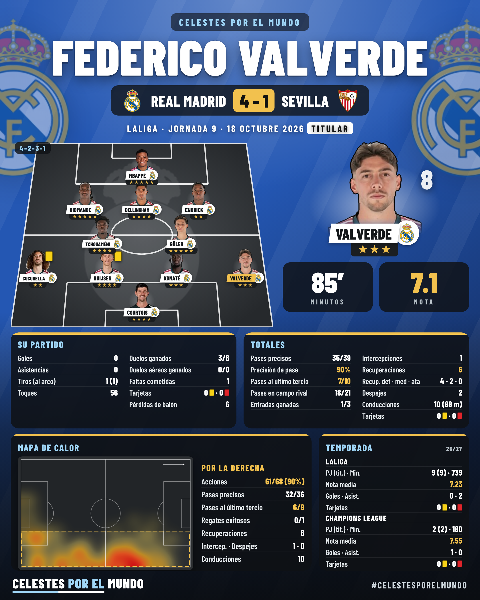
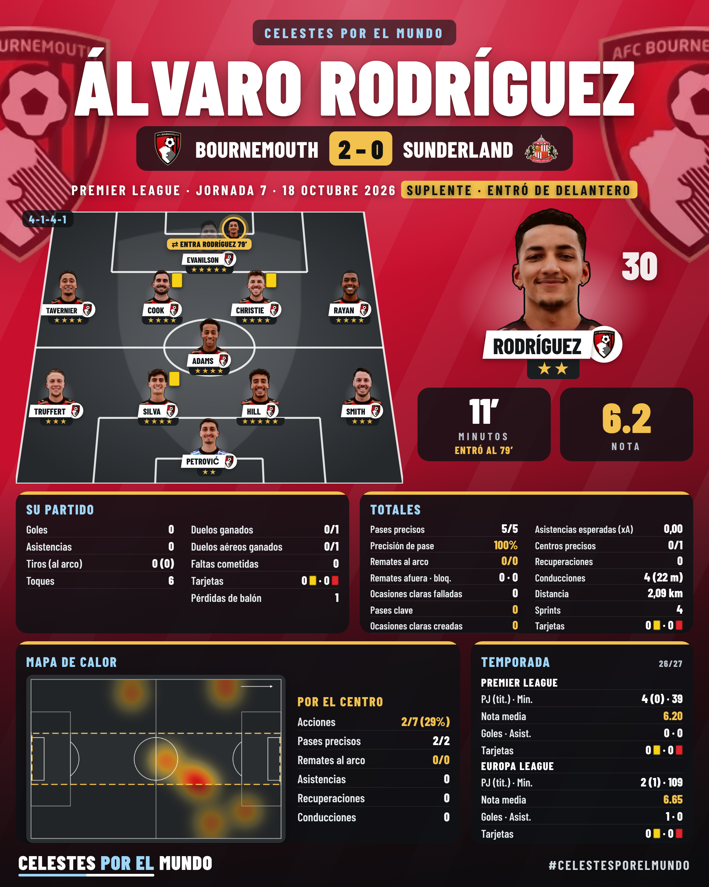
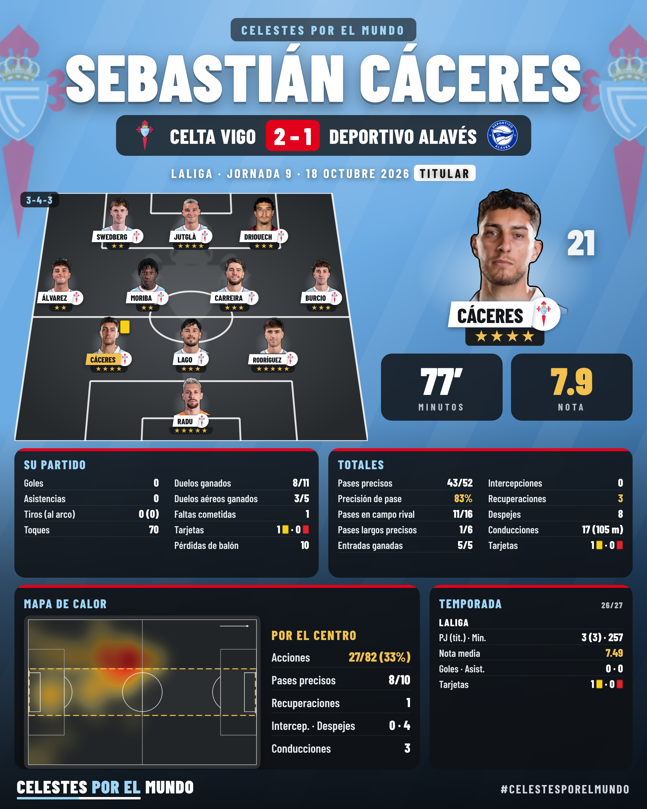

Valverde jugó 85' (titular, nota 7.1) en Real Madrid 4-1 Sevilla; Á. Rodríguez jugó 11' (suplente, nota 6.2) en Bournemouth 2-0 Sunderland; Cáceres jugó 77' (titular, nota 7.9) en Celta Vigo 2-1 Deportivo Alavés; infografías listas

@tuscxm

## Quién jugó
- **Valverde** jugó 85' (titular, nota 7.1, de lateral derecho) en Real Madrid 4-1 Sevilla · LaLiga
- **Á. Rodríguez** jugó 11' (suplente, entró al 79' por Evanilson, nota 6.2, de delantero) en Bournemouth 2-0 Sunderland · Premier League
- **Cáceres** jugó 77' (titular, nota 7.9, de defensor central) en Celta Vigo 2-1 Deportivo Alavés · LaLiga

## El resto
- Bernal: ya procesado · Real Betis 2-5 FC Barcelona
- Mouriño: ya procesado · Villarreal 0-0 Elche
- Araújo: sin partido hoy ni ayer
- González: no jugó en Osasuna 2-0 Real Racing Club (suplente sin entrar)
- Petit: sin partido hoy ni ayer
- Bentancur: sin partido hoy ni ayer
- Satriano: sin partido hoy ni ayer
- Boselli: sin partido hoy ni ayer
- J. Rodríguez: sin partido hoy ni ayer
- Zalazar: sin partido hoy ni ayer
- Merentiel: sin partido hoy ni ayer

## Avisos
- Valverde: Nota = promedio de sofascore 7.00 · fotmob 7.23 → 7.12
- Á. Rodríguez: Jugó solo 11 minutos: hay pocos datos, revisar si vale la pena publicarla
- Á. Rodríguez: Nota = promedio de sofascore 6.40 · fotmob 5.96 → 6.18
- Cáceres: Nota = promedio de sofascore 8.00 · fotmob 7.86 → 7.93

## Fuentes consultadas (uso interno, no va en el posteo)
- Valverde: fotmob ok · besoccer ok · api_football error HTTP 403: falta la clave o no es válida · football_data error: dominio no habilitado en la red de la nube · thesportsdb error: dominio no habilitado en la red de la nube · understat error: dominio no habilitado en la red de la nube · zerozero error: dominio no habilitado en la red de la nube
- Á. Rodríguez: fotmob ok · besoccer ok · api_football error HTTP 403: falta la clave o no es válida · football_data error: dominio no habilitado en la red de la nube · thesportsdb error: dominio no habilitado en la red de la nube · understat error: dominio no habilitado en la red de la nube · zerozero error: dominio no habilitado en la red de la nube
- Cáceres: fotmob ok · besoccer ok · api_football error HTTP 403: falta la clave o no es válida · football_data error: dominio no habilitado en la red de la nube · thesportsdb error: dominio no habilitado en la red de la nube · understat error: dominio no habilitado en la red de la nube · zerozero error: dominio no habilitado en la red de la nube

## Valverde · Real Madrid 4-1 Sevilla

[Abrir la imagen en tamaño completo](https://github.com/tuscxm/celestes-por-el-mundo/blob/main/salida/Valverde_RealMadrid-Sevilla_2026-10-18.png)

Texto para el posteo:
```
🇺🇾 FEDERICO VALVERDE · Real Madrid 4-1 Sevilla
⏱ 85' · ⭐ 7.1
35/39 pases · 3 duelos ganados · 6 recuperaciones
#CelestesPorElMundo #Uruguay #RealMadrid
```

## Á. Rodríguez · Bournemouth 2-0 Sunderland

[Abrir la imagen en tamaño completo](https://github.com/tuscxm/celestes-por-el-mundo/blob/main/salida/Rodriguez_Bournemouth-Sunderland_2026-10-18.png)

Texto para el posteo:
```
🇺🇾 ÁLVARO RODRÍGUEZ · Bournemouth 2-0 Sunderland
⏱ 11' · ⭐ 6.2
🔁 Entró al 79' por Evanilson, como delantero
5/5 pases
#CelestesPorElMundo #Uruguay #Bournemouth
```

## Cáceres · Celta Vigo 2-1 Deportivo Alavés

[Abrir la imagen en tamaño completo](https://github.com/tuscxm/celestes-por-el-mundo/blob/main/salida/Caceres_CeltaVigo-DeportivoAlaves_2026-10-18.png)

Texto para el posteo:
```
🇺🇾 SEBASTIÁN CÁCERES · Celta Vigo 2-1 Deportivo Alavés
⏱ 77' · ⭐ 7.9
43/52 pases · 8 duelos ganados · 3 recuperaciones
#CelestesPorElMundo #Uruguay #CeltaVigo
```

---
No se publicó nada en Instagram. Cerrá este aviso cuando la publiques o la descartes.
## Revisión visual
- Cáceres: la foto grande tiene un parche de fondo blanco del lado izquierdo de la cabeza (entre el pelo, la oreja y el hombro) y una línea negra suelta que sale del hombro derecho hacia la placa. Conviene rehacer el recorte antes de publicar.
- Cáceres: la placa de la foto dice "CACERES" sin tilde (en la cancha y el título sí dice "CÁCERES").
- Á. Rodríguez: el cartel "⇄ ENTRA RODRIGUEZ 79'" quedó encimado entre Cook y Christie (tapa en parte la amarilla de Christie) en lugar de junto a Evanilson; la carita del que entró queda pegada al arco de arriba.
- Á. Rodríguez: el bloque "POR EL CENTRO" no trae "Remates al arco" aunque en TOTALES aparece (0/0); la placa dice "RODRIGUEZ" sin tilde.
- Valverde: sin problemas a la vista (franja derecha bien marcada, último tercio y recuperaciones por tercio presentes, LaLiga y Champions en TEMPORADA).
- Fuentes extra: API-Football dio HTTP 403 (falta la clave o no es válida); football-data.org, TheSportsDB, Understat y zerozero dieron "dominio no habilitado en la red de la nube". Solo respondieron SofaScore y FotMob.
- BeSoccer: no se pudo leer en esta corrida (la herramienta web pidió permiso para es.besoccer.com y nadie lo aprobó), así que besoccer_hoy.json quedó vacío.

## Ajustes hechos (18/10, después de la revisión)
- Se rehicieron las tres infografías: Cáceres con la cara bien recortada, placas con tilde (CÁCERES, RODRÍGUEZ), el cartel del cambio de Á. Rodríguez sobre la cara de Evanilson (ya no pisa a Cook y Christie) y "Remates al arco 0/0" en su bloque de la franja.
- Desde ahora: PNG a 2160x2700, nuevo recorte de caras (dos modelos + matting), escudos y mapa de calor en alta.
