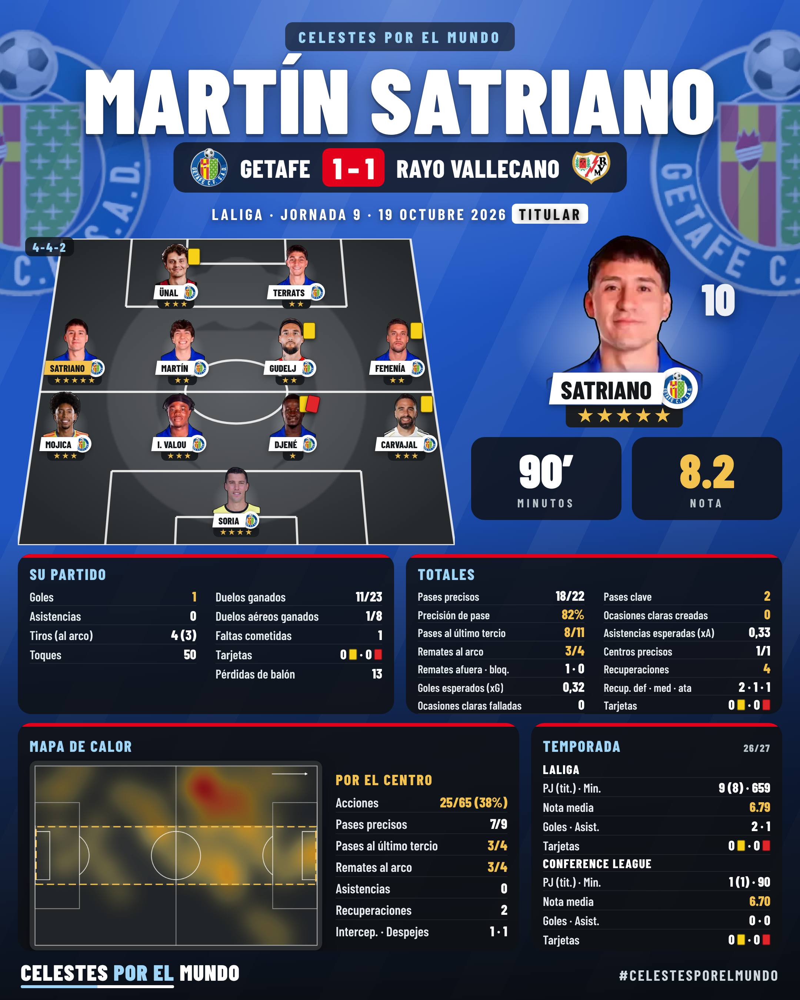
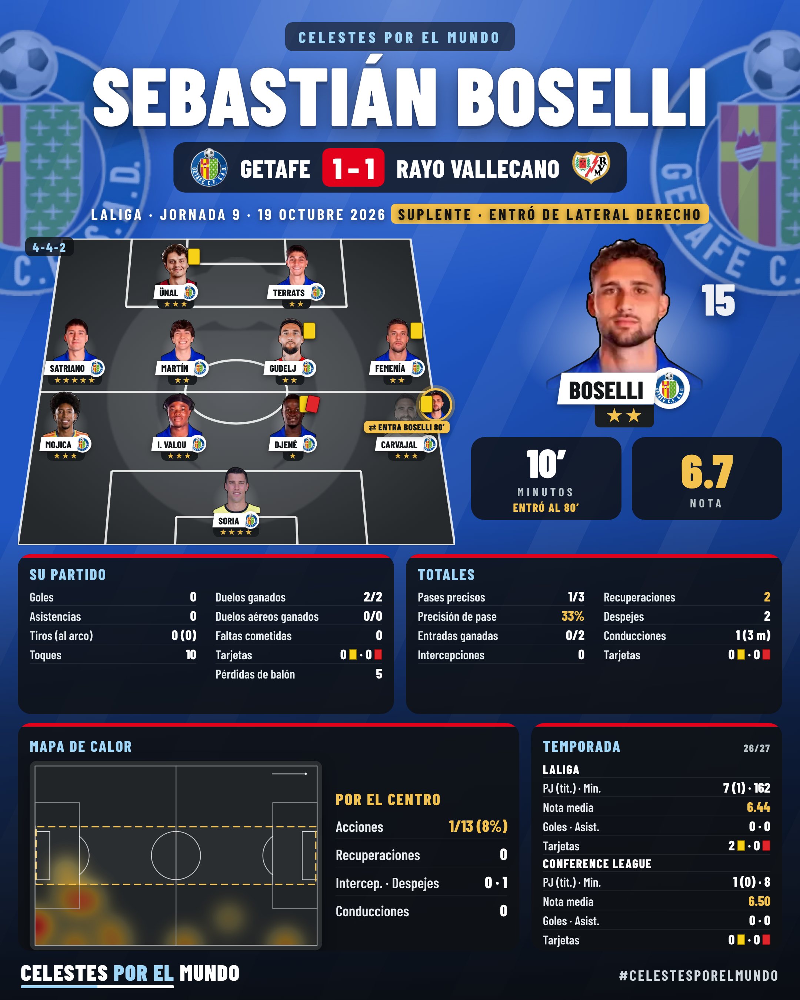
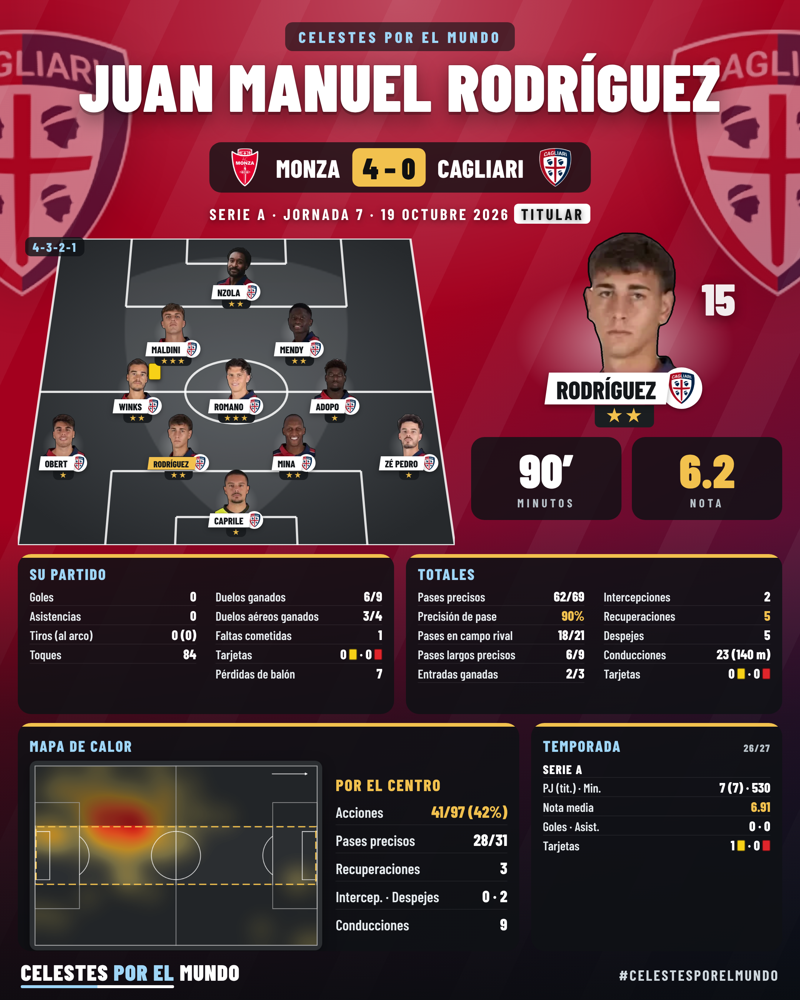

Satriano jugó 90' (titular, nota 8.2) en Getafe 1-1 Rayo Vallecano; Boselli jugó 10' (suplente, nota 6.7) en Getafe 1-1 Rayo Vallecano; J. Rodríguez jugó 90' (titular, nota 6.2) en Monza 4-0 Cagliari; infografías listas

@tuscxm

## Quién jugó
- **Satriano** jugó 90' (titular, nota 8.2, de mediocentro) en Getafe 1-1 Rayo Vallecano · LaLiga
- **Boselli** jugó 10' (suplente, entró al 80' por Carvajal, nota 6.7, de lateral derecho) en Getafe 1-1 Rayo Vallecano · LaLiga
- **J. Rodríguez** jugó 90' (titular, nota 6.2, de defensor central) en Monza 4-0 Cagliari · Serie A

## El resto
- Valverde: ya procesado · Real Madrid 4-1 Sevilla
- Bernal: sin partido hoy ni ayer
- Mouriño: sin partido hoy ni ayer
- Araújo: sin partido hoy ni ayer
- Á. Rodríguez: ya procesado · Bournemouth 2-0 Sunderland
- González: ya procesado · Osasuna 2-0 Real Racing Club
- Cáceres: ya procesado · Celta Vigo 2-1 Deportivo Alavés
- Petit: sin partido hoy ni ayer
- Bentancur: sin partido hoy ni ayer
- Zalazar: sin partido hoy ni ayer
- Merentiel: sin partido hoy ni ayer

## Avisos
- Satriano: Nota = promedio de sofascore 8.20 · fotmob 8.14 → 8.17
- Boselli: Jugó solo 10 minutos: hay pocos datos, revisar si vale la pena publicarla
- Boselli: Nota = promedio de sofascore 6.90 · fotmob 6.45 → 6.68
- J. Rodríguez: Nota = promedio de sofascore 6.50 · fotmob 5.92 → 6.21

## Fuentes consultadas (uso interno, no va en el posteo)
- Satriano: fotmob ok · besoccer ok · api_football error HTTP 403: falta la clave o no es válida · football_data error: dominio no habilitado en la red de la nube · thesportsdb error: dominio no habilitado en la red de la nube · understat error: dominio no habilitado en la red de la nube · zerozero error: dominio no habilitado en la red de la nube
- Boselli: fotmob ok · besoccer ok · api_football error HTTP 403: falta la clave o no es válida · football_data error: dominio no habilitado en la red de la nube · thesportsdb error: dominio no habilitado en la red de la nube · understat error: dominio no habilitado en la red de la nube · zerozero error: dominio no habilitado en la red de la nube
- J. Rodríguez: fotmob ok · besoccer ok · api_football error HTTP 403: falta la clave o no es válida · football_data error: dominio no habilitado en la red de la nube · thesportsdb error: dominio no habilitado en la red de la nube · understat error: dominio no habilitado en la red de la nube · zerozero error: dominio no habilitado en la red de la nube

## Satriano · Getafe 1-1 Rayo Vallecano

[Abrir la imagen en tamaño completo](https://github.com/tuscxm/celestes-por-el-mundo/blob/main/salida/png/M.%20Satriano/2026-10-19%20%C2%B7%20Rayo%20Vallecano%20%C2%B7%20LaLiga/Satriano_Getafe-RayoVallecano_2026-10-19.png)

Texto para el posteo:
```
🇺🇾 MARTÍN SATRIANO · Getafe 1-1 Rayo Vallecano
⏱ 90' · ⭐ 8.2
1 gol · 18/22 pases · 11 duelos ganados · 4 recuperaciones
#CelestesPorElMundo #Uruguay #Getafe
```

## Boselli · Getafe 1-1 Rayo Vallecano

[Abrir la imagen en tamaño completo](https://github.com/tuscxm/celestes-por-el-mundo/blob/main/salida/png/S.%20Boselli/2026-10-19%20%C2%B7%20Rayo%20Vallecano%20%C2%B7%20LaLiga/Boselli_Getafe-RayoVallecano_2026-10-19.png)

Texto para el posteo:
```
🇺🇾 SEBASTIÁN BOSELLI · Getafe 1-1 Rayo Vallecano
⏱ 10' · ⭐ 6.7
🔁 Entró al 80' por Carvajal, como lateral derecho
1/3 pases · 2 duelos ganados · 2 recuperaciones
#CelestesPorElMundo #Uruguay #Getafe
```

## J. Rodríguez · Monza 4-0 Cagliari

[Abrir la imagen en tamaño completo](https://github.com/tuscxm/celestes-por-el-mundo/blob/main/salida/png/J.%20M.%20Rodr%C3%ADguez/2026-10-19%20%C2%B7%20Monza%20%C2%B7%20Serie%20A/Rodriguez_Monza-Cagliari_2026-10-19.png)

Texto para el posteo:
```
🇺🇾 JUAN MANUEL RODRÍGUEZ · Monza 4-0 Cagliari
⏱ 90' · ⭐ 6.2
62/69 pases · 6 duelos ganados · 5 recuperaciones
#CelestesPorElMundo #Uruguay #Cagliari
```

---
No se publicó nada en Instagram. Cerrá este aviso cuando la publiques o la descartes.
## Revisión visual
- Satriano: bien en general (caras con contorno, escudos y escudo detrás de la cancha, resaltado en la cancha, TOTALES con todo por ser uno de los de afuera de la línea de 4 volantes, LaLiga + Conference en TEMPORADA). En la cancha se ve la roja de Djené (28'). El resumen lo describe "de mediocentro" aunque en la cancha figura como volante por izquierda del 4-4-2.
- Boselli: jugó de lateral derecho (el mapa de calor está casi todo en la franja derecha), pero en `jugadores.json` tiene `zona: centro`, así que el bloque "POR EL CENTRO" muestra solo 1 de 13 acciones. Conviene revisar si su franja debería ser "derecha". Con 10 minutos hay pocos datos.
- J. Rodríguez: bien; la foto grande tiene el hombro izquierdo un poco desprolijo (recorte de la camiseta). Solo Serie A en TEMPORADA (no juega copa internacional).
- BeSoccer: las páginas de partidos de los jugadores no se pudieron abrir directamente (la herramienta web pidió permiso y nadie respondió); se leyó lo que se pudo desde la ficha de cada jugador. Solo Valverde jugó en las fechas (Real Madrid 4-1 Sevilla, ya procesado); la página de alineaciones no se pudo abrir, así que no hay notas del once. 10 jugadores no tienen URL de BeSoccer y no se encontraron con seguridad.
- Fuentes extra con error: API-Football (HTTP 403: falta la clave o no es válida); football-data.org, TheSportsDB, Understat y zerozero (dominio no habilitado en la red de la nube).
