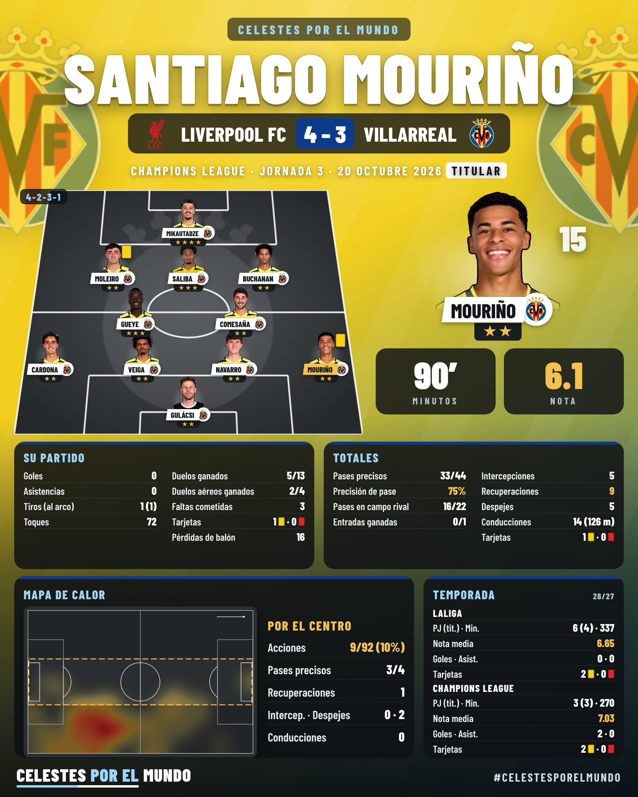

Mouriño jugó 90' (titular, nota 6.1) en Liverpool FC 4-3 Villarreal; infografía lista

@tuscxm

## Quién jugó
- **Mouriño** jugó 90' (titular, nota 6.1, de lateral derecho) en Liverpool FC 4-3 Villarreal · UEFA Champions League

## El resto
- Valverde: sin partido hoy ni ayer
- Bernal: sin partido hoy ni ayer
- Araújo: sin partido hoy ni ayer
- Á. Rodríguez: sin partido hoy ni ayer
- González: sin partido hoy ni ayer
- Cáceres: sin partido hoy ni ayer
- Petit: sin partido hoy ni ayer
- Bentancur: sin partido hoy ni ayer
- Satriano: ya procesado · Getafe 1-1 Rayo Vallecano
- Boselli: ya procesado · Getafe 1-1 Rayo Vallecano
- J. Rodríguez: ya procesado · Monza 4-0 Cagliari
- Zalazar: sin partido hoy ni ayer
- Merentiel: sin partido hoy ni ayer

## Avisos
- Mouriño: Nota = promedio de sofascore 5.80 · fotmob 6.39 → 6.09

## Fuentes consultadas (uso interno, no va en el posteo)
- Mouriño: fotmob ok · besoccer ok · api_football error HTTP 403: falta la clave o no es válida · football_data error: dominio no habilitado en la red de la nube · thesportsdb error: dominio no habilitado en la red de la nube · understat error: dominio no habilitado en la red de la nube · zerozero error: dominio no habilitado en la red de la nube

## Mouriño · Liverpool FC 4-3 Villarreal

[Abrir la imagen en tamaño completo](https://github.com/tuscxm/celestes-por-el-mundo/blob/main/salida/Mourino_LiverpoolFC-Villarreal_2026-10-20.png)

Texto para el posteo:
```
🇺🇾 SANTIAGO MOURIÑO · Liverpool FC 4-3 Villarreal
⏱ 90' · ⭐ 6.1
33/44 pases · 5 duelos ganados · 9 recuperaciones
#CelestesPorElMundo #Uruguay #Villarreal
```

---
No se publicó nada en Instagram. Cerrá este aviso cuando la publiques o la descartes.
## Revisión visual
- Mouriño · Liverpool 4-3 Villarreal: caras con contorno negro y bien recortadas, escudos bien (también la silueta detrás de la cancha), sin textos cortados ni encimados, jugador resaltado en la cancha, amarilla visible en la cancha, SU PARTIDO, TOTALES y TEMPORADA. TOTALES de defensor (jugó de lateral derecho): correcto. TEMPORADA con LaLiga y Champions League.
- Ojo con la franja: en este partido jugó de lateral derecho y el mapa de calor muestra casi todo por la derecha, pero el bloque es "POR EL CENTRO" (zona fija de jugadores.json), así que solo refleja 9 de 92 acciones (10%). No se cambió nada; evaluá si conviene usar la franja del puesto del partido.
- BeSoccer no respondió hoy (la página no se pudo leer), así que besoccer_hoy.json quedó vacío; el "besoccer ok" de Fuentes consultadas solo indica que se leyó el archivo, sin datos.
- Fuentes extra con error: API-Football (HTTP 403, falta la clave o no es válida); football-data.org, TheSportsDB, Understat y zerozero (dominio no habilitado en la red de la nube).
