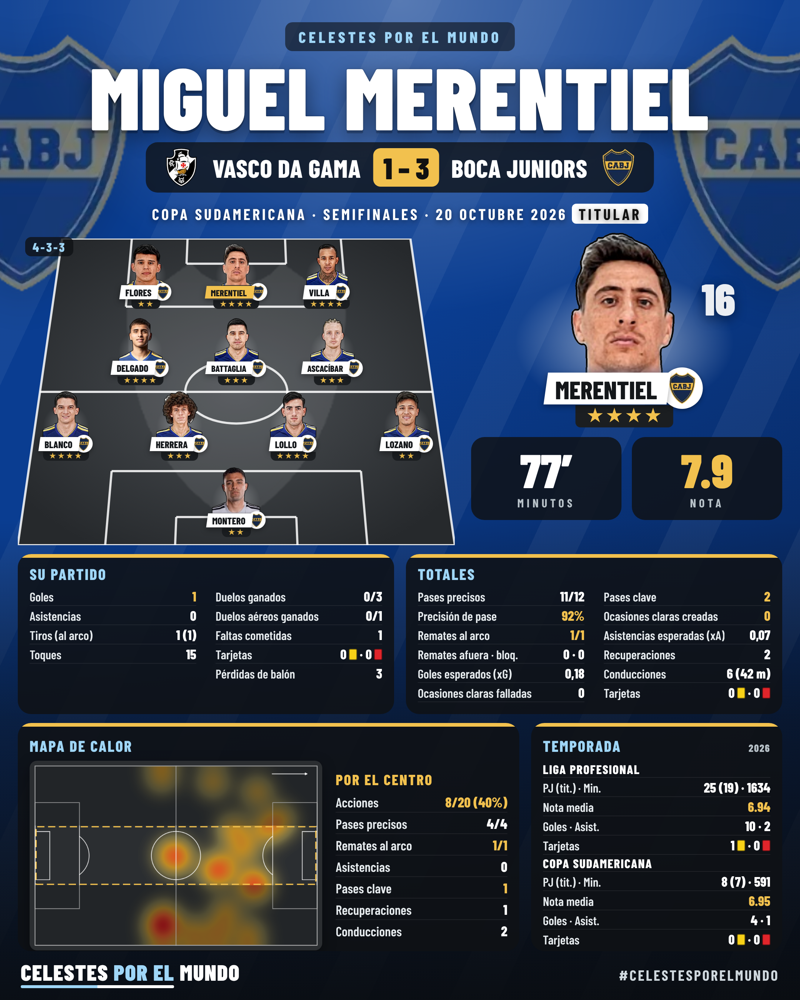
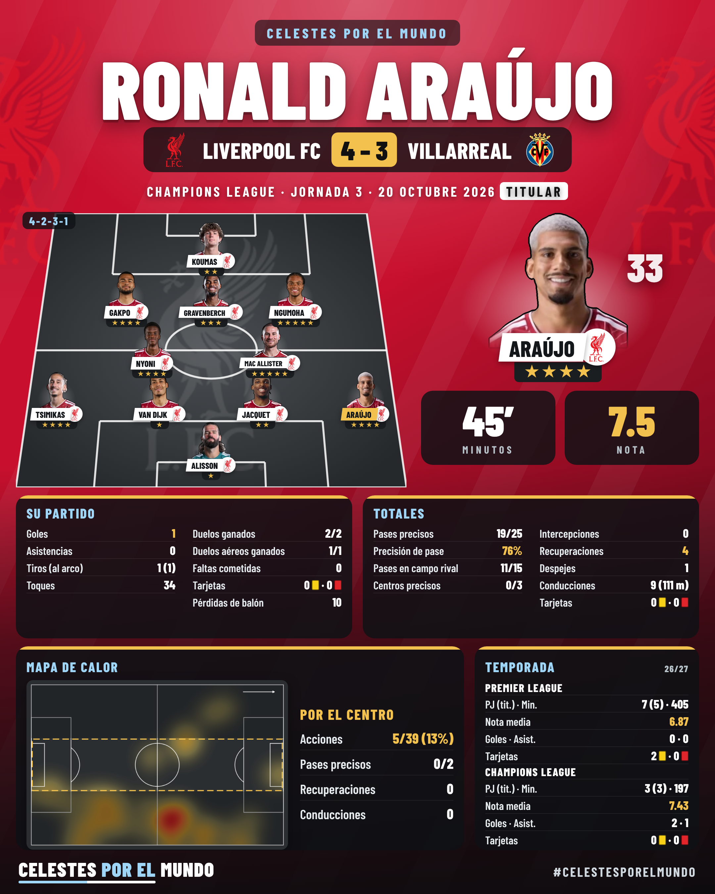
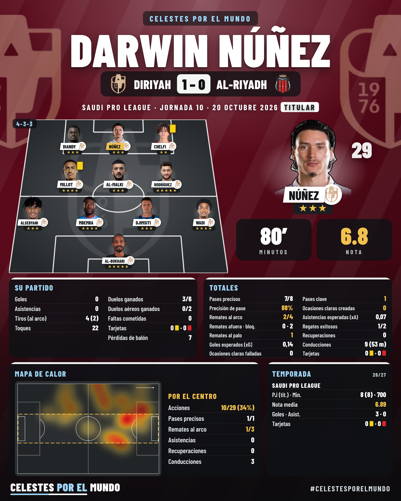

Merentiel jugó 77' (titular, nota 7.9) en Vasco da Gama 1-3 Boca Juniors; R. Araújo jugó 45' (titular, nota 7.5) en Liverpool FC 4-3 Villarreal; Darwin jugó 80' (titular, nota 6.8) en Diriyah 1-0 Al-Riyadh; infografías listas

@tuscxm

## Quién jugó
- **Merentiel** jugó 77' (titular, nota 7.9, de delantero) en Vasco da Gama 1-3 Boca Juniors · CONMEBOL Sudamericana, Knockout stage
- **R. Araújo** jugó 45' (titular, nota 7.5, de lateral derecho) en Liverpool FC 4-3 Villarreal · UEFA Champions League
- **Darwin** jugó 80' (titular, nota 6.8, de delantero) en Diriyah 1-0 Al-Riyadh · Saudi Pro League

## El resto
- Valverde: sin partido hoy ni ayer
- Bernal: sin partido hoy ni ayer
- Mouriño: ya procesado · Liverpool FC 4-3 Villarreal
- M. Araújo: sin partido hoy ni ayer
- Á. Rodríguez: sin partido hoy ni ayer
- González: sin partido hoy ni ayer
- Cáceres: sin partido hoy ni ayer
- Petit: sin partido hoy ni ayer
- Bentancur: sin partido hoy ni ayer
- Satriano: ya procesado · Getafe 1-1 Rayo Vallecano
- Boselli: ya procesado · Getafe 1-1 Rayo Vallecano
- J. Rodríguez: ya procesado · Monza 4-0 Cagliari
- Zalazar: sin partido hoy ni ayer
- Giménez: sin partido hoy ni ayer
- Amaro: sin partido hoy ni ayer
- J. M. Sanabria: sin partido hoy ni ayer
- Ugarte: sin partido hoy ni ayer
- Canobbio: sin partido hoy ni ayer
- F. Díaz: sin partido hoy ni ayer
- Torreira: sin partido hoy ni ayer
- Brizuela: sin partido hoy ni ayer
- Piquerez: sin partido hoy ni ayer

## Avisos
- Merentiel: Nota = promedio de sofascore 7.60 · fotmob 7.89 · besoccer 8.20 → 7.90
- R. Araújo: Nota = promedio de sofascore 7.40 · fotmob 7.44 · besoccer 7.50 → 7.45
- R. Araújo: Las fuentes no coinciden en minutos: SofaScore 45 · besoccer 46 (se usó SofaScore)
- Darwin: Nota = promedio de sofascore 6.80 · fotmob 6.92 · besoccer 6.70 → 6.81

## Fuentes consultadas (uso interno, no va en el posteo)
- Merentiel: fotmob ok · besoccer ok · api_football error HTTP 403: falta la clave o no es válida · thesportsdb error: dominio no habilitado en la red de la nube · understat sin datos: sin understat_equipo (Understat no cubre esa liga) · zerozero error: dominio no habilitado en la red de la nube
- R. Araújo: fotmob ok · besoccer ok · api_football error HTTP 403: falta la clave o no es válida · thesportsdb error: dominio no habilitado en la red de la nube · understat error: dominio no habilitado en la red de la nube · zerozero error: dominio no habilitado en la red de la nube
- Darwin: fotmob ok · besoccer ok · api_football error HTTP 403: falta la clave o no es válida · thesportsdb error: dominio no habilitado en la red de la nube · understat sin datos: sin understat_equipo (Understat no cubre esa liga) · zerozero error: dominio no habilitado en la red de la nube

## Merentiel · Vasco da Gama 1-3 Boca Juniors

[Abrir la imagen en tamaño completo](https://github.com/tuscxm/celestes-por-el-mundo/blob/main/salida/png/M.%20Merentiel/2026-10-20%20%C2%B7%20Vasco%20da%20Gama%20%C2%B7%20Copa%20Sudamericana/Merentiel_VascodaGama-BocaJuniors_2026-10-20.png)

Texto para el posteo:
```
🇺🇾 MIGUEL MERENTIEL · Vasco da Gama 1-3 Boca Juniors
⏱ 77' · ⭐ 7.9
1 gol · 11/12 pases · 2 recuperaciones
#CelestesPorElMundo #Uruguay #BocaJuniors
```

## R. Araújo · Liverpool FC 4-3 Villarreal

[Abrir la imagen en tamaño completo](https://github.com/tuscxm/celestes-por-el-mundo/blob/main/salida/png/R.%20Ara%C3%BAjo/2026-10-20%20%C2%B7%20Villarreal%20%C2%B7%20Champions%20League/Araujo_LiverpoolFC-Villarreal_2026-10-20.png)

Texto para el posteo:
```
🇺🇾 RONALD ARAÚJO · Liverpool FC 4-3 Villarreal
⏱ 45' · ⭐ 7.5
1 gol · 19/25 pases · 2 duelos ganados · 4 recuperaciones
#CelestesPorElMundo #Uruguay #LiverpoolFC
```

## Darwin · Diriyah 1-0 Al-Riyadh

[Abrir la imagen en tamaño completo](https://github.com/tuscxm/celestes-por-el-mundo/blob/main/salida/png/D.%20N%C3%BA%C3%B1ez/2026-10-20%20%C2%B7%20Al-Riyadh%20%C2%B7%20Saudi%20Pro%20League/Nunez_Diriyah-Al-Riyadh_2026-10-20.png)

Texto para el posteo:
```
🇺🇾 DARWIN NÚÑEZ · Diriyah 1-0 Al-Riyadh
⏱ 80' · ⭐ 6.8
7/8 pases · 3 duelos ganados
#CelestesPorElMundo #Uruguay #Diriyah
```

---
No se publicó nada en Instagram. Cerrá este aviso cuando la publiques o la descartes.
## Revisión visual
- Merentiel: todo en orden (cara con contorno, escudos, cancha con el escudo detrás, TOTALES de ataque, franja del centro completa, TEMPORADA con Liga Profesional y Copa Sudamericana). Detalle menor: la placa de Di Lollo dice "LOLLO".
- R. Araújo: jugó de lateral derecho pero su franja es el CENTRO (zaguero en el 3-5-2), así que el bloque "POR EL CENTRO" tiene poco (5/39 acciones). Figura con 1 gol y 1 tiro al arco en 45'; en la página de BeSoccer leída no aparecía su gol (solo listaba algunos goleadores), conviene confirmarlo antes de publicar. El resto bien (TEMPORADA con Premier League y Champions League).
- Darwin: el contorno de la cara grande queda algo desprolijo del lado derecho de la cabeza (borde irregular cerca de la oreja/cuello). El resto bien; TEMPORADA solo con la liga (no juega copa internacional).
- Fuentes extra con error en los tres partidos: API-Football HTTP 403 (falta la clave o no es válida); TheSportsDB, Understat y zerozero con dominio no habilitado en la red de la nube.
