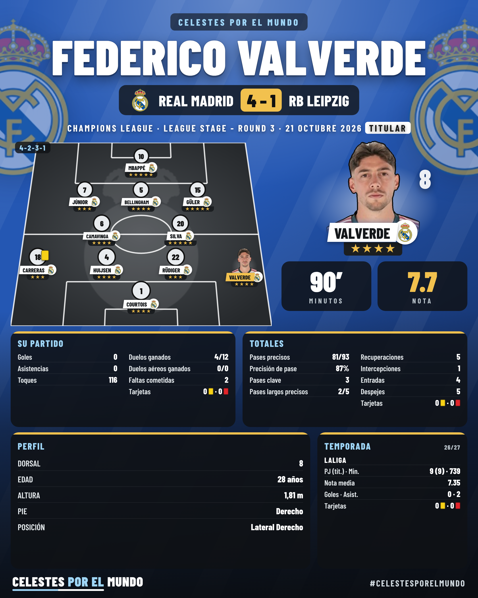
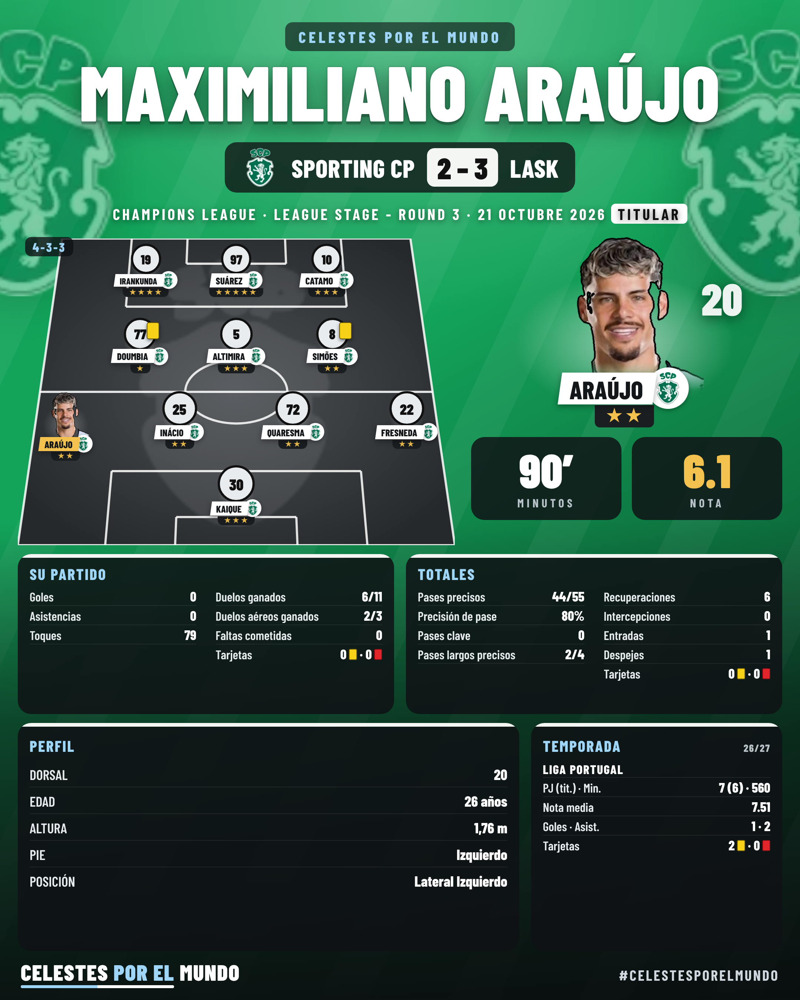
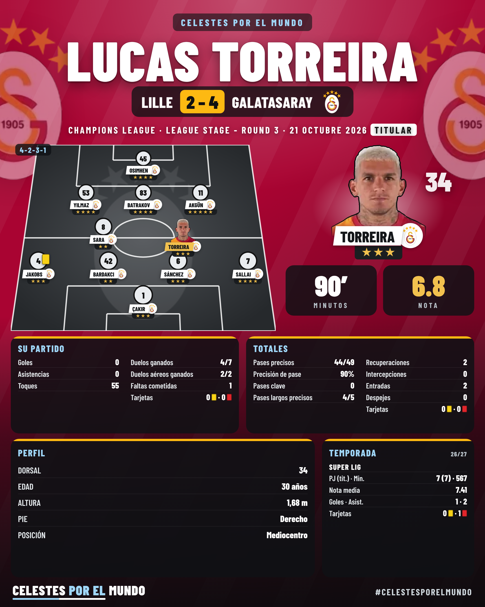

Valverde jugó 90' (titular, nota 7.7) en Real Madrid 4-1 RB Leipzig; M. Araújo jugó 90' (titular, nota 6.1) en Sporting CP 2-3 LASK; Torreira jugó 90' (titular, nota 6.8) en Lille 2-4 Galatasaray; infografías listas

@tuscxm

## Quién jugó
- **Valverde** jugó 90' (titular, nota 7.7, de lateral derecho) en Real Madrid 4-1 RB Leipzig · Champions League
- **M. Araújo** jugó 90' (titular, nota 6.1, de lateral izquierdo) en Sporting CP 2-3 LASK · Champions League
- **Torreira** jugó 90' (titular, nota 6.8, de mediocentro) en Lille 2-4 Galatasaray · Champions League

## El resto
- Bernal: no jugó en Real Betis 1-0 Feyenoord (no entró)
- Mouriño: ya procesado (el respaldo la volvió a armar por error; ver Revisión visual) · Liverpool 4-3 Villarreal
- Á. Rodríguez: sin partido hoy ni ayer
- González: sin partido hoy ni ayer
- Cáceres: sin partido hoy ni ayer
- Petit: sin partido hoy ni ayer
- Bentancur: sin partido hoy ni ayer
- Satriano: sin partido hoy ni ayer
- Boselli: sin partido hoy ni ayer
- J. Rodríguez: sin partido hoy ni ayer
- Zalazar: sin partido hoy ni ayer
- Merentiel: ya procesado (el respaldo la volvió a armar por error; ver Revisión visual) · Vasco da Gama 1-3 Boca Juniors
- Giménez: sin partido hoy ni ayer
- Amaro: sin partido hoy ni ayer
- R. Araújo: ya procesado (el respaldo la volvió a armar por error; ver Revisión visual) · Liverpool 4-3 Villarreal
- J. M. Sanabria: sin partido hoy ni ayer
- Ugarte: sin partido hoy ni ayer
- Canobbio: sin partido hoy ni ayer
- Darwin: ya procesado (el respaldo la volvió a armar por error; ver Revisión visual) · Al Diriyah 1-0 Al Riyadh
- F. Díaz: sin partido hoy ni ayer
- Brizuela: sin partido hoy ni ayer
- Piquerez: sin partido hoy ni ayer

## Avisos
- Valverde: SofaScore no respondió; fuentes: fotmob ok, besoccer ok, api_football error HTTP 403: falta la clave o no es válida, thesportsdb error: dominio no habilitado en la red de la nube, understat error: dominio no habilitado en la red de la nube, zerozero error: dominio no habilitado en la red de la nube
- Valverde: Nota = promedio de fotmob 8.33 · api_football None · besoccer 7.1 → 7.71
- Valverde: Armada con datos de respaldo (FotMob): hay menos estadísticas que de costumbre, revisala antes de publicar
- M. Araújo: SofaScore no respondió; fuentes: fotmob ok, besoccer ok, api_football error HTTP 403: falta la clave o no es válida, thesportsdb error: dominio no habilitado en la red de la nube, understat sin datos: sin understat_equipo (Understat no cubre esa liga), zerozero error: dominio no habilitado en la red de la nube
- M. Araújo: Nota = promedio de fotmob 5.92 · api_football None · besoccer 6.3 → 6.11
- M. Araújo: Armada con datos de respaldo (FotMob): hay menos estadísticas que de costumbre, revisala antes de publicar
- Torreira: SofaScore no respondió; fuentes: fotmob ok, besoccer ok, api_football error HTTP 403: falta la clave o no es válida, thesportsdb error: dominio no habilitado en la red de la nube, understat sin datos: sin understat_equipo (Understat no cubre esa liga), zerozero error: dominio no habilitado en la red de la nube
- Torreira: Nota = promedio de fotmob 6.95 · api_football None · besoccer 6.6 → 6.78
- Torreira: Armada con datos de respaldo (FotMob): hay menos estadísticas que de costumbre, revisala antes de publicar

## Valverde · Real Madrid 4-1 RB Leipzig

[Abrir la imagen en tamaño completo](https://github.com/tuscxm/celestes-por-el-mundo/blob/main/salida/png/F.%20Valverde/2026-10-21%20%C2%B7%20RB%20Leipzig%20%C2%B7%20Champions%20League/Valverde_RealMadrid-RBLeipzig_2026-10-21.png)

Texto para el posteo:
```
🇺🇾 FEDERICO VALVERDE · Real Madrid 4-1 RB Leipzig
⏱ 90' · ⭐ 7.7
81/93 pases · 4 duelos ganados · 5 recuperaciones
#CelestesPorElMundo #Uruguay #RealMadrid
```

## M. Araújo · Sporting CP 2-3 LASK

[Abrir la imagen en tamaño completo](https://github.com/tuscxm/celestes-por-el-mundo/blob/main/salida/png/M.%20Ara%C3%BAjo/2026-10-21%20%C2%B7%20LASK%20%C2%B7%20Champions%20League/Araujo_SportingCP-LASK_2026-10-21.png)

Texto para el posteo:
```
🇺🇾 MAXIMILIANO ARAÚJO · Sporting CP 2-3 LASK
⏱ 90' · ⭐ 6.1
44/55 pases · 6 duelos ganados · 6 recuperaciones
#CelestesPorElMundo #Uruguay #SportingCP
```

## Torreira · Lille 2-4 Galatasaray

[Abrir la imagen en tamaño completo](https://github.com/tuscxm/celestes-por-el-mundo/blob/main/salida/png/L.%20Torreira/2026-10-21%20%C2%B7%20Lille%20%C2%B7%20Champions%20League/Torreira_Lille-Galatasaray_2026-10-21.png)

Texto para el posteo:
```
🇺🇾 LUCAS TORREIRA · Lille 2-4 Galatasaray
⏱ 90' · ⭐ 6.8
44/49 pases · 4 duelos ganados · 2 recuperaciones
#CelestesPorElMundo #Uruguay #Galatasaray
```

---
No se publicó nada en Instagram. Cerrá este aviso cuando la publiques o la descartes.
## Revisión visual
- Hoy SofaScore no respondió (403) para nadie: las tres infografías de hoy (Valverde, M. Araújo, Torreira) salieron del respaldo automático. Por eso no tienen MAPA DE CALOR ni el bloque de la franja (en su lugar va PERFIL), TOTALES no trae "Pases al último tercio" ni "Recup. def · med · ata" (Valverde y Araújo son mixtos) y TEMPORADA muestra solo la liga, sin la Champions League. Revisalas antes de publicar.
- En la cancha casi todos aparecen solo con el dorsal (sin cara); solo el protagonista lleva foto.
- Valverde: la nota mezcla FotMob 8.33 y BeSoccer 7.1 (promedio 7.7): diferencia grande entre fuentes. Sale como "lateral derecho" (así lo ubicó FotMob). A Vinícius la placa lo pone como "JÚNIOR".
- M. Araújo: la cara grande tiene manchas negras del contorno sobre la sien/oreja izquierda y el cuello cortado en recto; conviene rehacer el recorte antes de publicar.
- La línea de la competición sale en inglés ("LEAGUE STAGE - ROUND 3") en las tres.
- Ningún texto nombra fuentes. Tarjetas: amarillas de Carreras, Doumbia, Simões y Jakobs visibles en la cancha; los protagonistas no tuvieron tarjetas.
- Error corregido en `respaldo_auto.py`: el respaldo no miraba `procesados.json` y volvió a armar los cuatro partidos de ayer (Mouriño y R. Araújo vs Liverpool, Merentiel vs Vasco, Darwin vs Al Riyadh). Quedaron copias nuevas en `salida/` con otra carpeta ("Liverpool" en lugar de "Liverpool FC", etc.) y la de Merentiel pisó la de ayer (la anterior sigue en el historial de git). Son duplicados: se pueden borrar. Ahora el respaldo saltea lo ya procesado.
- Error corregido en `respaldo_auto.py`: el respaldo no sumaba la nota de BeSoccer al promedio (ni las del once); ahora sí, y las tres de hoy se rearmaron con el promedio.
- Fuentes extra con error: API-Football devuelve HTTP 403 (falta la clave o no es válida); TheSportsDB, Understat y zerozero: dominio no habilitado en la red de la nube.
- BeSoccer: no se pudo abrir la página de partidos de cada jugador (la herramienta web pidió permiso y no hubo quien lo diera); se leyeron las páginas de los partidos de hoy encontradas por búsqueda. Bernal (Betis 1-0 Feyenoord) no entró.
