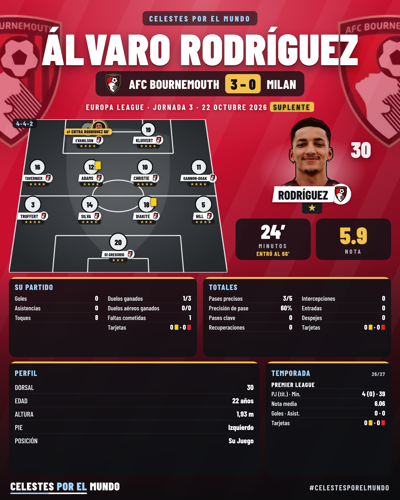
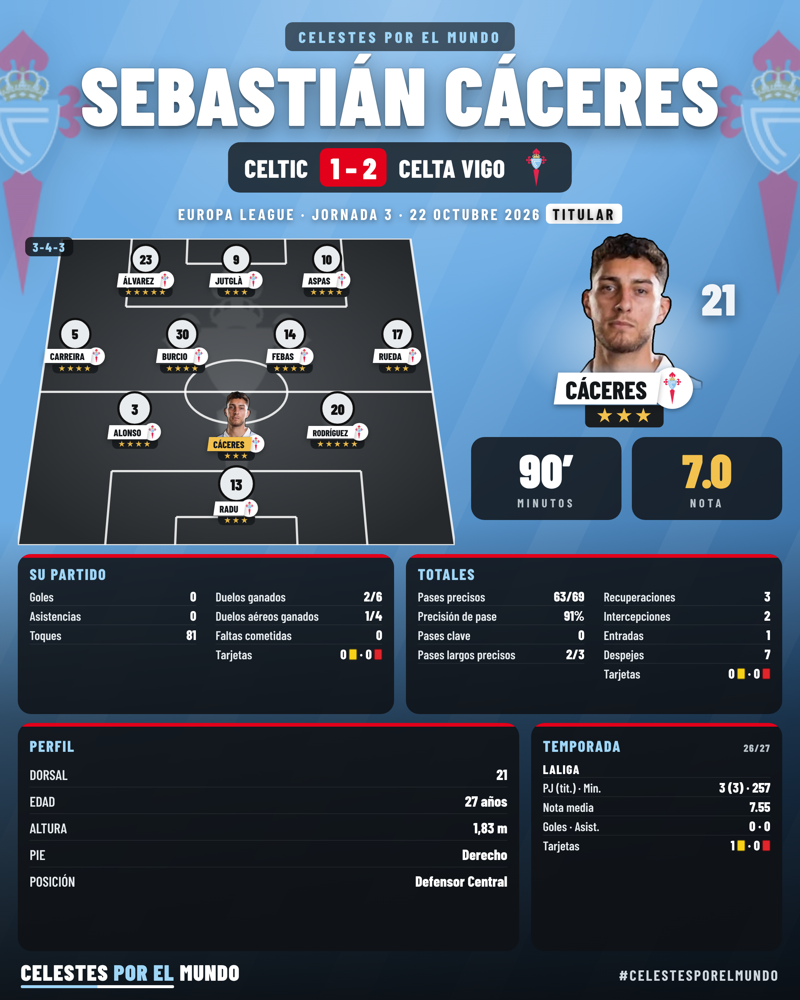
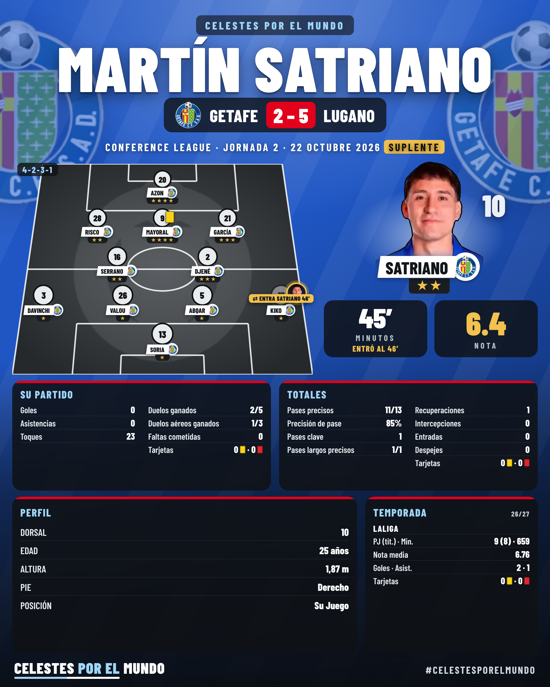
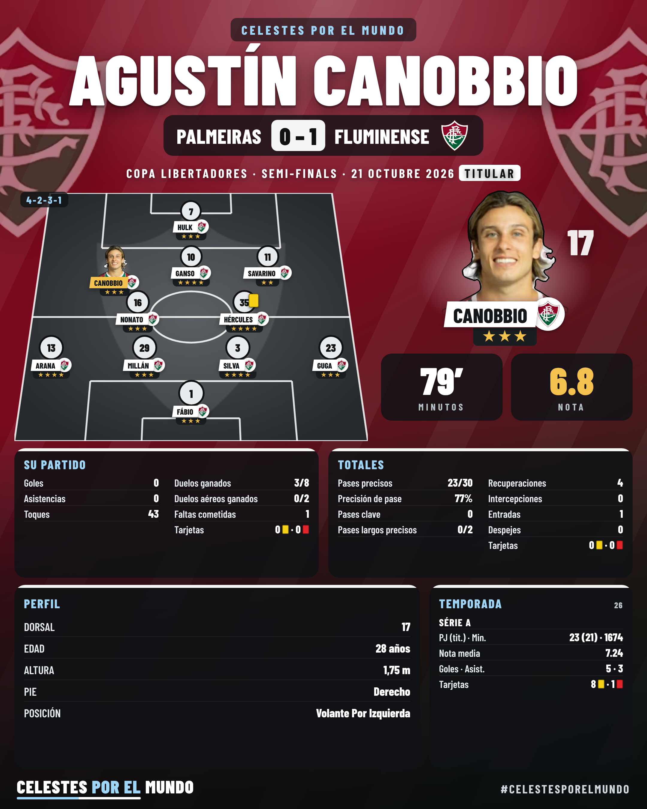
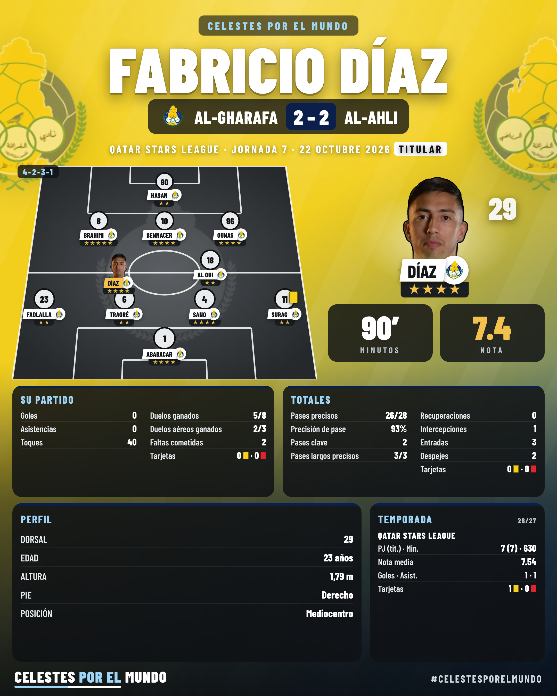
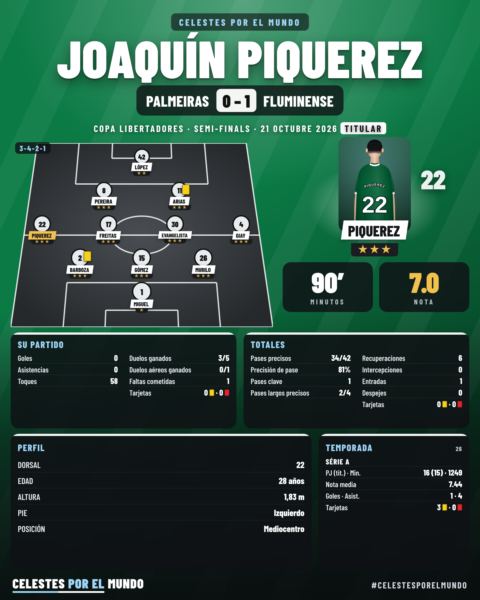

Á. Rodríguez jugó 24' (suplente, nota 5.9) en AFC Bournemouth 3-0 Milan; Cáceres jugó 90' (titular, nota 7.0) en Celtic 1-2 Celta Vigo; Satriano jugó 45' (suplente, nota 6.4) en Getafe 2-5 Lugano; Canobbio jugó 79' (titular, nota 6.8) en Palmeiras 0-

@tuscxm

## Quién jugó
- **Á. Rodríguez** jugó 24' (suplente, entró al 66' por Evanilson, nota 5.9, su juego) en AFC Bournemouth 3-0 Milan · Europa League
- **Cáceres** jugó 90' (titular, nota 7.0, de defensor central) en Celtic 1-2 Celta Vigo · Europa League
- **Satriano** jugó 45' (suplente, entró al 46' por Kiko, nota 6.4, su juego) en Getafe 2-5 Lugano · Conference League
- **Canobbio** jugó 79' (titular, nota 6.8, de volante por izquierda) en Palmeiras 0-1 Fluminense · Copa Libertadores
- **F. Díaz** jugó 90' (titular, nota 7.4, de mediocentro) en Al-Gharafa 2-2 Al-Ahli · Qatar Stars League
- **Piquerez** jugó 90' (titular, nota 7.0, de mediocentro) en Palmeiras 0-1 Fluminense · Copa Libertadores

## El resto
- Valverde: ya procesado · Real Madrid 4-1 RB Leipzig
- Bernal: no jugó en Real Betis 1-0 Feyenoord (no entró)
- Mouriño: sin partido hoy ni ayer
- M. Araújo: ya procesado · Sporting CP 2-3 LASK
- González: sin partido hoy ni ayer
- Petit: sin partido hoy ni ayer
- Bentancur: sin partido hoy ni ayer
- Boselli: no jugó en Getafe 2-5 Lugano (no entró)
- J. Rodríguez: sin partido hoy ni ayer
- Zalazar: sin partido hoy ni ayer
- Merentiel: sin partido hoy ni ayer
- Giménez: sin partido hoy ni ayer
- Amaro: sin partido hoy ni ayer
- R. Araújo: sin partido hoy ni ayer
- J. M. Sanabria: sin partido hoy ni ayer
- Ugarte: sin partido hoy ni ayer
- Darwin: sin partido hoy ni ayer
- Torreira: ya procesado · Lille 2-4 Galatasaray
- Brizuela: sin partido hoy ni ayer

## Avisos
- Á. Rodríguez: SofaScore no respondió; fuentes: fotmob ok, besoccer ok, api_football error HTTP 403: falta la clave o no es válida, thesportsdb error: dominio no habilitado en la red de la nube, understat error: dominio no habilitado en la red de la nube, zerozero error: dominio no habilitado en la red de la nube
- Á. Rodríguez: No se pudo saber el puesto en el que jugó
- Á. Rodríguez: Armada con datos de respaldo (FotMob): hay menos estadísticas que de costumbre, revisala antes de publicar
- Cáceres: SofaScore no respondió; fuentes: fotmob ok, besoccer ok, api_football error HTTP 403: falta la clave o no es válida, thesportsdb error: dominio no habilitado en la red de la nube, understat error: dominio no habilitado en la red de la nube, zerozero error: dominio no habilitado en la red de la nube
- Cáceres: Armada con datos de respaldo (FotMob): hay menos estadísticas que de costumbre, revisala antes de publicar
- Satriano: SofaScore no respondió; fuentes: fotmob ok, besoccer ok, api_football error HTTP 403: falta la clave o no es válida, thesportsdb error: dominio no habilitado en la red de la nube, understat error: dominio no habilitado en la red de la nube, zerozero error: dominio no habilitado en la red de la nube
- Satriano: No se pudo saber el puesto en el que jugó
- Satriano: Armada con datos de respaldo (FotMob): hay menos estadísticas que de costumbre, revisala antes de publicar
- Canobbio: SofaScore no respondió; fuentes: fotmob ok, besoccer ok, api_football error HTTP 403: falta la clave o no es válida, thesportsdb error: dominio no habilitado en la red de la nube, understat sin datos: sin understat_equipo (Understat no cubre esa liga), zerozero error: dominio no habilitado en la red de la nube
- Canobbio: Armada con datos de respaldo (FotMob): hay menos estadísticas que de costumbre, revisala antes de publicar
- F. Díaz: SofaScore no respondió; fuentes: fotmob ok, besoccer ok, api_football error HTTP 403: falta la clave o no es válida, thesportsdb error: dominio no habilitado en la red de la nube, understat sin datos: sin understat_equipo (Understat no cubre esa liga), zerozero error: dominio no habilitado en la red de la nube
- F. Díaz: Armada con datos de respaldo (FotMob): hay menos estadísticas que de costumbre, revisala antes de publicar
- Piquerez: SofaScore no respondió; fuentes: fotmob ok, besoccer ok, api_football error HTTP 403: falta la clave o no es válida, thesportsdb error: dominio no habilitado en la red de la nube, understat sin datos: sin understat_equipo (Understat no cubre esa liga), zerozero error: dominio no habilitado en la red de la nube
- Piquerez: Armada con datos de respaldo (FotMob): hay menos estadísticas que de costumbre, revisala antes de publicar
- Piquerez: No hay foto guardada del jugador: se usó la figura ilustrada

## Á. Rodríguez · AFC Bournemouth 3-0 Milan

[Abrir la imagen en tamaño completo](https://github.com/tuscxm/celestes-por-el-mundo/blob/main/salida/png/%C3%81.%20Rodr%C3%ADguez/2026-10-22%20%C2%B7%20Milan%20%C2%B7%20Europa%20League/Rodriguez_AFCBournemouth-Milan_2026-10-22.png)

Texto para el posteo:
```
🇺🇾 ÁLVARO RODRÍGUEZ · AFC Bournemouth 3-0 Milan
⏱ 24' · ⭐ 5.9
🔁 Entró al 66' por Evanilson
3/5 pases · 1 duelo ganado
#CelestesPorElMundo #Uruguay #Bournemouth
```

## Cáceres · Celtic 1-2 Celta Vigo

[Abrir la imagen en tamaño completo](https://github.com/tuscxm/celestes-por-el-mundo/blob/main/salida/png/S.%20C%C3%A1ceres/2026-10-22%20%C2%B7%20Celtic%20%C2%B7%20Europa%20League/Caceres_Celtic-CeltaVigo_2026-10-22.png)

Texto para el posteo:
```
🇺🇾 SEBASTIÁN CÁCERES · Celtic 1-2 Celta Vigo
⏱ 90' · ⭐ 7.0
63/69 pases · 2 duelos ganados · 3 recuperaciones
#CelestesPorElMundo #Uruguay #CeltadeVigo
```

## Satriano · Getafe 2-5 Lugano

[Abrir la imagen en tamaño completo](https://github.com/tuscxm/celestes-por-el-mundo/blob/main/salida/png/M.%20Satriano/2026-10-22%20%C2%B7%20Lugano%20%C2%B7%20Conference%20League/Satriano_Getafe-Lugano_2026-10-22.png)

Texto para el posteo:
```
🇺🇾 MARTÍN SATRIANO · Getafe 2-5 Lugano
⏱ 45' · ⭐ 6.4
🔁 Entró al 46' por Kiko
11/13 pases · 2 duelos ganados · 1 recuperación
#CelestesPorElMundo #Uruguay #Getafe
```

## Canobbio · Palmeiras 0-1 Fluminense

[Abrir la imagen en tamaño completo](https://github.com/tuscxm/celestes-por-el-mundo/blob/main/salida/png/A.%20Canobbio/2026-10-21%20%C2%B7%20Palmeiras%20%C2%B7%20Copa%20Libertadores/Canobbio_Palmeiras-Fluminense_2026-10-21.png)

Texto para el posteo:
```
🇺🇾 AGUSTÍN CANOBBIO · Palmeiras 0-1 Fluminense
⏱ 79' · ⭐ 6.8
23/30 pases · 3 duelos ganados · 4 recuperaciones
#CelestesPorElMundo #Uruguay #Fluminense
```

## F. Díaz · Al-Gharafa 2-2 Al-Ahli

[Abrir la imagen en tamaño completo](https://github.com/tuscxm/celestes-por-el-mundo/blob/main/salida/png/F.%20D%C3%ADaz/2026-10-22%20%C2%B7%20Al-Ahli%20%C2%B7%20Qatar%20Stars%20League/Diaz_Al-Gharafa-Al-Ahli_2026-10-22.png)

Texto para el posteo:
```
🇺🇾 FABRICIO DÍAZ · Al-Gharafa 2-2 Al-Ahli
⏱ 90' · ⭐ 7.4
26/28 pases · 5 duelos ganados
#CelestesPorElMundo #Uruguay #AlGharafa
```

## Piquerez · Palmeiras 0-1 Fluminense

[Abrir la imagen en tamaño completo](https://github.com/tuscxm/celestes-por-el-mundo/blob/main/salida/png/J.%20Piquerez/2026-10-21%20%C2%B7%20Fluminense%20%C2%B7%20Copa%20Libertadores/Piquerez_Palmeiras-Fluminense_2026-10-21.png)

Texto para el posteo:
```
🇺🇾 JOAQUÍN PIQUEREZ · Palmeiras 0-1 Fluminense
⏱ 90' · ⭐ 7.0
34/42 pases · 3 duelos ganados · 6 recuperaciones
#CelestesPorElMundo #Uruguay #Palmeiras
```

---
No se publicó nada en Instagram. Cerrá este aviso cuando la publiques o la descartes.
## Revisión visual
- Las 6 infografías salieron con el respaldo de FotMob (SofaScore no respondió): no tienen MAPA DE CALOR ni el bloque de la franja (en su lugar va PERFIL), y TEMPORADA muestra solo la liga, sin la copa internacional (falta Europa League en Á. Rodríguez y Cáceres, Conference League en Satriano y Copa Libertadores en Canobbio y Piquerez).
- Á. Rodríguez y Satriano (delanteros): TOTALES no trae lo de ataque (remates, xG, ocasiones, xA, centros) y en PERFIL la posición dice "Su Juego" porque no se pudo saber el puesto. Revisar antes de publicar.
- Canobbio: la cara grande tiene restos de fondo blanco del lado derecho del pelo (recorte con aureola blanca).
- Piquerez: no hay foto guardada (va la figura ilustrada), no aparece el escudo de Palmeiras (ni en el marcador, ni junto a la placa, ni en las placas de la cancha, ni de marca de agua) y la posición figura como "Mediocentro" aunque en la cancha está en la banda izquierda de la línea de 4 del 3-4-2-1.
- Canobbio y Piquerez: la fase dice "SEMI-FINALS" en inglés.
- Satriano: en la cancha, la cara de Satriano y la etiqueta "ENTRA SATRIANO 46'" quedan pegadas al borde derecho de la cancha (sobre Kiko); no se corta, pero queda justo.
- Sin textos encimados ni nombres de fuentes en ninguna imagen. Números razonables.
- Fuentes extra: API-Football dio HTTP 403 (falta la clave o no es válida); TheSportsDB, Understat y zerozero dieron "dominio no habilitado en la red de la nube".
- BeSoccer como fuente diaria: no se pudo leer en esta corrida (la herramienta web pidió un permiso que nadie podía aprobar); besoccer_hoy.json quedó vacío.
