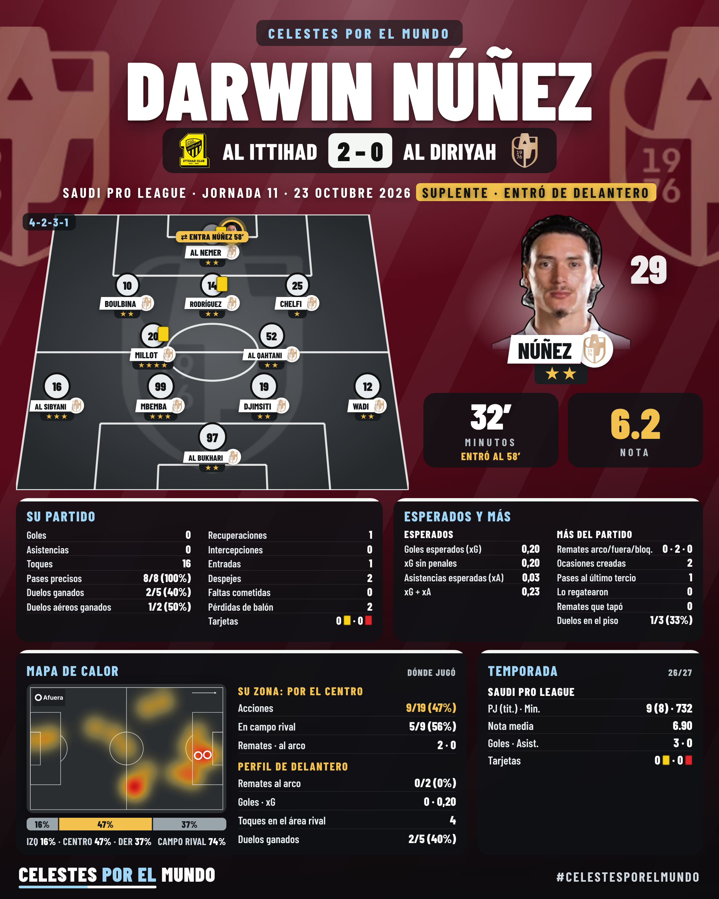

Darwin jugó 32' (suplente, nota 6.2) en Al Ittihad 2-0 Al Diriyah; infografía lista

@tuscxm

## Quién jugó
- **Darwin** jugó 32' (suplente, entró al 58' por Nemer, nota 6.2, de delantero) en Al Ittihad 2-0 Al Diriyah · Saudi Pro League

## El resto
- Valverde: sin partido hoy ni ayer
- Bernal: sin partido hoy ni ayer
- Mouriño: sin partido hoy ni ayer
- M. Araújo: sin partido hoy ni ayer
- Á. Rodríguez: ya procesado · AFC Bournemouth 3-0 Milan
- González: sin partido hoy ni ayer
- Cáceres: ya procesado · Celtic 1-2 Celta Vigo
- Petit: sin partido hoy ni ayer
- Bentancur: sin partido hoy ni ayer
- Satriano: ya procesado · Getafe 2-5 Lugano
- Boselli: no jugó en Getafe 2-5 Lugano (no entró)
- J. Rodríguez: sin partido hoy ni ayer
- Zalazar: sin partido hoy ni ayer
- Merentiel: sin partido hoy ni ayer
- Giménez: sin partido hoy ni ayer
- Amaro: sin partido hoy ni ayer
- R. Araújo: sin partido hoy ni ayer
- J. M. Sanabria: sin partido hoy ni ayer
- Ugarte: sin partido hoy ni ayer
- Canobbio: sin partido hoy ni ayer
- F. Díaz: ya procesado · Al-Gharafa 2-2 Al-Ahli
- Torreira: sin partido hoy ni ayer
- Brizuela: sin partido hoy ni ayer
- Piquerez: sin partido hoy ni ayer
- Matturro: sin partido hoy ni ayer
- Olivera: sin partido hoy ni ayer

## Avisos
- Darwin: SofaScore no respondió; fuentes: fotmob ok, besoccer ok, api_football sin datos: el plan gratis de API-Football no cubre esta temporada (plan: Free plans do not have access to this season, try from 2022 to 2024.), thesportsdb ok, understat sin datos: sin understat_equipo (Understat no cubre esa liga), zerozero error HTTP 403
- Darwin: Entró de suplente: el puesto (delantero) es su puesto habitual, no se sabe dónde entró
- Darwin: Armada con datos de respaldo (FotMob): hay menos estadísticas que de costumbre, revisala antes de publicar

## Darwin · Al Ittihad 2-0 Al Diriyah

[Abrir la imagen en tamaño completo](https://github.com/tuscxm/celestes-por-el-mundo/blob/main/salida/png/D.%20N%C3%BA%C3%B1ez/2026-10-23%20%C2%B7%20Al%20Ittihad%20%C2%B7%20Saudi%20Pro%20League/Nunez_AlIttihad-AlDiriyah_2026-10-23.png)

Texto para el posteo:
```
🇺🇾 DARWIN NÚÑEZ · Al Ittihad 2-0 Al Diriyah
⏱ 32' · ⭐ 6.2
🔁 Entró al 58' por Nemer, como delantero

Jugó de delantero: 47% de sus acciones por el centro, 1 recuperación, 1 pase al último tercio y 2 ocasiones creadas.

🧩 ¿Y en una Uruguay 3-5-2 con enganche?
Sería uno de los dos de punta: 4 toques en el área rival. Con un enganche que lo habilite y otro 9 al lado, deja de pelear solo contra los centrales.

Tres atrás, dos carrileros, dos internos, un 10 suelto y dos puntas. ¿Lo jugarías así? 👇
#CelestesPorElMundo #Uruguay #Diriyah #352
```

---
No se publicó nada en Instagram. Cerrá este aviso cuando la publiques o la descartes.
## Revisión visual
- Darwin: en la cancha, la carita de Núñez sobre Al Nemer queda casi tapada por el cartel "⇄ ENTRA NÚÑEZ 58'" (solo se ve el pelo, pegada al borde del área). El resto se ve bien: cara grande recortada con contorno negro, escudos (y el de detrás de la cancha), parte de abajo por puesto completa (SU PARTIDO, ESPERADOS Y MÁS, mapa acostado con sus 2 remates afuera, barra, SU ZONA y PERFIL DE DELANTERO), TEMPORADA solo con la liga (no juega copa internacional) y números iguales a los del texto del posteo. No aparece el nombre de ninguna fuente.
- "En campo rival 5/9 (56%)" de SU ZONA es solo de la franja del centro; el 74% de la barra es de todo el partido (no es un error).
- Fuentes: SofaScore no respondió (se armó con el respaldo de FotMob); API-Football sin datos (el plan gratis no cubre la temporada 2026); zerozero HTTP 403; BeSoccer no cargó por WebFetch ("A required part of this site couldn't load"), así que besoccer_hoy.json quedó vacío.
- Entorno: `python3` de la nube apuntaba a Python 3.11 y las dependencias estaban instaladas en 3.13 (faltaba numpy); se corrió correr.sh con `python3` → `python3.13` en el PATH, sin tocar el repositorio.
