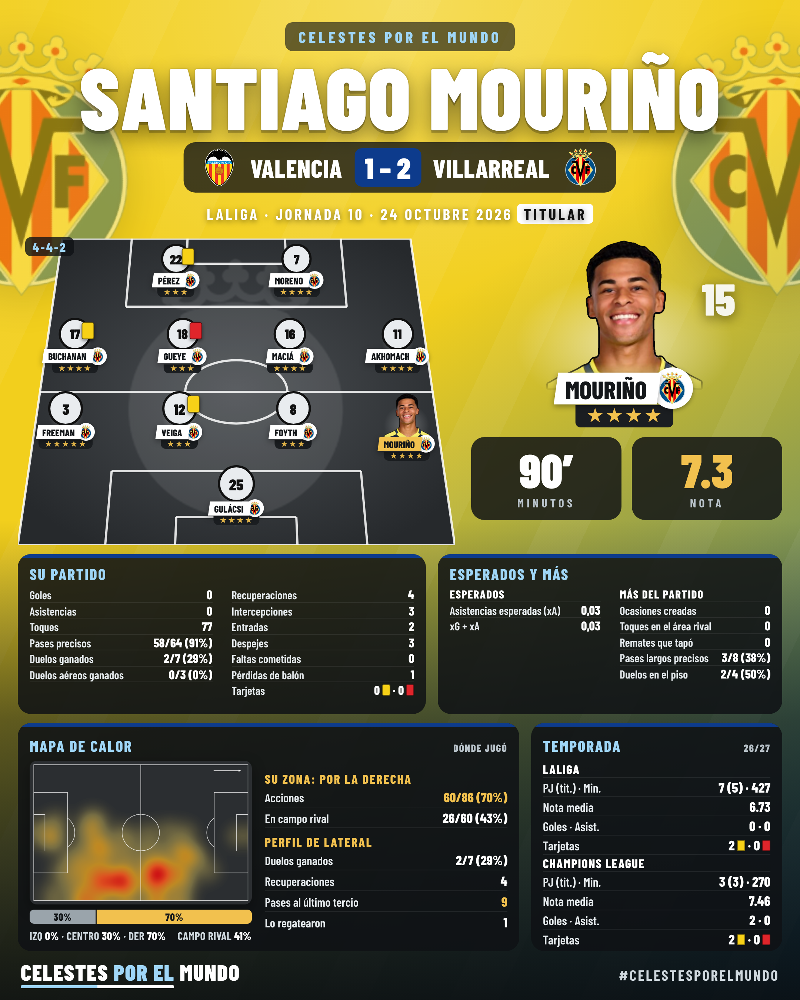
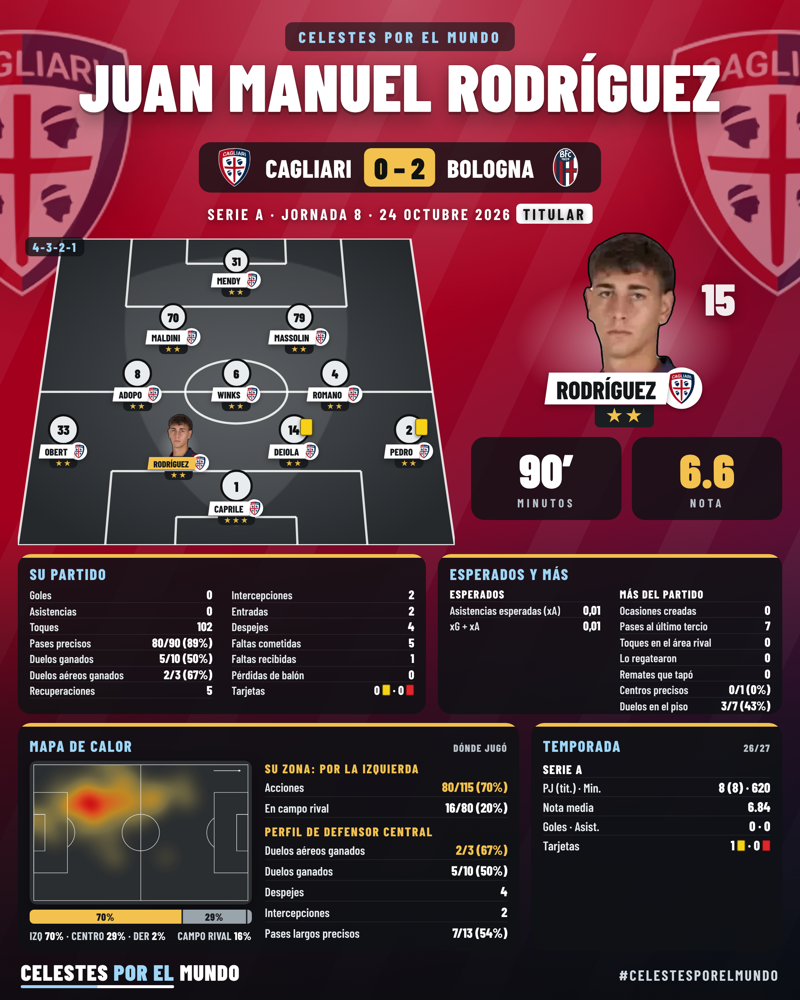
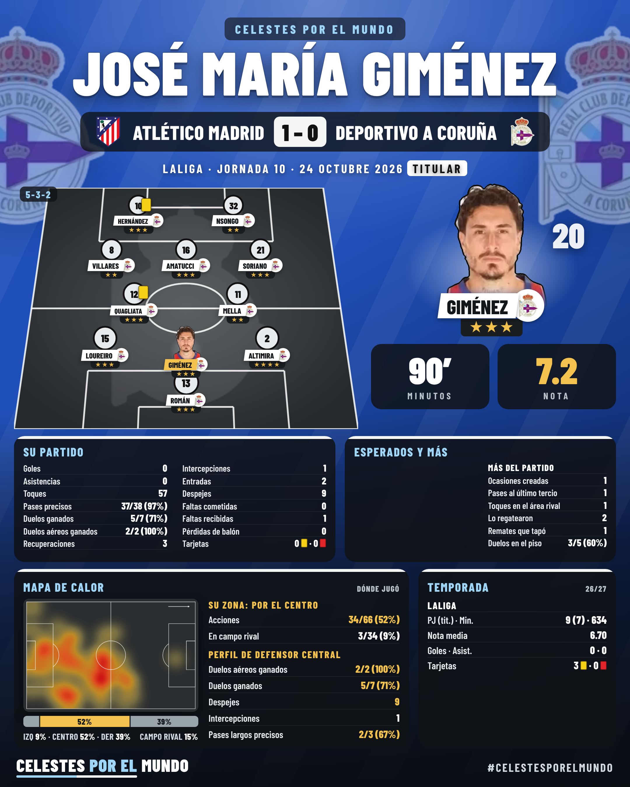
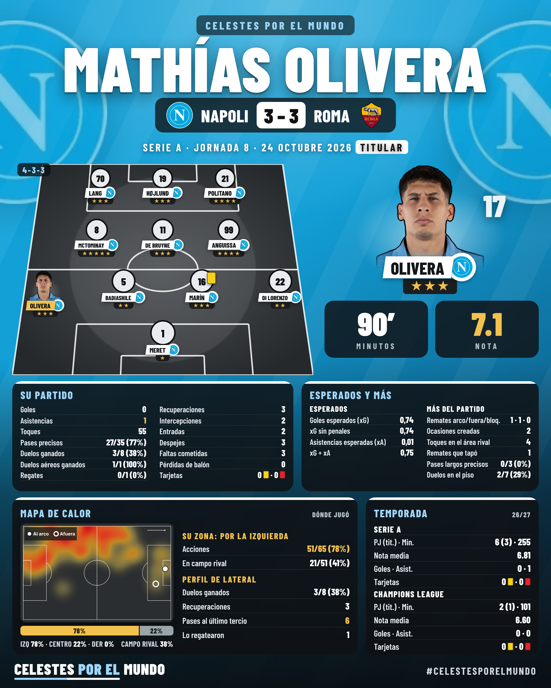

Mouriño jugó 90' (titular, nota 7.3) en Valencia 1-2 Villarreal; J. Rodríguez jugó 90' (titular, nota 6.6) en Cagliari 0-2 Bologna; Giménez jugó 90' (titular, nota 7.2) en Atlético Madrid 1-0 Deportivo A Coruña; Olivera jugó 90' (titular, nota 7.1) e

@tuscxm

## Quién jugó
- **Mouriño** jugó 90' (titular, nota 7.3, de lateral derecho) en Valencia 1-2 Villarreal · LaLiga
- **J. Rodríguez** jugó 90' (titular, nota 6.6, de defensor central) en Cagliari 0-2 Bologna · Serie A
- **Giménez** jugó 90' (titular, nota 7.2, de defensor central) en Atlético Madrid 1-0 Deportivo A Coruña · LaLiga
- **Olivera** jugó 90' (titular, nota 7.1, de lateral izquierdo) en Napoli 3-3 Roma · Serie A

## El resto
- Valverde: sin partido hoy ni ayer
- Bernal: sin partido hoy ni ayer
- M. Araújo: sin partido hoy ni ayer
- Á. Rodríguez: sin partido hoy ni ayer
- González: no jugó en Racing Santander 2-1 Espanyol (no entró)
- Cáceres: sin partido hoy ni ayer
- Petit: sin partido hoy ni ayer
- Bentancur: sin partido hoy ni ayer
- Satriano: sin partido hoy ni ayer
- Boselli: sin partido hoy ni ayer
- Zalazar: sin partido hoy ni ayer
- Merentiel: sin partido hoy ni ayer
- Amaro: sin partido hoy ni ayer
- R. Araújo: sin partido hoy ni ayer
- J. M. Sanabria: sin partido hoy ni ayer
- Ugarte: sin partido hoy ni ayer
- Canobbio: sin partido hoy ni ayer
- Darwin: ya procesado · Al Ittihad 2-0 Al Diriyah
- F. Díaz: sin partido hoy ni ayer
- Torreira: sin partido hoy ni ayer
- Brizuela: sin partido hoy ni ayer
- Piquerez: sin partido hoy ni ayer
- Matturro: no jugó en Shakhtar Donetsk 0-0 Zorya (no entró)

## Avisos
- Mouriño: SofaScore no respondió; fuentes: fotmob ok, besoccer ok, api_football sin datos: el plan gratis de API-Football no cubre esta temporada (plan: Free plans do not have access to this season, try from 2022 to 2024.), thesportsdb ok, understat ok, zerozero error HTTP 403
- Mouriño: Armada con datos de respaldo (FotMob): hay menos estadísticas que de costumbre, revisala antes de publicar
- J. Rodríguez: SofaScore no respondió; fuentes: fotmob ok, besoccer ok, api_football sin datos: el plan gratis de API-Football no cubre esta temporada (plan: Free plans do not have access to this season, try from 2022 to 2024.), thesportsdb ok, understat ok, zerozero error HTTP 403
- J. Rodríguez: Armada con datos de respaldo (FotMob): hay menos estadísticas que de costumbre, revisala antes de publicar
- Giménez: SofaScore no respondió; fuentes: fotmob ok, besoccer ok, api_football sin datos: el plan gratis de API-Football no cubre esta temporada (plan: Free plans do not have access to this season, try from 2022 to 2024.), thesportsdb ok, understat sin datos: sin understat_equipo (Understat no cubre esa liga), zerozero error HTTP 403
- Giménez: Armada con datos de respaldo (FotMob): hay menos estadísticas que de costumbre, revisala antes de publicar
- Olivera: SofaScore no respondió; fuentes: fotmob ok, besoccer ok, api_football sin datos: el plan gratis de API-Football no cubre esta temporada (plan: Free plans do not have access to this season, try from 2022 to 2024.), thesportsdb ok, understat ok, zerozero error HTTP 403
- Olivera: Armada con datos de respaldo (FotMob): hay menos estadísticas que de costumbre, revisala antes de publicar

## Mouriño · Valencia 1-2 Villarreal

[Abrir la imagen en tamaño completo](https://github.com/tuscxm/celestes-por-el-mundo/blob/main/salida/png/S.%20Mouri%C3%B1o/2026-10-24%20%C2%B7%20Valencia%20%C2%B7%20LaLiga/Mourino_Valencia-Villarreal_2026-10-24.png)

Texto para el posteo:
```
🇺🇾 SANTIAGO MOURIÑO · Valencia 1-2 Villarreal
⏱ 90' · ⭐ 7.3

Jugó de lateral derecho: 70% de sus acciones por la derecha, 58/64 pases (91%), 4 recuperaciones y 9 pases al último tercio.

🧩 ¿Y en una Uruguay 3-5-2 con enganche?
Lo vemos de zaguero por derecha en la línea de tres: 58/64 pases (91%), 3 intercepciones y 4 recuperaciones. Con tres atrás, un central que sale limpio le suma un pase para encontrar al enganche y deja a los carrileros libres para pasar.

Tres atrás, dos carrileros, dos internos, un 10 suelto y dos puntas. ¿Lo jugarías así? 👇
#CelestesPorElMundo #Uruguay #Villarreal #352
```

## J. Rodríguez · Cagliari 0-2 Bologna

[Abrir la imagen en tamaño completo](https://github.com/tuscxm/celestes-por-el-mundo/blob/main/salida/png/J.%20M.%20Rodr%C3%ADguez/2026-10-24%20%C2%B7%20Bologna%20%C2%B7%20Serie%20A/Rodriguez_Cagliari-Bologna_2026-10-24.png)

Texto para el posteo:
```
🇺🇾 JUAN MANUEL RODRÍGUEZ · Cagliari 0-2 Bologna
⏱ 90' · ⭐ 6.6

Jugó de defensor central: 70% de sus acciones por la izquierda, 80/90 pases (89%), 5/10 duelos ganados y 5 recuperaciones.

🧩 ¿Y en una Uruguay 3-5-2 con enganche?
Lo vemos de zaguero por izquierda en la línea de tres: 80/90 pases (89%), 7/13 pases largos y 5/10 duelos ganados. Con tres atrás, un central que sale limpio le suma un pase para encontrar al enganche y deja a los carrileros libres para pasar.

Tres atrás, dos carrileros, dos internos, un 10 suelto y dos puntas. ¿Lo jugarías así? 👇
#CelestesPorElMundo #Uruguay #Cagliari #352
```

## Giménez · Atlético Madrid 1-0 Deportivo A Coruña

[Abrir la imagen en tamaño completo](https://github.com/tuscxm/celestes-por-el-mundo/blob/main/salida/png/J.%20M.%20Gim%C3%A9nez/2026-10-24%20%C2%B7%20Atl%C3%A9tico%20Madrid%20%C2%B7%20LaLiga/Gimenez_AtleticoMadrid-DeportivoACoruna_2026-10-24.png)

Texto para el posteo:
```
🇺🇾 JOSÉ MARÍA GIMÉNEZ · Atlético Madrid 1-0 Deportivo A Coruña
⏱ 90' · ⭐ 7.2

Jugó de defensor central: 52% de sus acciones por el centro, 37/38 pases (97%), 5/7 duelos ganados y 3 recuperaciones.

🧩 ¿Y en una Uruguay 3-5-2 con enganche?
Lo vemos de zaguero en la línea de tres: 37/38 pases (97%), 2/3 pases largos y 5/7 duelos ganados. Con tres atrás, un central que sale limpio le suma un pase para encontrar al enganche y deja a los carrileros libres para pasar.

Tres atrás, dos carrileros, dos internos, un 10 suelto y dos puntas. ¿Lo jugarías así? 👇
#CelestesPorElMundo #Uruguay #DeportivodeLaCoruña #352
```

## Olivera · Napoli 3-3 Roma

[Abrir la imagen en tamaño completo](https://github.com/tuscxm/celestes-por-el-mundo/blob/main/salida/png/M.%20Olivera/2026-10-24%20%C2%B7%20Roma%20%C2%B7%20Serie%20A/Olivera_Napoli-Roma_2026-10-24.png)

Texto para el posteo:
```
🇺🇾 MATHÍAS OLIVERA · Napoli 3-3 Roma
⏱ 90' · ⭐ 7.1

Jugó de lateral izquierdo: 78% de sus acciones por la izquierda, 27/35 pases (77%), 3 recuperaciones y 6 pases al último tercio.

🧩 ¿Y en una Uruguay 3-5-2 con enganche?
Lo vemos de zaguero por izquierda en la línea de tres: 27/35 pases (77%), 1/1 por arriba y 2 intercepciones. Con tres atrás, un central que sale limpio le suma un pase para encontrar al enganche y deja a los carrileros libres para pasar.

Tres atrás, dos carrileros, dos internos, un 10 suelto y dos puntas. ¿Lo jugarías así? 👇
#CelestesPorElMundo #Uruguay #Napoli #352
```

---
No se publicó nada en Instagram. Cerrá este aviso cuando la publiques o la descartes.
## Revisión visual
- Fuentes: SofaScore no respondió (las 4 infografías salieron con el respaldo automático de FotMob, con la parte de abajo por puesto). API-Football: el plan gratis no cubre la temporada 2026. zerozero: error HTTP 403. BeSoccer (paso diario con WebFetch): la página devolvió "A required part of this site couldn't load", así que `besoccer_hoy.json` quedó vacío y no aportó notas.
- Ninguna salió con el diseño anterior; ninguna dice el nombre de una fuente. Sin tanda de penales ni rojas de los protagonistas.
- Olivera: SU PARTIDO marca **1 asistencia** (y 2 ocasiones creadas, xG 0,74), pero el texto del posteo no la menciona en "Jugó de lateral izquierdo: …". Conviene agregarla a mano antes de publicar.
- Giménez: en la cancha, la placa "GIMÉNEZ ★★★" queda encima del círculo del dorsal 13 (Román, arquero); se lee, pero se tocan. La foto grande y la cara de la cancha son con una camiseta roja y blanca (no la del Deportivo).
- J. M. Rodríguez: la cara grande tiene un halo gris/blanquecino alrededor de la cabeza y la cara se ve poco nítida (foto de origen de baja resolución).
- Mouriño: todo en orden (roja de Gueye visible en la cancha; amarillas en la cancha; TEMPORADA con LaLiga y Champions).
