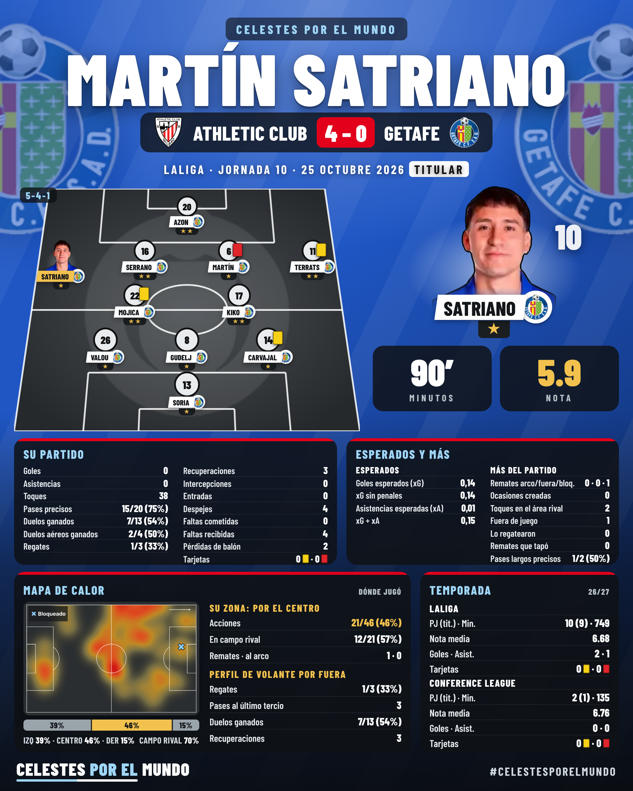
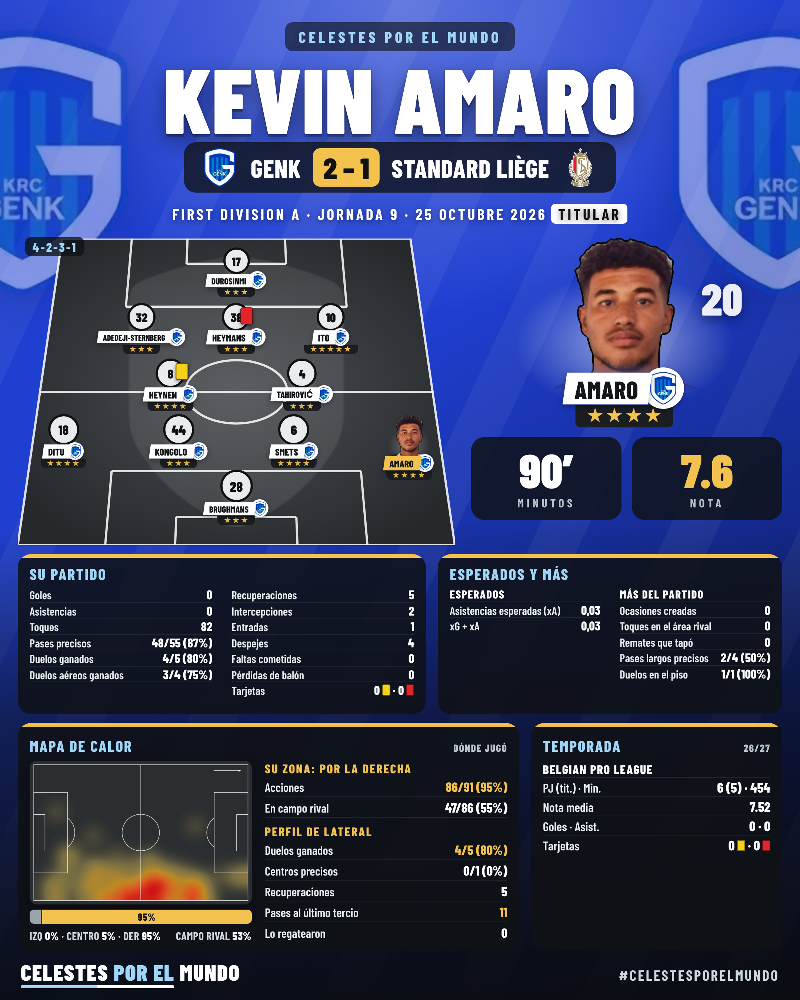
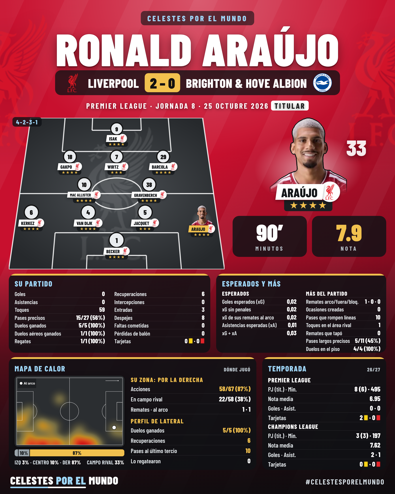
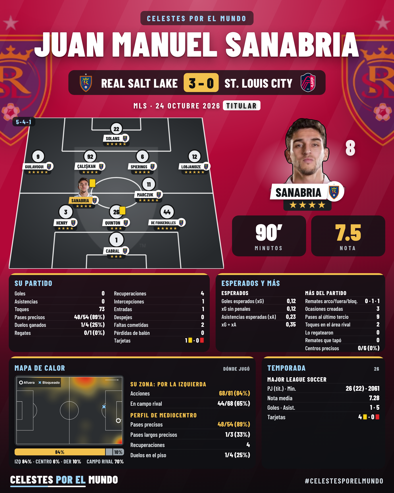

Satriano jugó 90' (titular, nota 5.9) en Athletic Club 4-0 Getafe; Amaro jugó 90' (titular, nota 7.6) en Genk 2-1 Standard Liège; R. Araújo jugó 90' (titular, nota 7.9) en Liverpool 2-0 Brighton & Hove Albion; J. M. Sanabria jugó 90' (titular, nota 7

@tuscxm

## Quién jugó
- **Satriano** jugó 90' (titular, nota 5.9, de volante por izquierda) en Athletic Club 4-0 Getafe · LaLiga
- **Amaro** jugó 90' (titular, nota 7.6, de lateral derecho) en Genk 2-1 Standard Liège · First Division A
- **R. Araújo** jugó 90' (titular, nota 7.9, de lateral derecho) en Liverpool 2-0 Brighton & Hove Albion · Premier League
- **J. M. Sanabria** jugó 90' (titular, nota 7.5, de mediocentro) en Real Salt Lake 3-0 St. Louis City · MLS

## El resto
- Valverde: sin partido hoy ni ayer
- Bernal: sin partido hoy ni ayer
- Mouriño: ya procesado · Valencia 1-2 Villarreal
- M. Araújo: sin partido hoy ni ayer
- Á. Rodríguez: no jugó en Manchester United 0-3 AFC Bournemouth (no entró)
- González: no jugó en Racing Santander 2-1 Espanyol (no entró)
- Cáceres: no jugó en Celta Vigo 0-0 Real Betis (no entró)
- Petit: sin partido hoy ni ayer
- Bentancur: sin partido hoy ni ayer
- Boselli: no jugó en Athletic Club 4-0 Getafe (no entró)
- J. Rodríguez: ya procesado · Cagliari 0-2 Bologna
- Zalazar: sin partido hoy ni ayer
- Merentiel: sin partido hoy ni ayer
- Giménez: ya procesado · Atlético Madrid 1-0 Deportivo A Coruña
- Ugarte: sin partido hoy ni ayer
- Canobbio: no jugó en Chapecoense 2-1 Fluminense (no entró)
- Darwin: sin partido hoy ni ayer
- F. Díaz: sin partido hoy ni ayer
- Torreira: sin partido hoy ni ayer
- Brizuela: sin partido hoy ni ayer
- Piquerez: sin partido hoy ni ayer
- Matturro: no jugó en Shakhtar Donetsk 0-0 Zorya (no entró)
- Olivera: ya procesado · Napoli 3-3 Roma

## Avisos
- Satriano: SofaScore no respondió; fuentes: fotmob ok, besoccer ok, api_football sin datos: el plan gratis de API-Football no cubre esta temporada (plan: Free plans do not have access to this season, try from 2022 to 2024.), thesportsdb ok, understat ok, zerozero error HTTP 403
- Satriano: Armada con datos de respaldo (FotMob): hay menos estadísticas que de costumbre, revisala antes de publicar
- Amaro: SofaScore no respondió; fuentes: fotmob ok, besoccer ok, api_football sin datos: el plan gratis de API-Football no cubre esta temporada (plan: Free plans do not have access to this season, try from 2022 to 2024.), thesportsdb ok, understat sin datos: sin understat_equipo (Understat no cubre esa liga), zerozero error HTTP 403
- Amaro: Armada con datos de respaldo (FotMob): hay menos estadísticas que de costumbre, revisala antes de publicar
- R. Araújo: SofaScore no respondió; fuentes: fotmob ok, besoccer ok, api_football sin datos: el plan gratis de API-Football no cubre esta temporada (plan: Free plans do not have access to this season, try from 2022 to 2024.), thesportsdb ok, understat ok, zerozero error HTTP 403
- R. Araújo: Armada con datos de respaldo (FotMob): hay menos estadísticas que de costumbre, revisala antes de publicar
- J. M. Sanabria: SofaScore no respondió; fuentes: fotmob ok, besoccer ok, api_football sin datos: el plan gratis de API-Football no cubre esta temporada (plan: Free plans do not have access to this season, try from 2022 to 2024.), thesportsdb ok, understat sin datos: sin understat_equipo (Understat no cubre esa liga), zerozero error HTTP 403
- J. M. Sanabria: Armada con datos de respaldo (FotMob): hay menos estadísticas que de costumbre, revisala antes de publicar

## Satriano · Athletic Club 4-0 Getafe

[Abrir la imagen en tamaño completo](https://github.com/tuscxm/celestes-por-el-mundo/blob/main/salida/png/M.%20Satriano/2026-10-25%20%C2%B7%20Athletic%20Club%20%C2%B7%20LaLiga/Satriano_AthleticClub-Getafe_2026-10-25.png)

Texto para el posteo:
```
🇺🇾 MARTÍN SATRIANO · Athletic Club 4-0 Getafe
⏱ 90' · ⭐ 5.9

Jugó de volante por izquierda: 46% de sus acciones por el centro, 15/20 pases (75%), 7/13 duelos ganados y 3 recuperaciones.

🧩 ¿Y en una Uruguay 3-5-2 con enganche?
Sería uno de los dos de punta: 2 toques en el área rival, 7/13 duelos ganados y 1/3 regates. Con un enganche que lo habilite y otro 9 al lado, deja de pelear solo contra los centrales.

Tres atrás, dos carrileros, dos internos, un 10 suelto y dos puntas. ¿Lo jugarías así? 👇
#CelestesPorElMundo #Uruguay #Getafe #352
```

## Amaro · Genk 2-1 Standard Liège

[Abrir la imagen en tamaño completo](https://github.com/tuscxm/celestes-por-el-mundo/blob/main/salida/png/K.%20Amaro/2026-10-25%20%C2%B7%20Standard%20Li%C3%A8ge%20%C2%B7%20First%20Division%20A/Amaro_Genk-StandardLi%C3%A8ge_2026-10-25.png)

Texto para el posteo:
```
🇺🇾 KEVIN AMARO · Genk 2-1 Standard Liège
⏱ 90' · ⭐ 7.6

Jugó de lateral derecho: 48/55 pases (87%), 4/5 duelos ganados, 5 recuperaciones y 11 pases al último tercio.

🧩 ¿Y en una Uruguay 3-5-2 con enganche?
Sería carrilero por derecha: 95% de sus acciones por la derecha, 53% en campo rival y 11 pases al último tercio. En el 3-5-2 toda la banda es suya, y con tres centrales atrás puede pasar sin dejar la espalda sola.

Tres atrás, dos carrileros, dos internos, un 10 suelto y dos puntas. ¿Lo jugarías así? 👇
#CelestesPorElMundo #Uruguay #Genk #352
```

## R. Araújo · Liverpool 2-0 Brighton & Hove Albion

[Abrir la imagen en tamaño completo](https://github.com/tuscxm/celestes-por-el-mundo/blob/main/salida/png/R.%20Ara%C3%BAjo/2026-10-25%20%C2%B7%20Brighton%20%26%20Hove%20Albion%20%C2%B7%20Premier%20League/Araujo_Liverpool-Brighton%26HoveAlbion_2026-10-25.png)

Texto para el posteo:
```
🇺🇾 RONALD ARAÚJO · Liverpool 2-0 Brighton & Hove Albion
⏱ 90' · ⭐ 7.9

Jugó de lateral derecho: 87% de sus acciones por la derecha, 15/27 pases (56%), 5/5 duelos ganados y 6 recuperaciones.

🧩 ¿Y en una Uruguay 3-5-2 con enganche?
Lo vemos de zaguero por derecha en la línea de tres: 15/27 pases (56%), 5/5 duelos ganados y 1/1 por arriba. Con tres atrás, un central que sale limpio le suma un pase para encontrar al enganche y deja a los carrileros libres para pasar.

Tres atrás, dos carrileros, dos internos, un 10 suelto y dos puntas. ¿Lo jugarías así? 👇
#CelestesPorElMundo #Uruguay #Liverpool #352
```

## J. M. Sanabria · Real Salt Lake 3-0 St. Louis City

[Abrir la imagen en tamaño completo](https://github.com/tuscxm/celestes-por-el-mundo/blob/main/salida/png/J.%20M.%20Sanabria/2026-10-24%20%C2%B7%20St.%20Louis%20City%20%C2%B7%20Mls/Sanabria_RealSaltLake-St.LouisCity_2026-10-24.png)

Texto para el posteo:
```
🇺🇾 JUAN MANUEL SANABRIA · Real Salt Lake 3-0 St. Louis City
⏱ 90' · ⭐ 7.5

Jugó de mediocentro: 48/54 pases (89%), 4 recuperaciones, 9 pases al último tercio y 3 ocasiones creadas.

🧩 ¿Y en una Uruguay 3-5-2 con enganche?
Sería carrilero por izquierda: 84% de sus acciones por la izquierda, 70% en campo rival y 9 pases al último tercio. En el 3-5-2 toda la banda es suya, y con tres centrales atrás puede pasar sin dejar la espalda sola.

Tres atrás, dos carrileros, dos internos, un 10 suelto y dos puntas. ¿Lo jugarías así? 👇
#CelestesPorElMundo #Uruguay #RealSaltLake #352
```

---
No se publicó nada en Instagram. Cerrá este aviso cuando la publiques o la descartes.
## Revisión visual
- Las 4 infografías salieron con la parte de abajo por puesto (ninguna con el diseño anterior). Caras recortadas con contorno negro, escudos (también el de detrás de la cancha), jugador resaltado en la cancha, tarjetas visibles y sin nombres de fuentes. Números de la infografía y del posteo coinciden.
- Satriano: el perfil es de "volante por fuera" (jugó de volante por izquierda), pero SU ZONA es "por el centro" (46%) y el posteo dice "Jugó de volante por izquierda: 46% de sus acciones por el centro". Son datos reales, pero conviene revisar la frase antes de publicar.
- En las canchas con un solo punta (Getafe 5-4-1, Genk y Liverpool 4-2-3-1, RSL 5-4-1) el delantero queda dibujado dentro del área de arriba y los cinco del fondo en dos filas (3 + 2): es el diseño de siempre, solo para tenerlo en cuenta.
- Sanabria: la carpeta quedó como "Mls" (en la infografía dice "MLS", bien).
- Fuentes: SofaScore no respondió (todas armadas con el respaldo automático de FotMob); BeSoccer no cargó por WebFetch ("A required part of this site couldn't load"), besoccer_hoy.json quedó vacío aunque el aviso diga "besoccer ok"; API-Football: el plan gratis no cubre la temporada; zerozero: error HTTP 403.
