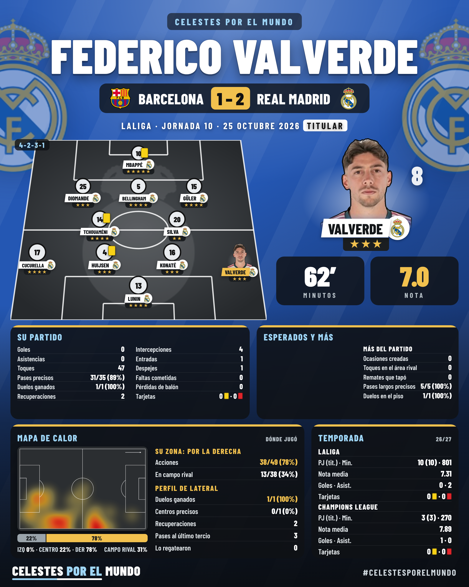
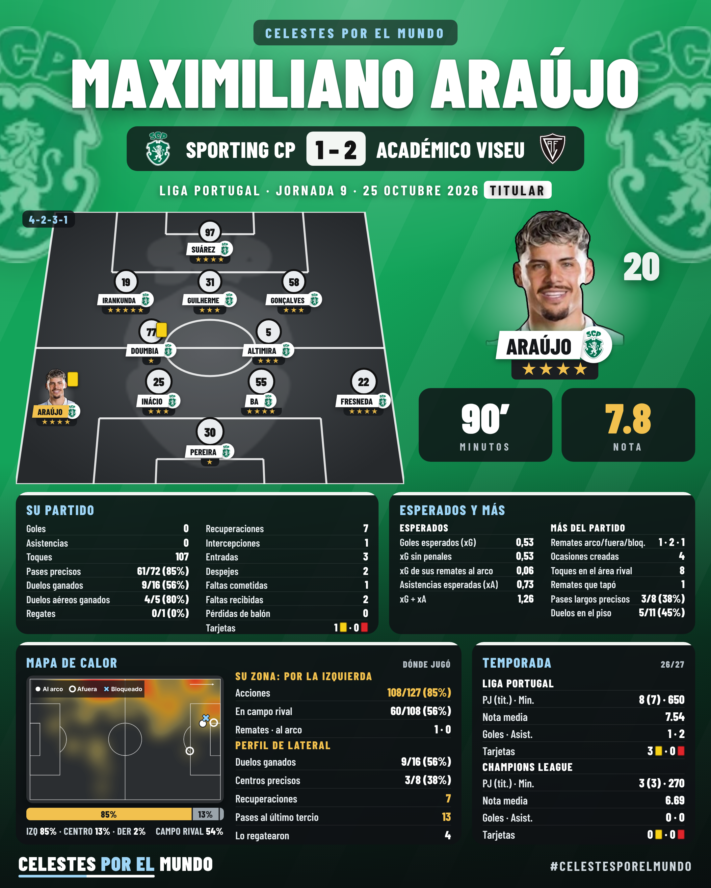
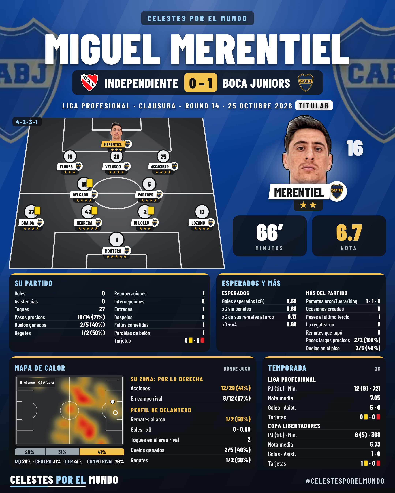
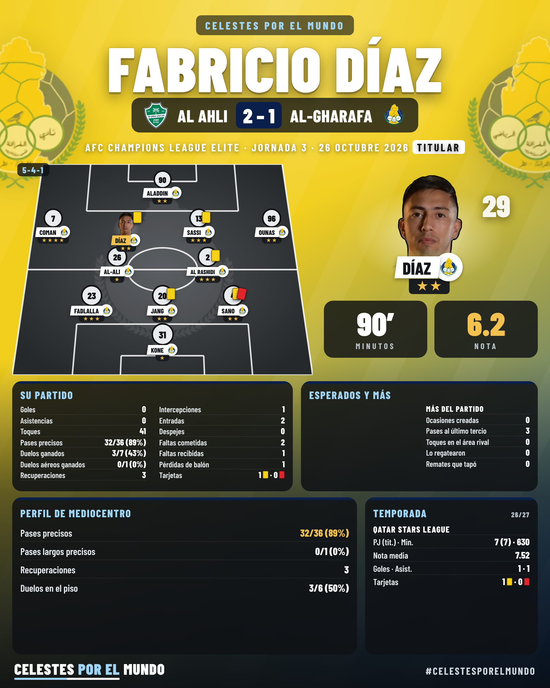
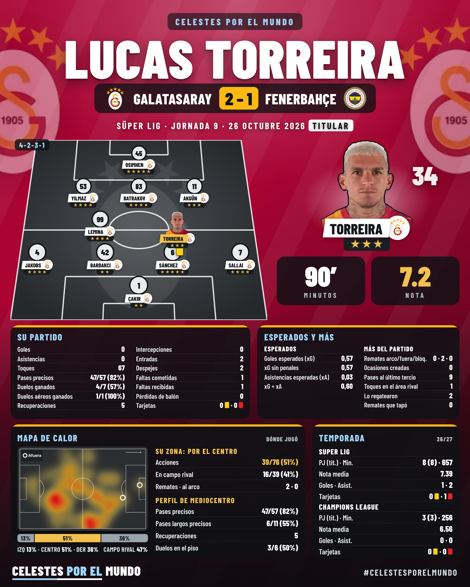

Valverde jugó 62' (titular, nota 7.0) en Barcelona 1-2 Real Madrid; M. Araújo jugó 90' (titular, nota 7.8) en Sporting CP 1-2 Académico Viseu; Merentiel jugó 66' (titular, nota 6.7) en Independiente 0-1 Boca Juniors; F. Díaz jugó 90' (titular, nota 6

@tuscxm

## Quién jugó
- **Valverde** jugó 62' (titular, nota 7.0, de lateral derecho) en Barcelona 1-2 Real Madrid · LaLiga
- **M. Araújo** jugó 90' (titular, nota 7.8, de lateral izquierdo) en Sporting CP 1-2 Académico Viseu · Liga Portugal
- **Merentiel** jugó 66' (titular, nota 6.7, de delantero) en Independiente 0-1 Boca Juniors · Liga Profesional
- **F. Díaz** jugó 90' (titular, nota 6.2, de mediocentro) en Al Ahli 2-1 Al-Gharafa · AFC Champions League Elite
- **Torreira** jugó 90' (titular, nota 7.2, de mediocentro) en Galatasaray 2-1 Fenerbahçe · Süper Lig

## El resto
- Bernal: sin partido hoy ni ayer
- Mouriño: sin partido hoy ni ayer
- Á. Rodríguez: no jugó en Manchester United 0-3 AFC Bournemouth (no entró)
- González: sin partido hoy ni ayer
- Cáceres: no jugó en Celta Vigo 0-0 Real Betis (no entró)
- Petit: sin partido hoy ni ayer
- Bentancur: sin partido hoy ni ayer
- Satriano: ya procesado · Athletic Club 4-0 Getafe
- Boselli: no jugó en Athletic Club 4-0 Getafe (no entró)
- J. Rodríguez: sin partido hoy ni ayer
- Zalazar: sin partido hoy ni ayer
- Giménez: sin partido hoy ni ayer
- Amaro: ya procesado · Genk 2-1 Standard Liège
- R. Araújo: ya procesado · Liverpool 2-0 Brighton & Hove Albion
- J. M. Sanabria: sin partido hoy ni ayer
- Ugarte: sin partido hoy ni ayer
- Canobbio: sin partido hoy ni ayer
- Darwin: sin partido hoy ni ayer
- Brizuela: sin partido hoy ni ayer
- Piquerez: sin partido hoy ni ayer
- Matturro: sin partido hoy ni ayer
- Olivera: sin partido hoy ni ayer

## Avisos
- Valverde: SofaScore no respondió; fuentes: fotmob ok, besoccer ok, api_football sin datos: el plan gratis de API-Football no cubre esta temporada (plan: Free plans do not have access to this season, try from 2022 to 2024.), thesportsdb ok, understat ok, zerozero error HTTP 403
- Valverde: Armada con datos de respaldo (FotMob): hay menos estadísticas que de costumbre, revisala antes de publicar
- M. Araújo: SofaScore no respondió; fuentes: fotmob ok, besoccer ok, api_football sin datos: el plan gratis de API-Football no cubre esta temporada (plan: Free plans do not have access to this season, try from 2022 to 2024.), thesportsdb ok, understat sin datos: sin understat_equipo (Understat no cubre esa liga), zerozero error HTTP 403
- M. Araújo: Armada con datos de respaldo (FotMob): hay menos estadísticas que de costumbre, revisala antes de publicar
- Merentiel: SofaScore no respondió; fuentes: fotmob ok, besoccer ok, api_football sin datos: el plan gratis de API-Football no cubre esta temporada (plan: Free plans do not have access to this season, try from 2022 to 2024.), thesportsdb ok, understat sin datos: sin understat_equipo (Understat no cubre esa liga), zerozero error HTTP 403
- Merentiel: Armada con datos de respaldo (FotMob): hay menos estadísticas que de costumbre, revisala antes de publicar
- F. Díaz: SofaScore no respondió; fuentes: fotmob ok, besoccer ok, api_football sin datos: el plan gratis de API-Football no cubre esta temporada (plan: Free plans do not have access to this season, try from 2022 to 2024.), thesportsdb sin datos: no se encontró el equipo, understat sin datos: sin understat_equipo (Understat no cubre esa liga), zerozero error HTTP 403
- F. Díaz: Sin remates en el respaldo: TOTALES va sin lo de ataque
- F. Díaz: No hay mapa de calor de este partido en el respaldo: se muestra el perfil
- F. Díaz: Armada con datos de respaldo (FotMob): hay menos estadísticas que de costumbre, revisala antes de publicar
- Torreira: SofaScore no respondió; fuentes: fotmob ok, besoccer ok, api_football sin datos: el plan gratis de API-Football no cubre esta temporada (plan: Free plans do not have access to this season, try from 2022 to 2024.), thesportsdb ok, understat sin datos: sin understat_equipo (Understat no cubre esa liga), zerozero error HTTP 403
- Torreira: Armada con datos de respaldo (FotMob): hay menos estadísticas que de costumbre, revisala antes de publicar

## Valverde · Barcelona 1-2 Real Madrid

[Abrir la imagen en tamaño completo](https://github.com/tuscxm/celestes-por-el-mundo/blob/main/salida/png/F.%20Valverde/2026-10-25%20%C2%B7%20Barcelona%20%C2%B7%20LaLiga/Valverde_Barcelona-RealMadrid_2026-10-25.png)

Texto para el posteo:
```
🇺🇾 FEDERICO VALVERDE · Barcelona 1-2 Real Madrid
⏱ 62' · ⭐ 7.0

Jugó de lateral derecho: 31/35 pases (89%), 1/1 duelos ganados, 2 recuperaciones y 3 pases al último tercio.

🧩 ¿Y en una Uruguay 3-5-2 con enganche?
Sería carrilero por derecha: 78% de sus acciones por la derecha, 3 pases al último tercio y 2 recuperaciones. En el 3-5-2 toda la banda es suya, y con tres centrales atrás puede pasar sin dejar la espalda sola.

Tres atrás, dos carrileros, dos internos, un 10 suelto y dos puntas. ¿Lo jugarías así? 👇
#CelestesPorElMundo #Uruguay #RealMadrid #352
```

## M. Araújo · Sporting CP 1-2 Académico Viseu

[Abrir la imagen en tamaño completo](https://github.com/tuscxm/celestes-por-el-mundo/blob/main/salida/png/M.%20Ara%C3%BAjo/2026-10-25%20%C2%B7%20Acad%C3%A9mico%20Viseu%20%C2%B7%20Liga%20Portugal/Araujo_SportingCP-AcademicoViseu_2026-10-25.png)

Texto para el posteo:
```
🇺🇾 MAXIMILIANO ARAÚJO · Sporting CP 1-2 Académico Viseu
⏱ 90' · ⭐ 7.8

Jugó de lateral izquierdo: 61/72 pases (85%), 9/16 duelos ganados, 7 recuperaciones y 13 pases al último tercio.

🧩 ¿Y en una Uruguay 3-5-2 con enganche?
Sería carrilero por izquierda: 85% de sus acciones por la izquierda, 54% en campo rival y 13 pases al último tercio. En el 3-5-2 toda la banda es suya, y con tres centrales atrás puede pasar sin dejar la espalda sola.

Tres atrás, dos carrileros, dos internos, un 10 suelto y dos puntas. ¿Lo jugarías así? 👇
#CelestesPorElMundo #Uruguay #SportingCP #352
```

## Merentiel · Independiente 0-1 Boca Juniors

[Abrir la imagen en tamaño completo](https://github.com/tuscxm/celestes-por-el-mundo/blob/main/salida/png/M.%20Merentiel/2026-10-25%20%C2%B7%20Independiente%20%C2%B7%20Liga%20Profesional/Merentiel_Independiente-BocaJuniors_2026-10-25.png)

Texto para el posteo:
```
🇺🇾 MIGUEL MERENTIEL · Independiente 0-1 Boca Juniors
⏱ 66' · ⭐ 6.7

Jugó de delantero: 41% de sus acciones por la derecha, 10/14 pases (71%), 1 recuperación y 1 pase al último tercio.

🧩 ¿Y en una Uruguay 3-5-2 con enganche?
Sería uno de los dos de punta: 1 de 2 remates al arco, 2 toques en el área rival y 1/2 regates. Con un enganche que lo habilite y otro 9 al lado, deja de pelear solo contra los centrales.

Tres atrás, dos carrileros, dos internos, un 10 suelto y dos puntas. ¿Lo jugarías así? 👇
#CelestesPorElMundo #Uruguay #BocaJuniors #352
```

## F. Díaz · Al Ahli 2-1 Al-Gharafa

[Abrir la imagen en tamaño completo](https://github.com/tuscxm/celestes-por-el-mundo/blob/main/salida/png/F.%20D%C3%ADaz/2026-10-26%20%C2%B7%20Al%20Ahli%20%C2%B7%20Afc%20Champions%20League%20Elite/Diaz_AlAhli-Al-Gharafa_2026-10-26.png)

Texto para el posteo:
```
🇺🇾 FABRICIO DÍAZ · Al Ahli 2-1 Al-Gharafa
⏱ 90' · ⭐ 6.2

Jugó de mediocentro: 32/36 pases (89%), 3 recuperaciones y 3 pases al último tercio.

🧩 ¿Y en una Uruguay 3-5-2 con enganche?
Sería uno de los dos internos: 32/36 pases (89%), 3 recuperaciones y 1 intercepción. Es el que sostiene y hace circular para que el enganche reciba de frente.

Tres atrás, dos carrileros, dos internos, un 10 suelto y dos puntas. ¿Lo jugarías así? 👇
#CelestesPorElMundo #Uruguay #AlGharafa #352
```

## Torreira · Galatasaray 2-1 Fenerbahçe

[Abrir la imagen en tamaño completo](https://github.com/tuscxm/celestes-por-el-mundo/blob/main/salida/png/L.%20Torreira/2026-10-26%20%C2%B7%20Fenerbah%C3%A7e%20%C2%B7%20S%C3%BCper%20Lig/Torreira_Galatasaray-Fenerbah%C3%A7e_2026-10-26.png)

Texto para el posteo:
```
🇺🇾 LUCAS TORREIRA · Galatasaray 2-1 Fenerbahçe
⏱ 90' · ⭐ 7.2

Jugó de mediocentro: 51% de sus acciones por el centro, 47/57 pases (82%), 4/7 duelos ganados y 5 recuperaciones.

🧩 ¿Y en una Uruguay 3-5-2 con enganche?
Sería uno de los dos internos: 47/57 pases (82%), 5 recuperaciones y 4/7 duelos ganados. Es el que sostiene y hace circular para que el enganche reciba de frente.

Tres atrás, dos carrileros, dos internos, un 10 suelto y dos puntas. ¿Lo jugarías así? 👇
#CelestesPorElMundo #Uruguay #Galatasaray #352
```

---
No se publicó nada en Instagram. Cerrá este aviso cuando la publiques o la descartes.
## Revisión visual
- Las 5 infografías salieron con la parte de abajo por puesto (ninguna con el diseño anterior). Caras bien recortadas y con contorno negro, escudos (también detrás de la cancha) bien, jugador resaltado en la cancha, sin nombres de fuentes. Números de la infografía y del posteo coinciden.
- Merentiel: debajo del marcador dice "CLAUSURA - ROUND 14" (la fase quedó en inglés, "Round" en vez de "Fecha").
- F. Díaz: no hay mapa de calor (el respaldo no lo trae), así que va solo el PERFIL DE MEDIOCENTRO. En TEMPORADA aparece solo la Qatar Stars League, sin la AFC Champions League Elite del partido. En la cancha, la roja de Sano (Al-Gharafa) tapa casi todo su dorsal.
- Valverde y F. Díaz: en ESPERADOS Y MÁS la columna ESPERADOS queda vacía (no hubo xG/xA de ese partido); se ve un hueco a la izquierda de MÁS DEL PARTIDO.
- Fuentes: SofaScore no respondió (las 5 salieron del respaldo automático con FotMob); API-Football: el plan gratis no cubre la temporada 2026; zerozero: error HTTP 403; BeSoccer: las páginas de partidos no cargaron por WebFetch ("A required part of this site couldn't load"), besoccer_hoy.json quedó vacío.
