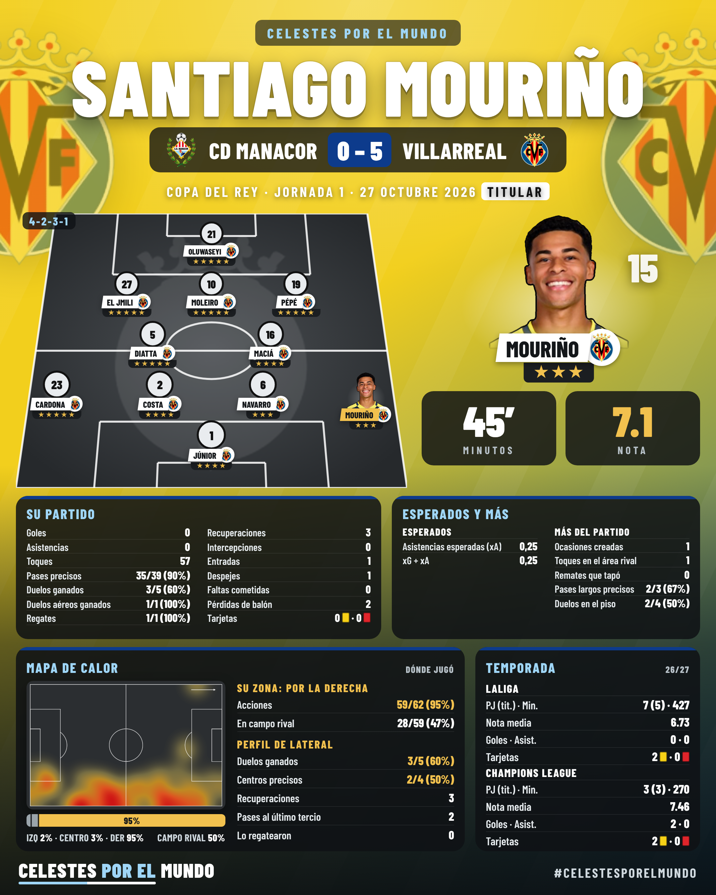
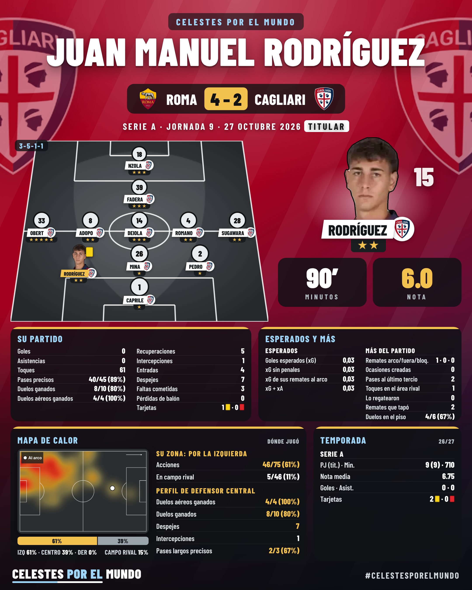

Mouriño jugó 45' (titular, nota 7.1) en CD Manacor 0-5 Villarreal; J. Rodríguez jugó 90' (titular, nota 6.0) en Roma 4-2 Cagliari; infografías listas

@tuscxm

## Quién jugó
- **Mouriño** jugó 45' (titular, nota 7.1, de lateral derecho) en CD Manacor 0-5 Villarreal · Copa del Rey
- **J. Rodríguez** jugó 90' (titular, nota 6.0, de defensor central) en Roma 4-2 Cagliari · Serie A

## El resto
- Valverde: sin partido hoy ni ayer
- Bernal: sin partido hoy ni ayer
- M. Araújo: sin partido hoy ni ayer
- Á. Rodríguez: sin partido hoy ni ayer
- González: sin partido hoy ni ayer
- Cáceres: sin partido hoy ni ayer
- Petit: sin partido hoy ni ayer
- Bentancur: sin partido hoy ni ayer
- Satriano: sin partido hoy ni ayer
- Boselli: sin partido hoy ni ayer
- Zalazar: sin partido hoy ni ayer
- Merentiel: sin partido hoy ni ayer
- Giménez: sin partido hoy ni ayer
- Amaro: sin partido hoy ni ayer
- R. Araújo: sin partido hoy ni ayer
- J. M. Sanabria: sin partido hoy ni ayer
- Ugarte: sin partido hoy ni ayer
- Canobbio: sin partido hoy ni ayer
- Darwin: sin partido hoy ni ayer
- F. Díaz: sin partido hoy ni ayer
- Torreira: sin partido hoy ni ayer
- Brizuela: sin partido hoy ni ayer
- Piquerez: sin partido hoy ni ayer
- Matturro: sin partido hoy ni ayer
- Olivera: sin partido hoy ni ayer

## Avisos
- Mouriño: SofaScore no respondió; fuentes: fotmob ok, besoccer ok, api_football sin datos: el plan gratis de API-Football no cubre esta temporada (plan: Free plans do not have access to this season, try from 2022 to 2024.), thesportsdb ok, understat ok, zerozero error HTTP 403
- Mouriño: Armada con datos de respaldo (FotMob): hay menos estadísticas que de costumbre, revisala antes de publicar
- J. Rodríguez: SofaScore no respondió; fuentes: fotmob ok, besoccer ok, api_football sin datos: el plan gratis de API-Football no cubre esta temporada (plan: Free plans do not have access to this season, try from 2022 to 2024.), thesportsdb ok, understat ok, zerozero error HTTP 403
- J. Rodríguez: Armada con datos de respaldo (FotMob): hay menos estadísticas que de costumbre, revisala antes de publicar

## Mouriño · CD Manacor 0-5 Villarreal

[Abrir la imagen en tamaño completo](https://github.com/tuscxm/celestes-por-el-mundo/blob/main/salida/png/S.%20Mouri%C3%B1o/2026-10-27%20%C2%B7%20CD%20Manacor%20%C2%B7%20Copa%20Del%20Rey/Mourino_CDManacor-Villarreal_2026-10-27.png)

Texto para el posteo:
```
🇺🇾 SANTIAGO MOURIÑO · CD Manacor 0-5 Villarreal
⏱ 45' · ⭐ 7.1

Jugó de lateral derecho: 95% de sus acciones por la derecha, 35/39 pases (90%), 3/5 duelos ganados y 3 recuperaciones.

🧩 ¿Y en una Uruguay 3-5-2 con enganche?
Lo vemos de zaguero por derecha en la línea de tres: 35/39 pases (90%), 2/3 pases largos y 3/5 duelos ganados. Con tres atrás, un central que sale limpio le suma un pase para encontrar al enganche y deja a los carrileros libres para pasar.

Tres atrás, dos carrileros, dos internos, un 10 suelto y dos puntas. ¿Lo jugarías así? 👇
#CelestesPorElMundo #Uruguay #Villarreal #352
```

## J. Rodríguez · Roma 4-2 Cagliari

[Abrir la imagen en tamaño completo](https://github.com/tuscxm/celestes-por-el-mundo/blob/main/salida/png/J.%20M.%20Rodr%C3%ADguez/2026-10-27%20%C2%B7%20Roma%20%C2%B7%20Serie%20A/Rodriguez_Roma-Cagliari_2026-10-27.png)

Texto para el posteo:
```
🇺🇾 JUAN MANUEL RODRÍGUEZ · Roma 4-2 Cagliari
⏱ 90' · ⭐ 6.0

Jugó de defensor central: 61% de sus acciones por la izquierda, 40/45 pases (89%), 8/10 duelos ganados y 5 recuperaciones.

🧩 ¿Y en una Uruguay 3-5-2 con enganche?
Lo vemos de zaguero por izquierda en la línea de tres: 40/45 pases (89%), 2/3 pases largos y 8/10 duelos ganados. Con tres atrás, un central que sale limpio le suma un pase para encontrar al enganche y deja a los carrileros libres para pasar.

Tres atrás, dos carrileros, dos internos, un 10 suelto y dos puntas. ¿Lo jugarías así? 👇
#CelestesPorElMundo #Uruguay #Cagliari #352
```

---
No se publicó nada en Instagram. Cerrá este aviso cuando la publiques o la descartes.
## Revisión visual
- Mouriño (CD Manacor 0-5 Villarreal): sale con la parte de abajo por puesto (perfil de lateral, coincide con el puesto del partido). Números iguales en la infografía y el posteo (45', 7.1, 35/39 pases, 3/5 duelos, 3 recuperaciones, 95% por la derecha). Sin remates, así que el mapa no lleva marcas. TEMPORADA con LaLiga y Champions. En la cancha su cara queda algo corrida hacia el borde derecho, fuera de la línea de los otros tres defensores (no tapa nada).
- J. M. Rodríguez (Roma 4-2 Cagliari): sale con la parte de abajo por puesto (perfil de defensor central). Amarilla visible en la cancha, en SU PARTIDO y en TEMPORADA. Números coinciden con el posteo (90', 6.0, 40/45 pases, 8/10 duelos, 5 recuperaciones, 61% por la izquierda). Un remate al arco dentro de la cancha, con leyenda. TEMPORADA solo Serie A (no juega copa internacional). La foto grande se ve un poco menos nítida que la de Mouriño.
- Caras con contorno negro, sin fondo blanco a la vista; escudos bien (también detrás de la cancha); sin textos cortados; no aparece el nombre de ninguna fuente. No hubo tandas de penales.
- Fuentes: SofaScore no respondió (las dos se armaron con el respaldo de FotMob); API-Football, plan gratis sin la temporada 2026; zerozero HTTP 403; BeSoccer no cargó ninguna página de jugador ("A required part of this site couldn't load"), así que besoccer_hoy.json quedó vacío.
