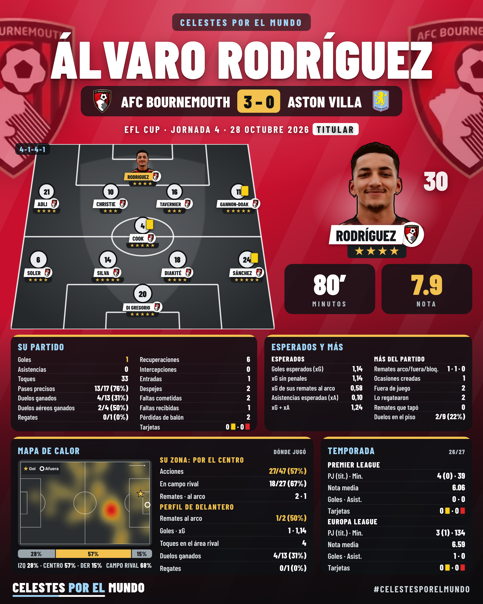
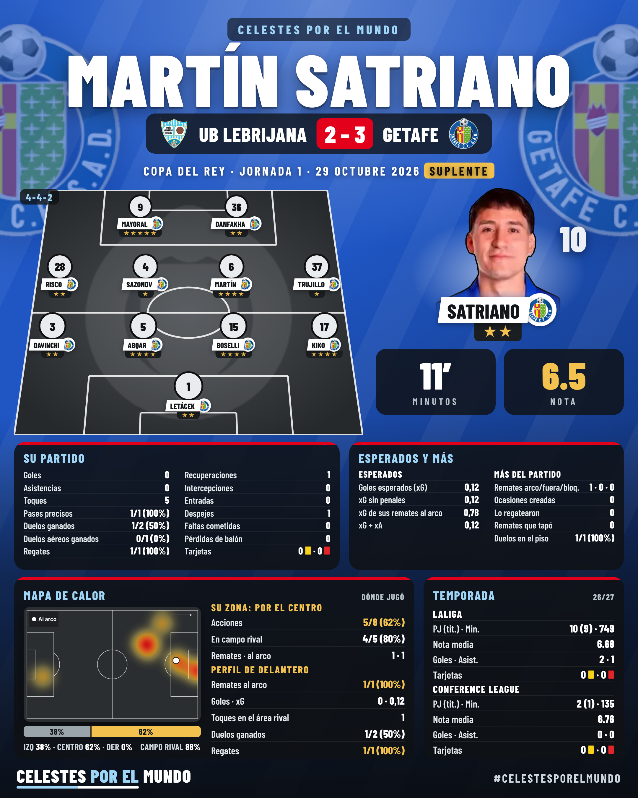
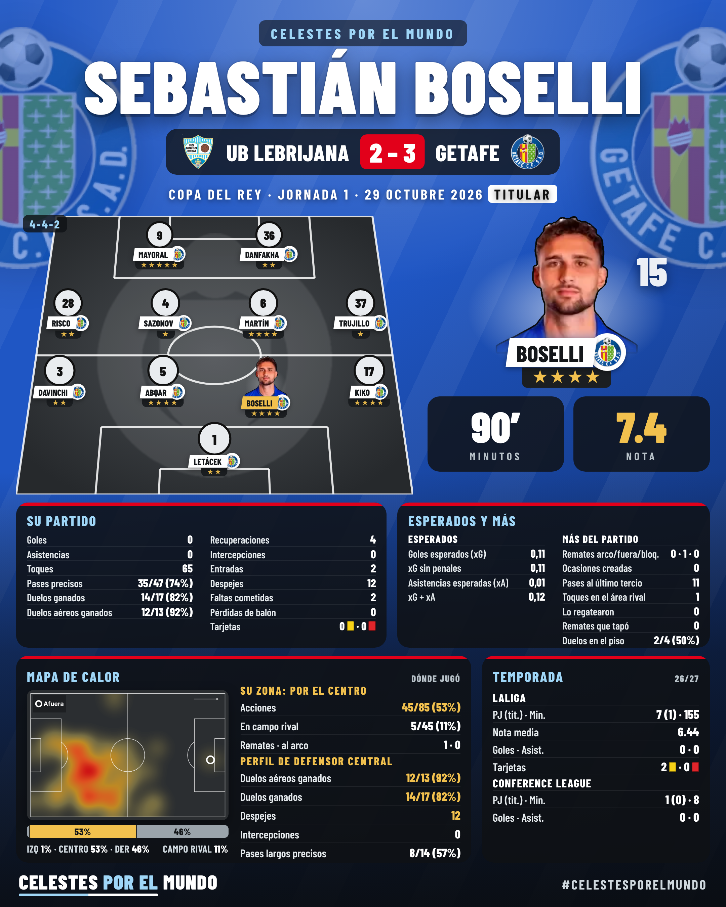
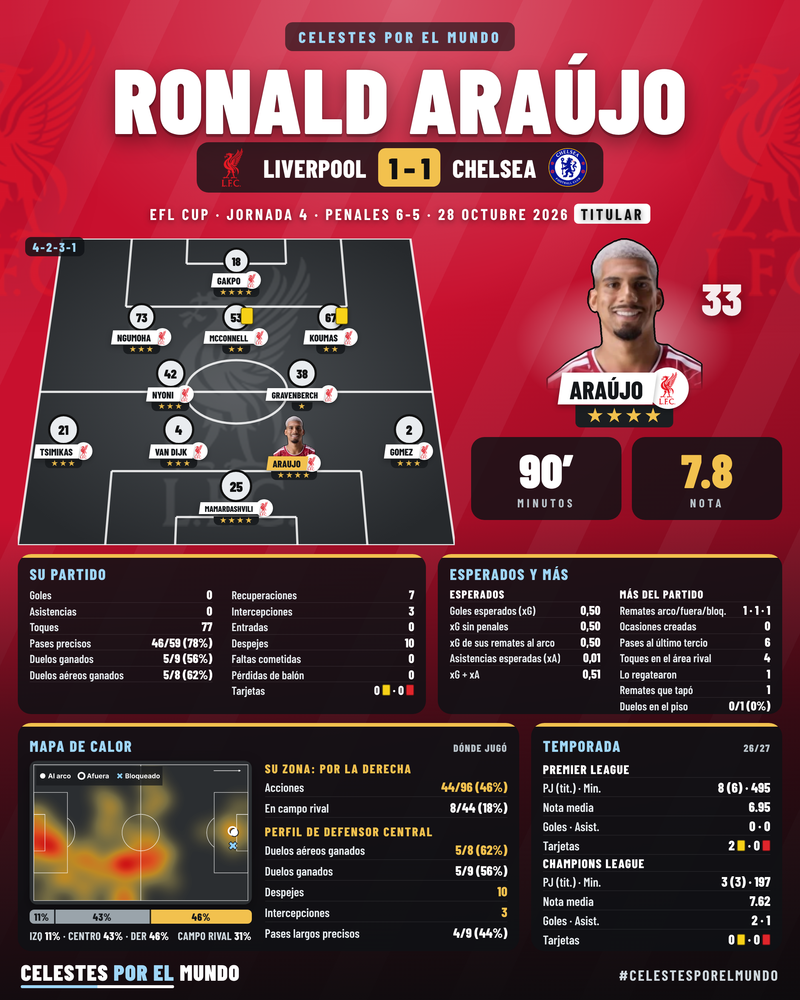
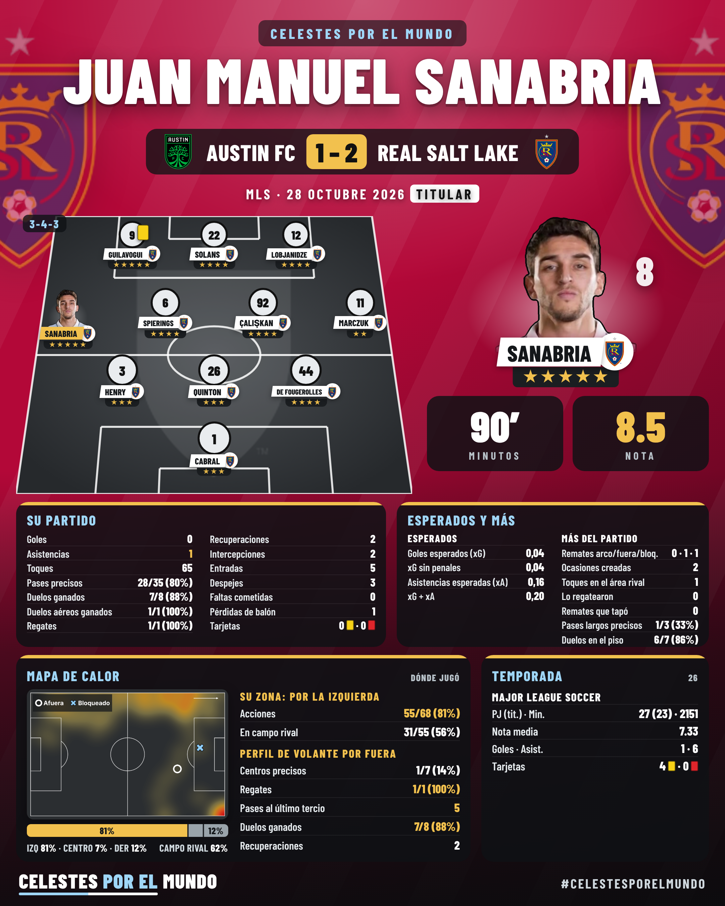
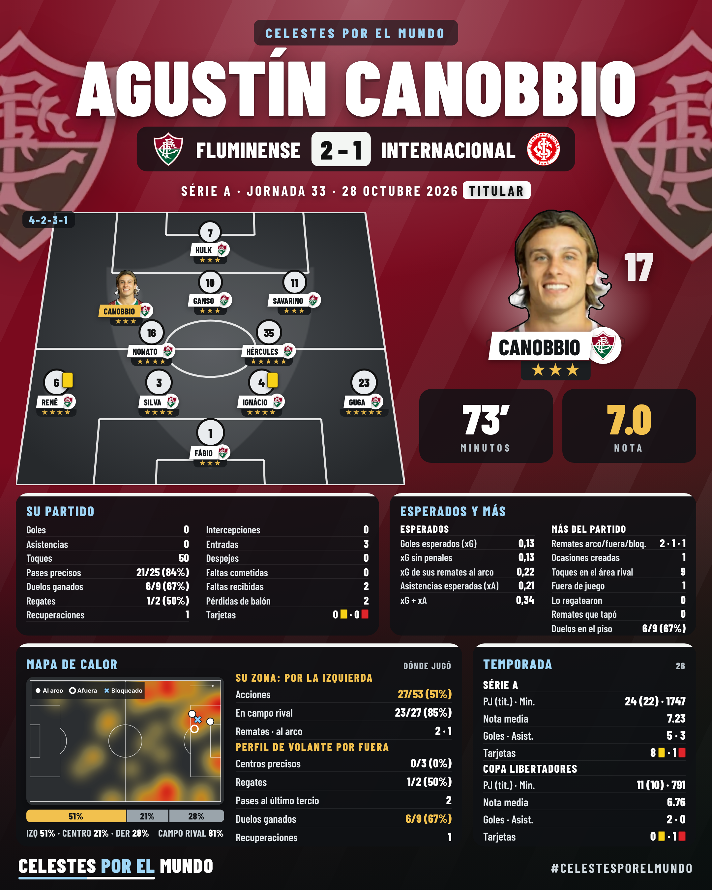
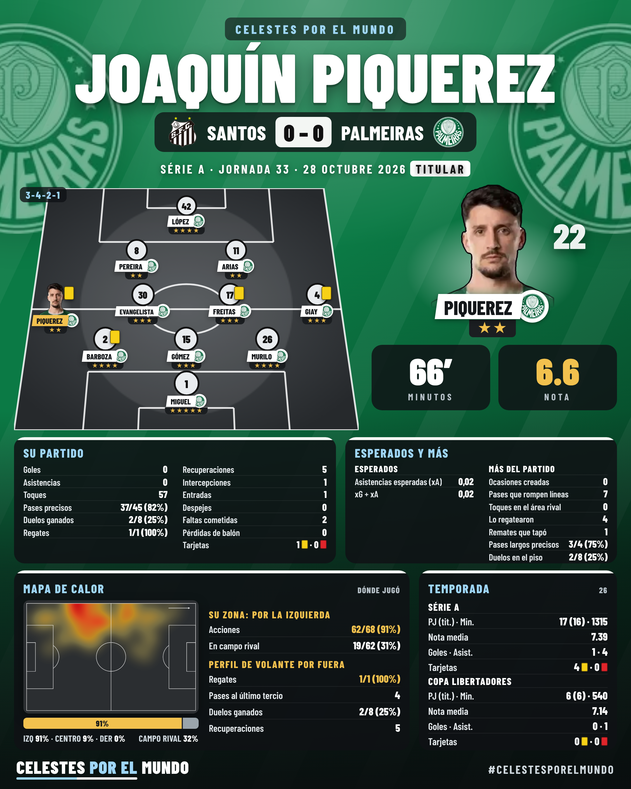
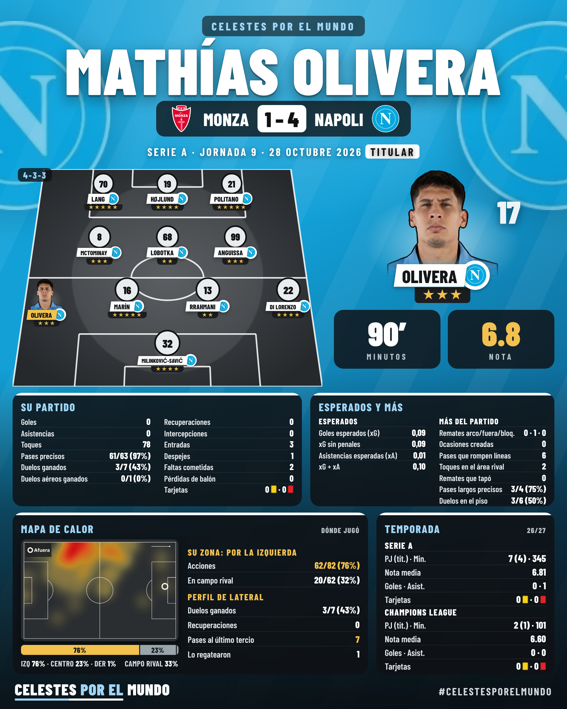

Á. Rodríguez jugó 80' (titular, nota 7.9) en AFC Bournemouth 3-0 Aston Villa; Satriano jugó 11' (suplente, nota 6.5) en UB Lebrijana 2-3 Getafe; Boselli jugó 90' (titular, nota 7.4) en UB Lebrijana 2-3 Getafe; R. Araújo jugó 90' (titular, nota 7.8) e

@tuscxm

## Quién jugó
- **Á. Rodríguez** jugó 80' (titular, nota 7.9, de delantero) en AFC Bournemouth 3-0 Aston Villa · EFL Cup
- **Satriano** jugó 11' (suplente, nota 6.5, de delantero) en UB Lebrijana 2-3 Getafe · Copa del Rey
- **Boselli** jugó 90' (titular, nota 7.4, de defensor central) en UB Lebrijana 2-3 Getafe · Copa del Rey
- **R. Araújo** jugó 90' (titular, nota 7.8, de defensor central) en Liverpool 1-1 Chelsea (6-5 en penales) · EFL Cup
- **J. M. Sanabria** jugó 90' (titular, nota 8.5, de volante por izquierda) en Austin FC 1-2 Real Salt Lake · MLS
- **Canobbio** jugó 73' (titular, nota 7.0, de volante por izquierda) en Fluminense 2-1 Internacional · Série A
- **Piquerez** jugó 66' (titular, nota 6.6, de volante por izquierda) en Santos 0-0 Palmeiras · Série A
- **Olivera** jugó 90' (titular, nota 6.8, de lateral izquierdo) en Monza 1-4 Napoli · Serie A

## El resto
- Valverde: sin partido hoy ni ayer
- Bernal: sin partido hoy ni ayer
- Mouriño: sin partido hoy ni ayer
- M. Araújo: sin partido hoy ni ayer
- González: sin partido hoy ni ayer
- Cáceres: sin partido hoy ni ayer
- Petit: sin partido hoy ni ayer
- Bentancur: sin partido hoy ni ayer
- J. Rodríguez: sin partido hoy ni ayer
- Zalazar: sin partido hoy ni ayer
- Merentiel: sin partido hoy ni ayer
- Giménez: sin partido hoy ni ayer
- Amaro: sin partido hoy ni ayer
- Ugarte: sin partido hoy ni ayer
- Darwin: sin partido hoy ni ayer
- F. Díaz: sin partido hoy ni ayer
- Torreira: sin partido hoy ni ayer
- Brizuela: sin partido hoy ni ayer
- Matturro: sin partido hoy ni ayer

## Avisos
- Á. Rodríguez: SofaScore no respondió; fuentes: fotmob ok, besoccer ok, api_football sin datos: el plan gratis de API-Football no cubre esta temporada (plan: Free plans do not have access to this season, try from 2022 to 2024.), thesportsdb ok, understat ok, zerozero error HTTP 403
- Á. Rodríguez: Armada con datos de respaldo (FotMob): hay menos estadísticas que de costumbre, revisala antes de publicar
- Satriano: SofaScore no respondió; fuentes: fotmob ok, besoccer ok, api_football sin datos: el plan gratis de API-Football no cubre esta temporada (plan: Free plans do not have access to this season, try from 2022 to 2024.), thesportsdb ok, understat ok, zerozero error HTTP 403
- Satriano: Entró de suplente: el puesto (delantero) es su puesto habitual, no se sabe dónde entró
- Satriano: Armada con datos de respaldo (FotMob): hay menos estadísticas que de costumbre, revisala antes de publicar
- Boselli: SofaScore no respondió; fuentes: fotmob ok, besoccer ok, api_football sin datos: el plan gratis de API-Football no cubre esta temporada (plan: Free plans do not have access to this season, try from 2022 to 2024.), thesportsdb ok, understat ok, zerozero error HTTP 403
- Boselli: Armada con datos de respaldo (FotMob): hay menos estadísticas que de costumbre, revisala antes de publicar
- R. Araújo: SofaScore no respondió; fuentes: fotmob ok, besoccer ok, api_football sin datos: el plan gratis de API-Football no cubre esta temporada (plan: Free plans do not have access to this season, try from 2022 to 2024.), thesportsdb ok, understat ok, zerozero error HTTP 403
- R. Araújo: Hubo tanda de penales (6-5) y no pateó
- R. Araújo: Armada con datos de respaldo (FotMob): hay menos estadísticas que de costumbre, revisala antes de publicar
- J. M. Sanabria: SofaScore no respondió; fuentes: fotmob ok, besoccer ok, api_football sin datos: el plan gratis de API-Football no cubre esta temporada (plan: Free plans do not have access to this season, try from 2022 to 2024.), thesportsdb ok, understat sin datos: sin understat_equipo (Understat no cubre esa liga), zerozero error HTTP 403
- J. M. Sanabria: Armada con datos de respaldo (FotMob): hay menos estadísticas que de costumbre, revisala antes de publicar
- Canobbio: SofaScore no respondió; fuentes: fotmob ok, besoccer ok, api_football sin datos: el plan gratis de API-Football no cubre esta temporada (plan: Free plans do not have access to this season, try from 2022 to 2024.), thesportsdb ok, understat sin datos: sin understat_equipo (Understat no cubre esa liga), zerozero error HTTP 403
- Canobbio: Armada con datos de respaldo (FotMob): hay menos estadísticas que de costumbre, revisala antes de publicar
- Piquerez: SofaScore no respondió; fuentes: fotmob ok, besoccer ok, api_football sin datos: el plan gratis de API-Football no cubre esta temporada (plan: Free plans do not have access to this season, try from 2022 to 2024.), thesportsdb ok, understat sin datos: sin understat_equipo (Understat no cubre esa liga), zerozero error HTTP 403
- Piquerez: Armada con datos de respaldo (FotMob): hay menos estadísticas que de costumbre, revisala antes de publicar
- Olivera: SofaScore no respondió; fuentes: fotmob ok, besoccer ok, api_football sin datos: el plan gratis de API-Football no cubre esta temporada (plan: Free plans do not have access to this season, try from 2022 to 2024.), thesportsdb ok, understat ok, zerozero error HTTP 403
- Olivera: Armada con datos de respaldo (FotMob): hay menos estadísticas que de costumbre, revisala antes de publicar

## Á. Rodríguez · AFC Bournemouth 3-0 Aston Villa

[Abrir la imagen en tamaño completo](https://github.com/tuscxm/celestes-por-el-mundo/blob/main/salida/png/%C3%81.%20Rodr%C3%ADguez/2026-10-28%20%C2%B7%20Aston%20Villa%20%C2%B7%20Efl%20Cup/Rodriguez_AFCBournemouth-AstonVilla_2026-10-28.png)

Texto para el posteo:
```
🇺🇾 ÁLVARO RODRÍGUEZ · AFC Bournemouth 3-0 Aston Villa
⏱ 80' · ⭐ 7.9

Jugó de delantero: 57% de sus acciones por el centro, 1 gol, 13/17 pases (76%) y 6 recuperaciones.

🧩 ¿Y en una Uruguay 3-5-2 con enganche?
Sería uno de los dos de punta: 1 gol, 1 de 2 remates al arco y 4 toques en el área rival. Con un enganche que lo habilite y otro 9 al lado, deja de pelear solo contra los centrales.

Tres atrás, dos carrileros, dos internos, un 10 suelto y dos puntas. ¿Lo jugarías así? 👇
#CelestesPorElMundo #Uruguay #Bournemouth #352
```

## Satriano · UB Lebrijana 2-3 Getafe

[Abrir la imagen en tamaño completo](https://github.com/tuscxm/celestes-por-el-mundo/blob/main/salida/png/M.%20Satriano/2026-10-29%20%C2%B7%20UB%20Lebrijana%20%C2%B7%20Copa%20Del%20Rey/Satriano_UBLebrijana-Getafe_2026-10-29.png)

Texto para el posteo:
```
🇺🇾 MARTÍN SATRIANO · UB Lebrijana 2-3 Getafe
⏱ 11' · ⭐ 6.5

Jugó de delantero: 62% de sus acciones por el centro, 1/2 duelos ganados y 1 recuperación.

🧩 ¿Y en una Uruguay 3-5-2 con enganche?
Sería uno de los dos de punta: 1 de 1 remates al arco, 1 toque en el área rival y 1/2 duelos ganados. Con un enganche que lo habilite y otro 9 al lado, deja de pelear solo contra los centrales.

Tres atrás, dos carrileros, dos internos, un 10 suelto y dos puntas. ¿Lo jugarías así? 👇
#CelestesPorElMundo #Uruguay #Getafe #352
```

## Boselli · UB Lebrijana 2-3 Getafe

[Abrir la imagen en tamaño completo](https://github.com/tuscxm/celestes-por-el-mundo/blob/main/salida/png/S.%20Boselli/2026-10-29%20%C2%B7%20UB%20Lebrijana%20%C2%B7%20Copa%20Del%20Rey/Boselli_UBLebrijana-Getafe_2026-10-29.png)

Texto para el posteo:
```
🇺🇾 SEBASTIÁN BOSELLI · UB Lebrijana 2-3 Getafe
⏱ 90' · ⭐ 7.4

Jugó de defensor central: 53% de sus acciones por el centro, 35/47 pases (74%), 14/17 duelos ganados y 4 recuperaciones.

🧩 ¿Y en una Uruguay 3-5-2 con enganche?
Lo vemos de zaguero en la línea de tres: 35/47 pases (74%), 8/14 pases largos y 14/17 duelos ganados. Con tres atrás, un central que sale limpio le suma un pase para encontrar al enganche y deja a los carrileros libres para pasar.

Tres atrás, dos carrileros, dos internos, un 10 suelto y dos puntas. ¿Lo jugarías así? 👇
#CelestesPorElMundo #Uruguay #Getafe #352
```

## R. Araújo · Liverpool 1-1 Chelsea (6-5 en penales)

[Abrir la imagen en tamaño completo](https://github.com/tuscxm/celestes-por-el-mundo/blob/main/salida/png/R.%20Ara%C3%BAjo/2026-10-28%20%C2%B7%20Chelsea%20%C2%B7%20Efl%20Cup/Araujo_Liverpool-Chelsea_2026-10-28.png)

Texto para el posteo:
```
🇺🇾 RONALD ARAÚJO · Liverpool 1-1 Chelsea (6-5 en penales)
⏱ 90' · ⭐ 7.8

Jugó de defensor central: 46% de sus acciones por la derecha, 46/59 pases (78%), 5/9 duelos ganados y 7 recuperaciones.

🧩 ¿Y en una Uruguay 3-5-2 con enganche?
Lo vemos de zaguero por derecha en la línea de tres: 46/59 pases (78%), 5/9 duelos ganados y 5/8 por arriba. Con tres atrás, un central que sale limpio le suma un pase para encontrar al enganche y deja a los carrileros libres para pasar.

Tres atrás, dos carrileros, dos internos, un 10 suelto y dos puntas. ¿Lo jugarías así? 👇
#CelestesPorElMundo #Uruguay #Liverpool #352
```

## J. M. Sanabria · Austin FC 1-2 Real Salt Lake

[Abrir la imagen en tamaño completo](https://github.com/tuscxm/celestes-por-el-mundo/blob/main/salida/png/J.%20M.%20Sanabria/2026-10-28%20%C2%B7%20Austin%20FC%20%C2%B7%20Mls/Sanabria_AustinFC-RealSaltLake_2026-10-28.png)

Texto para el posteo:
```
🇺🇾 JUAN MANUEL SANABRIA · Austin FC 1-2 Real Salt Lake
⏱ 90' · ⭐ 8.5

Jugó de volante por izquierda: 28/35 pases (80%), 7/8 duelos ganados, 2 recuperaciones y 5 pases al último tercio.

🧩 ¿Y en una Uruguay 3-5-2 con enganche?
Sería carrilero por izquierda: 81% de sus acciones por la izquierda, 62% en campo rival y 5 pases al último tercio. En el 3-5-2 toda la banda es suya, y con tres centrales atrás puede pasar sin dejar la espalda sola.

Tres atrás, dos carrileros, dos internos, un 10 suelto y dos puntas. ¿Lo jugarías así? 👇
#CelestesPorElMundo #Uruguay #RealSaltLake #352
```

## Canobbio · Fluminense 2-1 Internacional

[Abrir la imagen en tamaño completo](https://github.com/tuscxm/celestes-por-el-mundo/blob/main/salida/png/A.%20Canobbio/2026-10-28%20%C2%B7%20Internacional%20%C2%B7%20S%C3%A9rie%20A/Canobbio_Fluminense-Internacional_2026-10-28.png)

Texto para el posteo:
```
🇺🇾 AGUSTÍN CANOBBIO · Fluminense 2-1 Internacional
⏱ 73' · ⭐ 7.0

Jugó de volante por izquierda: 21/25 pases (84%), 6/9 duelos ganados, 1 recuperación y 2 pases al último tercio.

🧩 ¿Y en una Uruguay 3-5-2 con enganche?
Sería carrilero por izquierda: 51% de sus acciones por la izquierda, 81% en campo rival y 2 pases al último tercio. En el 3-5-2 toda la banda es suya, y con tres centrales atrás puede pasar sin dejar la espalda sola.

Tres atrás, dos carrileros, dos internos, un 10 suelto y dos puntas. ¿Lo jugarías así? 👇
#CelestesPorElMundo #Uruguay #Fluminense #352
```

## Piquerez · Santos 0-0 Palmeiras

[Abrir la imagen en tamaño completo](https://github.com/tuscxm/celestes-por-el-mundo/blob/main/salida/png/J.%20Piquerez/2026-10-28%20%C2%B7%20Santos%20%C2%B7%20S%C3%A9rie%20A/Piquerez_Santos-Palmeiras_2026-10-28.png)

Texto para el posteo:
```
🇺🇾 JOAQUÍN PIQUEREZ · Santos 0-0 Palmeiras
⏱ 66' · ⭐ 6.6

Jugó de volante por izquierda: 37/45 pases (82%), 5 recuperaciones y 4 pases al último tercio.

🧩 ¿Y en una Uruguay 3-5-2 con enganche?
Sería carrilero por izquierda: 91% de sus acciones por la izquierda, 4 pases al último tercio y 1/1 regates. En el 3-5-2 toda la banda es suya, y con tres centrales atrás puede pasar sin dejar la espalda sola.

Tres atrás, dos carrileros, dos internos, un 10 suelto y dos puntas. ¿Lo jugarías así? 👇
#CelestesPorElMundo #Uruguay #Palmeiras #352
```

## Olivera · Monza 1-4 Napoli

[Abrir la imagen en tamaño completo](https://github.com/tuscxm/celestes-por-el-mundo/blob/main/salida/png/M.%20Olivera/2026-10-28%20%C2%B7%20Monza%20%C2%B7%20Serie%20A/Olivera_Monza-Napoli_2026-10-28.png)

Texto para el posteo:
```
🇺🇾 MATHÍAS OLIVERA · Monza 1-4 Napoli
⏱ 90' · ⭐ 6.8

Jugó de lateral izquierdo: 76% de sus acciones por la izquierda, 61/63 pases (97%) y 7 pases al último tercio.

🧩 ¿Y en una Uruguay 3-5-2 con enganche?
Lo vemos de zaguero por izquierda en la línea de tres: 61/63 pases (97%), 3/4 pases largos y 1 despeje. Con tres atrás, un central que sale limpio le suma un pase para encontrar al enganche y deja a los carrileros libres para pasar.

Tres atrás, dos carrileros, dos internos, un 10 suelto y dos puntas. ¿Lo jugarías así? 👇
#CelestesPorElMundo #Uruguay #Napoli #352
```

---
No se publicó nada en Instagram. Cerrá este aviso cuando la publiques o la descartes.
## Revisión visual
- Todas salieron con la parte de abajo por puesto (ninguna con el diseño anterior). No aparece el nombre de ninguna fuente en las imágenes ni en los textos.
- R. Araújo: Liverpool 1-1 Chelsea, Liverpool ganó 6-5 en penales; está explicado ("PENALES 6-5" bajo el marcador y "(6-5 en penales)" en el posteo) y no pateó, así que no hay penal de la tanda contado como gol.
- Satriano (suplente, 11'): en la cancha no aparece su cara sobre el jugador que reemplazó ni el "⇄ ENTRA SATRIANO <minuto>", y el recuadro dice solo 11' (no el minuto en que entró). El aviso dice que no se sabe en qué puesto entró (respaldo FotMob). Revisar antes de publicar.
- Canobbio: la cara grande tiene restos blancos del fondo al costado derecho del pelo (a la altura de la oreja). Conviene recortarla de nuevo antes de publicar.
- Canobbio: el texto del 3-5-2 dice "Sería carrilero por izquierda", pero su rol_352 en jugadores.json es carrilero por derecha (jugó por la izquierda en este partido).
- Boselli: la foto grande se ve algo borrosa (poca resolución de origen); el contorno está bien.
- Boselli: en TEMPORADA, la Conference League no muestra nota media ni tarjetas (no llegaron los datos; jugó 8').
- Fuentes con error en todos los partidos: SofaScore no respondió (se usó el respaldo FotMob); API-Football: el plan gratis no cubre la temporada 2026; zerozero: HTTP 403; Understat no cubre MLS ni Brasil. BeSoccer no cargó la página (la lectura diaria quedó vacía).
