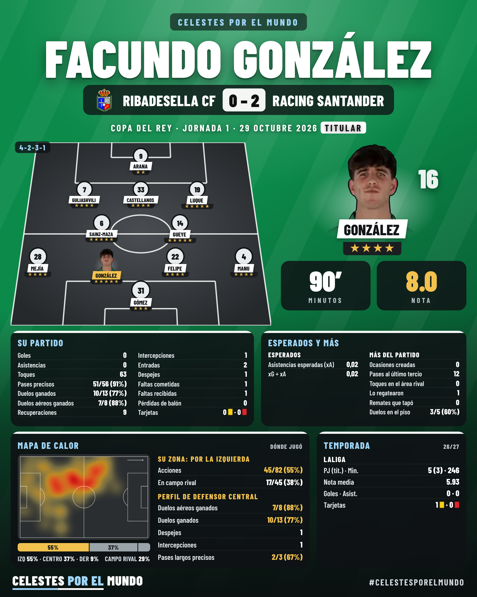
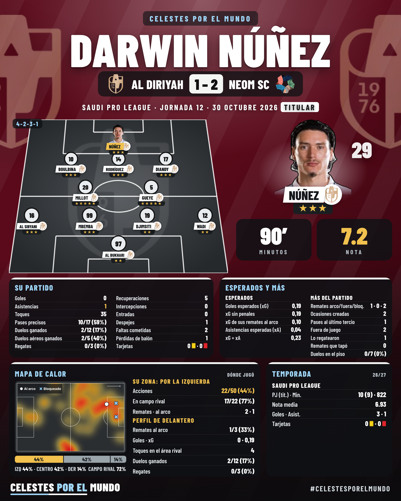
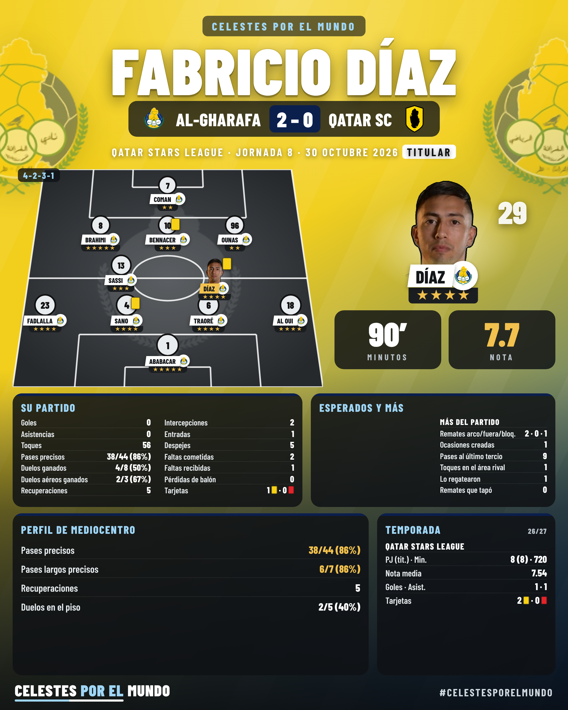
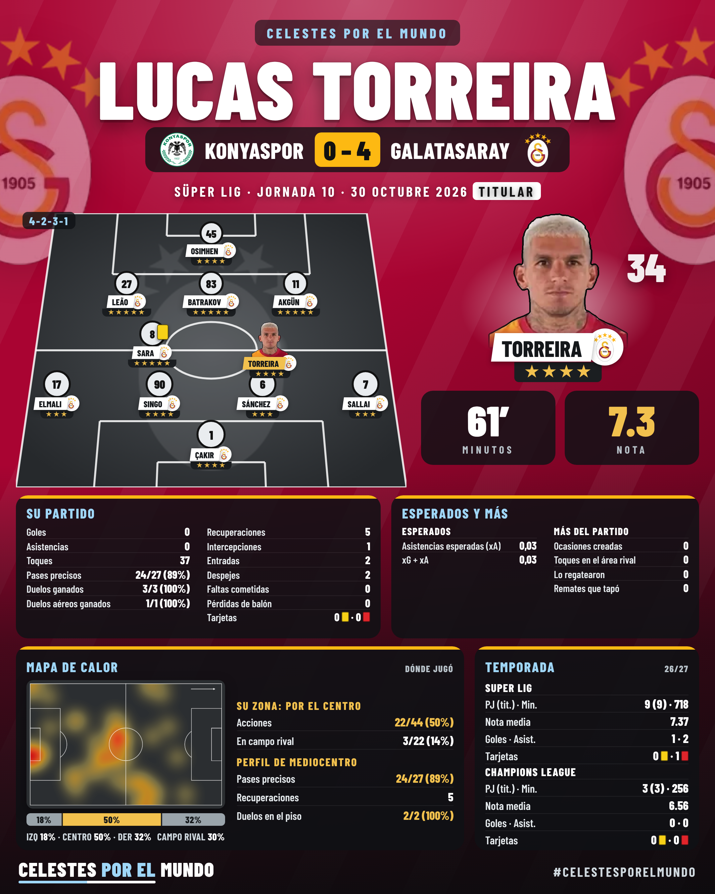

González jugó 90' (titular, nota 8.0) en Ribadesella CF 0-2 Racing Santander; Darwin jugó 90' (titular, nota 7.2) en Al Diriyah 1-2 Neom SC; F. Díaz jugó 90' (titular, nota 7.7) en Al-Gharafa 2-0 Qatar SC; Torreira jugó 61' (titular, nota 7.3) en Kon

@tuscxm

## Quién jugó
- **González** jugó 90' (titular, nota 8.0, de defensor central) en Ribadesella CF 0-2 Racing Santander · Copa del Rey
- **Darwin** jugó 90' (titular, nota 7.2, de delantero) en Al Diriyah 1-2 Neom SC · Saudi Pro League
- **F. Díaz** jugó 90' (titular, nota 7.7, de mediocentro) en Al-Gharafa 2-0 Qatar SC · Qatar Stars League
- **Torreira** jugó 61' (titular, nota 7.3, de mediocentro) en Konyaspor 0-4 Galatasaray · Süper Lig

## El resto
- Valverde: sin partido hoy ni ayer
- Bernal: sin partido hoy ni ayer
- Mouriño: sin partido hoy ni ayer
- M. Araújo: sin partido hoy ni ayer
- Á. Rodríguez: sin partido hoy ni ayer
- Cáceres: sin partido hoy ni ayer
- Petit: sin partido hoy ni ayer
- Bentancur: sin partido hoy ni ayer
- Satriano: ya procesado · UB Lebrijana 2-3 Getafe
- Boselli: ya procesado · UB Lebrijana 2-3 Getafe
- J. Rodríguez: sin partido hoy ni ayer
- Zalazar: sin partido hoy ni ayer
- Merentiel: sin partido hoy ni ayer
- Giménez: sin partido hoy ni ayer
- Amaro: sin partido hoy ni ayer
- R. Araújo: sin partido hoy ni ayer
- J. M. Sanabria: sin partido hoy ni ayer
- Ugarte: sin partido hoy ni ayer
- Canobbio: sin partido hoy ni ayer
- Brizuela: sin partido hoy ni ayer
- Piquerez: sin partido hoy ni ayer
- Matturro: no jugó en Shakhtar Donetsk 2-0 Obolon Kyiv (no entró)
- Olivera: sin partido hoy ni ayer

## Avisos
- González: SofaScore no respondió; fuentes: fotmob ok, besoccer ok, api_football sin datos: el plan gratis de API-Football no cubre esta temporada (plan: Free plans do not have access to this season, try from 2022 to 2024.), thesportsdb ok, understat sin datos: sin understat_equipo (Understat no cubre esa liga), zerozero error HTTP 403
- González: Armada con datos de respaldo (FotMob): hay menos estadísticas que de costumbre, revisala antes de publicar
- Darwin: SofaScore no respondió; fuentes: fotmob ok, besoccer ok, api_football sin datos: el plan gratis de API-Football no cubre esta temporada (plan: Free plans do not have access to this season, try from 2022 to 2024.), thesportsdb ok, understat sin datos: sin understat_equipo (Understat no cubre esa liga), zerozero error HTTP 403
- Darwin: Armada con datos de respaldo (FotMob): hay menos estadísticas que de costumbre, revisala antes de publicar
- F. Díaz: SofaScore no respondió; fuentes: fotmob ok, besoccer ok, api_football sin datos: el plan gratis de API-Football no cubre esta temporada (plan: Free plans do not have access to this season, try from 2022 to 2024.), thesportsdb sin datos: no se encontró el equipo, understat sin datos: sin understat_equipo (Understat no cubre esa liga), zerozero error HTTP 403
- F. Díaz: No hay mapa de calor de este partido en el respaldo: se muestra el perfil
- F. Díaz: Armada con datos de respaldo (FotMob): hay menos estadísticas que de costumbre, revisala antes de publicar
- Torreira: SofaScore no respondió; fuentes: fotmob ok, besoccer ok, api_football sin datos: el plan gratis de API-Football no cubre esta temporada (plan: Free plans do not have access to this season, try from 2022 to 2024.), thesportsdb ok, understat sin datos: sin understat_equipo (Understat no cubre esa liga), zerozero error HTTP 403
- Torreira: Armada con datos de respaldo (FotMob): hay menos estadísticas que de costumbre, revisala antes de publicar

## González · Ribadesella CF 0-2 Racing Santander

[Abrir la imagen en tamaño completo](https://github.com/tuscxm/celestes-por-el-mundo/blob/main/salida/png/F.%20Gonz%C3%A1lez/2026-10-29%20%C2%B7%20Ribadesella%20CF-Racing%20Santander%20%C2%B7%20Copa%20Del%20Rey/Gonzalez_RibadesellaCF-RacingSantander_2026-10-29.png)

Texto para el posteo:
```
🇺🇾 FACUNDO GONZÁLEZ · Ribadesella CF 0-2 Racing Santander
⏱ 90' · ⭐ 8.0

Jugó de defensor central: 55% de sus acciones por la izquierda, 51/56 pases (91%), 10/13 duelos ganados y 9 recuperaciones.

🧩 ¿Y en una Uruguay 3-5-2 con enganche?
Lo vemos de zaguero por izquierda en la línea de tres: 51/56 pases (91%), 2/3 pases largos y 10/13 duelos ganados. Con tres atrás, un central que sale limpio le suma un pase para encontrar al enganche y deja a los carrileros libres para pasar.

Tres atrás, dos carrileros, dos internos, un 10 suelto y dos puntas. ¿Lo jugarías así? 👇
#CelestesPorElMundo #Uruguay #RacingdeSantander #352
```

## Darwin · Al Diriyah 1-2 Neom SC

[Abrir la imagen en tamaño completo](https://github.com/tuscxm/celestes-por-el-mundo/blob/main/salida/png/D.%20N%C3%BA%C3%B1ez/2026-10-30%20%C2%B7%20Neom%20SC%20%C2%B7%20Saudi%20Pro%20League/Nunez_AlDiriyah-NeomSC_2026-10-30.png)

Texto para el posteo:
```
🇺🇾 DARWIN NÚÑEZ · Al Diriyah 1-2 Neom SC
⏱ 90' · ⭐ 7.2

Jugó de delantero: 44% de sus acciones por la izquierda, 10/17 pases (59%), 5 recuperaciones y 1 pase al último tercio.

🧩 ¿Y en una Uruguay 3-5-2 con enganche?
Sería uno de los dos de punta: 1 de 3 remates al arco y 4 toques en el área rival. Con un enganche que lo habilite y otro 9 al lado, deja de pelear solo contra los centrales.

Tres atrás, dos carrileros, dos internos, un 10 suelto y dos puntas. ¿Lo jugarías así? 👇
#CelestesPorElMundo #Uruguay #Diriyah #352
```

## F. Díaz · Al-Gharafa 2-0 Qatar SC

[Abrir la imagen en tamaño completo](https://github.com/tuscxm/celestes-por-el-mundo/blob/main/salida/png/F.%20D%C3%ADaz/2026-10-30%20%C2%B7%20Qatar%20SC%20%C2%B7%20Qatar%20Stars%20League/Diaz_Al-Gharafa-QatarSC_2026-10-30.png)

Texto para el posteo:
```
🇺🇾 FABRICIO DÍAZ · Al-Gharafa 2-0 Qatar SC
⏱ 90' · ⭐ 7.7

Jugó de mediocentro: 38/44 pases (86%), 4/8 duelos ganados, 5 recuperaciones y 9 pases al último tercio.

🧩 ¿Y en una Uruguay 3-5-2 con enganche?
Sería uno de los dos internos: 38/44 pases (86%), 5 recuperaciones y 4/8 duelos ganados. Es el que sostiene y hace circular para que el enganche reciba de frente.

Tres atrás, dos carrileros, dos internos, un 10 suelto y dos puntas. ¿Lo jugarías así? 👇
#CelestesPorElMundo #Uruguay #AlGharafa #352
```

## Torreira · Konyaspor 0-4 Galatasaray

[Abrir la imagen en tamaño completo](https://github.com/tuscxm/celestes-por-el-mundo/blob/main/salida/png/L.%20Torreira/2026-10-30%20%C2%B7%20Konyaspor%20%C2%B7%20S%C3%BCper%20Lig/Torreira_Konyaspor-Galatasaray_2026-10-30.png)

Texto para el posteo:
```
🇺🇾 LUCAS TORREIRA · Konyaspor 0-4 Galatasaray
⏱ 61' · ⭐ 7.3

Jugó de mediocentro: 50% de sus acciones por el centro, 24/27 pases (89%), 3/3 duelos ganados y 5 recuperaciones.

🧩 ¿Y en una Uruguay 3-5-2 con enganche?
Sería uno de los dos internos: 24/27 pases (89%), 5 recuperaciones y 3/3 duelos ganados. Es el que sostiene y hace circular para que el enganche reciba de frente.

Tres atrás, dos carrileros, dos internos, un 10 suelto y dos puntas. ¿Lo jugarías así? 👇
#CelestesPorElMundo #Uruguay #Galatasaray #352
```

---
No se publicó nada en Instagram. Cerrá este aviso cuando la publiques o la descartes.
## Revisión visual
- Fuentes: SofaScore no respondió (las 4 salieron con el respaldo automático de FotMob); BeSoccer no cargó la página ("A required part of this site couldn't load"), así que besoccer_hoy.json quedó vacío; API-Football: el plan gratis no cubre la temporada 2026; zerozero: HTTP 403; Understat no cubre esas ligas; TheSportsDB no encontró a Al-Gharafa.
- González (Ribadesella 0-2 Racing, Copa del Rey): falta el escudo del Racing de Santander en el marcador, en la placa de la foto, en las marcas de agua del fondo y en la silueta detrás de la cancha (el fondo quedó verde liso). TEMPORADA solo muestra LaLiga (no hay copa internacional, está bien).
- Darwin (Al Diriyah 1-2 Neom): el texto del posteo no menciona su asistencia (1 en SU PARTIDO) y pone "1 pase al último tercio" como lo mejor; conviene sumar la asistencia a mano antes de publicar.
- F. Díaz (Al-Gharafa 2-0 Qatar SC): sin mapa de calor (sale solo el PERFIL DE MEDIOCENTRO, con mucho espacio vacío) y la columna ESPERADOS quedó en blanco (no hay xG/xA). Amarilla visible en la cancha y en SU PARTIDO.
- Torreira (Konyaspor 0-4 Galatasaray): sin problemas; TEMPORADA muestra Süper Lig y Champions League.
- Caras con contorno negro y bien recortadas en las 4; ningún texto cortado ni nombre de fuente; números de la infografía coinciden con el texto del posteo. Ningún partido se definió por penales.
