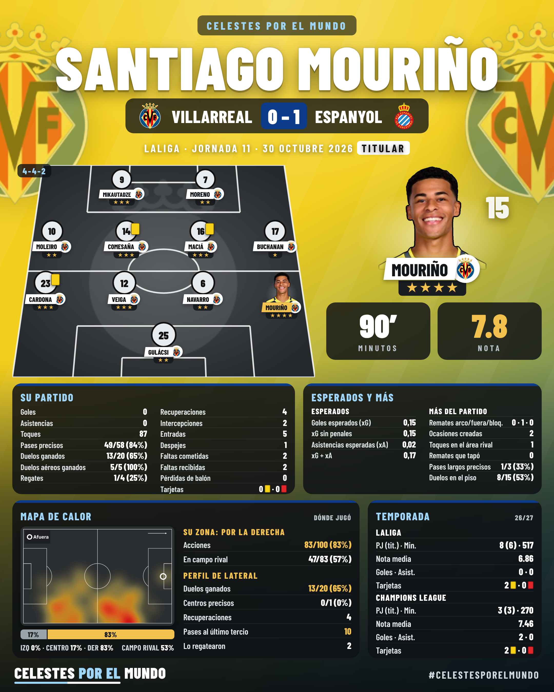
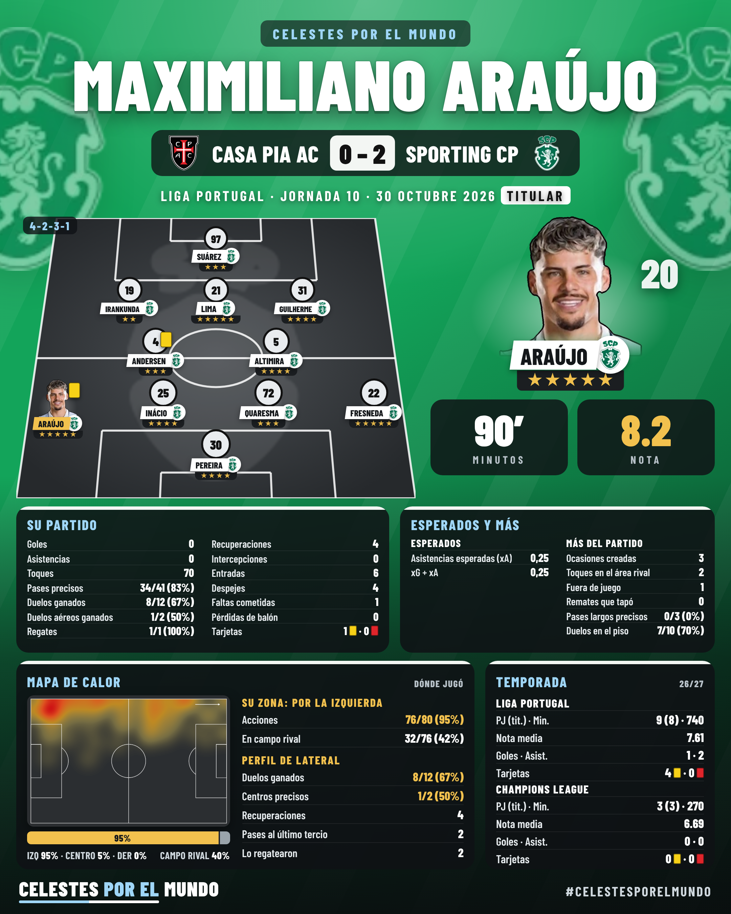
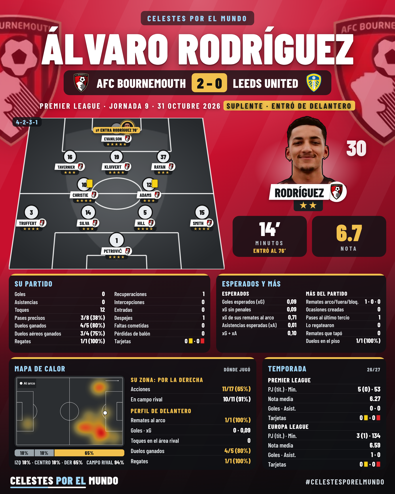
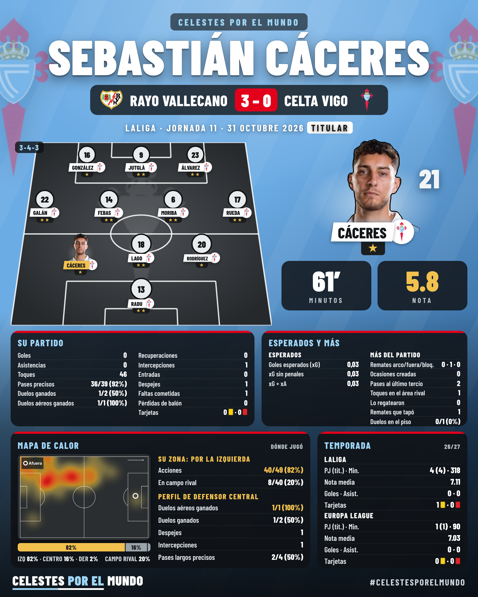
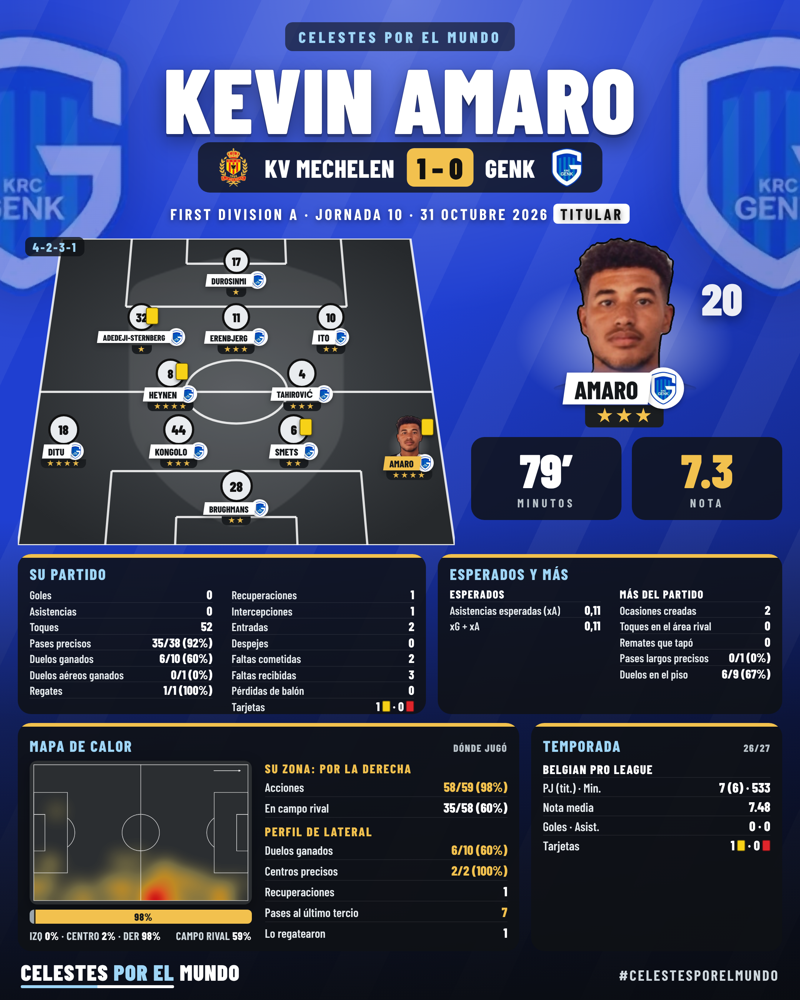

Mouriño jugó 90' (titular, nota 7.8) en Villarreal 0-1 Espanyol; M. Araújo jugó 90' (titular, nota 8.2) en Casa Pia AC 0-2 Sporting CP; Á. Rodríguez jugó 14' (suplente, nota 6.7) en AFC Bournemouth 2-0 Leeds United; Cáceres jugó 61' (titular, nota 5.

@tuscxm

## Quién jugó
- **Mouriño** jugó 90' (titular, nota 7.8, de lateral derecho) en Villarreal 0-1 Espanyol · LaLiga
- **M. Araújo** jugó 90' (titular, nota 8.2, de lateral izquierdo) en Casa Pia AC 0-2 Sporting CP · Liga Portugal
- **Á. Rodríguez** jugó 14' (suplente, entró al 76' por Evanilson, nota 6.7, de delantero) en AFC Bournemouth 2-0 Leeds United · Premier League
- **Cáceres** jugó 61' (titular, nota 5.8, de defensor central) en Rayo Vallecano 3-0 Celta Vigo · LaLiga
- **Amaro** jugó 79' (titular, nota 7.3, de lateral derecho) en KV Mechelen 1-0 Genk · First Division A

## El resto
- Valverde: sin partido hoy ni ayer
- Bernal: sin partido hoy ni ayer
- González: sin partido hoy ni ayer
- Petit: sin partido hoy ni ayer
- Bentancur: sin partido hoy ni ayer
- Satriano: sin partido hoy ni ayer
- Boselli: sin partido hoy ni ayer
- J. Rodríguez: sin partido hoy ni ayer
- Zalazar: sin partido hoy ni ayer
- Merentiel: sin partido hoy ni ayer
- Giménez: sin partido hoy ni ayer
- R. Araújo: sin partido hoy ni ayer
- J. M. Sanabria: sin partido hoy ni ayer
- Ugarte: sin partido hoy ni ayer
- Canobbio: sin partido hoy ni ayer
- Darwin: ya procesado · Al Diriyah 1-2 Neom SC
- F. Díaz: ya procesado · Al-Gharafa 2-0 Qatar SC
- Torreira: ya procesado · Konyaspor 0-4 Galatasaray
- Brizuela: sin partido hoy ni ayer
- Piquerez: sin partido hoy ni ayer
- Matturro: no jugó en Shakhtar Donetsk 2-0 Obolon Kyiv (no entró)
- Olivera: sin partido hoy ni ayer

## Avisos
- Mouriño: SofaScore no respondió; fuentes: fotmob ok, besoccer ok, api_football sin datos: el plan gratis de API-Football no cubre esta temporada (plan: Free plans do not have access to this season, try from 2022 to 2024.), thesportsdb ok, understat ok, zerozero error HTTP 403
- Mouriño: Armada con datos de respaldo (FotMob): hay menos estadísticas que de costumbre, revisala antes de publicar
- M. Araújo: SofaScore no respondió; fuentes: fotmob ok, besoccer ok, api_football sin datos: el plan gratis de API-Football no cubre esta temporada (plan: Free plans do not have access to this season, try from 2022 to 2024.), thesportsdb ok, understat sin datos: sin understat_equipo (Understat no cubre esa liga), zerozero error HTTP 403
- M. Araújo: Armada con datos de respaldo (FotMob): hay menos estadísticas que de costumbre, revisala antes de publicar
- Á. Rodríguez: SofaScore no respondió; fuentes: fotmob ok, besoccer ok, api_football sin datos: el plan gratis de API-Football no cubre esta temporada (plan: Free plans do not have access to this season, try from 2022 to 2024.), thesportsdb ok, understat ok, zerozero error HTTP 403
- Á. Rodríguez: Entró de suplente: el puesto (delantero) es su puesto habitual, no se sabe dónde entró
- Á. Rodríguez: Armada con datos de respaldo (FotMob): hay menos estadísticas que de costumbre, revisala antes de publicar
- Cáceres: SofaScore no respondió; fuentes: fotmob ok, besoccer ok, api_football sin datos: el plan gratis de API-Football no cubre esta temporada (plan: Free plans do not have access to this season, try from 2022 to 2024.), thesportsdb ok, understat ok, zerozero error HTTP 403
- Cáceres: Armada con datos de respaldo (FotMob): hay menos estadísticas que de costumbre, revisala antes de publicar
- Amaro: SofaScore no respondió; fuentes: fotmob ok, besoccer ok, api_football sin datos: el plan gratis de API-Football no cubre esta temporada (plan: Free plans do not have access to this season, try from 2022 to 2024.), thesportsdb ok, understat sin datos: sin understat_equipo (Understat no cubre esa liga), zerozero error HTTP 403
- Amaro: Armada con datos de respaldo (FotMob): hay menos estadísticas que de costumbre, revisala antes de publicar

## Mouriño · Villarreal 0-1 Espanyol

[Abrir la imagen en tamaño completo](https://github.com/tuscxm/celestes-por-el-mundo/blob/main/salida/png/S.%20Mouri%C3%B1o/2026-10-30%20%C2%B7%20Espanyol%20%C2%B7%20LaLiga/Mourino_Villarreal-Espanyol_2026-10-30.png)

Texto para el posteo:
```
🇺🇾 SANTIAGO MOURIÑO · Villarreal 0-1 Espanyol
⏱ 90' · ⭐ 7.8

Jugó de lateral derecho: 83% de sus acciones por la derecha, 49/58 pases (84%), 13/20 duelos ganados y 4 recuperaciones.

🧩 ¿Y en una Uruguay 3-5-2 con enganche?
Lo vemos de zaguero por derecha en la línea de tres: 49/58 pases (84%), 13/20 duelos ganados y 5/5 por arriba. Con tres atrás, un central que sale limpio le suma un pase para encontrar al enganche y deja a los carrileros libres para pasar.

Tres atrás, dos carrileros, dos internos, un 10 suelto y dos puntas. ¿Lo jugarías así? 👇
#CelestesPorElMundo #Uruguay #Villarreal #352
```

## M. Araújo · Casa Pia AC 0-2 Sporting CP

[Abrir la imagen en tamaño completo](https://github.com/tuscxm/celestes-por-el-mundo/blob/main/salida/png/M.%20Ara%C3%BAjo/2026-10-30%20%C2%B7%20Casa%20Pia%20AC%20%C2%B7%20Liga%20Portugal/Araujo_CasaPiaAC-SportingCP_2026-10-30.png)

Texto para el posteo:
```
🇺🇾 MAXIMILIANO ARAÚJO · Casa Pia AC 0-2 Sporting CP
⏱ 90' · ⭐ 8.2

Jugó de lateral izquierdo: 34/41 pases (83%), 8/12 duelos ganados, 4 recuperaciones y 2 pases al último tercio.

🧩 ¿Y en una Uruguay 3-5-2 con enganche?
Sería carrilero por izquierda: 95% de sus acciones por la izquierda, 2 pases al último tercio y 1/2 centros precisos. En el 3-5-2 toda la banda es suya, y con tres centrales atrás puede pasar sin dejar la espalda sola.

Tres atrás, dos carrileros, dos internos, un 10 suelto y dos puntas. ¿Lo jugarías así? 👇
#CelestesPorElMundo #Uruguay #SportingCP #352
```

## Á. Rodríguez · AFC Bournemouth 2-0 Leeds United

[Abrir la imagen en tamaño completo](https://github.com/tuscxm/celestes-por-el-mundo/blob/main/salida/png/%C3%81.%20Rodr%C3%ADguez/2026-10-31%20%C2%B7%20Leeds%20United%20%C2%B7%20Premier%20League/Rodriguez_AFCBournemouth-LeedsUnited_2026-10-31.png)

Texto para el posteo:
```
🇺🇾 ÁLVARO RODRÍGUEZ · AFC Bournemouth 2-0 Leeds United
⏱ 14' · ⭐ 6.7
🔁 Entró al 76' por Evanilson, como delantero

Jugó de delantero: 65% de sus acciones por la derecha, 4/5 duelos ganados, 1 recuperación y 1 pase al último tercio.

🧩 ¿Y en una Uruguay 3-5-2 con enganche?
Sería uno de los dos de punta: 1 de 1 remates al arco, 4/5 duelos ganados y 1/1 regates. Con un enganche que lo habilite y otro 9 al lado, deja de pelear solo contra los centrales.

Tres atrás, dos carrileros, dos internos, un 10 suelto y dos puntas. ¿Lo jugarías así? 👇
#CelestesPorElMundo #Uruguay #Bournemouth #352
```

## Cáceres · Rayo Vallecano 3-0 Celta Vigo

[Abrir la imagen en tamaño completo](https://github.com/tuscxm/celestes-por-el-mundo/blob/main/salida/png/S.%20C%C3%A1ceres/2026-10-31%20%C2%B7%20Rayo%20Vallecano%20%C2%B7%20LaLiga/Caceres_RayoVallecano-CeltaVigo_2026-10-31.png)

Texto para el posteo:
```
🇺🇾 SEBASTIÁN CÁCERES · Rayo Vallecano 3-0 Celta Vigo
⏱ 61' · ⭐ 5.8

Jugó de defensor central: 82% de sus acciones por la izquierda, 36/39 pases (92%), 1/2 duelos ganados y 2 pases al último tercio.

🧩 ¿Y en una Uruguay 3-5-2 con enganche?
Lo vemos de zaguero por izquierda en la línea de tres: 36/39 pases (92%), 2/4 pases largos y 1/2 duelos ganados. Con tres atrás, un central que sale limpio le suma un pase para encontrar al enganche y deja a los carrileros libres para pasar.

Tres atrás, dos carrileros, dos internos, un 10 suelto y dos puntas. ¿Lo jugarías así? 👇
#CelestesPorElMundo #Uruguay #CeltadeVigo #352
```

## Amaro · KV Mechelen 1-0 Genk

[Abrir la imagen en tamaño completo](https://github.com/tuscxm/celestes-por-el-mundo/blob/main/salida/png/K.%20Amaro/2026-10-31%20%C2%B7%20KV%20Mechelen%20%C2%B7%20First%20Division%20A/Amaro_KVMechelen-Genk_2026-10-31.png)

Texto para el posteo:
```
🇺🇾 KEVIN AMARO · KV Mechelen 1-0 Genk
⏱ 79' · ⭐ 7.3

Jugó de lateral derecho: 35/38 pases (92%), 6/10 duelos ganados, 1 recuperación y 7 pases al último tercio.

🧩 ¿Y en una Uruguay 3-5-2 con enganche?
Sería carrilero por derecha: 98% de sus acciones por la derecha, 59% en campo rival y 7 pases al último tercio. En el 3-5-2 toda la banda es suya, y con tres centrales atrás puede pasar sin dejar la espalda sola.

Tres atrás, dos carrileros, dos internos, un 10 suelto y dos puntas. ¿Lo jugarías así? 👇
#CelestesPorElMundo #Uruguay #Genk #352
```

---
No se publicó nada en Instagram. Cerrá este aviso cuando la publiques o la descartes.
## Revisión visual
- Las 5 infografías salieron con la parte de abajo por puesto (SU PARTIDO, ESPERADOS Y MÁS, mapa acostado sin franja, barra de dónde jugó, SU ZONA, PERFIL y TEMPORADA). Ninguna con el diseño anterior.
- Caras con contorno negro y bien recortadas; escudos (también detrás de la cancha) y colores de cada club correctos; jugador resaltado en la cancha; amarillas visibles en la cancha y en SU PARTIDO (M. Araújo y Amaro). Números de la infografía y del texto del posteo coinciden. En ningún lado se nombra una fuente. No hubo tandas de penales ni rojas.
- Á. Rodríguez: la carita del que entra queda chica y medio tapada por el cartel "⇄ ENTRA RODRÍGUEZ 76'" sobre Evanilson (se lee bien, es solo estético).
- Mouriño: en TEMPORADA la Champions dice 2 goles en 3 partidos (en LaLiga 0); conviene confirmarlo antes de publicar.
- Amaro: en TEMPORADA el título dice "Belgian Pro League" y arriba "First Division A" (misma liga, distinto nombre); y solo aparece la liga, sin copa internacional.
- Cáceres: SU PARTIDO no trae regates ni faltas recibidas (la fuente no los dio).
- Fuentes: SofaScore no respondió (se armó todo con el respaldo FotMob); API-Football: el plan gratis no cubre la temporada 2026; zerozero: HTTP 403; BeSoccer: la página no cargó ("A required part of this site couldn't load"), besoccer_hoy.json quedó vacío.
