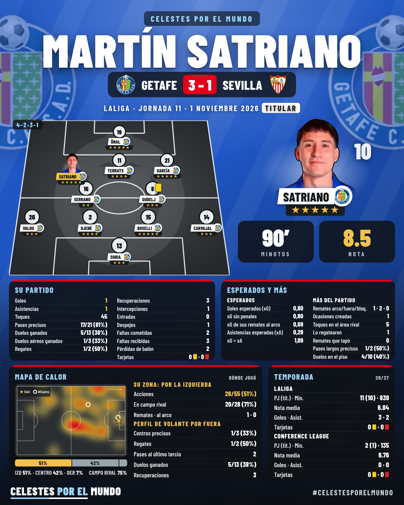
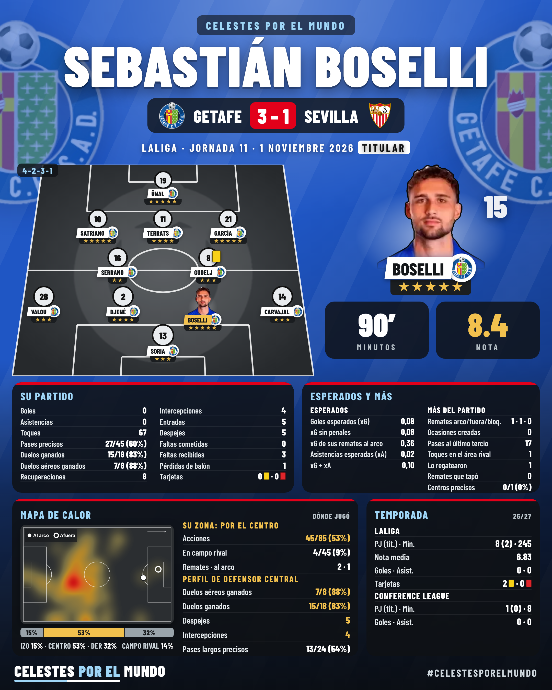
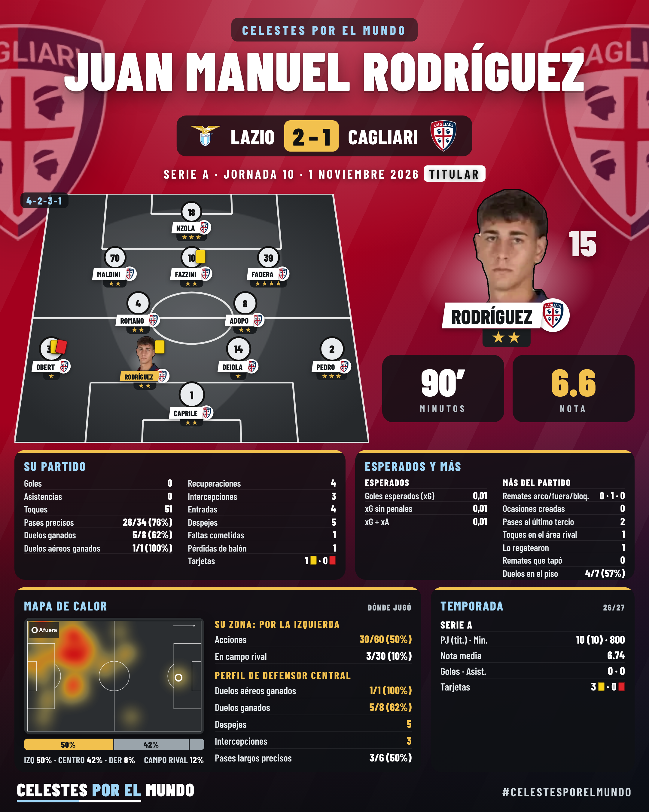
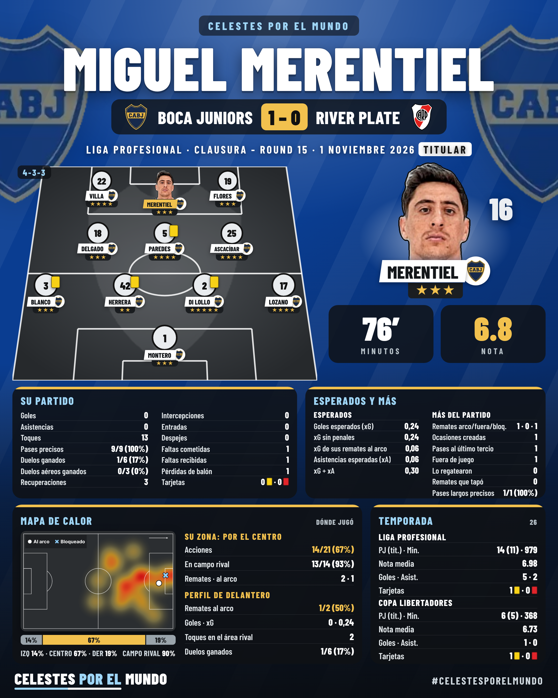
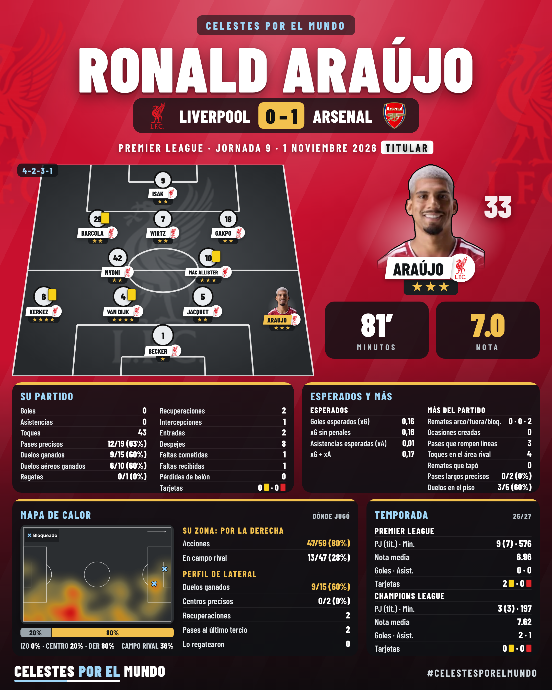
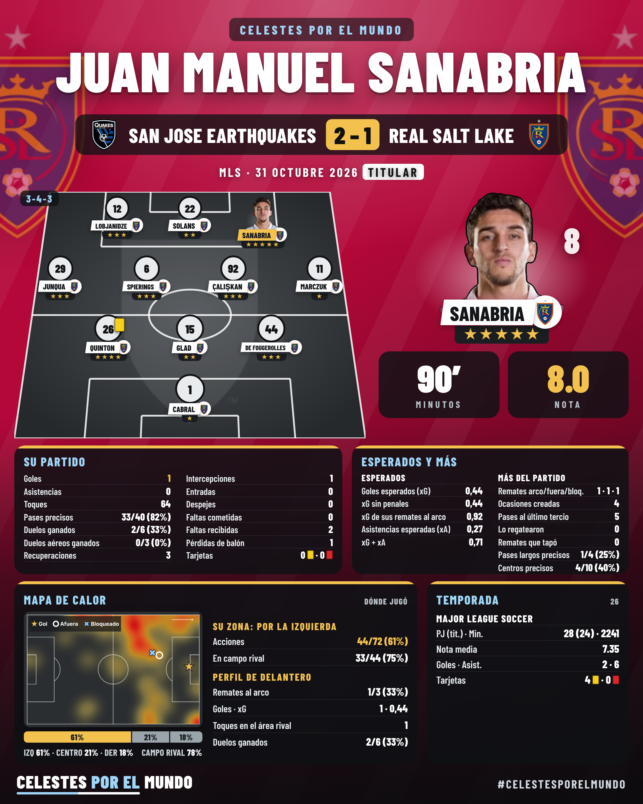
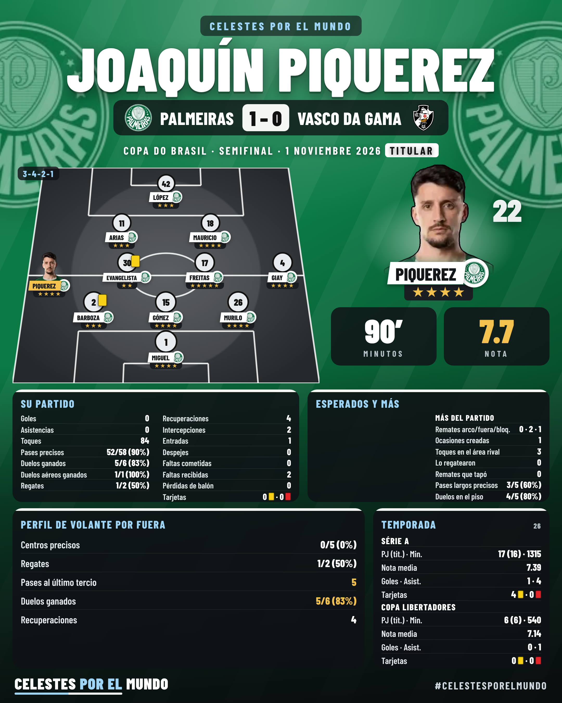

Satriano jugó 90' (titular, nota 8.5) en Getafe 3-1 Sevilla; Boselli jugó 90' (titular, nota 8.4) en Getafe 3-1 Sevilla; J. Rodríguez jugó 90' (titular, nota 6.6) en Lazio 2-1 Cagliari; Merentiel jugó 76' (titular, nota 6.8) en Boca Juniors 1-0 River

@tuscxm

## Quién jugó
- **Satriano** jugó 90' (titular, nota 8.5, de volante por izquierda) en Getafe 3-1 Sevilla · LaLiga
- **Boselli** jugó 90' (titular, nota 8.4, de defensor central) en Getafe 3-1 Sevilla · LaLiga
- **J. Rodríguez** jugó 90' (titular, nota 6.6, de defensor central) en Lazio 2-1 Cagliari · Serie A
- **Merentiel** jugó 76' (titular, nota 6.8, de delantero) en Boca Juniors 1-0 River Plate · Liga Profesional
- **R. Araújo** jugó 81' (titular, nota 7.0, de lateral derecho) en Liverpool 0-1 Arsenal · Premier League
- **J. M. Sanabria** jugó 90' (titular, nota 8.0, de delantero) en San Jose Earthquakes 2-1 Real Salt Lake · MLS
- **Piquerez** jugó 90' (titular, nota 7.7, de volante por izquierda) en Palmeiras 1-0 Vasco da Gama · Copa do Brasil

## El resto
- Valverde: sin partido hoy ni ayer
- Bernal: sin partido hoy ni ayer
- Mouriño: sin partido hoy ni ayer
- M. Araújo: sin partido hoy ni ayer
- Á. Rodríguez: ya procesado · AFC Bournemouth 2-0 Leeds United
- González: no jugó en Racing Santander 0-3 Real Madrid (no entró)
- Cáceres: ya procesado · Rayo Vallecano 3-0 Celta Vigo
- Petit: sin partido hoy ni ayer
- Bentancur: sin partido hoy ni ayer
- Zalazar: sin partido hoy ni ayer
- Giménez: sin partido hoy ni ayer
- Amaro: ya procesado · KV Mechelen 1-0 Genk
- Ugarte: sin partido hoy ni ayer
- Canobbio: sin partido hoy ni ayer
- Darwin: sin partido hoy ni ayer
- F. Díaz: sin partido hoy ni ayer
- Torreira: sin partido hoy ni ayer
- Brizuela: sin partido hoy ni ayer
- Matturro: sin partido hoy ni ayer
- Olivera: sin partido hoy ni ayer

## Avisos
- Satriano: SofaScore no respondió; fuentes: fotmob ok, besoccer ok, api_football sin datos: el plan gratis de API-Football no cubre esta temporada (plan: Free plans do not have access to this season, try from 2022 to 2024.), thesportsdb ok, understat ok, zerozero error HTTP 403
- Satriano: Armada con datos de respaldo (FotMob): hay menos estadísticas que de costumbre, revisala antes de publicar
- Boselli: SofaScore no respondió; fuentes: fotmob ok, besoccer ok, api_football sin datos: el plan gratis de API-Football no cubre esta temporada (plan: Free plans do not have access to this season, try from 2022 to 2024.), thesportsdb ok, understat ok, zerozero error HTTP 403
- Boselli: Armada con datos de respaldo (FotMob): hay menos estadísticas que de costumbre, revisala antes de publicar
- J. Rodríguez: SofaScore no respondió; fuentes: fotmob ok, besoccer ok, api_football sin datos: el plan gratis de API-Football no cubre esta temporada (plan: Free plans do not have access to this season, try from 2022 to 2024.), thesportsdb ok, understat ok, zerozero error HTTP 403
- J. Rodríguez: Armada con datos de respaldo (FotMob): hay menos estadísticas que de costumbre, revisala antes de publicar
- Merentiel: SofaScore no respondió; fuentes: fotmob ok, besoccer ok, api_football sin datos: el plan gratis de API-Football no cubre esta temporada (plan: Free plans do not have access to this season, try from 2022 to 2024.), thesportsdb ok, understat sin datos: sin understat_equipo (Understat no cubre esa liga), zerozero error HTTP 403
- Merentiel: Armada con datos de respaldo (FotMob): hay menos estadísticas que de costumbre, revisala antes de publicar
- R. Araújo: SofaScore no respondió; fuentes: fotmob ok, besoccer ok, api_football sin datos: el plan gratis de API-Football no cubre esta temporada (plan: Free plans do not have access to this season, try from 2022 to 2024.), thesportsdb ok, understat ok, zerozero error HTTP 403
- R. Araújo: Armada con datos de respaldo (FotMob): hay menos estadísticas que de costumbre, revisala antes de publicar
- J. M. Sanabria: SofaScore no respondió; fuentes: fotmob ok, besoccer ok, api_football sin datos: el plan gratis de API-Football no cubre esta temporada (plan: Free plans do not have access to this season, try from 2022 to 2024.), thesportsdb ok, understat sin datos: sin understat_equipo (Understat no cubre esa liga), zerozero error HTTP 403
- J. M. Sanabria: Armada con datos de respaldo (FotMob): hay menos estadísticas que de costumbre, revisala antes de publicar
- Piquerez: SofaScore no respondió; fuentes: fotmob ok, besoccer ok, api_football sin datos: el plan gratis de API-Football no cubre esta temporada (plan: Free plans do not have access to this season, try from 2022 to 2024.), thesportsdb ok, understat sin datos: sin understat_equipo (Understat no cubre esa liga), zerozero error HTTP 403
- Piquerez: No hay mapa de calor de este partido en el respaldo: se muestra el perfil
- Piquerez: Armada con datos de respaldo (FotMob): hay menos estadísticas que de costumbre, revisala antes de publicar

## Satriano · Getafe 3-1 Sevilla

[Abrir la imagen en tamaño completo](https://github.com/tuscxm/celestes-por-el-mundo/blob/main/salida/png/M.%20Satriano/2026-11-01%20%C2%B7%20Sevilla%20%C2%B7%20LaLiga/Satriano_Getafe-Sevilla_2026-11-01.png)

Texto para el posteo:
```
🇺🇾 MARTÍN SATRIANO · Getafe 3-1 Sevilla
⏱ 90' · ⭐ 8.5

Jugó de volante por izquierda: 51% de sus acciones por la izquierda, 1 gol, 17/21 pases (81%) y 3 recuperaciones.

🧩 ¿Y en una Uruguay 3-5-2 con enganche?
Sería uno de los dos de punta: 1 gol, 1 de 3 remates al arco y 5 toques en el área rival. Con un enganche que lo habilite y otro 9 al lado, deja de pelear solo contra los centrales.

Tres atrás, dos carrileros, dos internos, un 10 suelto y dos puntas. ¿Lo jugarías así? 👇
#CelestesPorElMundo #Uruguay #Getafe #352
```

## Boselli · Getafe 3-1 Sevilla

[Abrir la imagen en tamaño completo](https://github.com/tuscxm/celestes-por-el-mundo/blob/main/salida/png/S.%20Boselli/2026-11-01%20%C2%B7%20Sevilla%20%C2%B7%20LaLiga/Boselli_Getafe-Sevilla_2026-11-01.png)

Texto para el posteo:
```
🇺🇾 SEBASTIÁN BOSELLI · Getafe 3-1 Sevilla
⏱ 90' · ⭐ 8.4

Jugó de defensor central: 53% de sus acciones por el centro, 27/45 pases (60%), 15/18 duelos ganados y 8 recuperaciones.

🧩 ¿Y en una Uruguay 3-5-2 con enganche?
Lo vemos de zaguero en la línea de tres: 27/45 pases (60%), 13/24 pases largos y 15/18 duelos ganados. Con tres atrás, un central que sale limpio le suma un pase para encontrar al enganche y deja a los carrileros libres para pasar.

Tres atrás, dos carrileros, dos internos, un 10 suelto y dos puntas. ¿Lo jugarías así? 👇
#CelestesPorElMundo #Uruguay #Getafe #352
```

## J. Rodríguez · Lazio 2-1 Cagliari

[Abrir la imagen en tamaño completo](https://github.com/tuscxm/celestes-por-el-mundo/blob/main/salida/png/J.%20M.%20Rodr%C3%ADguez/2026-11-01%20%C2%B7%20Lazio%20%C2%B7%20Serie%20A/Rodriguez_Lazio-Cagliari_2026-11-01.png)

Texto para el posteo:
```
🇺🇾 JUAN MANUEL RODRÍGUEZ · Lazio 2-1 Cagliari
⏱ 90' · ⭐ 6.6

Jugó de defensor central: 50% de sus acciones por la izquierda, 26/34 pases (76%), 5/8 duelos ganados y 4 recuperaciones.

🧩 ¿Y en una Uruguay 3-5-2 con enganche?
Lo vemos de zaguero por izquierda en la línea de tres: 26/34 pases (76%), 3/6 pases largos y 5/8 duelos ganados. Con tres atrás, un central que sale limpio le suma un pase para encontrar al enganche y deja a los carrileros libres para pasar.

Tres atrás, dos carrileros, dos internos, un 10 suelto y dos puntas. ¿Lo jugarías así? 👇
#CelestesPorElMundo #Uruguay #Cagliari #352
```

## Merentiel · Boca Juniors 1-0 River Plate

[Abrir la imagen en tamaño completo](https://github.com/tuscxm/celestes-por-el-mundo/blob/main/salida/png/M.%20Merentiel/2026-11-01%20%C2%B7%20River%20Plate%20%C2%B7%20Liga%20Profesional/Merentiel_BocaJuniors-RiverPlate_2026-11-01.png)

Texto para el posteo:
```
🇺🇾 MIGUEL MERENTIEL · Boca Juniors 1-0 River Plate
⏱ 76' · ⭐ 6.8

Jugó de delantero: 67% de sus acciones por el centro, 3 recuperaciones, 1 pase al último tercio y 1 ocasión creada.

🧩 ¿Y en una Uruguay 3-5-2 con enganche?
Sería uno de los dos de punta: 1 de 2 remates al arco y 2 toques en el área rival. Con un enganche que lo habilite y otro 9 al lado, deja de pelear solo contra los centrales.

Tres atrás, dos carrileros, dos internos, un 10 suelto y dos puntas. ¿Lo jugarías así? 👇
#CelestesPorElMundo #Uruguay #BocaJuniors #352
```

## R. Araújo · Liverpool 0-1 Arsenal

[Abrir la imagen en tamaño completo](https://github.com/tuscxm/celestes-por-el-mundo/blob/main/salida/png/R.%20Ara%C3%BAjo/2026-11-01%20%C2%B7%20Arsenal%20%C2%B7%20Premier%20League/Araujo_Liverpool-Arsenal_2026-11-01.png)

Texto para el posteo:
```
🇺🇾 RONALD ARAÚJO · Liverpool 0-1 Arsenal
⏱ 81' · ⭐ 7.0

Jugó de lateral derecho: 80% de sus acciones por la derecha, 12/19 pases (63%), 9/15 duelos ganados y 2 recuperaciones.

🧩 ¿Y en una Uruguay 3-5-2 con enganche?
Lo vemos de zaguero por derecha en la línea de tres: 12/19 pases (63%), 9/15 duelos ganados y 6/10 por arriba. Con tres atrás, un central que sale limpio le suma un pase para encontrar al enganche y deja a los carrileros libres para pasar.

Tres atrás, dos carrileros, dos internos, un 10 suelto y dos puntas. ¿Lo jugarías así? 👇
#CelestesPorElMundo #Uruguay #Liverpool #352
```

## J. M. Sanabria · San Jose Earthquakes 2-1 Real Salt Lake

[Abrir la imagen en tamaño completo](https://github.com/tuscxm/celestes-por-el-mundo/blob/main/salida/png/J.%20M.%20Sanabria/2026-10-31%20%C2%B7%20San%20Jose%20Earthquakes%20%C2%B7%20Mls/Sanabria_SanJoseEarthquakes-RealSaltLake_2026-10-31.png)

Texto para el posteo:
```
🇺🇾 JUAN MANUEL SANABRIA · San Jose Earthquakes 2-1 Real Salt Lake
⏱ 90' · ⭐ 8.0

Jugó de delantero: 1 gol, 33/40 pases (82%), 3 recuperaciones y 5 pases al último tercio.

🧩 ¿Y en una Uruguay 3-5-2 con enganche?
Sería carrilero por izquierda: 61% de sus acciones por la izquierda, 78% en campo rival y 5 pases al último tercio. En el 3-5-2 toda la banda es suya, y con tres centrales atrás puede pasar sin dejar la espalda sola.

Tres atrás, dos carrileros, dos internos, un 10 suelto y dos puntas. ¿Lo jugarías así? 👇
#CelestesPorElMundo #Uruguay #RealSaltLake #352
```

## Piquerez · Palmeiras 1-0 Vasco da Gama

[Abrir la imagen en tamaño completo](https://github.com/tuscxm/celestes-por-el-mundo/blob/main/salida/png/J.%20Piquerez/2026-11-01%20%C2%B7%20Vasco%20da%20Gama%20%C2%B7%20Copa%20Do%20Brasil/Piquerez_Palmeiras-VascodaGama_2026-11-01.png)

Texto para el posteo:
```
🇺🇾 JOAQUÍN PIQUEREZ · Palmeiras 1-0 Vasco da Gama
⏱ 90' · ⭐ 7.7

Jugó de volante por izquierda: 52/58 pases (90%), 5/6 duelos ganados, 4 recuperaciones y 5 pases al último tercio.

🧩 ¿Y en una Uruguay 3-5-2 con enganche?
Sería carrilero: 5 pases al último tercio, 1/2 regates y 4 recuperaciones. En el 3-5-2 toda la banda es suya, y con tres centrales atrás puede pasar sin dejar la espalda sola.

Tres atrás, dos carrileros, dos internos, un 10 suelto y dos puntas. ¿Lo jugarías así? 👇
#CelestesPorElMundo #Uruguay #Palmeiras #352
```

---
No se publicó nada en Instagram. Cerrá este aviso cuando la publiques o la descartes.
## Revisión visual
- Fuentes con error: SofaScore no respondió (todas salieron por el respaldo automático); BeSoccer devolvió una página de error ("A required part of this site couldn't load") y no se pudo leer, por eso besoccer_hoy.json quedó vacío; zerozero HTTP 403; API-Football: el plan gratis no cubre la temporada 2026.
- Ninguna salió con el diseño anterior (TOTALES y franja). No hubo tandas de penales.
- Merentiel: el subtítulo dice "CLAUSURA - ROUND 15" (quedó "Round" en inglés en lugar de "Fecha/Jornada").
- J. M. Rodríguez: en la cancha, las tarjetas (amarilla y roja) de Obert tapan su dorsal (se lee solo "3"). Conviene confirmar la expulsión de Obert antes de publicar.
- Satriano: "Remates arco/fuera/bloq. 1·2·0" (3 remates), pero en el mapa se ven solo 2 marcas (el gol y uno afuera); probablemente una quedó encimada.
- Piquerez: sin mapa de calor (el respaldo no lo trajo) y la columna ESPERADOS quedó vacía (no hay xG/xA de ese partido): se ve un hueco grande a la izquierda de ESPERADOS Y MÁS. En TEMPORADA van Série A y Libertadores (la Copa do Brasil del partido no aparece, como dice la regla).
- Caras con contorno negro y bien recortadas en las 7; escudos (incluido el de detrás de la cancha) bien; números de la infografía coinciden con el texto del posteo; no se nombra ninguna fuente.
