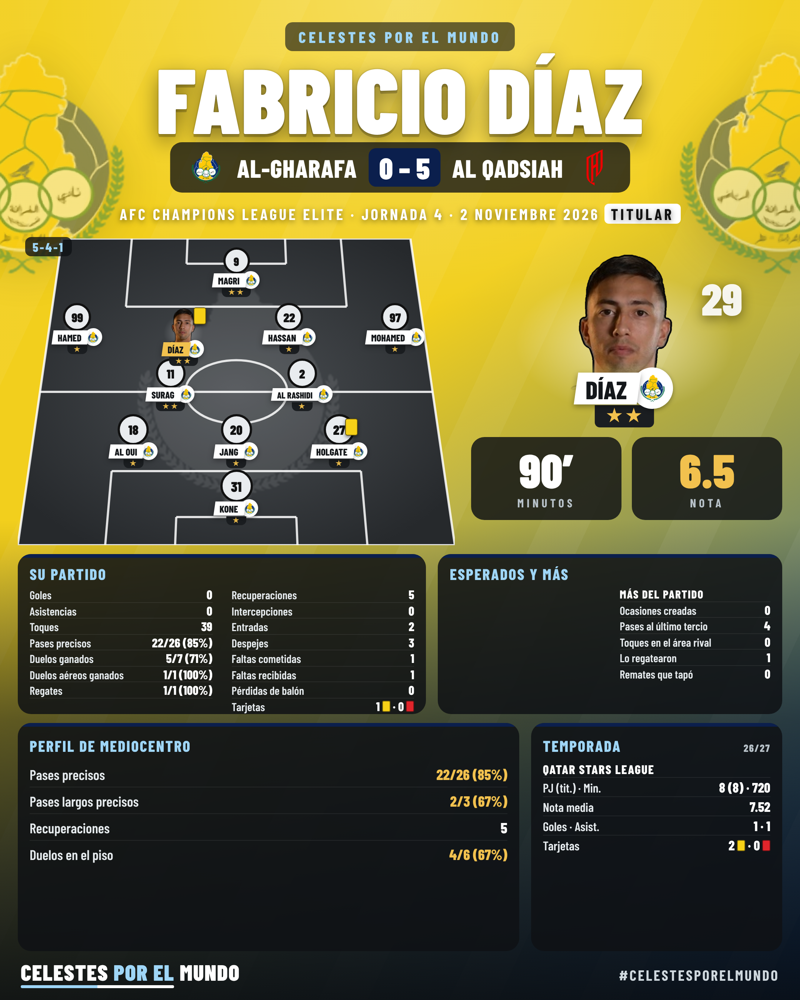
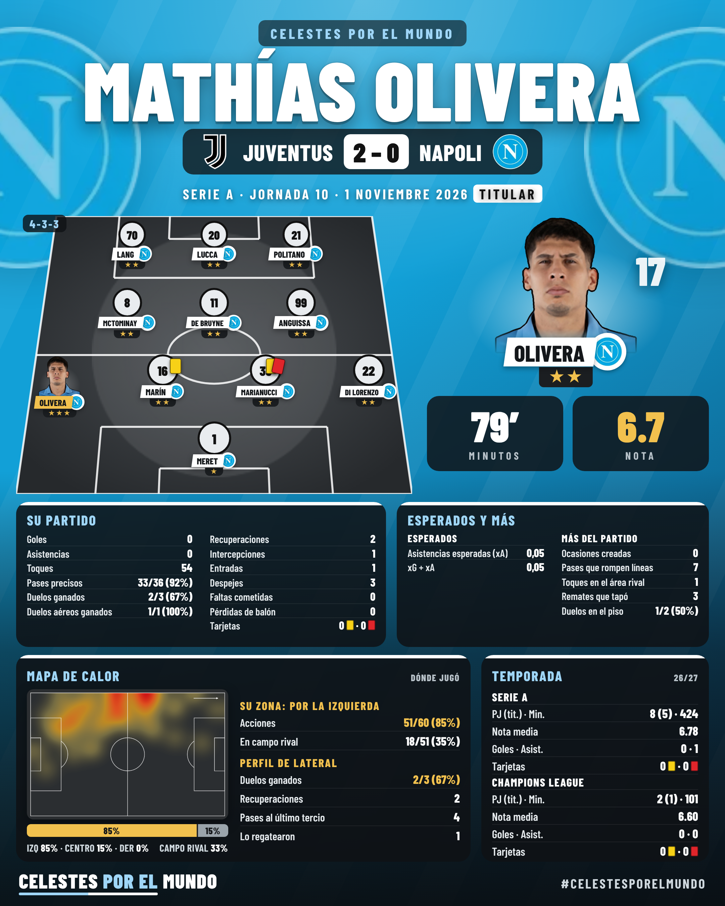

F. Díaz jugó 90' (titular, nota 6.5) en Al-Gharafa 0-5 Al Qadsiah; Olivera jugó 79' (titular, nota 6.7) en Juventus 2-0 Napoli; infografías listas

@tuscxm

## Quién jugó
- **F. Díaz** jugó 90' (titular, nota 6.5, de mediocentro) en Al-Gharafa 0-5 Al Qadsiah · AFC Champions League Elite
- **Olivera** jugó 79' (titular, nota 6.7, de lateral izquierdo) en Juventus 2-0 Napoli · Serie A

## El resto
- Valverde: sin partido hoy ni ayer
- Bernal: sin partido hoy ni ayer
- Mouriño: sin partido hoy ni ayer
- M. Araújo: sin partido hoy ni ayer
- Á. Rodríguez: sin partido hoy ni ayer
- González: no jugó en Racing Santander 0-3 Real Madrid (no entró)
- Cáceres: sin partido hoy ni ayer
- Petit: sin partido hoy ni ayer
- Bentancur: sin partido hoy ni ayer
- Satriano: ya procesado · Getafe 3-1 Sevilla
- Boselli: ya procesado · Getafe 3-1 Sevilla
- J. Rodríguez: ya procesado · Lazio 2-1 Cagliari
- Zalazar: sin partido hoy ni ayer
- Merentiel: ya procesado · Boca Juniors 1-0 River Plate
- Giménez: sin partido hoy ni ayer
- Amaro: sin partido hoy ni ayer
- R. Araújo: ya procesado · Liverpool 0-1 Arsenal
- J. M. Sanabria: sin partido hoy ni ayer
- Ugarte: sin partido hoy ni ayer
- Canobbio: sin partido hoy ni ayer
- Darwin: sin partido hoy ni ayer
- Torreira: sin partido hoy ni ayer
- Brizuela: sin partido hoy ni ayer
- Piquerez: ya procesado · Palmeiras 1-0 Vasco da Gama
- Matturro: sin partido hoy ni ayer

## Avisos
- F. Díaz: SofaScore no respondió; fuentes: fotmob ok, besoccer ok, api_football sin datos: el plan gratis de API-Football no cubre esta temporada (plan: Free plans do not have access to this season, try from 2022 to 2024.), thesportsdb sin datos: no se encontró el equipo, understat sin datos: sin understat_equipo (Understat no cubre esa liga), zerozero error HTTP 403
- F. Díaz: Sin remates en el respaldo: TOTALES va sin lo de ataque
- F. Díaz: No hay mapa de calor de este partido en el respaldo: se muestra el perfil
- F. Díaz: Armada con datos de respaldo (FotMob): hay menos estadísticas que de costumbre, revisala antes de publicar
- Olivera: SofaScore no respondió; fuentes: fotmob ok, besoccer ok, api_football sin datos: el plan gratis de API-Football no cubre esta temporada (plan: Free plans do not have access to this season, try from 2022 to 2024.), thesportsdb ok, understat error: URLError: <urlopen error [Errno 104] Connection reset by peer>, zerozero error HTTP 403
- Olivera: Armada con datos de respaldo (FotMob): hay menos estadísticas que de costumbre, revisala antes de publicar

## F. Díaz · Al-Gharafa 0-5 Al Qadsiah

[Abrir la imagen en tamaño completo](https://github.com/tuscxm/celestes-por-el-mundo/blob/main/salida/png/F.%20D%C3%ADaz/2026-11-02%20%C2%B7%20Al%20Qadsiah%20%C2%B7%20Afc%20Champions%20League%20Elite/Diaz_Al-Gharafa-AlQadsiah_2026-11-02.png)

Texto para el posteo:
```
🇺🇾 FABRICIO DÍAZ · Al-Gharafa 0-5 Al Qadsiah
⏱ 90' · ⭐ 6.5

Jugó de mediocentro: 22/26 pases (85%), 5/7 duelos ganados, 5 recuperaciones y 4 pases al último tercio.

🧩 ¿Y en una Uruguay 3-5-2 con enganche?
Sería uno de los dos internos: 22/26 pases (85%), 5 recuperaciones y 5/7 duelos ganados. Es el que sostiene y hace circular para que el enganche reciba de frente.

Tres atrás, dos carrileros, dos internos, un 10 suelto y dos puntas. ¿Lo jugarías así? 👇
#CelestesPorElMundo #Uruguay #AlGharafa #352
```

## Olivera · Juventus 2-0 Napoli

[Abrir la imagen en tamaño completo](https://github.com/tuscxm/celestes-por-el-mundo/blob/main/salida/png/M.%20Olivera/2026-11-01%20%C2%B7%20Juventus%20%C2%B7%20Serie%20A/Olivera_Juventus-Napoli_2026-11-01.png)

Texto para el posteo:
```
🇺🇾 MATHÍAS OLIVERA · Juventus 2-0 Napoli
⏱ 79' · ⭐ 6.7

Jugó de lateral izquierdo: 85% de sus acciones por la izquierda, 33/36 pases (92%), 2/3 duelos ganados y 2 recuperaciones.

🧩 ¿Y en una Uruguay 3-5-2 con enganche?
Lo vemos de zaguero por izquierda en la línea de tres: 33/36 pases (92%), 2/3 duelos ganados y 1/1 por arriba. Con tres atrás, un central que sale limpio le suma un pase para encontrar al enganche y deja a los carrileros libres para pasar.

Tres atrás, dos carrileros, dos internos, un 10 suelto y dos puntas. ¿Lo jugarías así? 👇
#CelestesPorElMundo #Uruguay #Napoli #352
```

---
No se publicó nada en Instagram. Cerrá este aviso cuando la publiques o la descartes.

## Revisión visual
- BeSoccer (fuente diaria): la página de partidos no cargó los datos ("A required part of this site couldn't load"); besoccer_hoy.json quedó vacío.
- Fuentes con error: SofaScore no respondió (las dos salieron con el respaldo de FotMob); API-Football: el plan gratis no cubre la temporada; zerozero HTTP 403; Understat: conexión cortada (Olivera); TheSportsDB no encontró a Al-Gharafa.
- F. Díaz: TEMPORADA muestra solo la Qatar Stars League; falta la AFC Champions League Elite (la copa del partido que se muestra).
- F. Díaz: sin mapa de calor del partido, la fila de abajo muestra el PERFIL DE MEDIOCENTRO en lugar del mapa / barra / SU ZONA; la columna ESPERADOS quedó vacía (no hay xG ni xA en el respaldo), deja un hueco a la izquierda de ESPERADOS Y MÁS.
- Olivera: en la cancha, las tarjetas de Marianucci (amarilla y roja) tapan parte de su dorsal ("3?").
- Caras y contornos bien, escudos bien (también detrás de la cancha), números iguales entre infografía y texto, sin nombres de fuentes. Ninguno de los dos partidos tuvo penales.
