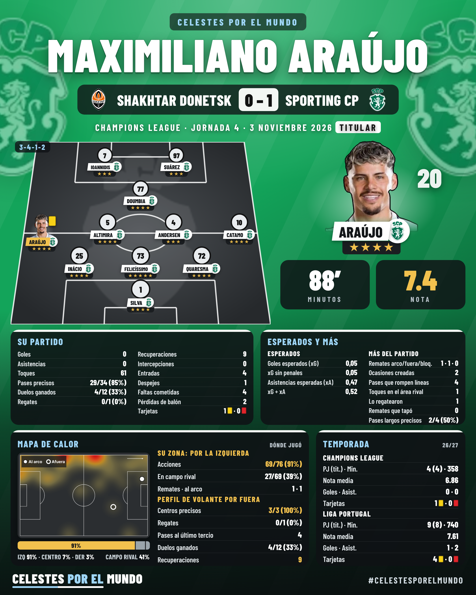
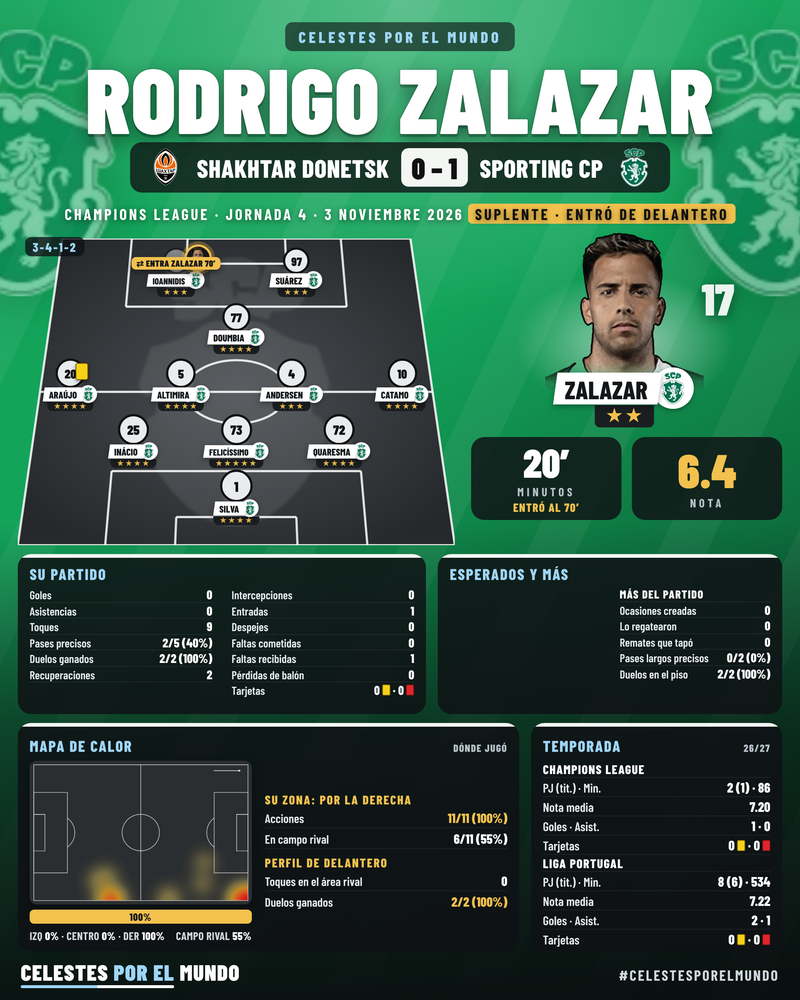
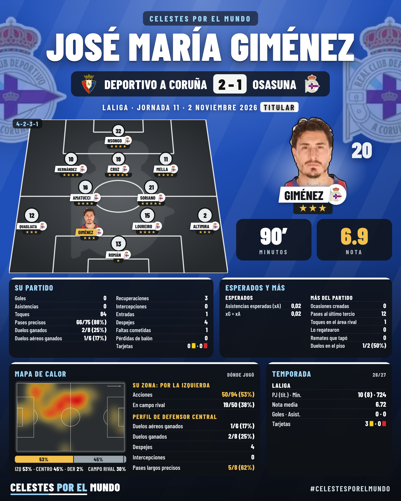
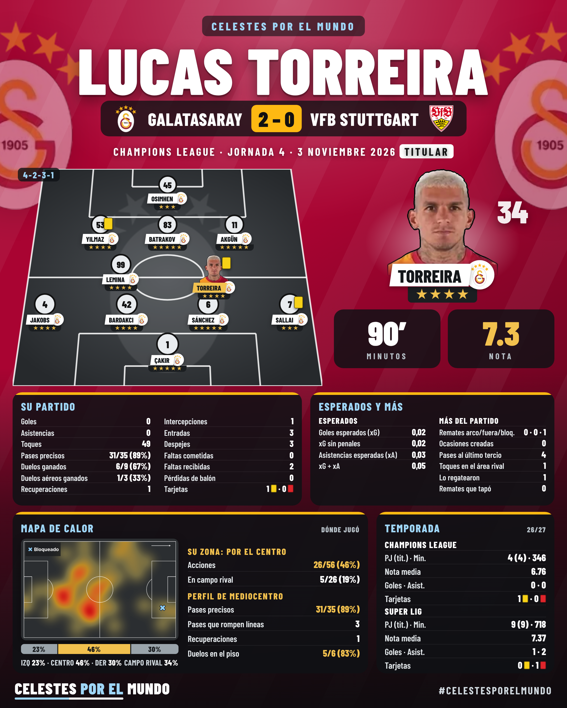

M. Araújo jugó 88' (titular, nota 7.4) en Shakhtar Donetsk 0-1 Sporting CP; Zalazar jugó 20' (suplente, nota 6.4) en Shakhtar Donetsk 0-1 Sporting CP; Giménez jugó 90' (titular, nota 6.9) en Deportivo A Coruña 2-1 Osasuna; Torreira jugó 90' (titular,

@tuscxm

## Quién jugó
- **M. Araújo** jugó 88' (titular, nota 7.4, de volante por izquierda) en Shakhtar Donetsk 0-1 Sporting CP · Champions League
- **Zalazar** jugó 20' (suplente, entró al 70' por Ioannidis, nota 6.4, de delantero) en Shakhtar Donetsk 0-1 Sporting CP · Champions League
- **Giménez** jugó 90' (titular, nota 6.9, de defensor central) en Deportivo A Coruña 2-1 Osasuna · LaLiga
- **Torreira** jugó 90' (titular, nota 7.3, de mediocentro) en Galatasaray 2-0 VfB Stuttgart · Champions League

## El resto
- Valverde: sin partido hoy ni ayer
- Bernal: sin partido hoy ni ayer
- Mouriño: sin partido hoy ni ayer
- Á. Rodríguez: sin partido hoy ni ayer
- González: sin partido hoy ni ayer
- Cáceres: sin partido hoy ni ayer
- Petit: sin partido hoy ni ayer
- Bentancur: sin partido hoy ni ayer
- Satriano: sin partido hoy ni ayer
- Boselli: sin partido hoy ni ayer
- J. Rodríguez: sin partido hoy ni ayer
- Merentiel: sin partido hoy ni ayer
- Amaro: sin partido hoy ni ayer
- R. Araújo: sin partido hoy ni ayer
- J. M. Sanabria: sin partido hoy ni ayer
- Ugarte: sin partido hoy ni ayer
- Canobbio: sin partido hoy ni ayer
- Darwin: sin partido hoy ni ayer
- F. Díaz: ya procesado · Al-Gharafa 0-5 Al Qadsiah
- Brizuela: sin partido hoy ni ayer
- Piquerez: sin partido hoy ni ayer
- Matturro: sin partido hoy ni ayer
- Olivera: sin partido hoy ni ayer

## Avisos
- M. Araújo: SofaScore no respondió; fuentes: fotmob ok, besoccer ok, api_football sin datos: el plan gratis de API-Football no cubre esta temporada (plan: Free plans do not have access to this season, try from 2022 to 2024.), thesportsdb ok, understat sin datos: sin understat_equipo (Understat no cubre esa liga), zerozero error HTTP 403
- M. Araújo: Armada con datos de respaldo (FotMob): hay menos estadísticas que de costumbre, revisala antes de publicar
- Zalazar: SofaScore no respondió; fuentes: fotmob ok, besoccer ok, api_football sin datos: el plan gratis de API-Football no cubre esta temporada (plan: Free plans do not have access to this season, try from 2022 to 2024.), thesportsdb ok, understat sin datos: sin understat_equipo (Understat no cubre esa liga), zerozero error HTTP 403
- Zalazar: Entró de suplente: el puesto (delantero) es su puesto habitual, no se sabe dónde entró
- Zalazar: Armada con datos de respaldo (FotMob): hay menos estadísticas que de costumbre, revisala antes de publicar
- Giménez: SofaScore no respondió; fuentes: fotmob ok, besoccer ok, api_football sin datos: el plan gratis de API-Football no cubre esta temporada (plan: Free plans do not have access to this season, try from 2022 to 2024.), thesportsdb ok, understat sin datos: sin understat_equipo (Understat no cubre esa liga), zerozero error HTTP 403
- Giménez: Armada con datos de respaldo (FotMob): hay menos estadísticas que de costumbre, revisala antes de publicar
- Torreira: SofaScore no respondió; fuentes: fotmob ok, besoccer ok, api_football sin datos: el plan gratis de API-Football no cubre esta temporada (plan: Free plans do not have access to this season, try from 2022 to 2024.), thesportsdb ok, understat sin datos: sin understat_equipo (Understat no cubre esa liga), zerozero error HTTP 403
- Torreira: Armada con datos de respaldo (FotMob): hay menos estadísticas que de costumbre, revisala antes de publicar

## M. Araújo · Shakhtar Donetsk 0-1 Sporting CP

[Abrir la imagen en tamaño completo](https://github.com/tuscxm/celestes-por-el-mundo/blob/main/salida/png/M.%20Ara%C3%BAjo/2026-11-03%20%C2%B7%20Shakhtar%20Donetsk%20%C2%B7%20Champions%20League/Araujo_ShakhtarDonetsk-SportingCP_2026-11-03.png)

Texto para el posteo:
```
🇺🇾 MAXIMILIANO ARAÚJO · Shakhtar Donetsk 0-1 Sporting CP
⏱ 88' · ⭐ 7.4

Jugó de volante por izquierda: 29/34 pases (85%), 9 recuperaciones, 4 pases al último tercio y 2 ocasiones creadas.

🧩 ¿Y en una Uruguay 3-5-2 con enganche?
Sería carrilero por izquierda: 91% de sus acciones por la izquierda, 4 pases al último tercio y 3/3 centros precisos. En el 3-5-2 toda la banda es suya, y con tres centrales atrás puede pasar sin dejar la espalda sola.

Tres atrás, dos carrileros, dos internos, un 10 suelto y dos puntas. ¿Lo jugarías así? 👇
#CelestesPorElMundo #Uruguay #SportingCP #352
```

## Zalazar · Shakhtar Donetsk 0-1 Sporting CP

[Abrir la imagen en tamaño completo](https://github.com/tuscxm/celestes-por-el-mundo/blob/main/salida/png/R.%20Zalazar/2026-11-03%20%C2%B7%20Shakhtar%20Donetsk%20%C2%B7%20Champions%20League/Zalazar_ShakhtarDonetsk-SportingCP_2026-11-03.png)

Texto para el posteo:
```
🇺🇾 RODRIGO ZALAZAR · Shakhtar Donetsk 0-1 Sporting CP
⏱ 20' · ⭐ 6.4
🔁 Entró al 70' por Ioannidis, como delantero

Jugó de delantero: 100% de sus acciones por la derecha, 2/2 duelos ganados y 2 recuperaciones.
#CelestesPorElMundo #Uruguay #SportingCP #352
```

## Giménez · Deportivo A Coruña 2-1 Osasuna

[Abrir la imagen en tamaño completo](https://github.com/tuscxm/celestes-por-el-mundo/blob/main/salida/png/J.%20M.%20Gim%C3%A9nez/2026-11-02%20%C2%B7%20Deportivo%20A%20Coru%C3%B1a%20%C2%B7%20LaLiga/Gimenez_DeportivoACoruna-Osasuna_2026-11-02.png)

Texto para el posteo:
```
🇺🇾 JOSÉ MARÍA GIMÉNEZ · Deportivo A Coruña 2-1 Osasuna
⏱ 90' · ⭐ 6.9

Jugó de defensor central: 53% de sus acciones por la izquierda, 66/75 pases (88%), 3 recuperaciones y 12 pases al último tercio.

🧩 ¿Y en una Uruguay 3-5-2 con enganche?
Lo vemos de zaguero por izquierda en la línea de tres: 66/75 pases (88%), 5/8 pases largos y 3 recuperaciones. Con tres atrás, un central que sale limpio le suma un pase para encontrar al enganche y deja a los carrileros libres para pasar.

Tres atrás, dos carrileros, dos internos, un 10 suelto y dos puntas. ¿Lo jugarías así? 👇
#CelestesPorElMundo #Uruguay #DeportivodeLaCoruña #352
```

## Torreira · Galatasaray 2-0 VfB Stuttgart

[Abrir la imagen en tamaño completo](https://github.com/tuscxm/celestes-por-el-mundo/blob/main/salida/png/L.%20Torreira/2026-11-03%20%C2%B7%20VfB%20Stuttgart%20%C2%B7%20Champions%20League/Torreira_Galatasaray-VfBStuttgart_2026-11-03.png)

Texto para el posteo:
```
🇺🇾 LUCAS TORREIRA · Galatasaray 2-0 VfB Stuttgart
⏱ 90' · ⭐ 7.3

Jugó de mediocentro: 46% de sus acciones por el centro, 31/35 pases (89%), 6/9 duelos ganados y 1 recuperación.

🧩 ¿Y en una Uruguay 3-5-2 con enganche?
Sería uno de los dos internos: 31/35 pases (89%), 3 pases que rompieron líneas y 1 recuperación. Es el que sostiene y hace circular para que el enganche reciba de frente.

Tres atrás, dos carrileros, dos internos, un 10 suelto y dos puntas. ¿Lo jugarías así? 👇
#CelestesPorElMundo #Uruguay #Galatasaray #352
```

---
No se publicó nada en Instagram. Cerrá este aviso cuando la publiques o la descartes.
## Revisión visual
- Giménez (Deportivo A Coruña 2-1 Osasuna): los escudos del marcador están cambiados: al lado de DEPORTIVO A CORUÑA aparece el de Osasuna y al lado de OSASUNA el del Deportivo. Además, la foto grande y la cara en la cancha lo muestran con una camiseta roja y azul que no es la del Deportivo. Corregir antes de publicar.
- Zalazar (Shakhtar 0-1 Sporting): el cartel "⇄ ENTRA ZALAZAR 70'" tapa casi toda su cara en la cancha. ESPERADOS Y MÁS sale sin la columna ESPERADOS (no hubo xG/xA en sus 20') y el PERFIL DE DELANTERO tiene solo 2 renglones. El texto del posteo no trae la parte "🧩 ¿Y en una Uruguay 3-5-2 con enganche?" ni la pregunta de cierre (solo #352).
- M. Araújo y Torreira: sin problemas a la vista (caras con contorno, escudos bien, tarjetas amarillas en la cancha, SU PARTIDO y TEMPORADA; remates del mapa coinciden con ESPERADOS Y MÁS; los números coinciden con el posteo).
- Las cuatro salieron con la parte de abajo por puesto (ninguna con el diseño anterior). Ninguna menciona fuentes. No hubo tandas de penales.
- Matturro figura "sin partido" aunque el Shakhtar jugó (0-1 con Sporting por Champions): probablemente no estuvo en la lista; revisar.
- Fuentes: SofaScore no respondió (respaldo con FotMob en todos); BeSoccer no cargó ("A required part of this site couldn't load"), se dejó besoccer_hoy.json vacío; API-Football: el plan gratis no cubre la temporada; zerozero: error HTTP 403; Understat no cubre esas ligas.
