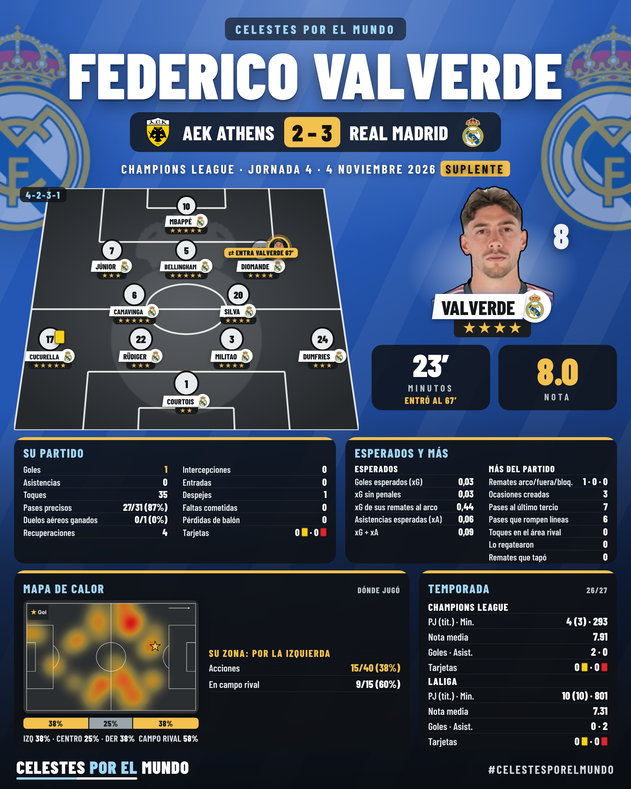
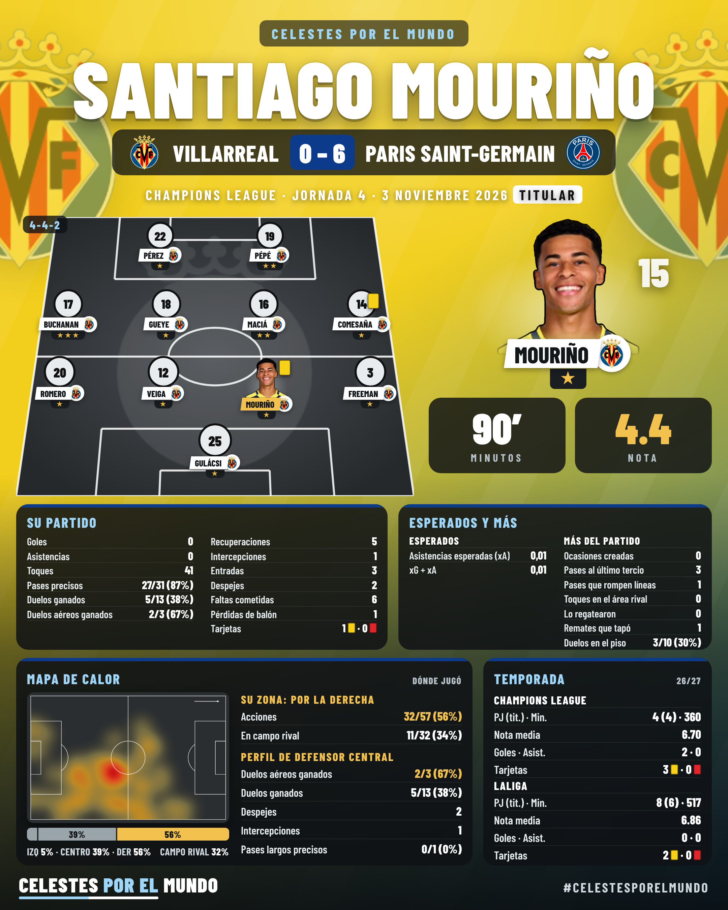

Valverde jugó 23' (suplente, nota 8.0) en AEK Athens 2-3 Real Madrid; Mouriño jugó 90' (titular, nota 4.4) en Villarreal 0-6 Paris Saint-Germain; infografías listas

@tuscxm

## Quién jugó
- **Valverde** jugó 23' (suplente, entró al 67' por Diomande, nota 8.0, su juego) en AEK Athens 2-3 Real Madrid · Champions League
- **Mouriño** jugó 90' (titular, nota 4.4, de defensor central) en Villarreal 0-6 Paris Saint-Germain · Champions League

## El resto
- Bernal: sin partido hoy ni ayer
- M. Araújo: ya procesado · Shakhtar Donetsk 0-1 Sporting CP
- Á. Rodríguez: sin partido hoy ni ayer
- González: sin partido hoy ni ayer
- Cáceres: sin partido hoy ni ayer
- Petit: sin partido hoy ni ayer
- Bentancur: sin partido hoy ni ayer
- Satriano: sin partido hoy ni ayer
- Boselli: sin partido hoy ni ayer
- J. Rodríguez: sin partido hoy ni ayer
- Zalazar: ya procesado · Shakhtar Donetsk 0-1 Sporting CP
- Merentiel: sin partido hoy ni ayer
- Giménez: sin partido hoy ni ayer
- Amaro: sin partido hoy ni ayer
- R. Araújo: no jugó en Fenerbahçe 3-2 Liverpool (no entró)
- J. M. Sanabria: sin partido hoy ni ayer
- Ugarte: sin partido hoy ni ayer
- Canobbio: sin partido hoy ni ayer
- Darwin: sin partido hoy ni ayer
- F. Díaz: sin partido hoy ni ayer
- Torreira: ya procesado · Galatasaray 2-0 VfB Stuttgart
- Brizuela: sin partido hoy ni ayer
- Piquerez: sin partido hoy ni ayer
- Matturro: sin partido hoy ni ayer
- Olivera: sin partido hoy ni ayer

## Avisos
- Valverde: SofaScore no respondió; fuentes: fotmob ok, besoccer ok, api_football sin datos: el plan gratis de API-Football no cubre esta temporada (plan: Free plans do not have access to this season, try from 2022 to 2024.), thesportsdb ok, understat sin datos: formato de página no reconocido, zerozero error HTTP 403
- Valverde: No se pudo saber el puesto en el que jugó
- Valverde: Armada con datos de respaldo (FotMob): hay menos estadísticas que de costumbre, revisala antes de publicar
- Mouriño: SofaScore no respondió; fuentes: fotmob ok, besoccer ok, api_football sin datos: el plan gratis de API-Football no cubre esta temporada (plan: Free plans do not have access to this season, try from 2022 to 2024.), thesportsdb ok, understat sin datos: formato de página no reconocido, zerozero error HTTP 403
- Mouriño: Armada con datos de respaldo (FotMob): hay menos estadísticas que de costumbre, revisala antes de publicar

## Valverde · AEK Athens 2-3 Real Madrid

[Abrir la imagen en tamaño completo](https://github.com/tuscxm/celestes-por-el-mundo/blob/main/salida/png/F.%20Valverde/2026-11-04%20%C2%B7%20AEK%20Athens%20%C2%B7%20Champions%20League/Valverde_AEKAthens-RealMadrid_2026-11-04.png)

Texto para el posteo:
```
🇺🇾 FEDERICO VALVERDE · AEK Athens 2-3 Real Madrid
⏱ 23' · ⭐ 8.0
🔁 Entró al 67' por Diomande

Jugó de titular: 1 gol, 27/31 pases (87%), 4 recuperaciones y 7 pases al último tercio.

🧩 ¿Y en una Uruguay 3-5-2 con enganche?
Sería carrilero por izquierda: 38% de sus acciones por la izquierda, 58% en campo rival y 7 pases al último tercio. En el 3-5-2 toda la banda es suya, y con tres centrales atrás puede pasar sin dejar la espalda sola.

Tres atrás, dos carrileros, dos internos, un 10 suelto y dos puntas. ¿Lo jugarías así? 👇
#CelestesPorElMundo #Uruguay #RealMadrid #352
```

## Mouriño · Villarreal 0-6 Paris Saint-Germain

[Abrir la imagen en tamaño completo](https://github.com/tuscxm/celestes-por-el-mundo/blob/main/salida/png/S.%20Mouri%C3%B1o/2026-11-03%20%C2%B7%20Paris%20Saint-Germain%20%C2%B7%20Champions%20League/Mourino_Villarreal-ParisSaint-Germain_2026-11-03.png)

Texto para el posteo:
```
🇺🇾 SANTIAGO MOURIÑO · Villarreal 0-6 Paris Saint-Germain
⏱ 90' · ⭐ 4.4

Jugó de defensor central: 56% de sus acciones por la derecha, 27/31 pases (87%), 5 recuperaciones y 3 pases al último tercio.

🧩 ¿Y en una Uruguay 3-5-2 con enganche?
Lo vemos de zaguero por derecha en la línea de tres: 27/31 pases (87%), 2/3 por arriba y 1 intercepción. Con tres atrás, un central que sale limpio le suma un pase para encontrar al enganche y deja a los carrileros libres para pasar.

Tres atrás, dos carrileros, dos internos, un 10 suelto y dos puntas. ¿Lo jugarías así? 👇
#CelestesPorElMundo #Uruguay #Villarreal #352
```

---
No se publicó nada en Instagram. Cerrá este aviso cuando la publiques o la descartes.
## Revisión visual
- Fuentes con error: SofaScore no respondió (ambas armadas con el respaldo FotMob); API-Football: el plan gratis no cubre la temporada; Understat: formato de página no reconocido; zerozero: HTTP 403; BeSoccer no cargó por WebFetch ("A required part of this site couldn't load"), así que besoccer_hoy.json quedó vacío.
- Valverde: el texto del posteo dice "Jugó de titular" pero entró de suplente al 67' (la infografía dice bien SUPLENTE). Corregir antes de publicar.
- Valverde: el texto dice "Sería carrilero por izquierda", pero su rol en el 3-5-2 de la cuenta es carrilero por derecha; además izquierda y derecha empatan en 38% (la barra marca las dos en dorado y SU ZONA eligió "por la izquierda").
- Valverde: no hay PERFIL del puesto (aviso: no se pudo saber el puesto en el que jugó); queda un hueco en esa tarjeta.
- Mouriño: sin problemas visuales; cara, escudos, amarilla en cancha y en SU PARTIDO/TEMPORADA, perfil de defensor central correctos. Números coinciden con el posteo.
