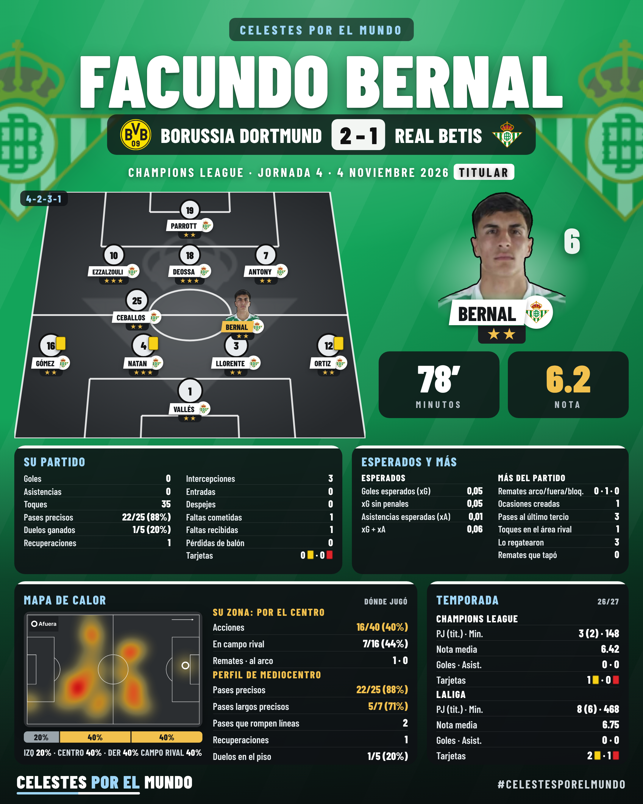
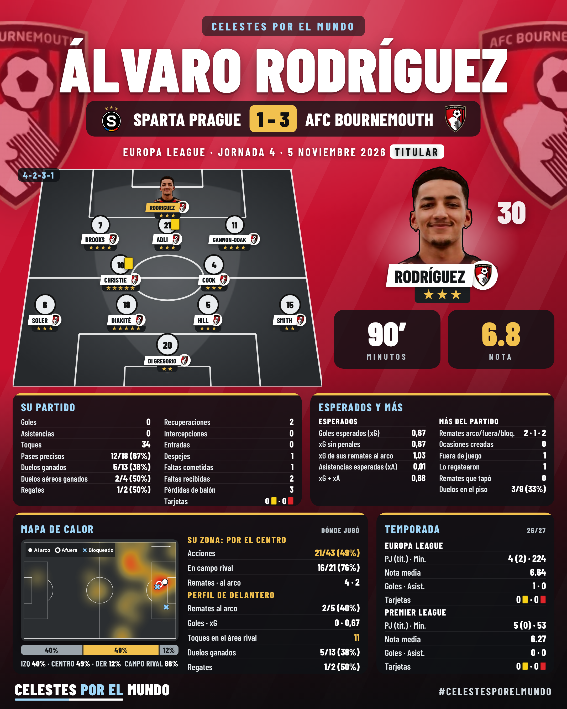

Bernal jugó 78' (titular, nota 6.2) en Borussia Dortmund 2-1 Real Betis; Á. Rodríguez jugó 90' (titular, nota 6.8) en Sparta Prague 1-3 AFC Bournemouth; infografías listas

@tuscxm

## Quién jugó
- **Bernal** jugó 78' (titular, nota 6.2, de mediocentro) en Borussia Dortmund 2-1 Real Betis · Champions League
- **Á. Rodríguez** jugó 90' (titular, nota 6.8, de delantero) en Sparta Prague 1-3 AFC Bournemouth · Europa League

## El resto
- Valverde: ya procesado · AEK Athens 2-3 Real Madrid
- Mouriño: sin partido hoy ni ayer
- M. Araújo: sin partido hoy ni ayer
- González: sin partido hoy ni ayer
- Cáceres: sin partido hoy ni ayer
- Petit: sin partido hoy ni ayer
- Bentancur: sin partido hoy ni ayer
- Satriano: sin partido hoy ni ayer
- Boselli: sin partido hoy ni ayer
- J. Rodríguez: sin partido hoy ni ayer
- Zalazar: sin partido hoy ni ayer
- Merentiel: sin partido hoy ni ayer
- Giménez: sin partido hoy ni ayer
- Amaro: sin partido hoy ni ayer
- R. Araújo: no jugó en Fenerbahçe 3-2 Liverpool (no entró)
- J. M. Sanabria: sin partido hoy ni ayer
- Ugarte: sin partido hoy ni ayer
- Canobbio: sin partido hoy ni ayer
- Darwin: sin partido hoy ni ayer
- F. Díaz: sin partido hoy ni ayer
- Torreira: sin partido hoy ni ayer
- Brizuela: sin partido hoy ni ayer
- Piquerez: sin partido hoy ni ayer
- Matturro: sin partido hoy ni ayer
- Olivera: sin partido hoy ni ayer

## Avisos
- Bernal: SofaScore no respondió; fuentes: fotmob ok, besoccer ok, api_football sin datos: el plan gratis de API-Football no cubre esta temporada (plan: Free plans do not have access to this season, try from 2022 to 2024.), thesportsdb ok, understat sin datos: formato de página no reconocido, zerozero error HTTP 403
- Bernal: Armada con datos de respaldo (FotMob): hay menos estadísticas que de costumbre, revisala antes de publicar
- Á. Rodríguez: SofaScore no respondió; fuentes: fotmob ok, besoccer ok, api_football sin datos: el plan gratis de API-Football no cubre esta temporada (plan: Free plans do not have access to this season, try from 2022 to 2024.), thesportsdb ok, understat sin datos: formato de página no reconocido, zerozero error HTTP 403
- Á. Rodríguez: Armada con datos de respaldo (FotMob): hay menos estadísticas que de costumbre, revisala antes de publicar

## Bernal · Borussia Dortmund 2-1 Real Betis

[Abrir la imagen en tamaño completo](https://github.com/tuscxm/celestes-por-el-mundo/blob/main/salida/png/F.%20Bernal/2026-11-04%20%C2%B7%20Borussia%20Dortmund%20%C2%B7%20Champions%20League/Bernal_BorussiaDortmund-RealBetis_2026-11-04.png)

Texto para el posteo:
```
🇺🇾 FACUNDO BERNAL · Borussia Dortmund 2-1 Real Betis
⏱ 78' · ⭐ 6.2

Jugó de mediocentro: 40% de sus acciones por el centro, 22/25 pases (88%), 1 recuperación y 3 pases al último tercio.

🧩 ¿Y en una Uruguay 3-5-2 con enganche?
Sería uno de los dos internos: 22/25 pases (88%), 2 pases que rompieron líneas y 1 recuperación. Es el que sostiene y hace circular para que el enganche reciba de frente.

Tres atrás, dos carrileros, dos internos, un 10 suelto y dos puntas. ¿Lo jugarías así? 👇
#CelestesPorElMundo #Uruguay #RealBetis #352
```

## Á. Rodríguez · Sparta Prague 1-3 AFC Bournemouth

[Abrir la imagen en tamaño completo](https://github.com/tuscxm/celestes-por-el-mundo/blob/main/salida/png/%C3%81.%20Rodr%C3%ADguez/2026-11-05%20%C2%B7%20Sparta%20Prague%20%C2%B7%20Europa%20League/Rodriguez_SpartaPrague-AFCBournemouth_2026-11-05.png)

Texto para el posteo:
```
🇺🇾 ÁLVARO RODRÍGUEZ · Sparta Prague 1-3 AFC Bournemouth
⏱ 90' · ⭐ 6.8

Jugó de delantero: 49% de sus acciones por el centro, 12/18 pases (67%) y 2 recuperaciones.

🧩 ¿Y en una Uruguay 3-5-2 con enganche?
Sería uno de los dos de punta: 2 de 5 remates al arco, 11 toques en el área rival y 1/2 regates. Con un enganche que lo habilite y otro 9 al lado, deja de pelear solo contra los centrales.

Tres atrás, dos carrileros, dos internos, un 10 suelto y dos puntas. ¿Lo jugarías así? 👇
#CelestesPorElMundo #Uruguay #Bournemouth #352
```

---
No se publicó nada en Instagram. Cerrá este aviso cuando la publiques o la descartes.
## Revisión visual
- Las dos infografías salieron con la parte de abajo por puesto (respaldo FotMob, SofaScore no respondió). Caras con contorno negro y bien recortadas, escudos bien (también el de detrás de la cancha), jugador resaltado en la cancha, sin textos cortados ni encimados. Sin penales ni rojas. Números de la infografía y del posteo coinciden.
- Á. Rodríguez: en la cancha la placa dice "RODRIGUEZ" sin tilde, mientras la placa grande dice "RODRÍGUEZ".
- Bernal: en "Dónde jugó" el centro y la derecha empatan (40% y 40%); SU ZONA eligió el centro.
- Fuentes con error: SofaScore no respondió; API-Football: el plan gratis no cubre la temporada; Understat: formato de página no reconocido; zerozero: HTTP 403; BeSoccer (WebFetch): la página de partidos devolvió un error de carga ("A required part of this site couldn't load"), besoccer_hoy.json quedó vacío.
