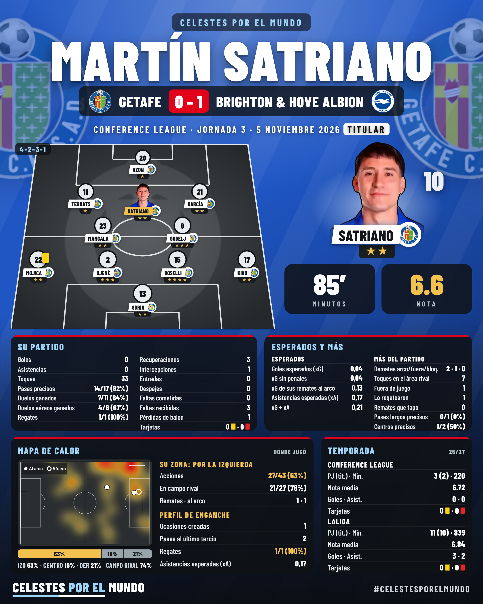
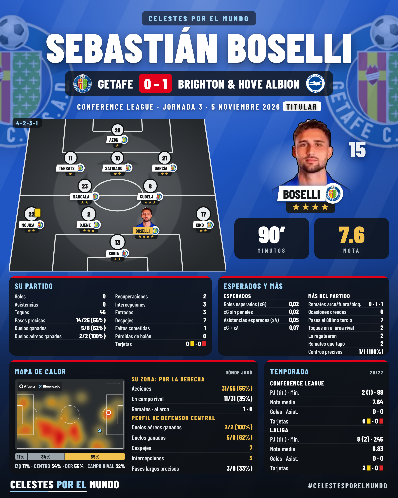

Satriano jugó 85' (titular, nota 6.6) en Getafe 0-1 Brighton & Hove Albion; Boselli jugó 90' (titular, nota 7.6) en Getafe 0-1 Brighton & Hove Albion; infografías listas

@tuscxm

## Quién jugó
- **Satriano** jugó 85' (titular, nota 6.6, de mediocentro) en Getafe 0-1 Brighton & Hove Albion · Conference League
- **Boselli** jugó 90' (titular, nota 7.6, de defensor central) en Getafe 0-1 Brighton & Hove Albion · Conference League

## El resto
- Valverde: sin partido hoy ni ayer
- Bernal: sin partido hoy ni ayer
- Mouriño: sin partido hoy ni ayer
- M. Araújo: sin partido hoy ni ayer
- Á. Rodríguez: ya procesado · Sparta Prague 1-3 AFC Bournemouth
- González: sin partido hoy ni ayer
- Cáceres: no jugó en Celta Vigo 1-2 Union St.Gilloise (no entró)
- Petit: sin partido hoy ni ayer
- Bentancur: sin partido hoy ni ayer
- J. Rodríguez: sin partido hoy ni ayer
- Zalazar: sin partido hoy ni ayer
- Merentiel: sin partido hoy ni ayer
- Giménez: sin partido hoy ni ayer
- Amaro: sin partido hoy ni ayer
- R. Araújo: sin partido hoy ni ayer
- J. M. Sanabria: sin partido hoy ni ayer
- Ugarte: sin partido hoy ni ayer
- Canobbio: sin partido hoy ni ayer
- Darwin: sin partido hoy ni ayer
- F. Díaz: sin partido hoy ni ayer
- Torreira: sin partido hoy ni ayer
- Brizuela: sin partido hoy ni ayer
- Piquerez: no jugó en Palmeiras 6-1 Remo (no entró)
- Matturro: sin partido hoy ni ayer
- Olivera: sin partido hoy ni ayer

## Avisos
- Satriano: SofaScore no respondió; fuentes: fotmob ok, besoccer ok, api_football sin datos: el plan gratis de API-Football no cubre esta temporada (plan: Free plans do not have access to this season, try from 2022 to 2024.), thesportsdb ok, understat sin datos: formato de página no reconocido, zerozero error HTTP 403
- Satriano: Armada con datos de respaldo (FotMob): hay menos estadísticas que de costumbre, revisala antes de publicar
- Boselli: SofaScore no respondió; fuentes: fotmob ok, besoccer ok, api_football sin datos: el plan gratis de API-Football no cubre esta temporada (plan: Free plans do not have access to this season, try from 2022 to 2024.), thesportsdb ok, understat sin datos: formato de página no reconocido, zerozero error HTTP 403
- Boselli: Armada con datos de respaldo (FotMob): hay menos estadísticas que de costumbre, revisala antes de publicar

## Satriano · Getafe 0-1 Brighton & Hove Albion

[Abrir la imagen en tamaño completo](https://github.com/tuscxm/celestes-por-el-mundo/blob/main/salida/png/M.%20Satriano/2026-11-05%20%C2%B7%20Brighton%20%26%20Hove%20Albion%20%C2%B7%20Conference%20League/Satriano_Getafe-Brighton%26HoveAlbion_2026-11-05.png)

Texto para el posteo:
```
🇺🇾 MARTÍN SATRIANO · Getafe 0-1 Brighton & Hove Albion
⏱ 85' · ⭐ 6.6

Jugó de enganche: 63% de sus acciones por la izquierda, 14/17 pases (82%), 7/11 duelos ganados y 3 recuperaciones.

🧩 ¿Y en una Uruguay 3-5-2 con enganche?
Sería uno de los dos de punta: 2 de 3 remates al arco, 7 toques en el área rival y 7/11 duelos ganados. Con un enganche que lo habilite y otro 9 al lado, deja de pelear solo contra los centrales.

Tres atrás, dos carrileros, dos internos, un 10 suelto y dos puntas. ¿Lo jugarías así? 👇
#CelestesPorElMundo #Uruguay #Getafe #352
```

## Boselli · Getafe 0-1 Brighton & Hove Albion

[Abrir la imagen en tamaño completo](https://github.com/tuscxm/celestes-por-el-mundo/blob/main/salida/png/S.%20Boselli/2026-11-05%20%C2%B7%20Brighton%20%26%20Hove%20Albion%20%C2%B7%20Conference%20League/Boselli_Getafe-Brighton%26HoveAlbion_2026-11-05.png)

Texto para el posteo:
```
🇺🇾 SEBASTIÁN BOSELLI · Getafe 0-1 Brighton & Hove Albion
⏱ 90' · ⭐ 7.6

Jugó de defensor central: 55% de sus acciones por la derecha, 14/25 pases (56%), 5/8 duelos ganados y 2 recuperaciones.

🧩 ¿Y en una Uruguay 3-5-2 con enganche?
Lo vemos de zaguero por derecha en la línea de tres: 14/25 pases (56%), 5/8 duelos ganados y 2/2 por arriba. Con tres atrás, un central que sale limpio le suma un pase para encontrar al enganche y deja a los carrileros libres para pasar.

Tres atrás, dos carrileros, dos internos, un 10 suelto y dos puntas. ¿Lo jugarías así? 👇
#CelestesPorElMundo #Uruguay #Getafe #352
```

---
No se publicó nada en Instagram. Cerrá este aviso cuando la publiques o la descartes.
## Revisión visual
- Satriano: el resumen del aviso dice "de mediocentro", pero la infografía (PERFIL DE ENGANCHE) y el texto del posteo dicen "Jugó de enganche" (en la cancha está en el medio de la línea de tres del 4-2-3-1, así que enganche es lo correcto). Revisar esa línea del resumen antes de usarla.
- Satriano: uno de sus 3 remates aparece en el mapa cerca de la mitad de cancha (dato de la fuente, no se cambió).
- Las dos (Satriano y Boselli) salieron con la parte de abajo por puesto, TEMPORADA con Conference League y LaLiga, caras con contorno negro y bien recortadas, escudos bien, sin tarjetas ni tanda de penales. Números de la infografía y del posteo coinciden. Ninguna nombra una fuente.
- Fuentes con error: SofaScore no respondió (se usó el respaldo FotMob); API-Football: el plan gratis no cubre la temporada 2026; zerozero HTTP 403; Understat formato de página no reconocido; BeSoccer no cargó por WebFetch ("A required part of this site couldn't load"), besoccer_hoy.json quedó vacío.
