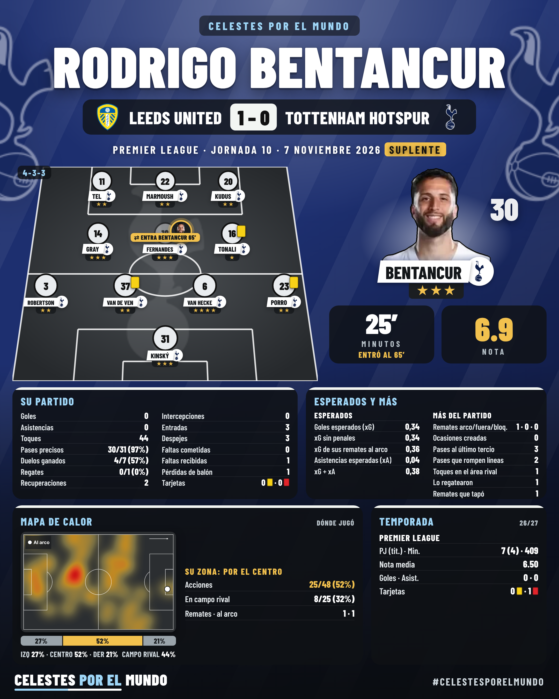
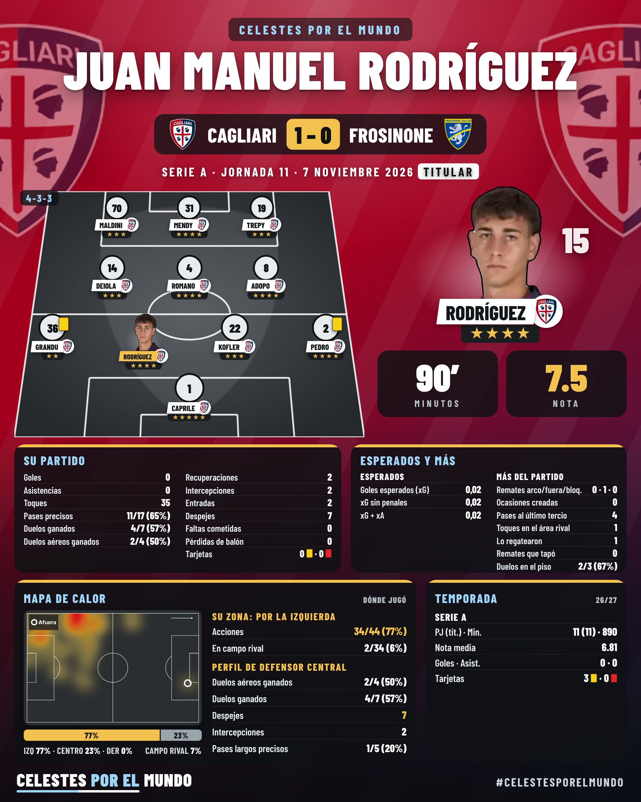
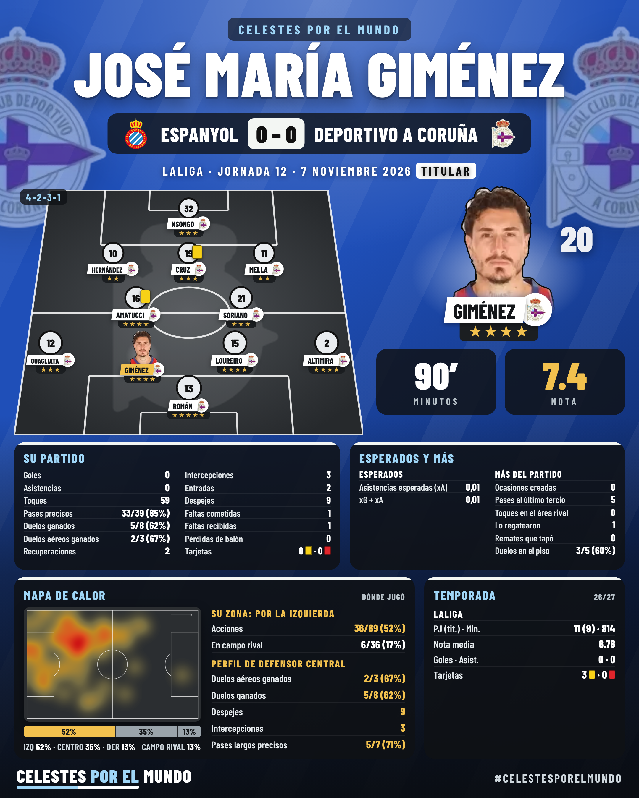
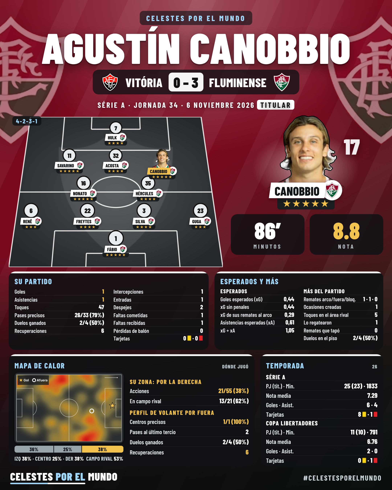
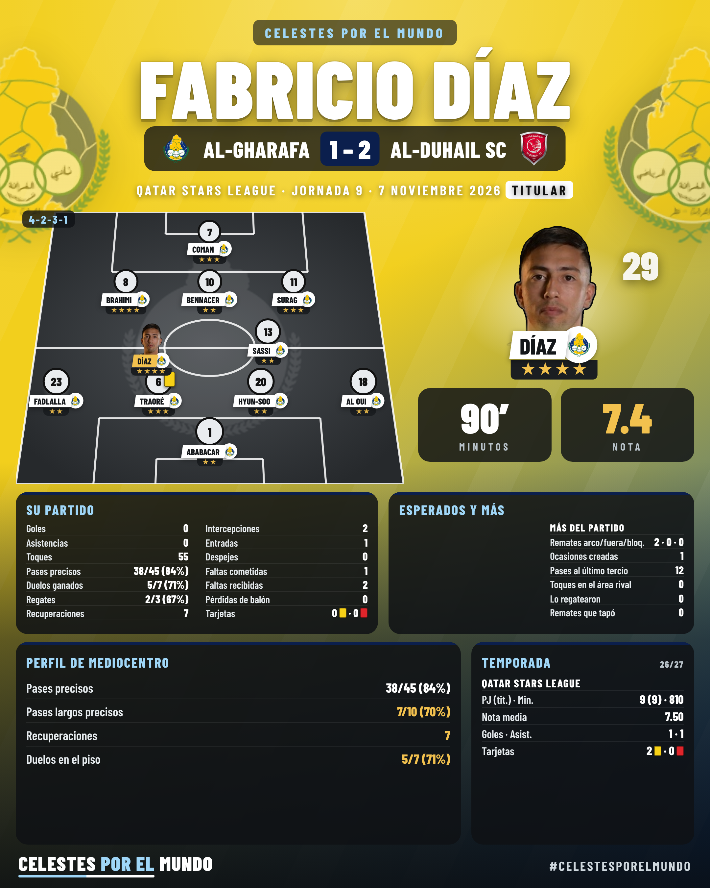
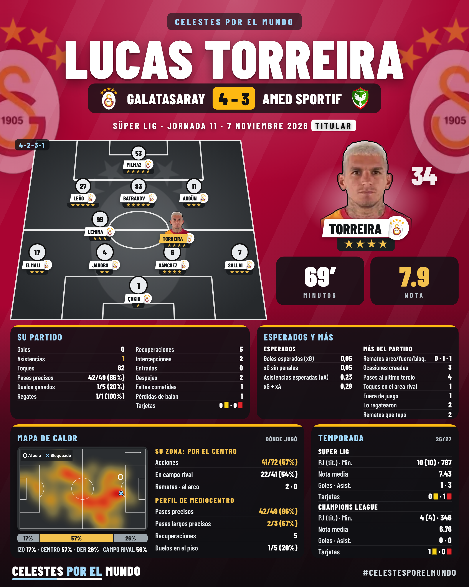

Bentancur jugó 25' (suplente, nota 6.9) en Leeds United 1-0 Tottenham Hotspur; J. Rodríguez jugó 90' (titular, nota 7.5) en Cagliari 1-0 Frosinone; Giménez jugó 90' (titular, nota 7.4) en Espanyol 0-0 Deportivo A Coruña; Canobbio jugó 86' (titular, n

@tuscxm

## Quién jugó
- **Bentancur** jugó 25' (suplente, entró al 65' por Fernandes, nota 6.9, su juego) en Leeds United 1-0 Tottenham Hotspur · Premier League
- **J. Rodríguez** jugó 90' (titular, nota 7.5, de defensor central) en Cagliari 1-0 Frosinone · Serie A
- **Giménez** jugó 90' (titular, nota 7.4, de defensor central) en Espanyol 0-0 Deportivo A Coruña · LaLiga
- **Canobbio** jugó 86' (titular, nota 8.8, de volante por derecha) en Vitória 0-3 Fluminense · Série A
- **F. Díaz** jugó 90' (titular, nota 7.4, de mediocentro) en Al-Gharafa 1-2 Al-Duhail SC · Qatar Stars League
- **Torreira** jugó 69' (titular, nota 7.9, de mediocentro) en Galatasaray 4-3 Amed Sportif · Süper Lig

## El resto
- Valverde: sin partido hoy ni ayer
- Bernal: sin partido hoy ni ayer
- Mouriño: sin partido hoy ni ayer
- M. Araújo: sin partido hoy ni ayer
- Á. Rodríguez: sin partido hoy ni ayer
- González: no jugó en Málaga 1-2 Racing Santander (no entró)
- Cáceres: sin partido hoy ni ayer
- Petit: sin partido hoy ni ayer
- Satriano: sin partido hoy ni ayer
- Boselli: sin partido hoy ni ayer
- Zalazar: sin partido hoy ni ayer
- Merentiel: sin partido hoy ni ayer
- Amaro: sin partido hoy ni ayer
- R. Araújo: sin partido hoy ni ayer
- J. M. Sanabria: sin partido hoy ni ayer
- Ugarte: sin partido hoy ni ayer
- Darwin: sin partido hoy ni ayer
- Brizuela: sin partido hoy ni ayer
- Piquerez: sin partido hoy ni ayer
- Matturro: sin partido hoy ni ayer
- Olivera: sin partido hoy ni ayer

## Avisos
- Bentancur: SofaScore no respondió; fuentes: fotmob ok, besoccer ok, api_football sin datos: el plan gratis de API-Football no cubre esta temporada (plan: Free plans do not have access to this season, try from 2022 to 2024.), thesportsdb ok, understat sin datos: formato de página no reconocido, zerozero error HTTP 403
- Bentancur: No se pudo saber el puesto en el que jugó
- Bentancur: Armada con datos de respaldo (FotMob): hay menos estadísticas que de costumbre, revisala antes de publicar
- J. Rodríguez: SofaScore no respondió; fuentes: fotmob ok, besoccer ok, api_football sin datos: el plan gratis de API-Football no cubre esta temporada (plan: Free plans do not have access to this season, try from 2022 to 2024.), thesportsdb ok, understat sin datos: formato de página no reconocido, zerozero error HTTP 403
- J. Rodríguez: Armada con datos de respaldo (FotMob): hay menos estadísticas que de costumbre, revisala antes de publicar
- Giménez: SofaScore no respondió; fuentes: fotmob ok, besoccer ok, api_football sin datos: el plan gratis de API-Football no cubre esta temporada (plan: Free plans do not have access to this season, try from 2022 to 2024.), thesportsdb ok, understat sin datos: sin understat_equipo (Understat no cubre esa liga), zerozero error HTTP 403
- Giménez: Armada con datos de respaldo (FotMob): hay menos estadísticas que de costumbre, revisala antes de publicar
- Canobbio: SofaScore no respondió; fuentes: fotmob ok, besoccer ok, api_football sin datos: el plan gratis de API-Football no cubre esta temporada (plan: Free plans do not have access to this season, try from 2022 to 2024.), thesportsdb ok, understat sin datos: sin understat_equipo (Understat no cubre esa liga), zerozero error HTTP 403
- Canobbio: Armada con datos de respaldo (FotMob): hay menos estadísticas que de costumbre, revisala antes de publicar
- F. Díaz: SofaScore no respondió; fuentes: fotmob ok, besoccer ok, api_football sin datos: el plan gratis de API-Football no cubre esta temporada (plan: Free plans do not have access to this season, try from 2022 to 2024.), thesportsdb sin datos: no se encontró el equipo, understat sin datos: sin understat_equipo (Understat no cubre esa liga), zerozero error HTTP 403
- F. Díaz: No hay mapa de calor de este partido en el respaldo: se muestra el perfil
- F. Díaz: Armada con datos de respaldo (FotMob): hay menos estadísticas que de costumbre, revisala antes de publicar
- Torreira: SofaScore no respondió; fuentes: fotmob ok, besoccer ok, api_football sin datos: el plan gratis de API-Football no cubre esta temporada (plan: Free plans do not have access to this season, try from 2022 to 2024.), thesportsdb ok, understat sin datos: sin understat_equipo (Understat no cubre esa liga), zerozero error HTTP 403
- Torreira: Armada con datos de respaldo (FotMob): hay menos estadísticas que de costumbre, revisala antes de publicar

## Bentancur · Leeds United 1-0 Tottenham Hotspur

[Abrir la imagen en tamaño completo](https://github.com/tuscxm/celestes-por-el-mundo/blob/main/salida/png/R.%20Bentancur/2026-11-07%20%C2%B7%20Leeds%20United%20%C2%B7%20Premier%20League/Bentancur_LeedsUnited-TottenhamHotspur_2026-11-07.png)

Texto para el posteo:
```
🇺🇾 RODRIGO BENTANCUR · Leeds United 1-0 Tottenham Hotspur
⏱ 25' · ⭐ 6.9
🔁 Entró al 65' por Fernandes

Jugó de titular: 52% de sus acciones por el centro, 30/31 pases (97%), 4/7 duelos ganados y 2 recuperaciones.

🧩 ¿Y en una Uruguay 3-5-2 con enganche?
Sería uno de los dos internos: 30/31 pases (97%), 2 pases que rompieron líneas y 2 recuperaciones. Es el que sostiene y hace circular para que el enganche reciba de frente.

Tres atrás, dos carrileros, dos internos, un 10 suelto y dos puntas. ¿Lo jugarías así? 👇
#CelestesPorElMundo #Uruguay #Tottenham #352
```

## J. Rodríguez · Cagliari 1-0 Frosinone

[Abrir la imagen en tamaño completo](https://github.com/tuscxm/celestes-por-el-mundo/blob/main/salida/png/J.%20M.%20Rodr%C3%ADguez/2026-11-07%20%C2%B7%20Frosinone%20%C2%B7%20Serie%20A/Rodriguez_Cagliari-Frosinone_2026-11-07.png)

Texto para el posteo:
```
🇺🇾 JUAN MANUEL RODRÍGUEZ · Cagliari 1-0 Frosinone
⏱ 90' · ⭐ 7.5

Jugó de defensor central: 77% de sus acciones por la izquierda, 11/17 pases (65%), 4/7 duelos ganados y 2 recuperaciones.

🧩 ¿Y en una Uruguay 3-5-2 con enganche?
Lo vemos de zaguero por izquierda en la línea de tres: 11/17 pases (65%), 4/7 duelos ganados y 2/4 por arriba. Con tres atrás, un central que sale limpio le suma un pase para encontrar al enganche y deja a los carrileros libres para pasar.

Tres atrás, dos carrileros, dos internos, un 10 suelto y dos puntas. ¿Lo jugarías así? 👇
#CelestesPorElMundo #Uruguay #Cagliari #352
```

## Giménez · Espanyol 0-0 Deportivo A Coruña

[Abrir la imagen en tamaño completo](https://github.com/tuscxm/celestes-por-el-mundo/blob/main/salida/png/J.%20M.%20Gim%C3%A9nez/2026-11-07%20%C2%B7%20Espanyol%20%C2%B7%20LaLiga/Gimenez_Espanyol-DeportivoACoruna_2026-11-07.png)

Texto para el posteo:
```
🇺🇾 JOSÉ MARÍA GIMÉNEZ · Espanyol 0-0 Deportivo A Coruña
⏱ 90' · ⭐ 7.4

Jugó de defensor central: 52% de sus acciones por la izquierda, 33/39 pases (85%), 5/8 duelos ganados y 2 recuperaciones.

🧩 ¿Y en una Uruguay 3-5-2 con enganche?
Lo vemos de zaguero por izquierda en la línea de tres: 33/39 pases (85%), 5/7 pases largos y 5/8 duelos ganados. Con tres atrás, un central que sale limpio le suma un pase para encontrar al enganche y deja a los carrileros libres para pasar.

Tres atrás, dos carrileros, dos internos, un 10 suelto y dos puntas. ¿Lo jugarías así? 👇
#CelestesPorElMundo #Uruguay #DeportivodeLaCoruña #352
```

## Canobbio · Vitória 0-3 Fluminense

[Abrir la imagen en tamaño completo](https://github.com/tuscxm/celestes-por-el-mundo/blob/main/salida/png/A.%20Canobbio/2026-11-06%20%C2%B7%20Vit%C3%B3ria%20%C2%B7%20S%C3%A9rie%20A/Canobbio_Vitoria-Fluminense_2026-11-06.png)

Texto para el posteo:
```
🇺🇾 AGUSTÍN CANOBBIO · Vitória 0-3 Fluminense
⏱ 86' · ⭐ 8.8

Jugó de volante por derecha: 1 gol, 26/33 pases (79%), 2/4 duelos ganados y 6 recuperaciones.

🧩 ¿Y en una Uruguay 3-5-2 con enganche?
Sería carrilero por derecha: 38% de sus acciones por la derecha, 53% en campo rival y 2 pases al último tercio. En el 3-5-2 toda la banda es suya, y con tres centrales atrás puede pasar sin dejar la espalda sola.

Tres atrás, dos carrileros, dos internos, un 10 suelto y dos puntas. ¿Lo jugarías así? 👇
#CelestesPorElMundo #Uruguay #Fluminense #352
```

## F. Díaz · Al-Gharafa 1-2 Al-Duhail SC

[Abrir la imagen en tamaño completo](https://github.com/tuscxm/celestes-por-el-mundo/blob/main/salida/png/F.%20D%C3%ADaz/2026-11-07%20%C2%B7%20Al-Duhail%20SC%20%C2%B7%20Qatar%20Stars%20League/Diaz_Al-Gharafa-Al-DuhailSC_2026-11-07.png)

Texto para el posteo:
```
🇺🇾 FABRICIO DÍAZ · Al-Gharafa 1-2 Al-Duhail SC
⏱ 90' · ⭐ 7.4

Jugó de mediocentro: 38/45 pases (84%), 5/7 duelos ganados, 7 recuperaciones y 12 pases al último tercio.

🧩 ¿Y en una Uruguay 3-5-2 con enganche?
Sería uno de los dos internos: 38/45 pases (84%), 7 recuperaciones y 5/7 duelos ganados. Es el que sostiene y hace circular para que el enganche reciba de frente.

Tres atrás, dos carrileros, dos internos, un 10 suelto y dos puntas. ¿Lo jugarías así? 👇
#CelestesPorElMundo #Uruguay #AlGharafa #352
```

## Torreira · Galatasaray 4-3 Amed Sportif

[Abrir la imagen en tamaño completo](https://github.com/tuscxm/celestes-por-el-mundo/blob/main/salida/png/L.%20Torreira/2026-11-07%20%C2%B7%20Amed%20Sportif%20%C2%B7%20S%C3%BCper%20Lig/Torreira_Galatasaray-AmedSportif_2026-11-07.png)

Texto para el posteo:
```
🇺🇾 LUCAS TORREIRA · Galatasaray 4-3 Amed Sportif
⏱ 69' · ⭐ 7.9

Jugó de mediocentro: 57% de sus acciones por el centro, 42/49 pases (86%), 5 recuperaciones y 4 pases al último tercio.

🧩 ¿Y en una Uruguay 3-5-2 con enganche?
Sería uno de los dos internos: 42/49 pases (86%), 5 recuperaciones y 2 intercepciones. Es el que sostiene y hace circular para que el enganche reciba de frente.

Tres atrás, dos carrileros, dos internos, un 10 suelto y dos puntas. ¿Lo jugarías así? 👇
#CelestesPorElMundo #Uruguay #Galatasaray #352
```

---
No se publicó nada en Instagram. Cerrá este aviso cuando la publiques o la descartes.
## Revisión visual
- Bentancur: el texto del posteo dice "Jugó de titular:" pero entró de suplente al 65' (no se pudo saber el puesto en el que jugó); hay que corregir esa línea antes de publicar. La infografía no tiene PERFIL por el mismo motivo.
- F. Díaz: no hay mapa de calor ni xG/xA, así que la columna ESPERADOS quedó vacía y en lugar del mapa va el PERFIL DE MEDIOCENTRO. En la cancha, la cara y la placa de Díaz quedan muy pegadas al círculo del 6 (Traoré) con su amarilla; conviene mirarla.
- Canobbio: la cara grande tiene restos blancos entre el pelo del lado derecho (recorte mejorable). El texto del posteo menciona el gol pero no la asistencia que figura en SU PARTIDO.
- Giménez: la foto de la cara es con una camiseta a rayas rojas y azules (no la del Deportivo).
- Resto (J. M. Rodríguez, Torreira) sin problemas: escudos, colores, tarjetas, mapas con remates y TEMPORADA (Torreira con Champions, Canobbio con Libertadores) bien; ningún texto nombra fuentes.
- Fuentes con error: SofaScore no respondió (todas armadas con el respaldo FotMob); API-Football: el plan gratis no cubre la temporada; zerozero HTTP 403; Understat formato no reconocido; TheSportsDB no encontró al Al-Gharafa; BeSoccer no cargó por WebFetch (página de error), besoccer_hoy.json quedó vacío.
