Valverde jugó 90' (titular, nota 8.2) en Valencia 0-3 Real Madrid; Mouriño jugó 64' (titular, nota 7.7) en Villarreal 2-0 Getafe; M. Araújo jugó 90' (titular, nota 7.6) en Sporting CP 1-0 Moreirense; Á. Rodríguez jugó 5' (suplente) en Ipswich Town 1-

@tuscxm

## Quién jugó
- **Valverde** jugó 90' (titular, nota 8.2, de lateral derecho) en Valencia 0-3 Real Madrid · LaLiga
- **Mouriño** jugó 64' (titular, nota 7.7, de lateral derecho) en Villarreal 2-0 Getafe · LaLiga
- **M. Araújo** jugó 90' (titular, nota 7.6, de lateral izquierdo) en Sporting CP 1-0 Moreirense · Liga Portugal
- **Á. Rodríguez** jugó 5' (suplente, entró al 85' por Evanilson, de delantero) en Ipswich Town 1-2 AFC Bournemouth · Premier League
- **Cáceres** jugó 90' (titular, nota 7.3, de defensor central) en Celta Vigo 0-0 Levante · LaLiga
- **Satriano** jugó 90' (titular, nota 6.1, de volante por izquierda) en Villarreal 2-0 Getafe · LaLiga
- **Boselli** jugó 90' (titular, nota 6.7, de defensor central) en Villarreal 2-0 Getafe · LaLiga
- **Zalazar** jugó 28' (suplente, entró al 62' por Irankunda, nota 6.7, de delantero) en Sporting CP 1-0 Moreirense · Liga Portugal
- **Merentiel** jugó 90' (titular, nota 7.2, de delantero) en Boca Juniors 1-0 Defensa y Justicia · Liga Profesional
- **Amaro** jugó 71' (titular, nota 6.8, de volante por derecha) en Union St.Gilloise 1-0 Genk · First Division A
- **R. Araújo** jugó 89' (titular, nota 7.3, de lateral derecho) en Crystal Palace 1-3 Liverpool · Premier League
- **J. M. Sanabria** jugó 90' (titular, nota 7.8, de mediocentro) en Real Salt Lake 2-1 LA Galaxy · MLS
- **Olivera** jugó 90' (titular, nota 7.1, de mediocentro) en Napoli 1-1 Lazio · Serie A

## El resto
- Bernal: sin partido hoy ni ayer
- González: no jugó en Málaga 1-2 Racing Santander (no entró)
- Petit: sin partido hoy ni ayer
- Bentancur: ya procesado · Leeds United 1-0 Tottenham Hotspur
- J. Rodríguez: ya procesado · Cagliari 1-0 Frosinone
- Giménez: ya procesado · Espanyol 0-0 Deportivo A Coruña
- Ugarte: sin partido hoy ni ayer
- Canobbio: sin partido hoy ni ayer
- Darwin: sin partido hoy ni ayer
- F. Díaz: ya procesado · Al-Gharafa 1-2 Al-Duhail SC
- Torreira: ya procesado · Galatasaray 4-3 Amed Sportif
- Brizuela: sin partido hoy ni ayer
- Piquerez: sin partido hoy ni ayer
- Matturro: no jugó en Shakhtar Donetsk 0-0 Dynamo Kyiv (no entró)

## Avisos
- Valverde: SofaScore no respondió; fuentes: fotmob ok, besoccer ok, api_football sin datos: el plan gratis de API-Football no cubre esta temporada (plan: Free plans do not have access to this season, try from 2022 to 2024.), thesportsdb ok, understat sin datos: formato de página no reconocido, zerozero error HTTP 403
- Valverde: Armada con datos de respaldo (FotMob): hay menos estadísticas que de costumbre, revisala antes de publicar
- Mouriño: SofaScore no respondió; fuentes: fotmob ok, besoccer ok, api_football sin datos: el plan gratis de API-Football no cubre esta temporada (plan: Free plans do not have access to this season, try from 2022 to 2024.), thesportsdb ok, understat sin datos: formato de página no reconocido, zerozero error HTTP 403
- Mouriño: Armada con datos de respaldo (FotMob): hay menos estadísticas que de costumbre, revisala antes de publicar
- M. Araújo: SofaScore no respondió; fuentes: fotmob ok, besoccer ok, api_football sin datos: el plan gratis de API-Football no cubre esta temporada (plan: Free plans do not have access to this season, try from 2022 to 2024.), thesportsdb ok, understat sin datos: sin understat_equipo (Understat no cubre esa liga), zerozero error HTTP 403
- M. Araújo: Armada con datos de respaldo (FotMob): hay menos estadísticas que de costumbre, revisala antes de publicar
- Á. Rodríguez: SofaScore no respondió; fuentes: fotmob ok, besoccer ok, api_football sin datos: el plan gratis de API-Football no cubre esta temporada (plan: Free plans do not have access to this season, try from 2022 to 2024.), thesportsdb ok, understat sin datos: formato de página no reconocido, zerozero error HTTP 403
- Á. Rodríguez: Entró de suplente: el puesto (delantero) es su puesto habitual, no se sabe dónde entró
- Á. Rodríguez: Armada con datos de respaldo (FotMob): hay menos estadísticas que de costumbre, revisala antes de publicar
- Cáceres: SofaScore no respondió; fuentes: fotmob ok, besoccer ok, api_football sin datos: el plan gratis de API-Football no cubre esta temporada (plan: Free plans do not have access to this season, try from 2022 to 2024.), thesportsdb ok, understat sin datos: formato de página no reconocido, zerozero error HTTP 403
- Cáceres: Armada con datos de respaldo (FotMob): hay menos estadísticas que de costumbre, revisala antes de publicar
- Satriano: SofaScore no respondió; fuentes: fotmob ok, besoccer ok, api_football sin datos: el plan gratis de API-Football no cubre esta temporada (plan: Free plans do not have access to this season, try from 2022 to 2024.), thesportsdb ok, understat sin datos: formato de página no reconocido, zerozero error HTTP 403
- Satriano: Armada con datos de respaldo (FotMob): hay menos estadísticas que de costumbre, revisala antes de publicar
- Boselli: SofaScore no respondió; fuentes: fotmob ok, besoccer ok, api_football sin datos: el plan gratis de API-Football no cubre esta temporada (plan: Free plans do not have access to this season, try from 2022 to 2024.), thesportsdb error HTTP 429, understat sin datos: formato de página no reconocido, zerozero error HTTP 403
- Boselli: Armada con datos de respaldo (FotMob): hay menos estadísticas que de costumbre, revisala antes de publicar
- Zalazar: SofaScore no respondió; fuentes: fotmob ok, besoccer ok, api_football sin datos: el plan gratis de API-Football no cubre esta temporada (plan: Free plans do not have access to this season, try from 2022 to 2024.), thesportsdb error HTTP 429, understat sin datos: sin understat_equipo (Understat no cubre esa liga), zerozero error HTTP 403
- Zalazar: Entró de suplente: el puesto (delantero) es su puesto habitual, no se sabe dónde entró
- Zalazar: Armada con datos de respaldo (FotMob): hay menos estadísticas que de costumbre, revisala antes de publicar
- Merentiel: SofaScore no respondió; fuentes: fotmob ok, besoccer ok, api_football sin datos: el plan gratis de API-Football no cubre esta temporada (plan: Free plans do not have access to this season, try from 2022 to 2024.), thesportsdb ok, understat sin datos: sin understat_equipo (Understat no cubre esa liga), zerozero error HTTP 403
- Merentiel: Armada con datos de respaldo (FotMob): hay menos estadísticas que de costumbre, revisala antes de publicar
- Amaro: SofaScore no respondió; fuentes: fotmob ok, besoccer ok, api_football sin datos: el plan gratis de API-Football no cubre esta temporada (plan: Free plans do not have access to this season, try from 2022 to 2024.), thesportsdb ok, understat sin datos: sin understat_equipo (Understat no cubre esa liga), zerozero error HTTP 403
- Amaro: Armada con datos de respaldo (FotMob): hay menos estadísticas que de costumbre, revisala antes de publicar
- R. Araújo: SofaScore no respondió; fuentes: fotmob ok, besoccer ok, api_football sin datos: el plan gratis de API-Football no cubre esta temporada (plan: Free plans do not have access to this season, try from 2022 to 2024.), thesportsdb ok, understat sin datos: formato de página no reconocido, zerozero error HTTP 403
- R. Araújo: Armada con datos de respaldo (FotMob): hay menos estadísticas que de costumbre, revisala antes de publicar
- J. M. Sanabria: SofaScore no respondió; fuentes: fotmob ok, besoccer ok, api_football sin datos: el plan gratis de API-Football no cubre esta temporada (plan: Free plans do not have access to this season, try from 2022 to 2024.), thesportsdb ok, understat sin datos: sin understat_equipo (Understat no cubre esa liga), zerozero error HTTP 403
- J. M. Sanabria: Armada con datos de respaldo (FotMob): hay menos estadísticas que de costumbre, revisala antes de publicar
- Olivera: SofaScore no respondió; fuentes: fotmob ok, besoccer ok, api_football sin datos: el plan gratis de API-Football no cubre esta temporada (plan: Free plans do not have access to this season, try from 2022 to 2024.), thesportsdb ok, understat sin datos: formato de página no reconocido, zerozero error HTTP 403
- Olivera: Armada con datos de respaldo (FotMob): hay menos estadísticas que de costumbre, revisala antes de publicar

## Valverde · Valencia 0-3 Real Madrid
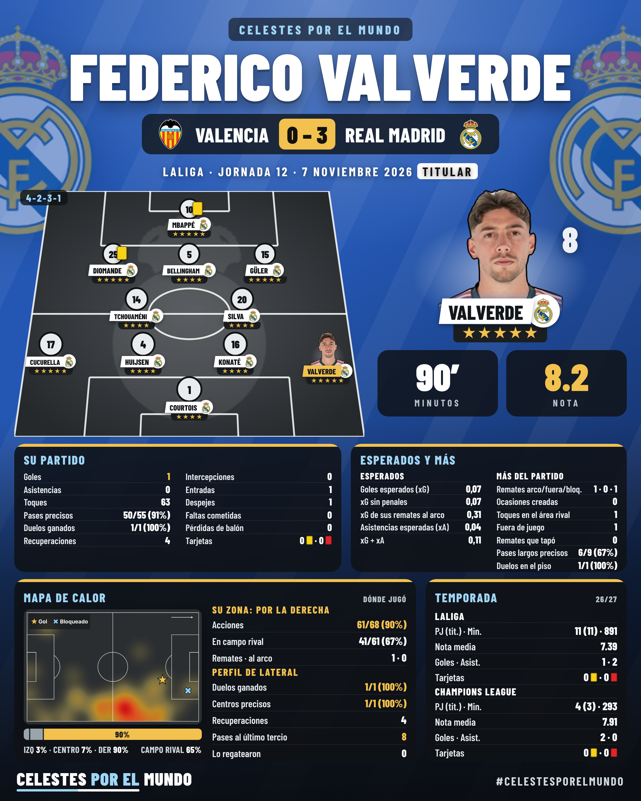
[Abrir la imagen en tamaño completo](https://github.com/tuscxm/celestes-por-el-mundo/blob/main/salida/png/F.%20Valverde/2026-11-07%20%C2%B7%20Valencia%20%C2%B7%20LaLiga/Valverde_Valencia-RealMadrid_2026-11-07.png)

Texto para el posteo:
```
🇺🇾 FEDERICO VALVERDE · Valencia 0-3 Real Madrid
⏱ 90' · ⭐ 8.2

Jugó de lateral derecho: 1 gol, 50/55 pases (91%), 1/1 duelos ganados y 4 recuperaciones.

🧩 ¿Y en una Uruguay 3-5-2 con enganche?
Sería carrilero por derecha: 90% de sus acciones por la derecha, 65% en campo rival y 8 pases al último tercio. En el 3-5-2 toda la banda es suya, y con tres centrales atrás puede pasar sin dejar la espalda sola.

Tres atrás, dos carrileros, dos internos, un 10 suelto y dos puntas. ¿Lo jugarías así? 👇
#CelestesPorElMundo #Uruguay #RealMadrid #352
```

## Mouriño · Villarreal 2-0 Getafe
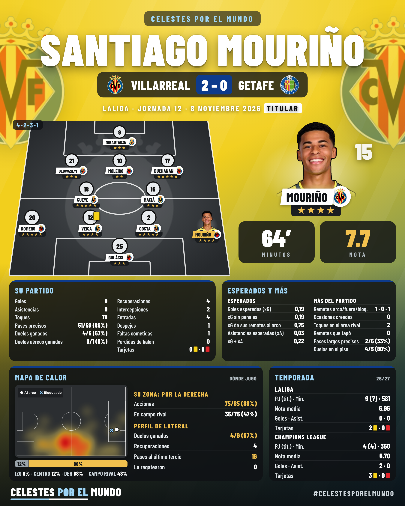
[Abrir la imagen en tamaño completo](https://github.com/tuscxm/celestes-por-el-mundo/blob/main/salida/png/S.%20Mouri%C3%B1o/2026-11-08%20%C2%B7%20Getafe%20%C2%B7%20LaLiga/Mourino_Villarreal-Getafe_2026-11-08.png)

Texto para el posteo:
```
🇺🇾 SANTIAGO MOURIÑO · Villarreal 2-0 Getafe
⏱ 64' · ⭐ 7.7

Jugó de lateral derecho: 88% de sus acciones por la derecha, 51/59 pases (86%), 4/6 duelos ganados y 4 recuperaciones.

🧩 ¿Y en una Uruguay 3-5-2 con enganche?
Lo vemos de zaguero por derecha en la línea de tres: 51/59 pases (86%), 4/6 duelos ganados y 2 intercepciones. Con tres atrás, un central que sale limpio le suma un pase para encontrar al enganche y deja a los carrileros libres para pasar.

Tres atrás, dos carrileros, dos internos, un 10 suelto y dos puntas. ¿Lo jugarías así? 👇
#CelestesPorElMundo #Uruguay #Villarreal #352
```

## M. Araújo · Sporting CP 1-0 Moreirense
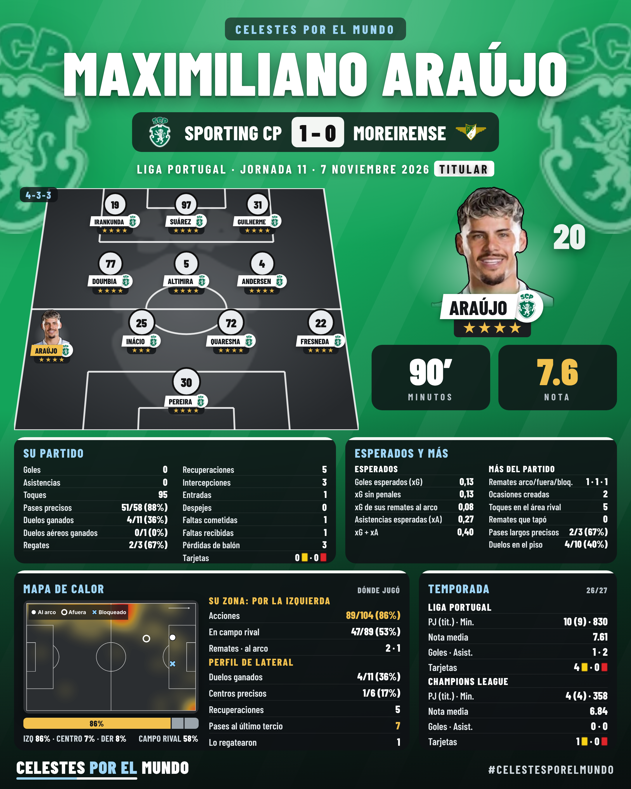
[Abrir la imagen en tamaño completo](https://github.com/tuscxm/celestes-por-el-mundo/blob/main/salida/png/M.%20Ara%C3%BAjo/2026-11-07%20%C2%B7%20Moreirense%20%C2%B7%20Liga%20Portugal/Araujo_SportingCP-Moreirense_2026-11-07.png)

Texto para el posteo:
```
🇺🇾 MAXIMILIANO ARAÚJO · Sporting CP 1-0 Moreirense
⏱ 90' · ⭐ 7.6

Jugó de lateral izquierdo: 51/58 pases (88%), 5 recuperaciones, 7 pases al último tercio y 2 ocasiones creadas.

🧩 ¿Y en una Uruguay 3-5-2 con enganche?
Sería carrilero por izquierda: 86% de sus acciones por la izquierda, 58% en campo rival y 7 pases al último tercio. En el 3-5-2 toda la banda es suya, y con tres centrales atrás puede pasar sin dejar la espalda sola.

Tres atrás, dos carrileros, dos internos, un 10 suelto y dos puntas. ¿Lo jugarías así? 👇
#CelestesPorElMundo #Uruguay #SportingCP #352
```

## Á. Rodríguez · Ipswich Town 1-2 AFC Bournemouth
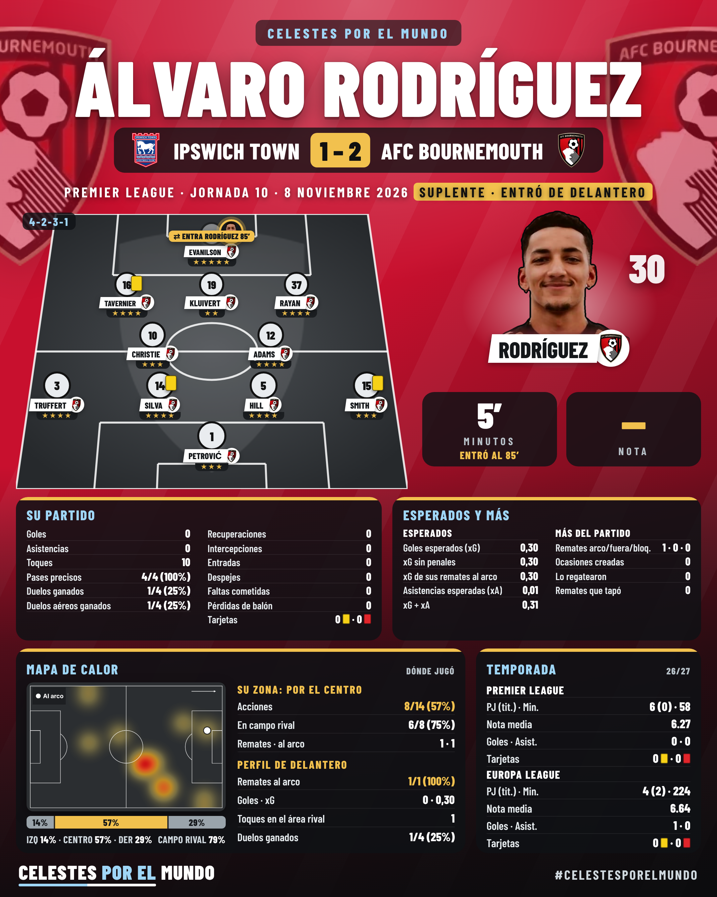
[Abrir la imagen en tamaño completo](https://github.com/tuscxm/celestes-por-el-mundo/blob/main/salida/png/%C3%81.%20Rodr%C3%ADguez/2026-11-08%20%C2%B7%20Ipswich%20Town%20%C2%B7%20Premier%20League/Rodriguez_IpswichTown-AFCBournemouth_2026-11-08.png)

Texto para el posteo:
```
🇺🇾 ÁLVARO RODRÍGUEZ · Ipswich Town 1-2 AFC Bournemouth
⏱ 5'
🔁 Entró al 85' por Evanilson, como delantero

Jugó de delantero: 57% de sus acciones por el centro.

🧩 ¿Y en una Uruguay 3-5-2 con enganche?
Sería uno de los dos de punta: 1 de 1 remates al arco y 1 toque en el área rival. Con un enganche que lo habilite y otro 9 al lado, deja de pelear solo contra los centrales.

Tres atrás, dos carrileros, dos internos, un 10 suelto y dos puntas. ¿Lo jugarías así? 👇
#CelestesPorElMundo #Uruguay #Bournemouth #352
```

## Cáceres · Celta Vigo 0-0 Levante
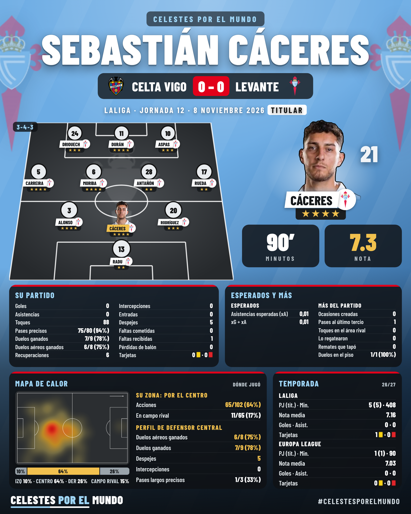
[Abrir la imagen en tamaño completo](https://github.com/tuscxm/celestes-por-el-mundo/blob/main/salida/png/S.%20C%C3%A1ceres/2026-11-08%20%C2%B7%20Celta%20Vigo%20%C2%B7%20LaLiga/Caceres_CeltaVigo-Levante_2026-11-08.png)

Texto para el posteo:
```
🇺🇾 SEBASTIÁN CÁCERES · Celta Vigo 0-0 Levante
⏱ 90' · ⭐ 7.3

Jugó de defensor central: 64% de sus acciones por el centro, 75/80 pases (94%), 7/9 duelos ganados y 6 recuperaciones.

🧩 ¿Y en una Uruguay 3-5-2 con enganche?
Lo vemos de zaguero en la línea de tres: 75/80 pases (94%), 7/9 duelos ganados y 6/8 por arriba. Con tres atrás, un central que sale limpio le suma un pase para encontrar al enganche y deja a los carrileros libres para pasar.

Tres atrás, dos carrileros, dos internos, un 10 suelto y dos puntas. ¿Lo jugarías así? 👇
#CelestesPorElMundo #Uruguay #CeltadeVigo #352
```

## Satriano · Villarreal 2-0 Getafe
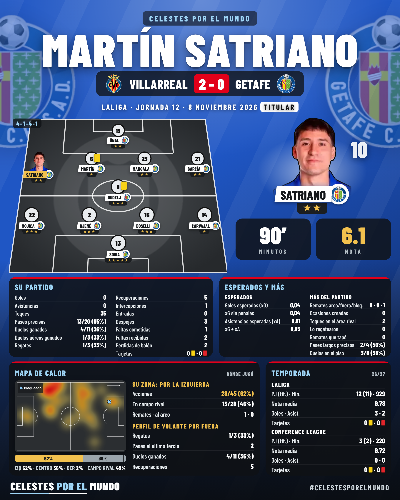
[Abrir la imagen en tamaño completo](https://github.com/tuscxm/celestes-por-el-mundo/blob/main/salida/png/M.%20Satriano/2026-11-08%20%C2%B7%20Villarreal%20%C2%B7%20LaLiga/Satriano_Villarreal-Getafe_2026-11-08.png)

Texto para el posteo:
```
🇺🇾 MARTÍN SATRIANO · Villarreal 2-0 Getafe
⏱ 90' · ⭐ 6.1

Jugó de volante por izquierda: 62% de sus acciones por la izquierda, 13/20 pases (65%), 5 recuperaciones y 2 pases al último tercio.

🧩 ¿Y en una Uruguay 3-5-2 con enganche?
Sería uno de los dos de punta: 2 toques en el área rival y 1/3 regates. Con un enganche que lo habilite y otro 9 al lado, deja de pelear solo contra los centrales.

Tres atrás, dos carrileros, dos internos, un 10 suelto y dos puntas. ¿Lo jugarías así? 👇
#CelestesPorElMundo #Uruguay #Getafe #352
```

## Boselli · Villarreal 2-0 Getafe
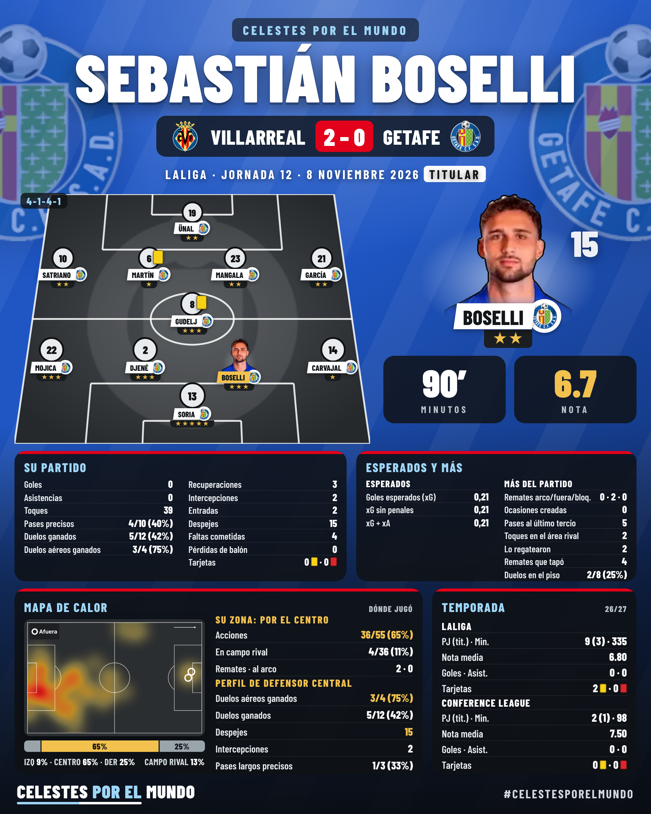
[Abrir la imagen en tamaño completo](https://github.com/tuscxm/celestes-por-el-mundo/blob/main/salida/png/S.%20Boselli/2026-11-08%20%C2%B7%20Villarreal%20%C2%B7%20LaLiga/Boselli_Villarreal-Getafe_2026-11-08.png)

Texto para el posteo:
```
🇺🇾 SEBASTIÁN BOSELLI · Villarreal 2-0 Getafe
⏱ 90' · ⭐ 6.7

Jugó de defensor central: 65% de sus acciones por el centro, 4/10 pases (40%), 3 recuperaciones y 5 pases al último tercio.

🧩 ¿Y en una Uruguay 3-5-2 con enganche?
Lo vemos de zaguero en la línea de tres: 4/10 pases (40%), 3/4 por arriba y 2 intercepciones. Con tres atrás, un central que sale limpio le suma un pase para encontrar al enganche y deja a los carrileros libres para pasar.

Tres atrás, dos carrileros, dos internos, un 10 suelto y dos puntas. ¿Lo jugarías así? 👇
#CelestesPorElMundo #Uruguay #Getafe #352
```

## Zalazar · Sporting CP 1-0 Moreirense
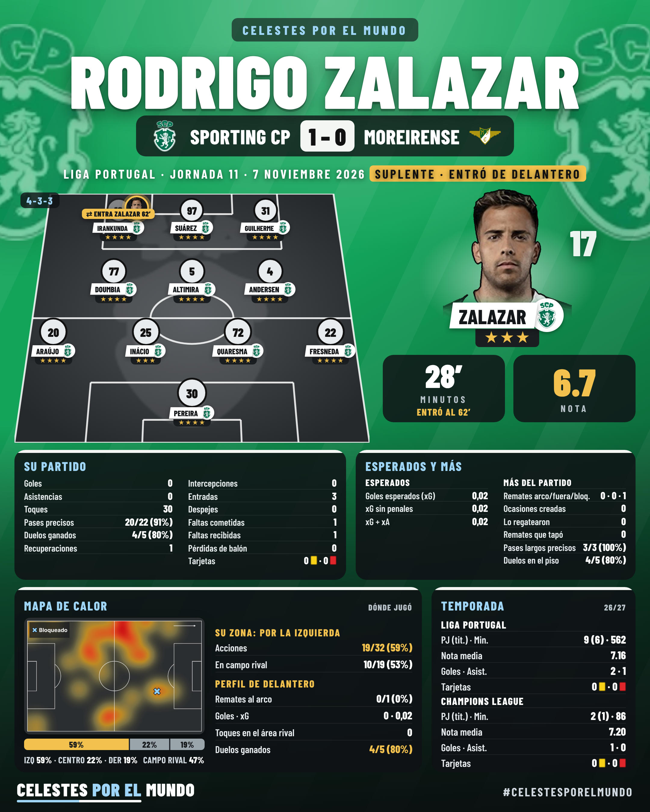
[Abrir la imagen en tamaño completo](https://github.com/tuscxm/celestes-por-el-mundo/blob/main/salida/png/R.%20Zalazar/2026-11-07%20%C2%B7%20Moreirense%20%C2%B7%20Liga%20Portugal/Zalazar_SportingCP-Moreirense_2026-11-07.png)

Texto para el posteo:
```
🇺🇾 RODRIGO ZALAZAR · Sporting CP 1-0 Moreirense
⏱ 28' · ⭐ 6.7
🔁 Entró al 62' por Irankunda, como delantero

Jugó de delantero: 59% de sus acciones por la izquierda, 20/22 pases (91%), 4/5 duelos ganados y 1 recuperación.
#CelestesPorElMundo #Uruguay #SportingCP #352
```

## Merentiel · Boca Juniors 1-0 Defensa y Justicia
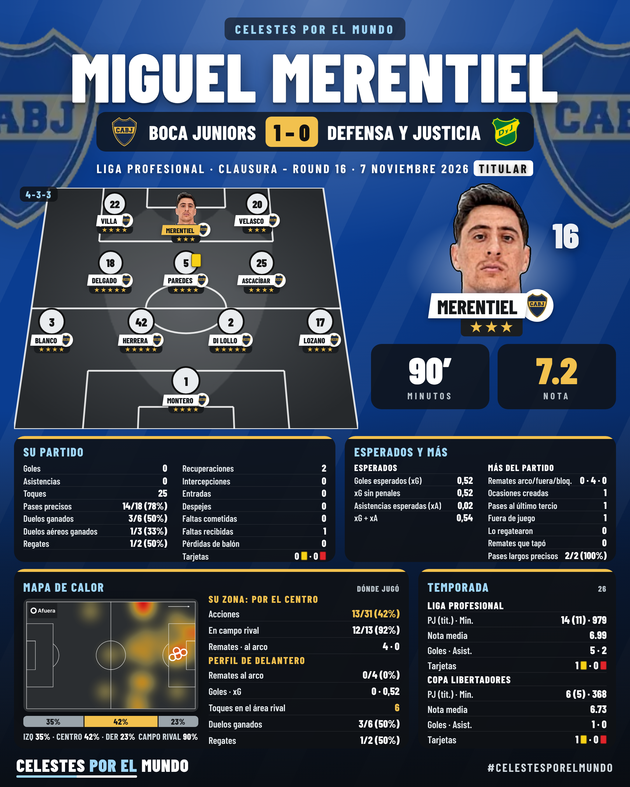
[Abrir la imagen en tamaño completo](https://github.com/tuscxm/celestes-por-el-mundo/blob/main/salida/png/M.%20Merentiel/2026-11-07%20%C2%B7%20Defensa%20y%20Justicia%20%C2%B7%20Liga%20Profesional/Merentiel_BocaJuniors-DefensayJusticia_2026-11-07.png)

Texto para el posteo:
```
🇺🇾 MIGUEL MERENTIEL · Boca Juniors 1-0 Defensa y Justicia
⏱ 90' · ⭐ 7.2

Jugó de delantero: 42% de sus acciones por el centro, 14/18 pases (78%), 3/6 duelos ganados y 2 recuperaciones.

🧩 ¿Y en una Uruguay 3-5-2 con enganche?
Sería uno de los dos de punta: 6 toques en el área rival, 3/6 duelos ganados y 1/2 regates. Con un enganche que lo habilite y otro 9 al lado, deja de pelear solo contra los centrales.

Tres atrás, dos carrileros, dos internos, un 10 suelto y dos puntas. ¿Lo jugarías así? 👇
#CelestesPorElMundo #Uruguay #BocaJuniors #352
```

## Amaro · Union St.Gilloise 1-0 Genk
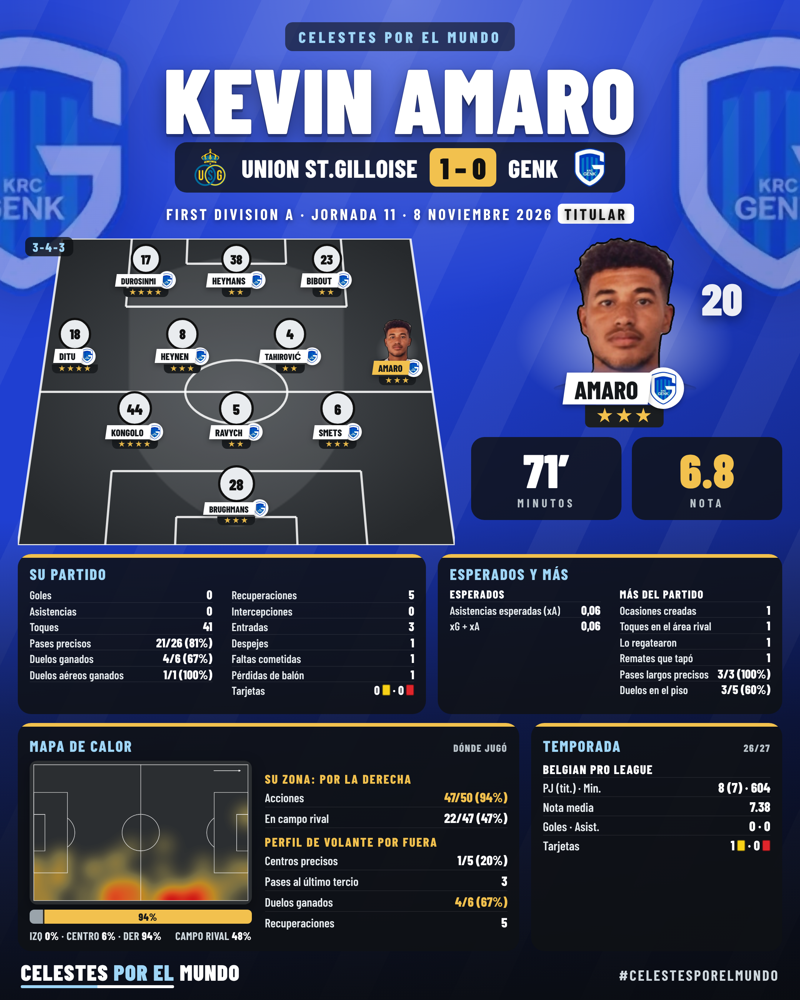
[Abrir la imagen en tamaño completo](https://github.com/tuscxm/celestes-por-el-mundo/blob/main/salida/png/K.%20Amaro/2026-11-08%20%C2%B7%20Union%20St.Gilloise%20%C2%B7%20First%20Division%20A/Amaro_UnionSt.Gilloise-Genk_2026-11-08.png)

Texto para el posteo:
```
🇺🇾 KEVIN AMARO · Union St.Gilloise 1-0 Genk
⏱ 71' · ⭐ 6.8

Jugó de volante por derecha: 21/26 pases (81%), 4/6 duelos ganados, 5 recuperaciones y 3 pases al último tercio.

🧩 ¿Y en una Uruguay 3-5-2 con enganche?
Sería carrilero por derecha: 94% de sus acciones por la derecha, 3 pases al último tercio y 1/5 centros precisos. En el 3-5-2 toda la banda es suya, y con tres centrales atrás puede pasar sin dejar la espalda sola.

Tres atrás, dos carrileros, dos internos, un 10 suelto y dos puntas. ¿Lo jugarías así? 👇
#CelestesPorElMundo #Uruguay #Genk #352
```

## R. Araújo · Crystal Palace 1-3 Liverpool
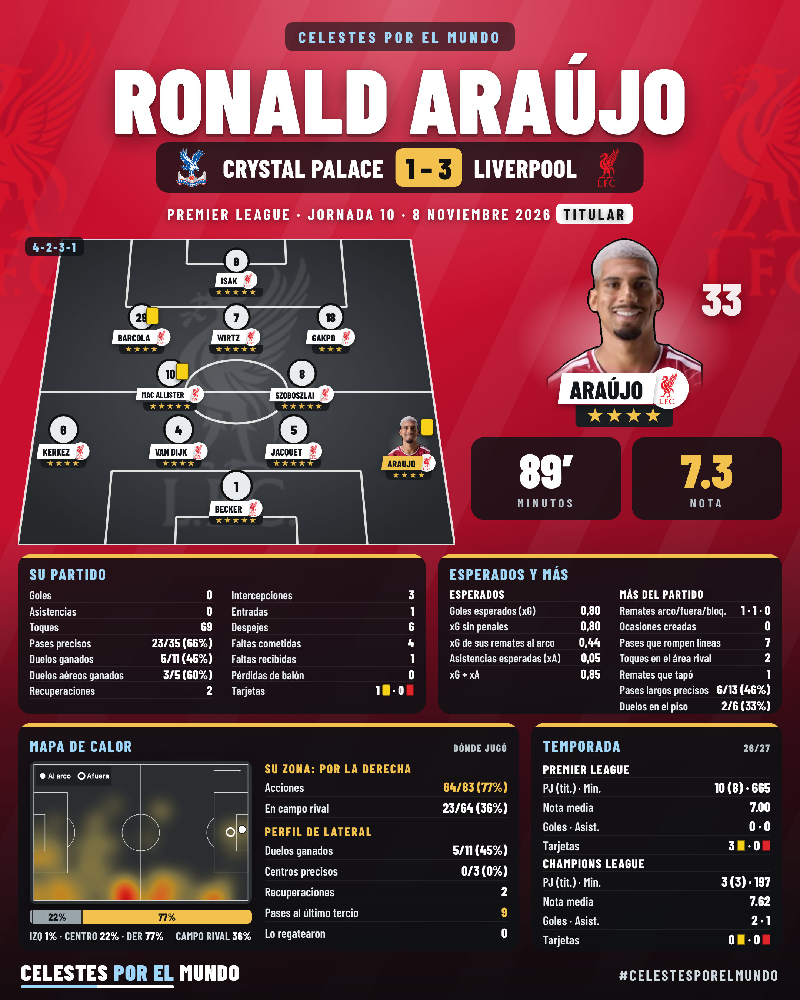
[Abrir la imagen en tamaño completo](https://github.com/tuscxm/celestes-por-el-mundo/blob/main/salida/png/R.%20Ara%C3%BAjo/2026-11-08%20%C2%B7%20Crystal%20Palace%20%C2%B7%20Premier%20League/Araujo_CrystalPalace-Liverpool_2026-11-08.png)

Texto para el posteo:
```
🇺🇾 RONALD ARAÚJO · Crystal Palace 1-3 Liverpool
⏱ 89' · ⭐ 7.3

Jugó de lateral derecho: 77% de sus acciones por la derecha, 23/35 pases (66%), 2 recuperaciones y 9 pases al último tercio.

🧩 ¿Y en una Uruguay 3-5-2 con enganche?
Lo vemos de zaguero por derecha en la línea de tres: 23/35 pases (66%), 3/5 por arriba y 3 intercepciones. Con tres atrás, un central que sale limpio le suma un pase para encontrar al enganche y deja a los carrileros libres para pasar.

Tres atrás, dos carrileros, dos internos, un 10 suelto y dos puntas. ¿Lo jugarías así? 👇
#CelestesPorElMundo #Uruguay #Liverpool #352
```

## J. M. Sanabria · Real Salt Lake 2-1 LA Galaxy
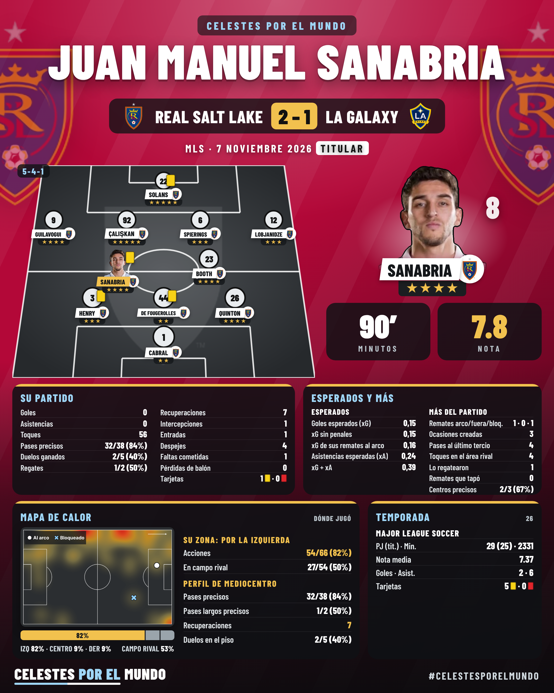
[Abrir la imagen en tamaño completo](https://github.com/tuscxm/celestes-por-el-mundo/blob/main/salida/png/J.%20M.%20Sanabria/2026-11-07%20%C2%B7%20LA%20Galaxy%20%C2%B7%20Mls/Sanabria_RealSaltLake-LAGalaxy_2026-11-07.png)

Texto para el posteo:
```
🇺🇾 JUAN MANUEL SANABRIA · Real Salt Lake 2-1 LA Galaxy
⏱ 90' · ⭐ 7.8

Jugó de mediocentro: 32/38 pases (84%), 7 recuperaciones, 4 pases al último tercio y 3 ocasiones creadas.

🧩 ¿Y en una Uruguay 3-5-2 con enganche?
Sería carrilero por izquierda: 82% de sus acciones por la izquierda, 53% en campo rival y 4 pases al último tercio. En el 3-5-2 toda la banda es suya, y con tres centrales atrás puede pasar sin dejar la espalda sola.

Tres atrás, dos carrileros, dos internos, un 10 suelto y dos puntas. ¿Lo jugarías así? 👇
#CelestesPorElMundo #Uruguay #RealSaltLake #352
```

## Olivera · Napoli 1-1 Lazio
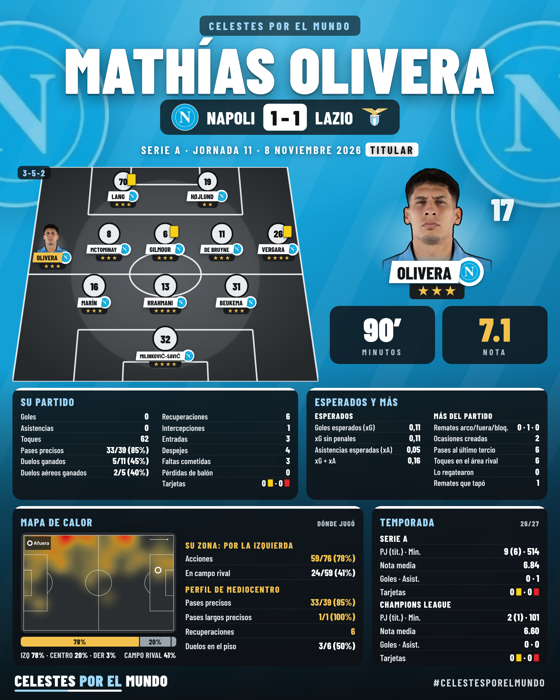
[Abrir la imagen en tamaño completo](https://github.com/tuscxm/celestes-por-el-mundo/blob/main/salida/png/M.%20Olivera/2026-11-08%20%C2%B7%20Lazio%20%C2%B7%20Serie%20A/Olivera_Napoli-Lazio_2026-11-08.png)

Texto para el posteo:
```
🇺🇾 MATHÍAS OLIVERA · Napoli 1-1 Lazio
⏱ 90' · ⭐ 7.1

Jugó de mediocentro: 78% de sus acciones por la izquierda, 33/39 pases (85%), 6 recuperaciones y 6 pases al último tercio.

🧩 ¿Y en una Uruguay 3-5-2 con enganche?
Lo vemos de zaguero por izquierda en la línea de tres: 33/39 pases (85%), 1 intercepción y 6 recuperaciones. Con tres atrás, un central que sale limpio le suma un pase para encontrar al enganche y deja a los carrileros libres para pasar.

Tres atrás, dos carrileros, dos internos, un 10 suelto y dos puntas. ¿Lo jugarías así? 👇
#CelestesPorElMundo #Uruguay #Napoli #352
```

---
No se publicó nada en Instagram. Cerrá este aviso cuando la publiques o la descartes.
## Revisión visual
- Fuentes: SofaScore no respondió para ningún jugador; las 13 infografías salieron con el respaldo automático (FotMob), todas con la parte de abajo por puesto (ninguna con el diseño anterior). API-Football: el plan gratis no cubre la temporada. zerozero: HTTP 403. Understat: formato de página no reconocido. TheSportsDB: HTTP 429 en Boselli y Zalazar. BeSoccer: las páginas de partidos devolvieron un error de carga ("A required part of this site couldn't load"), no se pudo leer nada (besoccer_hoy.json quedó vacío).
- Cáceres (Celta Vigo 0-0 Levante): los escudos del marcador están invertidos (el de Levante al lado de CELTA VIGO y el del Celta al lado de LEVANTE). Corregir antes de publicar.
- Olivera (Napoli 1-1 Lazio): en la cancha está en la punta izquierda de la línea de 5 del 3-5-2 (carrilero) y el 78% de sus acciones fueron por la izquierda, pero el PERFIL y el posteo dicen "mediocentro". Debería ser volante por fuera / carrilero.
- Sanabria (Real Salt Lake 2-1 LA Galaxy): mismo caso: 82% por la izquierda en un 5-4-1, pero el PERFIL y el posteo dicen "mediocentro". La cancha del 5-4-1 muestra solo 3 en la última línea y a Sanabria y Booth medio escalón arriba (dibujo raro).
- Boselli (Villarreal 2-0 Getafe): "Pases precisos 4/10 (40%)" con 39 toques, y en MÁS DEL PARTIDO "Pases al último tercio 5" (más que los pases precisos totales). Los números no cierran: revisar antes de publicar.
- Merentiel (Boca 1-0 Defensa y Justicia): la fase dice "CLAUSURA - ROUND 16" (en inglés).
- Amaro: TEMPORADA dice "BELGIAN PRO LEAGUE" y el encabezado "FIRST DIVISION A" (misma liga, nombres distintos).
- Á. Rodríguez y Zalazar entraron de suplentes: el puesto es el habitual (aviso del respaldo). Á. Rodríguez sin nota (no la trae ninguna fuente).
- Resto: caras recortadas con contorno, escudos y escudo detrás de la cancha visibles, jugador resaltado, tarjetas amarillas visibles (R. Araújo y Sanabria con su amarilla en SU PARTIDO), sin textos cortados ni nombres de fuentes. No hubo tandas de penales.
