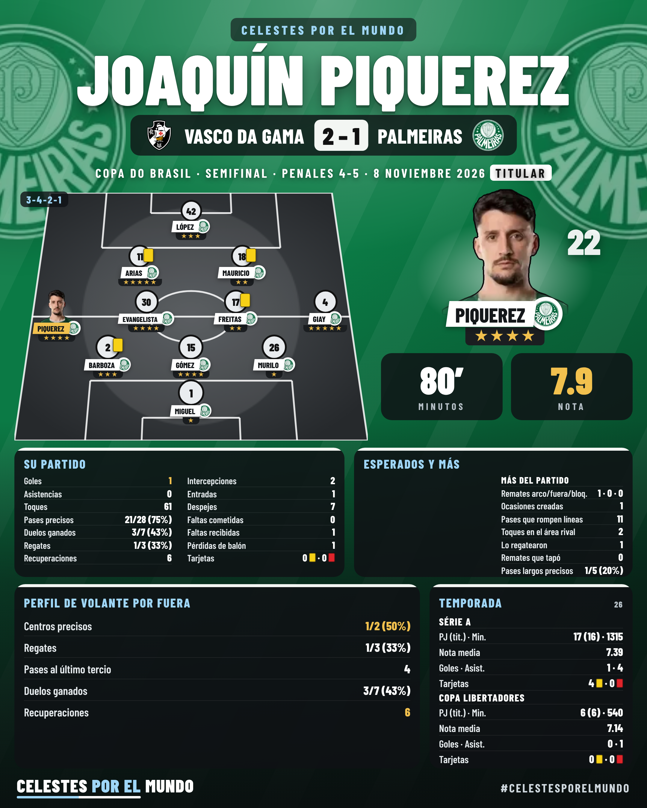

Piquerez jugó 80' (titular, nota 7.9) en Vasco da Gama 2-1 Palmeiras (4-5 en penales); infografía lista

@tuscxm

## Quién jugó
- **Piquerez** jugó 80' (titular, nota 7.9, de volante por izquierda) en Vasco da Gama 2-1 Palmeiras (4-5 en penales) · Copa do Brasil

## El resto
- Valverde: sin partido hoy ni ayer
- Bernal: sin partido hoy ni ayer
- Mouriño: ya procesado · Villarreal 2-0 Getafe
- M. Araújo: sin partido hoy ni ayer
- Á. Rodríguez: ya procesado · Ipswich Town 1-2 AFC Bournemouth
- González: sin partido hoy ni ayer
- Cáceres: ya procesado · Celta Vigo 0-0 Levante
- Petit: sin partido hoy ni ayer
- Bentancur: sin partido hoy ni ayer
- Satriano: ya procesado · Villarreal 2-0 Getafe
- Boselli: ya procesado · Villarreal 2-0 Getafe
- J. Rodríguez: sin partido hoy ni ayer
- Zalazar: sin partido hoy ni ayer
- Merentiel: sin partido hoy ni ayer
- Giménez: sin partido hoy ni ayer
- Amaro: ya procesado · Union St.Gilloise 1-0 Genk
- R. Araújo: ya procesado · Crystal Palace 1-3 Liverpool
- J. M. Sanabria: sin partido hoy ni ayer
- Ugarte: sin partido hoy ni ayer
- Canobbio: sin partido hoy ni ayer
- Darwin: sin partido hoy ni ayer
- F. Díaz: sin partido hoy ni ayer
- Torreira: sin partido hoy ni ayer
- Brizuela: sin partido hoy ni ayer
- Matturro: no jugó en Shakhtar Donetsk 0-0 Dynamo Kyiv (no entró)
- Olivera: ya procesado · Napoli 1-1 Lazio

## Avisos
- Piquerez: SofaScore no respondió; fuentes: fotmob ok, besoccer ok, api_football sin datos: el plan gratis de API-Football no cubre esta temporada (plan: Free plans do not have access to this season, try from 2022 to 2024.), thesportsdb ok, understat sin datos: sin understat_equipo (Understat no cubre esa liga), zerozero error HTTP 403
- Piquerez: Hubo tanda de penales (4-5) y no pateó
- Piquerez: No hay mapa de calor de este partido en el respaldo: se muestra el perfil
- Piquerez: Armada con datos de respaldo (FotMob): hay menos estadísticas que de costumbre, revisala antes de publicar

## Piquerez · Vasco da Gama 2-1 Palmeiras (4-5 en penales)

[Abrir la imagen en tamaño completo](https://github.com/tuscxm/celestes-por-el-mundo/blob/main/salida/png/J.%20Piquerez/2026-11-08%20%C2%B7%20Vasco%20da%20Gama%20%C2%B7%20Copa%20Do%20Brasil/Piquerez_VascodaGama-Palmeiras_2026-11-08.png)

Texto para el posteo:
```
🇺🇾 JOAQUÍN PIQUEREZ · Vasco da Gama 2-1 Palmeiras (4-5 en penales, global 2-2)
⏱ 80' · ⭐ 7.9

Jugó de volante por izquierda: 1 gol, 21/28 pases (75%), 6 recuperaciones y 4 pases al último tercio.

🧩 ¿Y en una Uruguay 3-5-2 con enganche?
Sería carrilero: 4 pases al último tercio, 1/2 centros precisos y 1/3 regates. En el 3-5-2 toda la banda es suya, y con tres centrales atrás puede pasar sin dejar la espalda sola.

Tres atrás, dos carrileros, dos internos, un 10 suelto y dos puntas. ¿Lo jugarías así? 👇
#CelestesPorElMundo #Uruguay #Palmeiras #352
```

---
No se publicó nada en Instagram. Cerrá este aviso cuando la publiques o la descartes.
## Revisión visual
- Piquerez (Vasco da Gama 2-1 Palmeiras): la tanda está bien explicada (PENALES 4-5 bajo el marcador; "(4-5 en penales, global 2-2)" en el posteo; no pateó). Palmeiras ganó la tanda 5-4. Su gol (1 remate al arco) es del partido, no de la tanda. Números de la infografía y del posteo coinciden (80', 7.9, 1 gol, 21/28 pases, 6 recuperaciones, 4 pases al último tercio, 1/2 centros, 1/3 regates).
- Sale sin mapa de calor, sin barra de dónde jugó y sin SU ZONA (el respaldo no trae mapa de este partido): el PERFIL de volante por fuera ocupa toda la fila. Las rojas/amarillas se ven bien.
- ESPERADOS Y MÁS tiene la columna ESPERADOS vacía (no hay xG/xA de este partido); queda un hueco a la izquierda de esa tarjeta.
- En la cancha, la cara de Piquerez queda pegada al borde izquierdo, apenas fuera de la línea lateral y sin el círculo del dorsal (22); el resto de las caras van con su número.
- TEMPORADA muestra Série A y Copa Libertadores; la Copa do Brasil (competición del partido) no figura porque es copa nacional.
- Fuentes: SofaScore no respondió (respaldo FotMob); API-Football: el plan gratis no cubre esta temporada; zerozero HTTP 403; BeSoccer no cargó desde WebFetch ("A required part of this site couldn't load"), besoccer_hoy.json quedó vacío aunque el aviso diga "besoccer ok".
- correr.sh avisa: Playwright 1.56.0 no abre el Chromium de la nube; anduvo con 1.63.0 (actualizar requirements.txt a playwright==1.63.0).
