Valverde jugó 32' (suplente, nota 6.6) en Argentina 1-2 Uruguay; Bernal jugó 14' (suplente, nota 6.2) en Argentina 1-2 Uruguay; M. Araújo jugó 85' (titular, nota 7.3) en Argentina 1-2 Uruguay; Cáceres jugó 32' (suplente, nota 6.5) en Argentina 1-2 Ur

@tuscxm

## Quién jugó
- **Valverde** jugó 32' (suplente, entró al 58' por Canobbio, nota 6.6, su juego) en Argentina 1-2 Uruguay · Amistoso internacional
- **Bernal** jugó 14' (suplente, entró al 76' por Torreira, nota 6.2, su juego) en Argentina 1-2 Uruguay · Amistoso internacional
- **M. Araújo** jugó 85' (titular, nota 7.3, de volante por izquierda) en Argentina 1-2 Uruguay · Amistoso internacional
- **Cáceres** jugó 32' (suplente, entró al 58' por Piquerez, nota 6.5, su juego) en Argentina 1-2 Uruguay · Amistoso internacional
- **Bentancur** jugó 90' (titular, nota 7.4, de mediocentro) en Argentina 1-2 Uruguay · Amistoso internacional
- **R. Araújo** jugó 90' (titular, nota 7.1, de defensor central) en Argentina 1-2 Uruguay · Amistoso internacional
- **Canobbio** jugó 58' (titular, nota 6.6, de volante por derecha) en Argentina 1-2 Uruguay · Amistoso internacional
- **Darwin** jugó 85' (titular, nota 6.7, de delantero) en Argentina 1-2 Uruguay · Amistoso internacional
- **Torreira** jugó 76' (titular, nota 6.6, de mediocentro) en Argentina 1-2 Uruguay · Amistoso internacional
- **Piquerez** jugó 58' (titular, nota 7.2, de lateral izquierdo) en Argentina 1-2 Uruguay · Amistoso internacional
- **Olivera** jugó 90' (titular, nota 6.9, de defensor central) en Argentina 1-2 Uruguay · Amistoso internacional
- **Varela** jugó 90' (titular, nota 6.8, de lateral derecho) en Argentina 1-2 Uruguay · Amistoso internacional
- **Arrascaeta** jugó 76' (titular, nota 7.9, su juego) en Argentina 1-2 Uruguay · Amistoso internacional
- **Pellistri** jugó 5' (suplente, entró al 85' por Araújo, de delantero) en Argentina 1-2 Uruguay · Amistoso internacional
- **Aguirre** jugó 5' (suplente, entró al 85' por Núñez, de delantero) en Argentina 1-2 Uruguay · Amistoso internacional
- **Viñas** jugó 14' (suplente, entró al 76' por Arrascaeta, nota 6.3, de delantero) en Argentina 1-2 Uruguay · Amistoso internacional

## El resto
- Mouriño: no jugó en Argentina 1-2 Uruguay (no entró)
- Á. Rodríguez: sin partido hoy ni ayer
- González: sin partido hoy ni ayer
- Petit: sin partido hoy ni ayer
- Satriano: no jugó en Argentina 1-2 Uruguay (no entró)
- Boselli: sin partido hoy ni ayer
- J. Rodríguez: no jugó en Argentina 1-2 Uruguay (no entró)
- Zalazar: no jugó en Argentina 1-2 Uruguay (no entró)
- Merentiel: sin partido hoy ni ayer
- Giménez: no jugó en Argentina 1-2 Uruguay (no entró)
- Amaro: sin partido hoy ni ayer
- J. M. Sanabria: no jugó en Argentina 1-2 Uruguay (no entró)
- Ugarte: sin partido hoy ni ayer
- F. Díaz: sin partido hoy ni ayer
- Brizuela: sin partido hoy ni ayer
- Matturro: sin partido hoy ni ayer
- Nández: sin partido hoy ni ayer
- Bueno: sin partido hoy ni ayer
- Pereira: sin partido hoy ni ayer
- Marichal: sin partido hoy ni ayer
- Barboza: sin partido hoy ni ayer
- Olaza: sin partido hoy ni ayer
- Fonseca: sin partido hoy ni ayer
- E. Martínez: sin partido hoy ni ayer
- De la Cruz: ERROR al revisar (no se pudo consultar SofaScore) → `<HTTPError 403: 'Forbidden'>`
- Rossi: sin partido hoy ni ayer
- B. Rodríguez: sin partido hoy ni ayer
- Damiani: sin partido hoy ni ayer

## Avisos
- Valverde: SofaScore no respondió; fuentes: fotmob ok, besoccer ok, api_football sin datos: el plan gratis de API-Football no cubre esta temporada (plan: Free plans do not have access to this season, try from 2022 to 2024.), thesportsdb ok, understat sin datos: formato de página no reconocido, zerozero error HTTP 403
- Valverde: No hay mapa de calor de este partido en el respaldo: se muestra el perfil
- Valverde: No se pudo saber el puesto en el que jugó
- Valverde: Armada con datos de respaldo (FotMob): hay menos estadísticas que de costumbre, revisala antes de publicar
- Bernal: SofaScore no respondió; fuentes: fotmob ok, besoccer ok, api_football sin datos: el plan gratis de API-Football no cubre esta temporada (plan: Free plans do not have access to this season, try from 2022 to 2024.), thesportsdb ok, understat sin datos: formato de página no reconocido, zerozero error HTTP 403
- Bernal: No hay mapa de calor de este partido en el respaldo: se muestra el perfil
- Bernal: No se pudo saber el puesto en el que jugó
- Bernal: Armada con datos de respaldo (FotMob): hay menos estadísticas que de costumbre, revisala antes de publicar
- M. Araújo: SofaScore no respondió; fuentes: fotmob ok, besoccer ok, api_football sin datos: el plan gratis de API-Football no cubre esta temporada (plan: Free plans do not have access to this season, try from 2022 to 2024.), thesportsdb ok, understat sin datos: sin understat_equipo (Understat no cubre esa liga), zerozero error HTTP 403
- M. Araújo: No hay mapa de calor de este partido en el respaldo: se muestra el perfil
- M. Araújo: Armada con datos de respaldo (FotMob): hay menos estadísticas que de costumbre, revisala antes de publicar
- Cáceres: SofaScore no respondió; fuentes: fotmob ok, besoccer ok, api_football sin datos: el plan gratis de API-Football no cubre esta temporada (plan: Free plans do not have access to this season, try from 2022 to 2024.), thesportsdb ok, understat sin datos: formato de página no reconocido, zerozero error HTTP 403
- Cáceres: No hay mapa de calor de este partido en el respaldo: se muestra el perfil
- Cáceres: No se pudo saber el puesto en el que jugó
- Cáceres: Armada con datos de respaldo (FotMob): hay menos estadísticas que de costumbre, revisala antes de publicar
- Bentancur: SofaScore no respondió; fuentes: fotmob ok, besoccer ok, api_football sin datos: el plan gratis de API-Football no cubre esta temporada (plan: Free plans do not have access to this season, try from 2022 to 2024.), thesportsdb ok, understat sin datos: formato de página no reconocido, zerozero error HTTP 403
- Bentancur: No hay mapa de calor de este partido en el respaldo: se muestra el perfil
- Bentancur: Armada con datos de respaldo (FotMob): hay menos estadísticas que de costumbre, revisala antes de publicar
- R. Araújo: SofaScore no respondió; fuentes: fotmob ok, besoccer ok, api_football sin datos: el plan gratis de API-Football no cubre esta temporada (plan: Free plans do not have access to this season, try from 2022 to 2024.), thesportsdb ok, understat sin datos: formato de página no reconocido, zerozero error HTTP 403
- R. Araújo: No hay mapa de calor de este partido en el respaldo: se muestra el perfil
- R. Araújo: Armada con datos de respaldo (FotMob): hay menos estadísticas que de costumbre, revisala antes de publicar
- Canobbio: SofaScore no respondió; fuentes: fotmob ok, besoccer ok, api_football sin datos: el plan gratis de API-Football no cubre esta temporada (plan: Free plans do not have access to this season, try from 2022 to 2024.), thesportsdb ok, understat sin datos: sin understat_equipo (Understat no cubre esa liga), zerozero error HTTP 403
- Canobbio: Sin remates en el respaldo: TOTALES va sin lo de ataque
- Canobbio: No hay mapa de calor de este partido en el respaldo: se muestra el perfil
- Canobbio: Armada con datos de respaldo (FotMob): hay menos estadísticas que de costumbre, revisala antes de publicar
- Darwin: SofaScore no respondió; fuentes: fotmob ok, besoccer ok, api_football sin datos: el plan gratis de API-Football no cubre esta temporada (plan: Free plans do not have access to this season, try from 2022 to 2024.), thesportsdb ok, understat sin datos: sin understat_equipo (Understat no cubre esa liga), zerozero error HTTP 403
- Darwin: No hay mapa de calor de este partido en el respaldo: se muestra el perfil
- Darwin: Armada con datos de respaldo (FotMob): hay menos estadísticas que de costumbre, revisala antes de publicar
- Torreira: SofaScore no respondió; fuentes: fotmob ok, besoccer ok, api_football sin datos: el plan gratis de API-Football no cubre esta temporada (plan: Free plans do not have access to this season, try from 2022 to 2024.), thesportsdb ok, understat sin datos: sin understat_equipo (Understat no cubre esa liga), zerozero error HTTP 403
- Torreira: Sin remates en el respaldo: TOTALES va sin lo de ataque
- Torreira: No hay mapa de calor de este partido en el respaldo: se muestra el perfil
- Torreira: Armada con datos de respaldo (FotMob): hay menos estadísticas que de costumbre, revisala antes de publicar
- Piquerez: SofaScore no respondió; fuentes: fotmob ok, besoccer ok, api_football sin datos: el plan gratis de API-Football no cubre esta temporada (plan: Free plans do not have access to this season, try from 2022 to 2024.), thesportsdb ok, understat sin datos: sin understat_equipo (Understat no cubre esa liga), zerozero error HTTP 403
- Piquerez: No hay mapa de calor de este partido en el respaldo: se muestra el perfil
- Piquerez: Armada con datos de respaldo (FotMob): hay menos estadísticas que de costumbre, revisala antes de publicar
- Olivera: SofaScore no respondió; fuentes: fotmob ok, besoccer ok, api_football sin datos: el plan gratis de API-Football no cubre esta temporada (plan: Free plans do not have access to this season, try from 2022 to 2024.), thesportsdb ok, understat sin datos: formato de página no reconocido, zerozero error HTTP 403
- Olivera: No hay mapa de calor de este partido en el respaldo: se muestra el perfil
- Olivera: Armada con datos de respaldo (FotMob): hay menos estadísticas que de costumbre, revisala antes de publicar
- Varela: SofaScore no respondió; fuentes: fotmob ok, besoccer ok, api_football sin datos: el plan gratis de API-Football no cubre esta temporada (plan: Free plans do not have access to this season, try from 2022 to 2024.), thesportsdb ok, understat sin datos: sin understat_equipo (Understat no cubre esa liga), zerozero error HTTP 403
- Varela: No hay mapa de calor de este partido en el respaldo: se muestra el perfil
- Varela: Armada con datos de respaldo (FotMob): hay menos estadísticas que de costumbre, revisala antes de publicar
- Arrascaeta: SofaScore no respondió; fuentes: fotmob ok, besoccer ok, api_football sin datos: el plan gratis de API-Football no cubre esta temporada (plan: Free plans do not have access to this season, try from 2022 to 2024.), thesportsdb ok, understat sin datos: sin understat_equipo (Understat no cubre esa liga), zerozero error HTTP 403
- Arrascaeta: Sin remates en el respaldo: TOTALES va sin lo de ataque
- Arrascaeta: No hay mapa de calor de este partido en el respaldo: se muestra el perfil
- Arrascaeta: No se pudo saber el puesto en el que jugó
- Arrascaeta: Armada con datos de respaldo (FotMob): hay menos estadísticas que de costumbre, revisala antes de publicar
- Pellistri: SofaScore no respondió; fuentes: fotmob ok, besoccer ok, api_football sin datos: el plan gratis de API-Football no cubre esta temporada (plan: Free plans do not have access to this season, try from 2022 to 2024.), thesportsdb ok, understat sin datos: sin understat_equipo (Understat no cubre esa liga), zerozero error HTTP 403
- Pellistri: Entró de suplente: el puesto (delantero) es su puesto habitual, no se sabe dónde entró
- Pellistri: Sin remates en el respaldo: TOTALES va sin lo de ataque
- Pellistri: No hay mapa de calor de este partido en el respaldo: se muestra el perfil
- Pellistri: Armada con datos de respaldo (FotMob): hay menos estadísticas que de costumbre, revisala antes de publicar
- Aguirre: SofaScore no respondió; fuentes: fotmob ok, besoccer ok, api_football sin datos: el plan gratis de API-Football no cubre esta temporada (plan: Free plans do not have access to this season, try from 2022 to 2024.), thesportsdb ok, understat sin datos: sin understat_equipo (Understat no cubre esa liga), zerozero error HTTP 403
- Aguirre: Entró de suplente: el puesto (delantero) es su puesto habitual, no se sabe dónde entró
- Aguirre: Sin remates en el respaldo: TOTALES va sin lo de ataque
- Aguirre: No hay mapa de calor de este partido en el respaldo: se muestra el perfil
- Aguirre: Armada con datos de respaldo (FotMob): hay menos estadísticas que de costumbre, revisala antes de publicar
- Viñas: SofaScore no respondió; fuentes: fotmob ok, besoccer ok, api_football sin datos: el plan gratis de API-Football no cubre esta temporada (plan: Free plans do not have access to this season, try from 2022 to 2024.), thesportsdb ok, understat sin datos: sin understat_equipo (Understat no cubre esa liga), zerozero error HTTP 403
- Viñas: Entró de suplente: el puesto (delantero) es su puesto habitual, no se sabe dónde entró
- Viñas: Sin remates en el respaldo: TOTALES va sin lo de ataque
- Viñas: No hay mapa de calor de este partido en el respaldo: se muestra el perfil
- Viñas: Armada con datos de respaldo (FotMob): hay menos estadísticas que de costumbre, revisala antes de publicar

## Valverde · Argentina 1-2 Uruguay
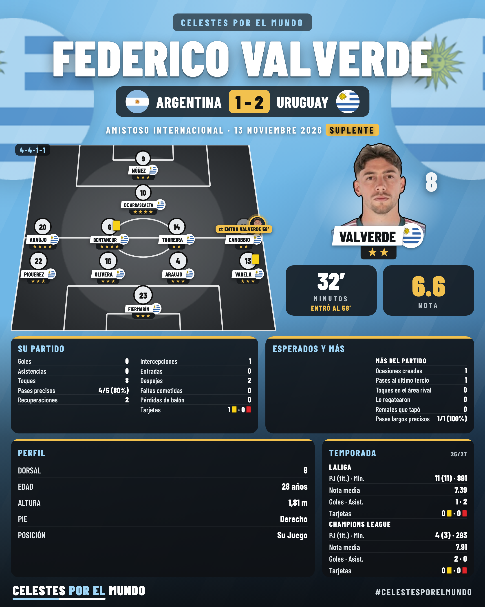
[Abrir la imagen en tamaño completo](https://github.com/tuscxm/celestes-por-el-mundo/blob/main/salida/png/F.%20Valverde/2026-11-13%20%C2%B7%20Argentina%20%C2%B7%20Amistoso%20Internacional/Valverde_Argentina-Uruguay_2026-11-13.png)

Texto para el posteo:
```
🇺🇾 FEDERICO VALVERDE · Argentina 1-2 Uruguay
⏱ 32' · ⭐ 6.6
🔁 Entró al 58' por Canobbio

Jugó de titular: 2 recuperaciones, 1 pase al último tercio y 1 ocasión creada.

🧩 ¿Y en una Uruguay 3-5-2 con enganche?
Sería carrilero: 1 pase al último tercio y 2 recuperaciones. En el 3-5-2 toda la banda es suya, y con tres centrales atrás puede pasar sin dejar la espalda sola.

Tres atrás, dos carrileros, dos internos, un 10 suelto y dos puntas. ¿Lo jugarías así? 👇
#CelestesPorElMundo #Uruguay #352
```

## Bernal · Argentina 1-2 Uruguay

[Abrir la imagen en tamaño completo](https://github.com/tuscxm/celestes-por-el-mundo/blob/main/salida/png/F.%20Bernal/2026-11-13%20%C2%B7%20Argentina%20%C2%B7%20Amistoso%20Internacional/Bernal_Argentina-Uruguay_2026-11-13.png)

Texto para el posteo:
```
🇺🇾 FACUNDO BERNAL · Argentina 1-2 Uruguay
⏱ 14' · ⭐ 6.2
🔁 Entró al 76' por Torreira

Jugó de titular: 1/2 duelos ganados, 1 recuperación y 1 pase al último tercio.

🧩 ¿Y en una Uruguay 3-5-2 con enganche?
Sería uno de los dos internos: 1 recuperación y 1/2 duelos ganados. Es el que sostiene y hace circular para que el enganche reciba de frente.

Tres atrás, dos carrileros, dos internos, un 10 suelto y dos puntas. ¿Lo jugarías así? 👇
#CelestesPorElMundo #Uruguay #352
```

## M. Araújo · Argentina 1-2 Uruguay
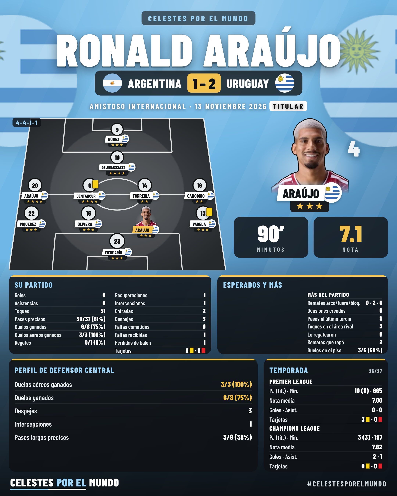
[Abrir la imagen en tamaño completo](https://github.com/tuscxm/celestes-por-el-mundo/blob/main/salida/png/R.%20Ara%C3%BAjo/2026-11-13%20%C2%B7%20Argentina%20%C2%B7%20Amistoso%20Internacional/Araujo_Argentina-Uruguay_2026-11-13.png)

Texto para el posteo:
```
🇺🇾 RONALD ARAÚJO · Argentina 1-2 Uruguay
⏱ 90' · ⭐ 7.1

Jugó de defensor central: 30/37 pases (81%), 6/8 duelos ganados, 1 recuperación y 8 pases al último tercio.

🧩 ¿Y en una Uruguay 3-5-2 con enganche?
Lo vemos de zaguero en la línea de tres: 30/37 pases (81%), 6/8 duelos ganados y 3/3 por arriba. Con tres atrás, un central que sale limpio le suma un pase para encontrar al enganche y deja a los carrileros libres para pasar.

Tres atrás, dos carrileros, dos internos, un 10 suelto y dos puntas. ¿Lo jugarías así? 👇
#CelestesPorElMundo #Uruguay #352
```

## Cáceres · Argentina 1-2 Uruguay
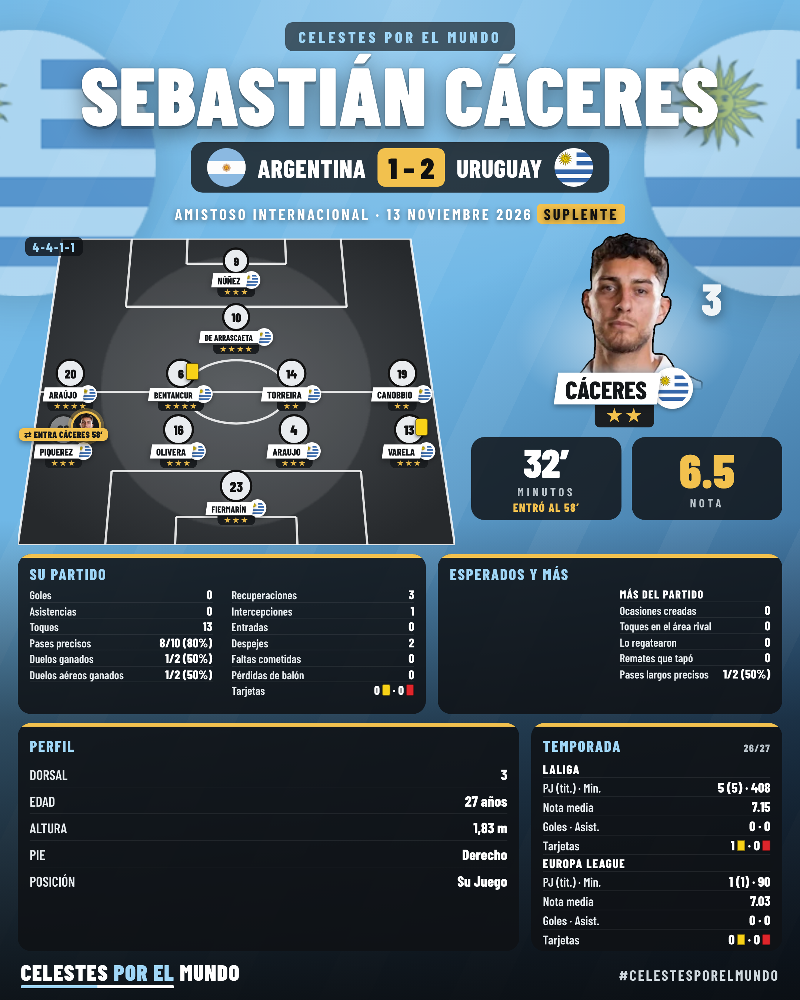
[Abrir la imagen en tamaño completo](https://github.com/tuscxm/celestes-por-el-mundo/blob/main/salida/png/S.%20C%C3%A1ceres/2026-11-13%20%C2%B7%20Argentina%20%C2%B7%20Amistoso%20Internacional/Caceres_Argentina-Uruguay_2026-11-13.png)

Texto para el posteo:
```
🇺🇾 SEBASTIÁN CÁCERES · Argentina 1-2 Uruguay
⏱ 32' · ⭐ 6.5
🔁 Entró al 58' por Piquerez

Jugó de titular: 8/10 pases (80%), 1/2 duelos ganados y 3 recuperaciones.

🧩 ¿Y en una Uruguay 3-5-2 con enganche?
Lo vemos de zaguero en la línea de tres: 8/10 pases (80%), 1/2 duelos ganados y 1/2 por arriba. Con tres atrás, un central que sale limpio le suma un pase para encontrar al enganche y deja a los carrileros libres para pasar.

Tres atrás, dos carrileros, dos internos, un 10 suelto y dos puntas. ¿Lo jugarías así? 👇
#CelestesPorElMundo #Uruguay #352
```

## Bentancur · Argentina 1-2 Uruguay
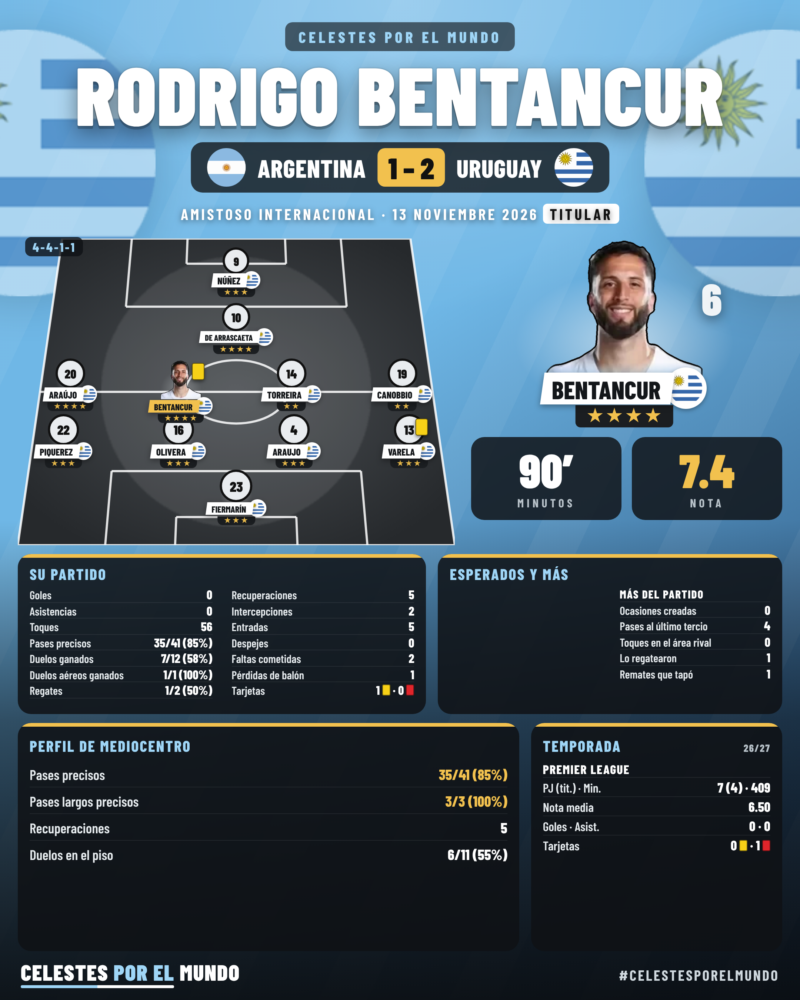
[Abrir la imagen en tamaño completo](https://github.com/tuscxm/celestes-por-el-mundo/blob/main/salida/png/R.%20Bentancur/2026-11-13%20%C2%B7%20Argentina%20%C2%B7%20Amistoso%20Internacional/Bentancur_Argentina-Uruguay_2026-11-13.png)

Texto para el posteo:
```
🇺🇾 RODRIGO BENTANCUR · Argentina 1-2 Uruguay
⏱ 90' · ⭐ 7.4

Jugó de mediocentro: 35/41 pases (85%), 7/12 duelos ganados, 5 recuperaciones y 4 pases al último tercio.

🧩 ¿Y en una Uruguay 3-5-2 con enganche?
Sería uno de los dos internos: 35/41 pases (85%), 5 recuperaciones y 7/12 duelos ganados. Es el que sostiene y hace circular para que el enganche reciba de frente.

Tres atrás, dos carrileros, dos internos, un 10 suelto y dos puntas. ¿Lo jugarías así? 👇
#CelestesPorElMundo #Uruguay #352
```

## R. Araújo · Argentina 1-2 Uruguay

[Abrir la imagen en tamaño completo](https://github.com/tuscxm/celestes-por-el-mundo/blob/main/salida/png/R.%20Ara%C3%BAjo/2026-11-13%20%C2%B7%20Argentina%20%C2%B7%20Amistoso%20Internacional/Araujo_Argentina-Uruguay_2026-11-13.png)

Texto para el posteo:
```
🇺🇾 RONALD ARAÚJO · Argentina 1-2 Uruguay
⏱ 90' · ⭐ 7.1

Jugó de defensor central: 30/37 pases (81%), 6/8 duelos ganados, 1 recuperación y 8 pases al último tercio.

🧩 ¿Y en una Uruguay 3-5-2 con enganche?
Lo vemos de zaguero en la línea de tres: 30/37 pases (81%), 6/8 duelos ganados y 3/3 por arriba. Con tres atrás, un central que sale limpio le suma un pase para encontrar al enganche y deja a los carrileros libres para pasar.

Tres atrás, dos carrileros, dos internos, un 10 suelto y dos puntas. ¿Lo jugarías así? 👇
#CelestesPorElMundo #Uruguay #352
```

## Canobbio · Argentina 1-2 Uruguay
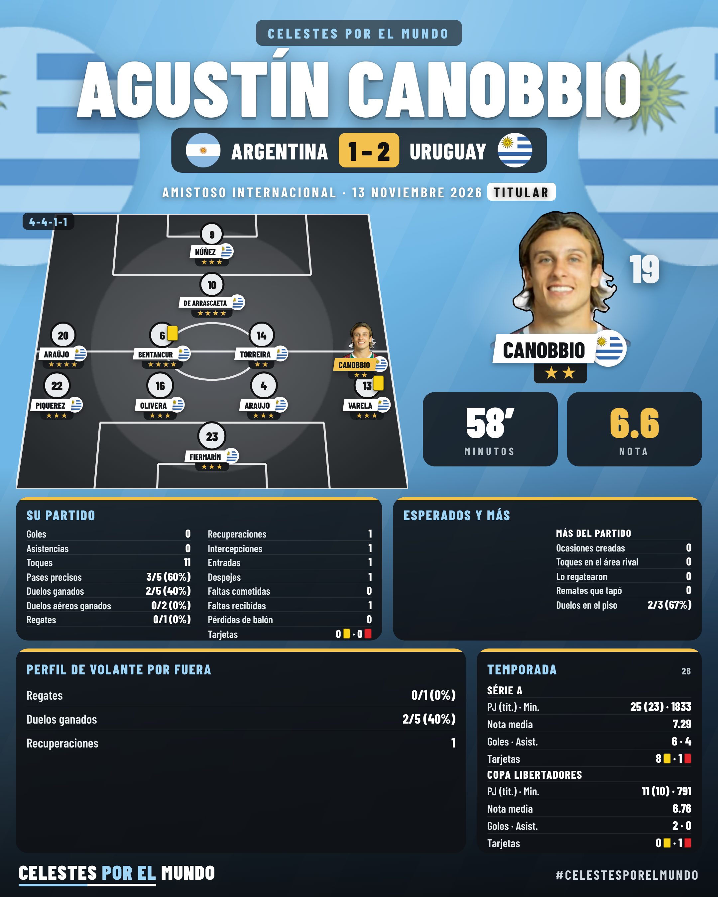
[Abrir la imagen en tamaño completo](https://github.com/tuscxm/celestes-por-el-mundo/blob/main/salida/png/A.%20Canobbio/2026-11-13%20%C2%B7%20Argentina%20%C2%B7%20Amistoso%20Internacional/Canobbio_Argentina-Uruguay_2026-11-13.png)

Texto para el posteo:
```
🇺🇾 AGUSTÍN CANOBBIO · Argentina 1-2 Uruguay
⏱ 58' · ⭐ 6.6

Jugó de volante por derecha: 1 recuperación.

🧩 ¿Y en una Uruguay 3-5-2 con enganche?
Sería carrilero: 1 recuperación. En el 3-5-2 toda la banda es suya, y con tres centrales atrás puede pasar sin dejar la espalda sola.

Tres atrás, dos carrileros, dos internos, un 10 suelto y dos puntas. ¿Lo jugarías así? 👇
#CelestesPorElMundo #Uruguay #352
```

## Darwin · Argentina 1-2 Uruguay
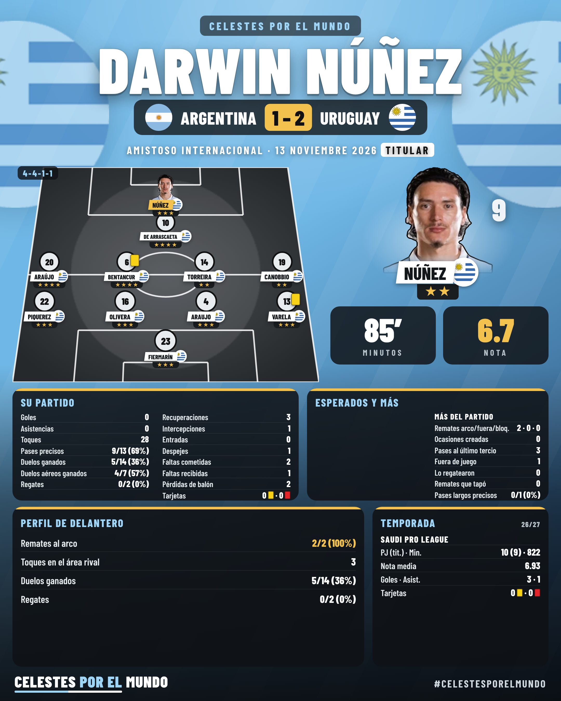
[Abrir la imagen en tamaño completo](https://github.com/tuscxm/celestes-por-el-mundo/blob/main/salida/png/D.%20N%C3%BA%C3%B1ez/2026-11-13%20%C2%B7%20Argentina%20%C2%B7%20Amistoso%20Internacional/Nunez_Argentina-Uruguay_2026-11-13.png)

Texto para el posteo:
```
🇺🇾 DARWIN NÚÑEZ · Argentina 1-2 Uruguay
⏱ 85' · ⭐ 6.7

Jugó de delantero: 9/13 pases (69%), 3 recuperaciones y 3 pases al último tercio.

🧩 ¿Y en una Uruguay 3-5-2 con enganche?
Sería uno de los dos de punta: 2 de 2 remates al arco y 3 toques en el área rival. Con un enganche que lo habilite y otro 9 al lado, deja de pelear solo contra los centrales.

Tres atrás, dos carrileros, dos internos, un 10 suelto y dos puntas. ¿Lo jugarías así? 👇
#CelestesPorElMundo #Uruguay #352
```

## Torreira · Argentina 1-2 Uruguay
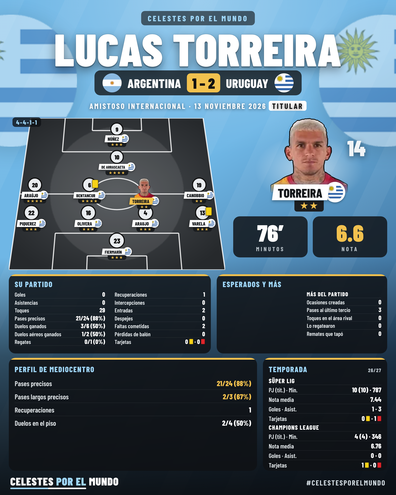
[Abrir la imagen en tamaño completo](https://github.com/tuscxm/celestes-por-el-mundo/blob/main/salida/png/L.%20Torreira/2026-11-13%20%C2%B7%20Argentina%20%C2%B7%20Amistoso%20Internacional/Torreira_Argentina-Uruguay_2026-11-13.png)

Texto para el posteo:
```
🇺🇾 LUCAS TORREIRA · Argentina 1-2 Uruguay
⏱ 76' · ⭐ 6.6

Jugó de mediocentro: 21/24 pases (88%), 3/6 duelos ganados, 1 recuperación y 3 pases al último tercio.

🧩 ¿Y en una Uruguay 3-5-2 con enganche?
Sería uno de los dos internos: 21/24 pases (88%), 1 recuperación y 3/6 duelos ganados. Es el que sostiene y hace circular para que el enganche reciba de frente.

Tres atrás, dos carrileros, dos internos, un 10 suelto y dos puntas. ¿Lo jugarías así? 👇
#CelestesPorElMundo #Uruguay #352
```

## Piquerez · Argentina 1-2 Uruguay

[Abrir la imagen en tamaño completo](https://github.com/tuscxm/celestes-por-el-mundo/blob/main/salida/png/J.%20Piquerez/2026-11-13%20%C2%B7%20Argentina%20%C2%B7%20Amistoso%20Internacional/Piquerez_Argentina-Uruguay_2026-11-13.png)

Texto para el posteo:
```
🇺🇾 JOAQUÍN PIQUEREZ · Argentina 1-2 Uruguay
⏱ 58' · ⭐ 7.2

Jugó de lateral izquierdo: 14/18 pases (78%) y 5/5 duelos ganados.
#CelestesPorElMundo #Uruguay #352
```

## Olivera · Argentina 1-2 Uruguay
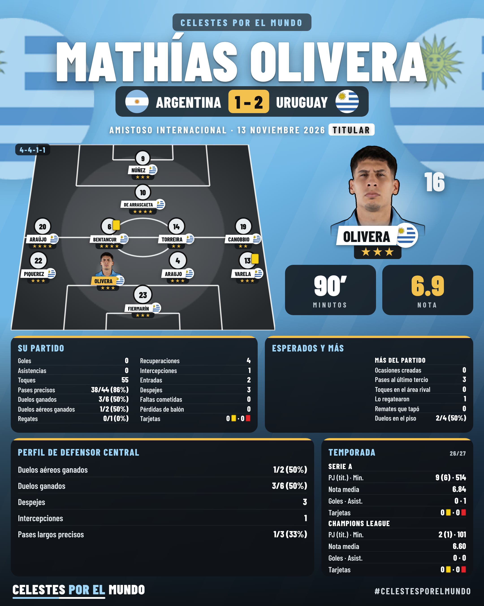
[Abrir la imagen en tamaño completo](https://github.com/tuscxm/celestes-por-el-mundo/blob/main/salida/png/M.%20Olivera/2026-11-13%20%C2%B7%20Argentina%20%C2%B7%20Amistoso%20Internacional/Olivera_Argentina-Uruguay_2026-11-13.png)

Texto para el posteo:
```
🇺🇾 MATHÍAS OLIVERA · Argentina 1-2 Uruguay
⏱ 90' · ⭐ 6.9

Jugó de defensor central: 38/44 pases (86%), 3/6 duelos ganados, 4 recuperaciones y 3 pases al último tercio.

🧩 ¿Y en una Uruguay 3-5-2 con enganche?
Lo vemos de zaguero en la línea de tres: 38/44 pases (86%), 3/6 duelos ganados y 1/2 por arriba. Con tres atrás, un central que sale limpio le suma un pase para encontrar al enganche y deja a los carrileros libres para pasar.

Tres atrás, dos carrileros, dos internos, un 10 suelto y dos puntas. ¿Lo jugarías así? 👇
#CelestesPorElMundo #Uruguay #352
```

## Varela · Argentina 1-2 Uruguay
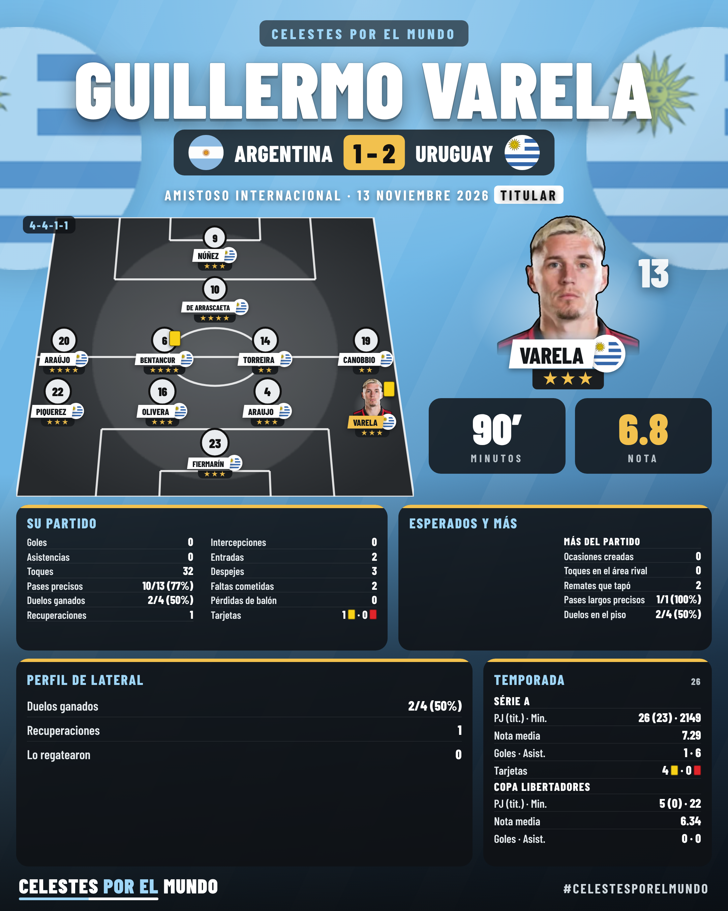
[Abrir la imagen en tamaño completo](https://github.com/tuscxm/celestes-por-el-mundo/blob/main/salida/png/G.%20Varela/2026-11-13%20%C2%B7%20Argentina%20%C2%B7%20Amistoso%20Internacional/Varela_Argentina-Uruguay_2026-11-13.png)

Texto para el posteo:
```
🇺🇾 GUILLERMO VARELA · Argentina 1-2 Uruguay
⏱ 90' · ⭐ 6.8

Jugó de lateral derecho: 10/13 pases (77%), 2/4 duelos ganados y 1 recuperación.

🧩 ¿Y en una Uruguay 3-5-2 con enganche?
Sería carrilero: 1 recuperación. En el 3-5-2 toda la banda es suya, y con tres centrales atrás puede pasar sin dejar la espalda sola.

Tres atrás, dos carrileros, dos internos, un 10 suelto y dos puntas. ¿Lo jugarías así? 👇
#CelestesPorElMundo #Uruguay #352
```

## Arrascaeta · Argentina 1-2 Uruguay
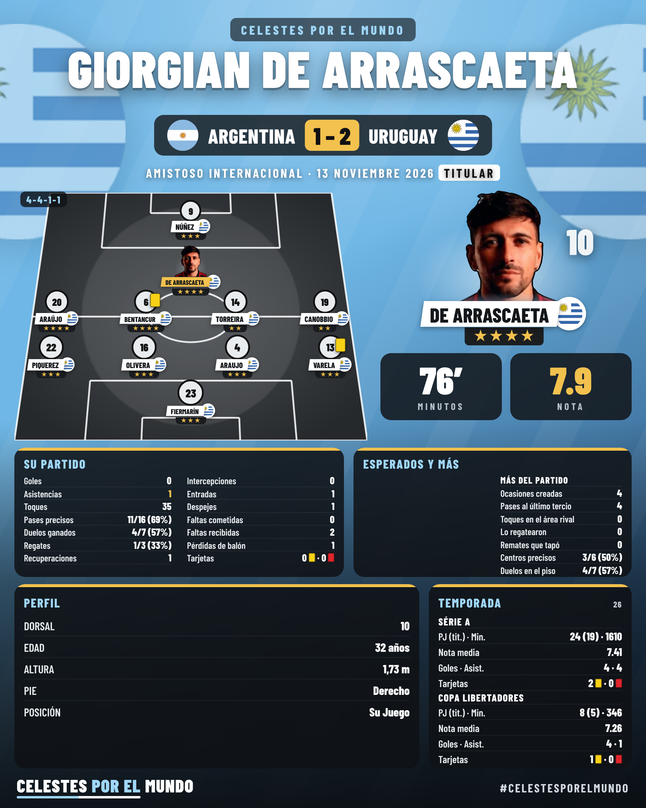
[Abrir la imagen en tamaño completo](https://github.com/tuscxm/celestes-por-el-mundo/blob/main/salida/png/G.%20De%20Arrascaeta/2026-11-13%20%C2%B7%20Argentina%20%C2%B7%20Amistoso%20Internacional/DeArrascaeta_Argentina-Uruguay_2026-11-13.png)

Texto para el posteo:
```
🇺🇾 GIORGIAN DE ARRASCAETA · Argentina 1-2 Uruguay
⏱ 76' · ⭐ 7.9

Jugó de titular: 11/16 pases (69%), 4/7 duelos ganados, 1 recuperación y 4 pases al último tercio.

🧩 ¿Y en una Uruguay 3-5-2 con enganche?
Es el 10 que pide el sistema: 4 ocasiones creadas, 4 pases al último tercio y 1/3 regates. Suelto detrás de dos puntas, con dos internos que lo cubren, Uruguay junta a los que definen.

Tres atrás, dos carrileros, dos internos, un 10 suelto y dos puntas. ¿Lo jugarías así? 👇
#CelestesPorElMundo #Uruguay #352
```

## Pellistri · Argentina 1-2 Uruguay
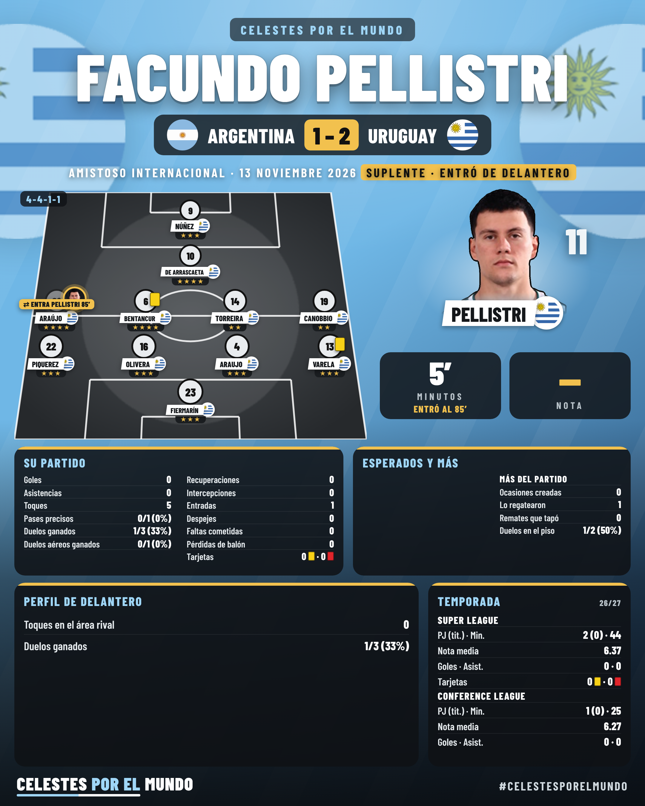
[Abrir la imagen en tamaño completo](https://github.com/tuscxm/celestes-por-el-mundo/blob/main/salida/png/F.%20Pellistri/2026-11-13%20%C2%B7%20Argentina%20%C2%B7%20Amistoso%20Internacional/Pellistri_Argentina-Uruguay_2026-11-13.png)

Texto para el posteo:
```
🇺🇾 FACUNDO PELLISTRI · Argentina 1-2 Uruguay
⏱ 5'
🔁 Entró al 85' por Araújo, como delantero

Jugó de delantero.
#CelestesPorElMundo #Uruguay #352
```

## Aguirre · Argentina 1-2 Uruguay
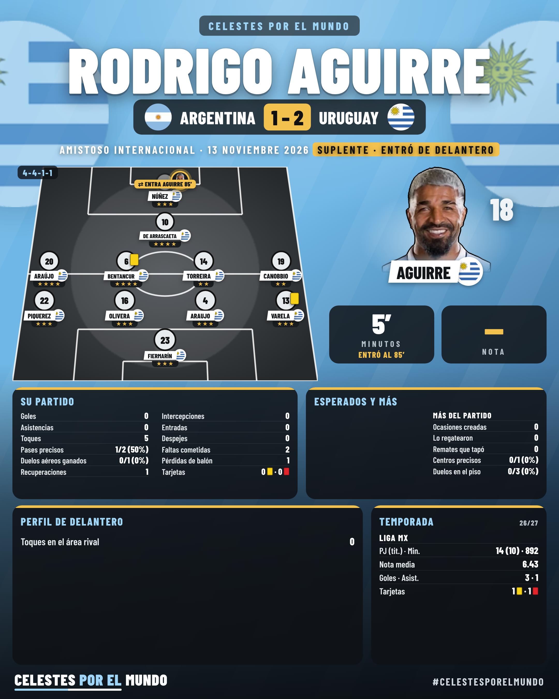
[Abrir la imagen en tamaño completo](https://github.com/tuscxm/celestes-por-el-mundo/blob/main/salida/png/R.%20Aguirre/2026-11-13%20%C2%B7%20Argentina%20%C2%B7%20Amistoso%20Internacional/Aguirre_Argentina-Uruguay_2026-11-13.png)

Texto para el posteo:
```
🇺🇾 RODRIGO AGUIRRE · Argentina 1-2 Uruguay
⏱ 5'
🔁 Entró al 85' por Núñez, como delantero

Jugó de delantero: 1 recuperación.
#CelestesPorElMundo #Uruguay #352
```

## Viñas · Argentina 1-2 Uruguay
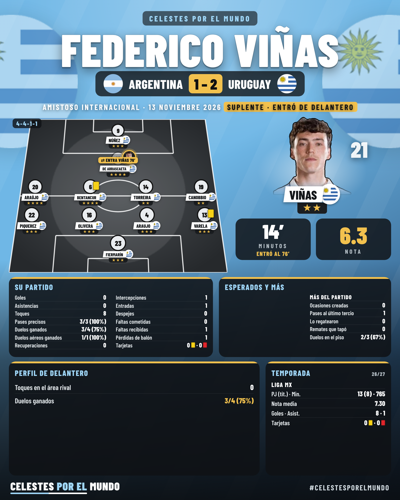
[Abrir la imagen en tamaño completo](https://github.com/tuscxm/celestes-por-el-mundo/blob/main/salida/png/F.%20Vi%C3%B1as/2026-11-13%20%C2%B7%20Argentina%20%C2%B7%20Amistoso%20Internacional/Vinas_Argentina-Uruguay_2026-11-13.png)

Texto para el posteo:
```
🇺🇾 FEDERICO VIÑAS · Argentina 1-2 Uruguay
⏱ 14' · ⭐ 6.3
🔁 Entró al 76' por Arrascaeta, como delantero

Jugó de delantero: 3/4 duelos ganados y 1 pase al último tercio.

🧩 ¿Y en una Uruguay 3-5-2 con enganche?
Sería uno de los dos de punta: 3/4 duelos ganados. Con un enganche que lo habilite y otro 9 al lado, deja de pelear solo contra los centrales.

Tres atrás, dos carrileros, dos internos, un 10 suelto y dos puntas. ¿Lo jugarías así? 👇
#CelestesPorElMundo #Uruguay #352
```

---
En X se publican solas en unos minutos (menos las que la revisión ponga en *No publicar en X*); en Instagram no se publicó nada. Cerrá este aviso cuando la publiques o la descartes.
## Revisión visual
- **M. Araújo: su infografía se perdió.** Maximiliano y Ronald Araújo generan el mismo nombre de archivo (`Araujo_Argentina-Uruguay_2026-11-13`) y la de Ronald pisó a la de Maximiliano (85', titular, nota 7.3). Solo quedó la de Ronald (en `salida/png/R. Araújo/`); la sección "M. Araújo" de este aviso muestra en realidad la de Ronald. `araujo_2026-11-13` quedó en procesados.json: para rehacerla hay que sacarlo y correr `bash automatizacion/correr.sh --fecha 2026-11-13 --clave araujo --forzar` (conviene que el script use un nombre distinto para cada Araújo).
- Todas salieron con el respaldo de FotMob (SofaScore 403): sin mapa de calor ni SU ZONA (va el PERFIL en esa fila), la columna ESPERADOS vacía (sin xG/xA) y en la cancha solo la cara del protagonista. No es el diseño anterior (TOTALES y franja): es la parte de abajo por puesto, recortada.
- Valverde, Bernal y Cáceres (suplentes): el texto del posteo dice "Jugó de titular:" y el cuadro PERFIL es el genérico con "POSICIÓN: Su Juego" (no se supo dónde entraron).
- De Arrascaeta: jugó de enganche (el "1" del 4-4-1-1) pero el PERFIL es el genérico con "POSICIÓN: Su Juego" y el texto dice "Jugó de titular:".
- Bernal: TEMPORADA dice "SÉRIE A" (temporada "26") para un jugador del Real Betis: el nombre de la liga (y quizá los números) no corresponden.
- Canobbio: la foto grande quedó con fondo blanco entre el pelo a los dos costados de la cara.
- Pellistri: dice "ENTRÓ DE DELANTERO" y PERFIL DE DELANTERO, pero entró al 85' por M. Araújo, volante por izquierda.
- Valverde: tiene una amarilla en SU PARTIDO que no se ve en la cancha (su cara chica va encima de Canobbio).
- Piquerez, Pellistri y Aguirre: el texto del posteo no trae la parte del 3-5-2 (Pellistri queda solo con "Jugó de delantero.").
- Arriba todo bien: colores celestes, bandera como escudo, "AMISTOSO INTERNACIONAL", marcador 1-2, sin textos cortados ni nombres de fuentes; los números de la infografía coinciden con los del texto.
- De la Cruz: ERROR. SofaScore 403 y el respaldo de FotMob falló (`AttributeError: 'NoneType' object has no attribute 'get'`); no tiene página de BeSoccer en la lista y BeSoccer no cargó, así que no se pudo saber si jugó.
- Fuentes con error: SofaScore 403; BeSoccer no cargó ninguna página ("A required part of this site couldn't load"), besoccer_hoy.json quedó vacío; API-Football: el plan gratis no cubre esta temporada; zerozero HTTP 403; Understat: formato de página no reconocido (o liga sin cobertura).

## No publicar en X
- Valverde_Argentina-Uruguay_2026-11-13: el texto dice "Jugó de titular" y entró de suplente; PERFIL con "Posición: Su Juego"
- Bernal_Argentina-Uruguay_2026-11-13: el texto dice "Jugó de titular" y entró de suplente; TEMPORADA dice "SÉRIE A" para un jugador del Betis
- Caceres_Argentina-Uruguay_2026-11-13: el texto dice "Jugó de titular" y entró de suplente; PERFIL con "Posición: Su Juego"
- DeArrascaeta_Argentina-Uruguay_2026-11-13: jugó de enganche y el PERFIL es el genérico con "Posición: Su Juego"
- Canobbio_Argentina-Uruguay_2026-11-13: cara mal recortada (fondo blanco entre el pelo)
- Pellistri_Argentina-Uruguay_2026-11-13: dice "entró de delantero" y entró por un volante por izquierda (PERFIL que no corresponde)
