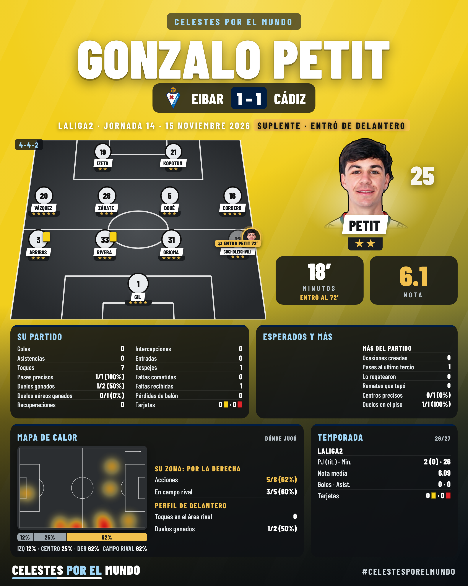
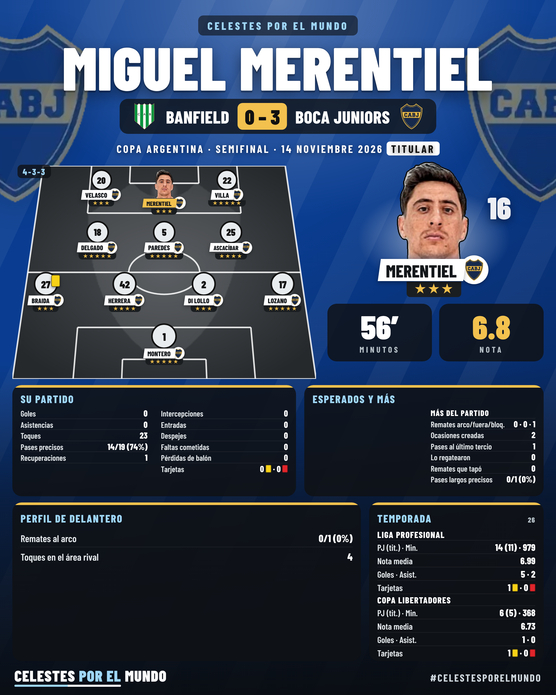
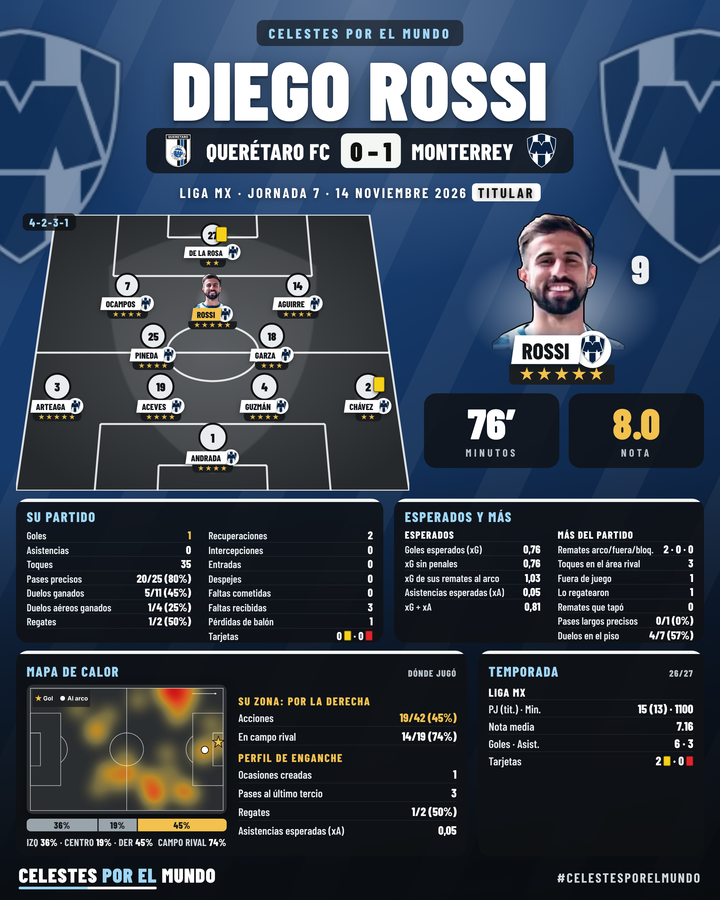

Petit jugó 18' (suplente, nota 6.1) en Eibar 1-1 Cádiz; Merentiel jugó 56' (titular, nota 6.8) en Banfield 0-3 Boca Juniors; Rossi jugó 76' (titular, nota 8.0) en Querétaro FC 0-1 Monterrey; infografías listas (con errores)

@tuscxm

## Quién jugó
- **Petit** jugó 18' (suplente, entró al 72' por Gocholeishvili, nota 6.1, de delantero) en Eibar 1-1 Cádiz · LaLiga2
- **Merentiel** jugó 56' (titular, nota 6.8, de delantero) en Banfield 0-3 Boca Juniors · Copa Argentina
- **Rossi** jugó 76' (titular, nota 8.0, de mediocentro) en Querétaro FC 0-1 Monterrey · Liga MX

## El resto
- Valverde: sin partido hoy ni ayer
- Bernal: sin partido hoy ni ayer
- Mouriño: sin partido hoy ni ayer
- M. Araújo: sin partido hoy ni ayer
- Á. Rodríguez: sin partido hoy ni ayer
- González: sin partido hoy ni ayer
- Cáceres: sin partido hoy ni ayer
- Bentancur: sin partido hoy ni ayer
- Satriano: sin partido hoy ni ayer
- Boselli: sin partido hoy ni ayer
- J. Rodríguez: sin partido hoy ni ayer
- Zalazar: sin partido hoy ni ayer
- Giménez: sin partido hoy ni ayer
- Amaro: sin partido hoy ni ayer
- R. Araújo: sin partido hoy ni ayer
- J. M. Sanabria: sin partido hoy ni ayer
- Ugarte: sin partido hoy ni ayer
- Canobbio: sin partido hoy ni ayer
- Darwin: sin partido hoy ni ayer
- F. Díaz: sin partido hoy ni ayer
- Torreira: sin partido hoy ni ayer
- Brizuela: sin partido hoy ni ayer
- Piquerez: sin partido hoy ni ayer
- Matturro: sin partido hoy ni ayer
- Olivera: sin partido hoy ni ayer
- Varela: sin partido hoy ni ayer
- Nández: sin partido hoy ni ayer
- Bueno: sin partido hoy ni ayer
- Pereira: sin partido hoy ni ayer
- Marichal: sin partido hoy ni ayer
- Barboza: sin partido hoy ni ayer
- Olaza: sin partido hoy ni ayer
- Fonseca: sin partido hoy ni ayer
- E. Martínez: sin partido hoy ni ayer
- De la Cruz: ERROR al revisar (no se pudo consultar SofaScore) → `<HTTPError 403: 'Forbidden'>`
- Arrascaeta: sin partido hoy ni ayer
- Pellistri: sin partido hoy ni ayer
- B. Rodríguez: sin partido hoy ni ayer
- Damiani: sin partido hoy ni ayer
- Aguirre: sin partido hoy ni ayer
- Viñas: sin partido hoy ni ayer

## Avisos
- Petit: SofaScore no respondió; fuentes: fotmob ok, besoccer ok, api_football sin datos: el plan gratis de API-Football no cubre esta temporada (plan: Free plans do not have access to this season, try from 2022 to 2024.), thesportsdb ok, understat sin datos: sin understat_equipo (Understat no cubre esa liga), zerozero error HTTP 403
- Petit: Entró de suplente: el puesto (delantero) es su puesto habitual, no se sabe dónde entró
- Petit: Armada con datos de respaldo (FotMob): hay menos estadísticas que de costumbre, revisala antes de publicar
- Merentiel: SofaScore no respondió; fuentes: fotmob ok, besoccer ok, api_football sin datos: el plan gratis de API-Football no cubre esta temporada (plan: Free plans do not have access to this season, try from 2022 to 2024.), thesportsdb ok, understat sin datos: sin understat_equipo (Understat no cubre esa liga), zerozero error HTTP 403
- Merentiel: No hay mapa de calor de este partido en el respaldo: se muestra el perfil
- Merentiel: Armada con datos de respaldo (FotMob): hay menos estadísticas que de costumbre, revisala antes de publicar
- Rossi: SofaScore no respondió; fuentes: fotmob ok, besoccer ok, api_football sin datos: el plan gratis de API-Football no cubre esta temporada (plan: Free plans do not have access to this season, try from 2022 to 2024.), thesportsdb ok, understat sin datos: sin understat_equipo (Understat no cubre esa liga), zerozero error HTTP 403
- Rossi: Armada con datos de respaldo (FotMob): hay menos estadísticas que de costumbre, revisala antes de publicar

## Petit · Eibar 1-1 Cádiz

[Abrir la imagen en tamaño completo](https://github.com/tuscxm/celestes-por-el-mundo/blob/main/salida/png/G.%20Petit/2026-11-15%20%C2%B7%20Eibar%20%C2%B7%20LaLiga%202/Petit_Eibar-Cadiz_2026-11-15.png)

Texto para el posteo:
```
🇺🇾 GONZALO PETIT · Eibar 1-1 Cádiz
⏱ 18' · ⭐ 6.1
🔁 Entró al 72' por Gocholeishvili, como delantero

Jugó de delantero: 62% de sus acciones por la derecha, 1/2 duelos ganados y 1 pase al último tercio.

🧩 ¿Y en una Uruguay 3-5-2 con enganche?
Sería uno de los dos de punta: 1/2 duelos ganados. Con un enganche que lo habilite y otro 9 al lado, deja de pelear solo contra los centrales.

Tres atrás, dos carrileros, dos internos, un 10 suelto y dos puntas. ¿Lo jugarías así? 👇
#CelestesPorElMundo #Uruguay #Cádiz #352
```

## Merentiel · Banfield 0-3 Boca Juniors

[Abrir la imagen en tamaño completo](https://github.com/tuscxm/celestes-por-el-mundo/blob/main/salida/png/M.%20Merentiel/2026-11-14%20%C2%B7%20Banfield%20%C2%B7%20Copa%20Argentina/Merentiel_Banfield-BocaJuniors_2026-11-14.png)

Texto para el posteo:
```
🇺🇾 MIGUEL MERENTIEL · Banfield 0-3 Boca Juniors
⏱ 56' · ⭐ 6.8

Jugó de delantero: 14/19 pases (74%), 1 recuperación, 1 pase al último tercio y 2 ocasiones creadas.

🧩 ¿Y en una Uruguay 3-5-2 con enganche?
Sería uno de los dos de punta: 4 toques en el área rival. Con un enganche que lo habilite y otro 9 al lado, deja de pelear solo contra los centrales.

Tres atrás, dos carrileros, dos internos, un 10 suelto y dos puntas. ¿Lo jugarías así? 👇
#CelestesPorElMundo #Uruguay #BocaJuniors #352
```

## Rossi · Querétaro FC 0-1 Monterrey

[Abrir la imagen en tamaño completo](https://github.com/tuscxm/celestes-por-el-mundo/blob/main/salida/png/D.%20Rossi/2026-11-14%20%C2%B7%20Quer%C3%A9taro%20FC%20%C2%B7%20Liga%20Mx/Rossi_QueretaroFC-Monterrey_2026-11-14.png)

Texto para el posteo:
```
🇺🇾 DIEGO ROSSI · Querétaro FC 0-1 Monterrey
⏱ 76' · ⭐ 8.0

Jugó de enganche: 45% de sus acciones por la derecha, 1 gol, 20/25 pases (80%) y 2 recuperaciones.

🧩 ¿Y en una Uruguay 3-5-2 con enganche?
Sería uno de los dos de punta: 1 gol, 2 de 2 remates al arco y 3 toques en el área rival. Con un enganche que lo habilite y otro 9 al lado, deja de pelear solo contra los centrales.

Tres atrás, dos carrileros, dos internos, un 10 suelto y dos puntas. ¿Lo jugarías así? 👇
#CelestesPorElMundo #Uruguay #CFMonterrey #352
```

---
En X se publican solas en unos minutos (menos las que la revisión ponga en *No publicar en X*); en Instagram no se publicó nada. Cerrá este aviso cuando la publiques o la descartes.
## Revisión visual
- Fuentes: SofaScore respondió 403 (las tres salieron con el respaldo de FotMob); API-Football: plan gratis sin la temporada; zerozero: HTTP 403; BeSoccer no cargó (página de error) y besoccer_hoy.json quedó vacío.
- De la Cruz: error sin resolver (SofaScore 403 y el respaldo de FotMob falló con `AttributeError`); no tiene URL de BeSoccer en jugadores.json y BeSoccer igual no respondía.
- Petit_Eibar-Cadiz_2026-11-15: falta el escudo de Cádiz en todos lados (marcador, placa, marcas de agua, cancha): `escudo_visita` y `escudo_club` quedaron en null. Además entró por Gocholeishvili (lateral derecho) y figura "entró de delantero" por su puesto habitual (aviso del script). El resto se ve bien: cara con contorno, sin textos encimados, números coinciden con el posteo.
- Merentiel_Banfield-BocaJuniors_2026-11-14: sin mapa de calor (el respaldo no lo trae), así que la fila de abajo muestra solo el PERFIL DE DELANTERO; la columna ESPERADOS queda vacía (sin xG/xA). TEMPORADA con Liga Profesional y Libertadores. Datos coinciden con el posteo.
- Rossi_QueretaroFC-Monterrey_2026-11-14: bien. El resumen dice "de mediocentro" pero jugó en el medio de la línea de tres del 4-2-3-1: PERFIL DE ENGANCHE y "Jugó de enganche" en el posteo son correctos (detalle menor solo del título del aviso).
- Ninguna infografía ni texto nombra fuentes.

## No publicar en X
- Petit_Eibar-Cadiz_2026-11-15: falta el escudo de Cádiz (marcador, placa y marcas de agua)
