Valverde jugó 28' (suplente, nota 7.5) en Uruguay 5-0 Dominican Republic; Bernal jugó 75' (titular, nota 7.3) en Uruguay 5-0 Dominican Republic; Mouriño jugó 62' (titular, nota 7.5) en Uruguay 5-0 Dominican Republic; Cáceres jugó 90' (titular, nota 7

@tuscxm

## Quién jugó
- **Valverde** jugó 28' (suplente, nota 7.5, su juego) en Uruguay 5-0 Dominican Republic · Amistoso internacional
- **Bernal** jugó 75' (titular, nota 7.3, de mediocentro) en Uruguay 5-0 Dominican Republic · Amistoso internacional
- **Mouriño** jugó 62' (titular, nota 7.5, de lateral derecho) en Uruguay 5-0 Dominican Republic · Amistoso internacional
- **Cáceres** jugó 90' (titular, nota 7.3, de defensor central) en Uruguay 5-0 Dominican Republic · Amistoso internacional
- **Bentancur** jugó 84' (titular, nota 8.3, de mediocentro) en Uruguay 5-0 Dominican Republic · Amistoso internacional
- **Satriano** jugó 15' (suplente, nota 6.5, de delantero) en Uruguay 5-0 Dominican Republic · Amistoso internacional
- **J. Rodríguez** jugó 15' (suplente, nota 6.3, su juego) en Uruguay 5-0 Dominican Republic · Amistoso internacional
- **Zalazar** jugó 62' (titular, nota 6.9, de volante por izquierda) en Uruguay 5-0 Dominican Republic · Amistoso internacional
- **Giménez** jugó 75' (titular, nota 7.7, de defensor central) en Uruguay 5-0 Dominican Republic · Amistoso internacional
- **R. Araújo** jugó 28' (suplente, nota 7.0, su juego) en Uruguay 5-0 Dominican Republic · Amistoso internacional
- **J. M. Sanabria** jugó 45' (titular, nota 6.9, de lateral izquierdo) en Uruguay 5-0 Dominican Republic · Amistoso internacional
- **Canobbio** jugó 75' (titular, nota 7.5, de volante por derecha) en Uruguay 5-0 Dominican Republic · Amistoso internacional
- **Darwin** jugó 28' (suplente, nota 7.3, de delantero) en Uruguay 5-0 Dominican Republic · Amistoso internacional
- **Olivera** jugó 45' (suplente, nota 6.7, su juego) en Uruguay 5-0 Dominican Republic · Amistoso internacional
- **Pellistri** jugó 15' (suplente, nota 7.3, su juego) en Uruguay 5-0 Dominican Republic · Amistoso internacional
- **Damiani** jugó 6' (suplente, de delantero) en Uruguay 5-0 Dominican Republic · Amistoso internacional
- **Aguirre** jugó 62' (titular, nota 7.6, de delantero) en Uruguay 5-0 Dominican Republic · Amistoso internacional
- **Viñas** jugó 75' (titular, nota 7.3, de delantero) en Uruguay 5-0 Dominican Republic · Amistoso internacional

## El resto
- M. Araújo: no jugó en Uruguay 5-0 Dominican Republic (no entró)
- Á. Rodríguez: sin partido hoy ni ayer
- González: sin partido hoy ni ayer
- Petit: sin partido hoy ni ayer
- Boselli: sin partido hoy ni ayer
- Merentiel: sin partido hoy ni ayer
- Amaro: sin partido hoy ni ayer
- Ugarte: sin partido hoy ni ayer
- F. Díaz: sin partido hoy ni ayer
- Torreira: no jugó en Uruguay 5-0 Dominican Republic (no entró)
- Brizuela: sin partido hoy ni ayer
- Piquerez: sin partido hoy ni ayer
- Matturro: sin partido hoy ni ayer
- Varela: sin partido hoy ni ayer
- Nández: sin partido hoy ni ayer
- Bueno: sin partido hoy ni ayer
- Pereira: sin partido hoy ni ayer
- Marichal: sin partido hoy ni ayer
- Barboza: sin partido hoy ni ayer
- Olaza: sin partido hoy ni ayer
- Fonseca: sin partido hoy ni ayer
- E. Martínez: sin partido hoy ni ayer
- De la Cruz: ERROR al revisar (no se pudo consultar SofaScore) → `<HTTPError 403: 'Forbidden'>`
- Arrascaeta: sin partido hoy ni ayer
- Rossi: sin partido hoy ni ayer
- B. Rodríguez: sin partido hoy ni ayer

## Avisos
- Valverde: SofaScore no respondió; fuentes: fotmob ok, besoccer ok, api_football sin datos: el plan gratis de API-Football no cubre esta temporada (plan: Free plans do not have access to this season, try from 2022 to 2024.), thesportsdb ok, understat sin datos: formato de página no reconocido, zerozero error HTTP 403
- Valverde: No hay mapa de calor de este partido en el respaldo: se muestra el perfil
- Valverde: No se pudo saber el puesto en el que jugó
- Valverde: Armada con datos de respaldo (FotMob): hay menos estadísticas que de costumbre, revisala antes de publicar
- Bernal: SofaScore no respondió; fuentes: fotmob ok, besoccer ok, api_football sin datos: el plan gratis de API-Football no cubre esta temporada (plan: Free plans do not have access to this season, try from 2022 to 2024.), thesportsdb ok, understat sin datos: formato de página no reconocido, zerozero error HTTP 403
- Bernal: No hay mapa de calor de este partido en el respaldo: se muestra el perfil
- Bernal: Armada con datos de respaldo (FotMob): hay menos estadísticas que de costumbre, revisala antes de publicar
- Mouriño: SofaScore no respondió; fuentes: fotmob ok, besoccer ok, api_football sin datos: el plan gratis de API-Football no cubre esta temporada (plan: Free plans do not have access to this season, try from 2022 to 2024.), thesportsdb ok, understat sin datos: formato de página no reconocido, zerozero error HTTP 403
- Mouriño: No hay mapa de calor de este partido en el respaldo: se muestra el perfil
- Mouriño: Armada con datos de respaldo (FotMob): hay menos estadísticas que de costumbre, revisala antes de publicar
- Cáceres: SofaScore no respondió; fuentes: fotmob ok, besoccer ok, api_football sin datos: el plan gratis de API-Football no cubre esta temporada (plan: Free plans do not have access to this season, try from 2022 to 2024.), thesportsdb ok, understat sin datos: formato de página no reconocido, zerozero error HTTP 403
- Cáceres: No hay mapa de calor de este partido en el respaldo: se muestra el perfil
- Cáceres: Armada con datos de respaldo (FotMob): hay menos estadísticas que de costumbre, revisala antes de publicar
- Bentancur: SofaScore no respondió; fuentes: fotmob ok, besoccer ok, api_football sin datos: el plan gratis de API-Football no cubre esta temporada (plan: Free plans do not have access to this season, try from 2022 to 2024.), thesportsdb ok, understat sin datos: formato de página no reconocido, zerozero error HTTP 403
- Bentancur: No hay mapa de calor de este partido en el respaldo: se muestra el perfil
- Bentancur: Armada con datos de respaldo (FotMob): hay menos estadísticas que de costumbre, revisala antes de publicar
- Satriano: SofaScore no respondió; fuentes: fotmob ok, besoccer ok, api_football sin datos: el plan gratis de API-Football no cubre esta temporada (plan: Free plans do not have access to this season, try from 2022 to 2024.), thesportsdb ok, understat sin datos: formato de página no reconocido, zerozero error HTTP 403
- Satriano: Entró de suplente: el puesto (delantero) es su puesto habitual, no se sabe dónde entró
- Satriano: Sin remates en el respaldo: TOTALES va sin lo de ataque
- Satriano: No hay mapa de calor de este partido en el respaldo: se muestra el perfil
- Satriano: Armada con datos de respaldo (FotMob): hay menos estadísticas que de costumbre, revisala antes de publicar
- J. Rodríguez: SofaScore no respondió; fuentes: fotmob ok, besoccer ok, api_football sin datos: el plan gratis de API-Football no cubre esta temporada (plan: Free plans do not have access to this season, try from 2022 to 2024.), thesportsdb ok, understat sin datos: formato de página no reconocido, zerozero error HTTP 403
- J. Rodríguez: No hay mapa de calor de este partido en el respaldo: se muestra el perfil
- J. Rodríguez: No se pudo saber el puesto en el que jugó
- J. Rodríguez: Armada con datos de respaldo (FotMob): hay menos estadísticas que de costumbre, revisala antes de publicar
- Zalazar: SofaScore no respondió; fuentes: fotmob ok, besoccer ok, api_football sin datos: el plan gratis de API-Football no cubre esta temporada (plan: Free plans do not have access to this season, try from 2022 to 2024.), thesportsdb ok, understat sin datos: sin understat_equipo (Understat no cubre esa liga), zerozero error HTTP 403
- Zalazar: No hay mapa de calor de este partido en el respaldo: se muestra el perfil
- Zalazar: Armada con datos de respaldo (FotMob): hay menos estadísticas que de costumbre, revisala antes de publicar
- Giménez: SofaScore no respondió; fuentes: fotmob ok, besoccer ok, api_football sin datos: el plan gratis de API-Football no cubre esta temporada (plan: Free plans do not have access to this season, try from 2022 to 2024.), thesportsdb ok, understat sin datos: sin understat_equipo (Understat no cubre esa liga), zerozero error HTTP 403
- Giménez: No hay mapa de calor de este partido en el respaldo: se muestra el perfil
- Giménez: Armada con datos de respaldo (FotMob): hay menos estadísticas que de costumbre, revisala antes de publicar
- R. Araújo: SofaScore no respondió; fuentes: fotmob ok, besoccer ok, api_football sin datos: el plan gratis de API-Football no cubre esta temporada (plan: Free plans do not have access to this season, try from 2022 to 2024.), thesportsdb ok, understat sin datos: formato de página no reconocido, zerozero error HTTP 403
- R. Araújo: No hay mapa de calor de este partido en el respaldo: se muestra el perfil
- R. Araújo: No se pudo saber el puesto en el que jugó
- R. Araújo: Armada con datos de respaldo (FotMob): hay menos estadísticas que de costumbre, revisala antes de publicar
- J. M. Sanabria: SofaScore no respondió; fuentes: fotmob ok, besoccer ok, api_football sin datos: el plan gratis de API-Football no cubre esta temporada (plan: Free plans do not have access to this season, try from 2022 to 2024.), thesportsdb ok, understat sin datos: sin understat_equipo (Understat no cubre esa liga), zerozero error HTTP 403
- J. M. Sanabria: No hay mapa de calor de este partido en el respaldo: se muestra el perfil
- J. M. Sanabria: Armada con datos de respaldo (FotMob): hay menos estadísticas que de costumbre, revisala antes de publicar
- Canobbio: SofaScore no respondió; fuentes: fotmob ok, besoccer ok, api_football sin datos: el plan gratis de API-Football no cubre esta temporada (plan: Free plans do not have access to this season, try from 2022 to 2024.), thesportsdb ok, understat sin datos: sin understat_equipo (Understat no cubre esa liga), zerozero error HTTP 403
- Canobbio: No hay mapa de calor de este partido en el respaldo: se muestra el perfil
- Canobbio: Armada con datos de respaldo (FotMob): hay menos estadísticas que de costumbre, revisala antes de publicar
- Darwin: SofaScore no respondió; fuentes: fotmob ok, besoccer ok, api_football sin datos: el plan gratis de API-Football no cubre esta temporada (plan: Free plans do not have access to this season, try from 2022 to 2024.), thesportsdb ok, understat sin datos: sin understat_equipo (Understat no cubre esa liga), zerozero error HTTP 403
- Darwin: Entró de suplente: el puesto (delantero) es su puesto habitual, no se sabe dónde entró
- Darwin: No hay mapa de calor de este partido en el respaldo: se muestra el perfil
- Darwin: Armada con datos de respaldo (FotMob): hay menos estadísticas que de costumbre, revisala antes de publicar
- Olivera: SofaScore no respondió; fuentes: fotmob ok, besoccer ok, api_football sin datos: el plan gratis de API-Football no cubre esta temporada (plan: Free plans do not have access to this season, try from 2022 to 2024.), thesportsdb ok, understat sin datos: formato de página no reconocido, zerozero error HTTP 403
- Olivera: No hay mapa de calor de este partido en el respaldo: se muestra el perfil
- Olivera: No se pudo saber el puesto en el que jugó
- Olivera: Armada con datos de respaldo (FotMob): hay menos estadísticas que de costumbre, revisala antes de publicar
- Pellistri: SofaScore no respondió; fuentes: fotmob ok, besoccer ok, api_football sin datos: el plan gratis de API-Football no cubre esta temporada (plan: Free plans do not have access to this season, try from 2022 to 2024.), thesportsdb ok, understat sin datos: sin understat_equipo (Understat no cubre esa liga), zerozero error HTTP 403
- Pellistri: No hay mapa de calor de este partido en el respaldo: se muestra el perfil
- Pellistri: No se pudo saber el puesto en el que jugó
- Pellistri: Armada con datos de respaldo (FotMob): hay menos estadísticas que de costumbre, revisala antes de publicar
- Damiani: SofaScore no respondió; fuentes: fotmob ok, besoccer ok, api_football sin datos: el plan gratis de API-Football no cubre esta temporada (plan: Free plans do not have access to this season, try from 2022 to 2024.), thesportsdb ok, understat sin datos: sin understat_equipo (Understat no cubre esa liga), zerozero error HTTP 403
- Damiani: Entró de suplente: el puesto (delantero) es su puesto habitual, no se sabe dónde entró
- Damiani: No hay mapa de calor de este partido en el respaldo: se muestra el perfil
- Damiani: Armada con datos de respaldo (FotMob): hay menos estadísticas que de costumbre, revisala antes de publicar
- Aguirre: SofaScore no respondió; fuentes: fotmob ok, besoccer ok, api_football sin datos: el plan gratis de API-Football no cubre esta temporada (plan: Free plans do not have access to this season, try from 2022 to 2024.), thesportsdb ok, understat sin datos: sin understat_equipo (Understat no cubre esa liga), zerozero error HTTP 403
- Aguirre: No hay mapa de calor de este partido en el respaldo: se muestra el perfil
- Aguirre: Armada con datos de respaldo (FotMob): hay menos estadísticas que de costumbre, revisala antes de publicar
- Viñas: SofaScore no respondió; fuentes: fotmob ok, besoccer ok, api_football sin datos: el plan gratis de API-Football no cubre esta temporada (plan: Free plans do not have access to this season, try from 2022 to 2024.), thesportsdb ok, understat sin datos: sin understat_equipo (Understat no cubre esa liga), zerozero error HTTP 403
- Viñas: Sin remates en el respaldo: TOTALES va sin lo de ataque
- Viñas: No hay mapa de calor de este partido en el respaldo: se muestra el perfil
- Viñas: Armada con datos de respaldo (FotMob): hay menos estadísticas que de costumbre, revisala antes de publicar

## Valverde · Uruguay 5-0 Dominican Republic
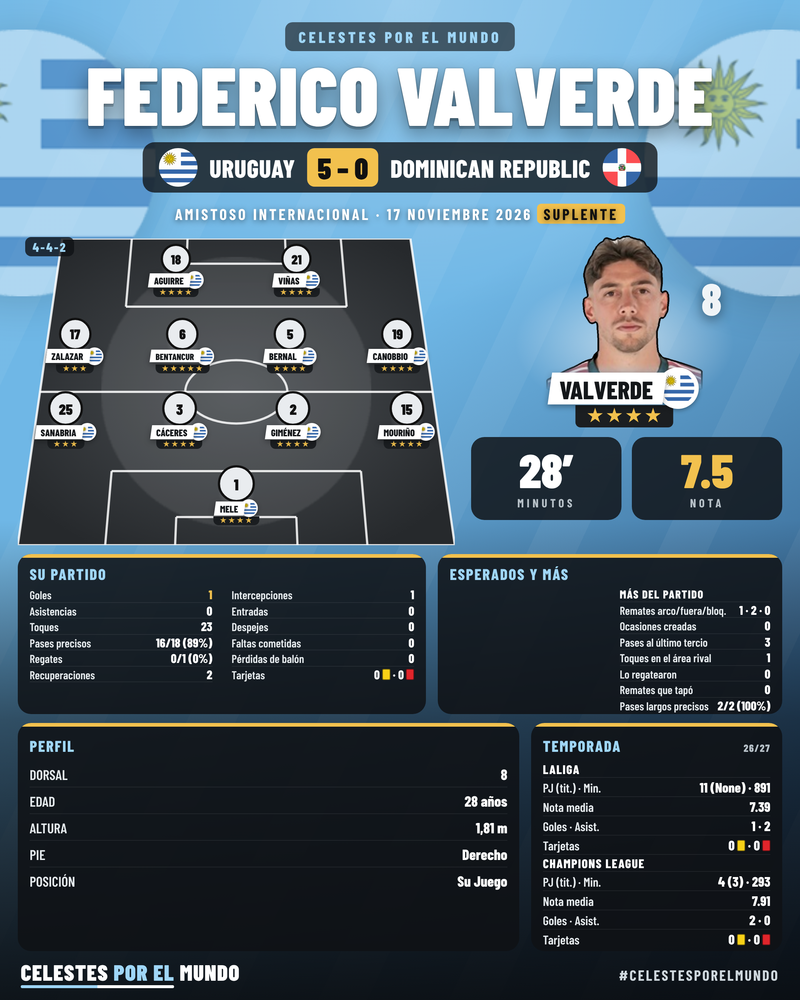
[Abrir la imagen en tamaño completo](https://github.com/tuscxm/celestes-por-el-mundo/blob/main/salida/png/F.%20Valverde/2026-11-17%20%C2%B7%20Dominican%20Republic%20%C2%B7%20Amistoso%20Internacional/Valverde_Uruguay-DominicanRepublic_2026-11-17.png)

Texto para el posteo:
```
🇺🇾 FEDERICO VALVERDE · Uruguay 5-0 Dominican Republic
⏱ 28' · ⭐ 7.5

Jugó de titular: 1 gol, 16/18 pases (89%), 2 recuperaciones y 3 pases al último tercio.

🧩 ¿Y en una Uruguay 3-5-2 con enganche?
Sería carrilero: 3 pases al último tercio y 2 recuperaciones. En el 3-5-2 toda la banda es suya, y con tres centrales atrás puede pasar sin dejar la espalda sola.

Tres atrás, dos carrileros, dos internos, un 10 suelto y dos puntas. ¿Lo jugarías así? 👇
#CelestesPorElMundo #Uruguay #352
```

## Bernal · Uruguay 5-0 Dominican Republic
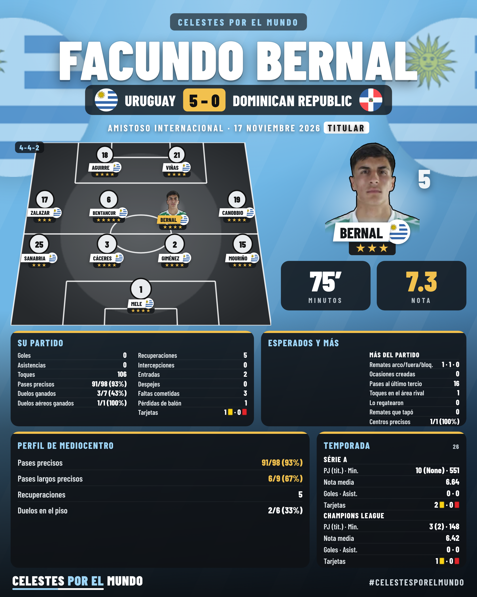
[Abrir la imagen en tamaño completo](https://github.com/tuscxm/celestes-por-el-mundo/blob/main/salida/png/F.%20Bernal/2026-11-17%20%C2%B7%20Dominican%20Republic%20%C2%B7%20Amistoso%20Internacional/Bernal_Uruguay-DominicanRepublic_2026-11-17.png)

Texto para el posteo:
```
🇺🇾 FACUNDO BERNAL · Uruguay 5-0 Dominican Republic
⏱ 75' · ⭐ 7.3

Jugó de mediocentro: 91/98 pases (93%), 5 recuperaciones y 16 pases al último tercio.

🧩 ¿Y en una Uruguay 3-5-2 con enganche?
Sería uno de los dos internos: 91/98 pases (93%) y 5 recuperaciones. Es el que sostiene y hace circular para que el enganche reciba de frente.

Tres atrás, dos carrileros, dos internos, un 10 suelto y dos puntas. ¿Lo jugarías así? 👇
#CelestesPorElMundo #Uruguay #352
```

## Mouriño · Uruguay 5-0 Dominican Republic
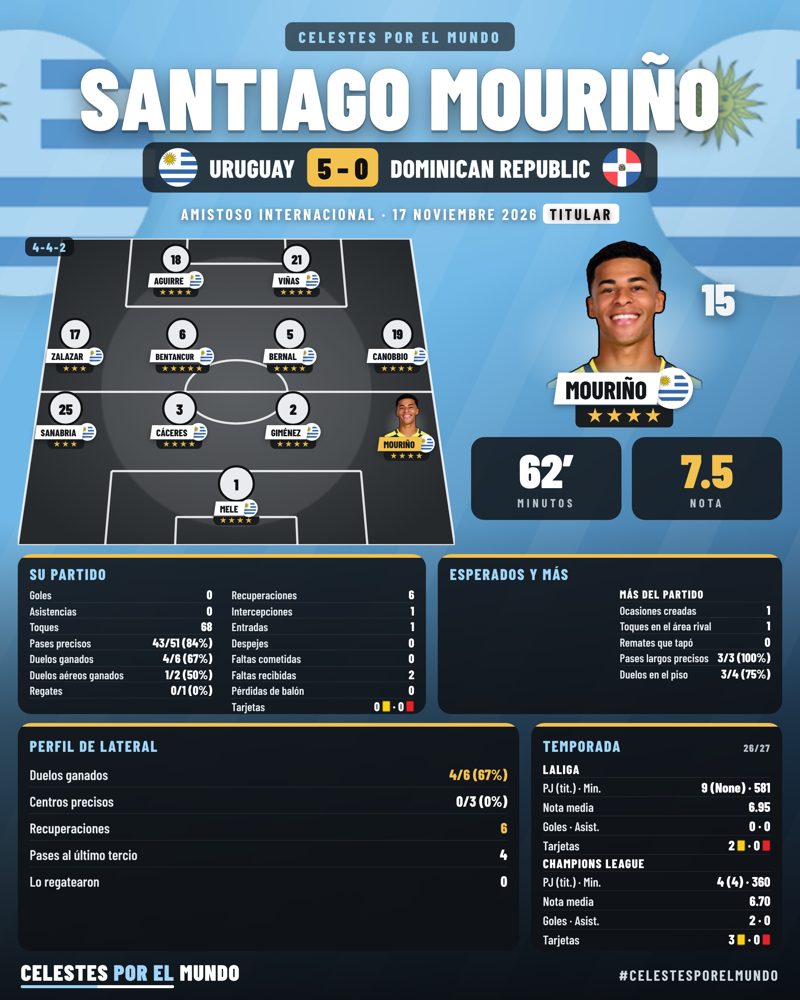
[Abrir la imagen en tamaño completo](https://github.com/tuscxm/celestes-por-el-mundo/blob/main/salida/png/S.%20Mouri%C3%B1o/2026-11-17%20%C2%B7%20Dominican%20Republic%20%C2%B7%20Amistoso%20Internacional/Mourino_Uruguay-DominicanRepublic_2026-11-17.png)

Texto para el posteo:
```
🇺🇾 SANTIAGO MOURIÑO · Uruguay 5-0 Dominican Republic
⏱ 62' · ⭐ 7.5

Jugó de lateral derecho: 43/51 pases (84%), 4/6 duelos ganados, 6 recuperaciones y 4 pases al último tercio.

🧩 ¿Y en una Uruguay 3-5-2 con enganche?
Lo vemos de zaguero en la línea de tres: 43/51 pases (84%), 3/3 pases largos y 4/6 duelos ganados. Con tres atrás, un central que sale limpio le suma un pase para encontrar al enganche y deja a los carrileros libres para pasar.

Tres atrás, dos carrileros, dos internos, un 10 suelto y dos puntas. ¿Lo jugarías así? 👇
#CelestesPorElMundo #Uruguay #352
```

## Cáceres · Uruguay 5-0 Dominican Republic
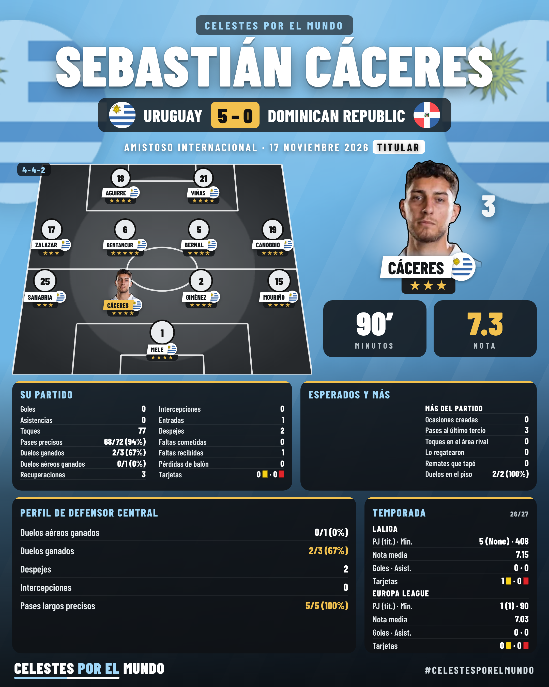
[Abrir la imagen en tamaño completo](https://github.com/tuscxm/celestes-por-el-mundo/blob/main/salida/png/S.%20C%C3%A1ceres/2026-11-17%20%C2%B7%20Dominican%20Republic%20%C2%B7%20Amistoso%20Internacional/Caceres_Uruguay-DominicanRepublic_2026-11-17.png)

Texto para el posteo:
```
🇺🇾 SEBASTIÁN CÁCERES · Uruguay 5-0 Dominican Republic
⏱ 90' · ⭐ 7.3

Jugó de defensor central: 68/72 pases (94%), 2/3 duelos ganados, 3 recuperaciones y 3 pases al último tercio.

🧩 ¿Y en una Uruguay 3-5-2 con enganche?
Lo vemos de zaguero en la línea de tres: 68/72 pases (94%), 5/5 pases largos y 2/3 duelos ganados. Con tres atrás, un central que sale limpio le suma un pase para encontrar al enganche y deja a los carrileros libres para pasar.

Tres atrás, dos carrileros, dos internos, un 10 suelto y dos puntas. ¿Lo jugarías así? 👇
#CelestesPorElMundo #Uruguay #352
```

## Bentancur · Uruguay 5-0 Dominican Republic

[Abrir la imagen en tamaño completo](https://github.com/tuscxm/celestes-por-el-mundo/blob/main/salida/png/R.%20Bentancur/2026-11-17%20%C2%B7%20Dominican%20Republic%20%C2%B7%20Amistoso%20Internacional/Bentancur_Uruguay-DominicanRepublic_2026-11-17.png)

Texto para el posteo:
```
🇺🇾 RODRIGO BENTANCUR · Uruguay 5-0 Dominican Republic
⏱ 84' · ⭐ 8.3

Jugó de mediocentro: 109/118 pases (92%), 5/6 duelos ganados, 6 recuperaciones y 16 pases al último tercio.

🧩 ¿Y en una Uruguay 3-5-2 con enganche?
Sería uno de los dos internos: 109/118 pases (92%), 6 recuperaciones y 5/6 duelos ganados. Es el que sostiene y hace circular para que el enganche reciba de frente.

Tres atrás, dos carrileros, dos internos, un 10 suelto y dos puntas. ¿Lo jugarías así? 👇
#CelestesPorElMundo #Uruguay #352
```

## Satriano · Uruguay 5-0 Dominican Republic
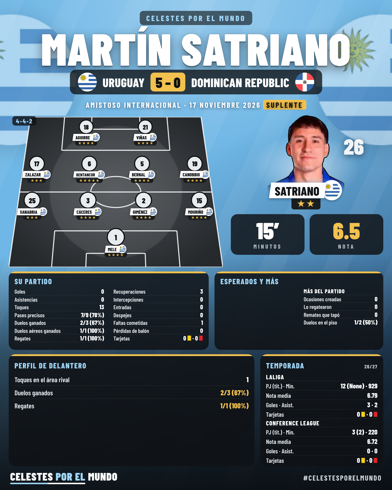
[Abrir la imagen en tamaño completo](https://github.com/tuscxm/celestes-por-el-mundo/blob/main/salida/png/M.%20Satriano/2026-11-17%20%C2%B7%20Dominican%20Republic%20%C2%B7%20Amistoso%20Internacional/Satriano_Uruguay-DominicanRepublic_2026-11-17.png)

Texto para el posteo:
```
🇺🇾 MARTÍN SATRIANO · Uruguay 5-0 Dominican Republic
⏱ 15' · ⭐ 6.5

Jugó de delantero: 2/3 duelos ganados y 3 recuperaciones.

🧩 ¿Y en una Uruguay 3-5-2 con enganche?
Sería uno de los dos de punta: 1 toque en el área rival, 2/3 duelos ganados y 1/1 regates. Con un enganche que lo habilite y otro 9 al lado, deja de pelear solo contra los centrales.

Tres atrás, dos carrileros, dos internos, un 10 suelto y dos puntas. ¿Lo jugarías así? 👇
#CelestesPorElMundo #Uruguay #352
```

## J. Rodríguez · Uruguay 5-0 Dominican Republic
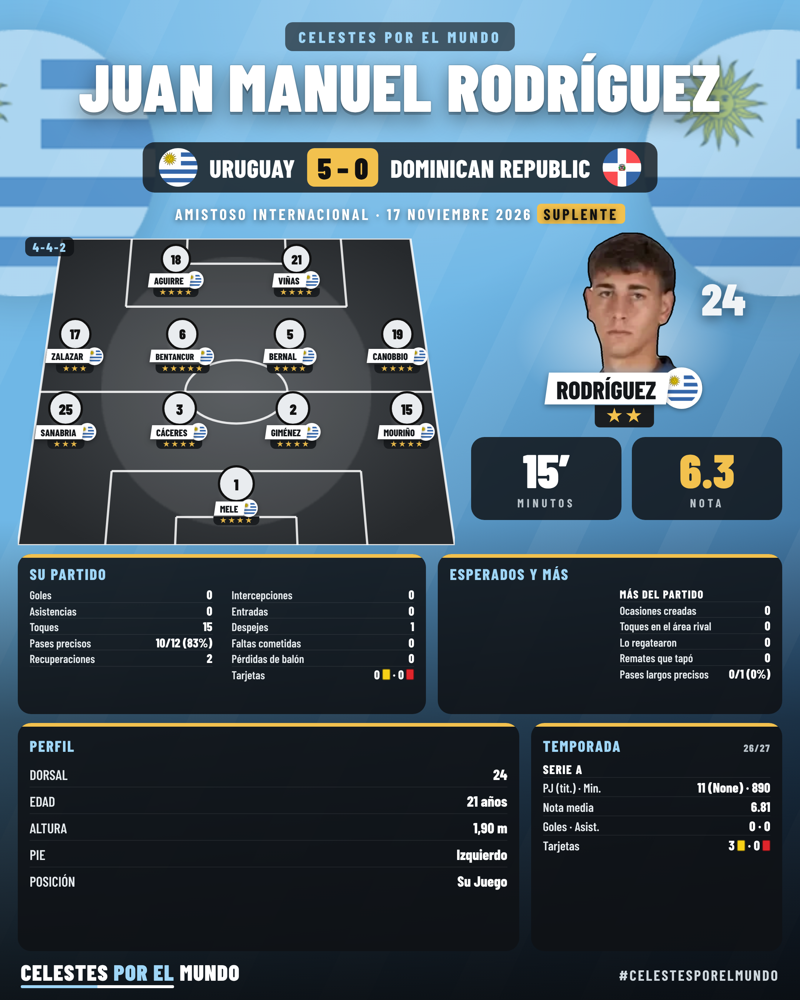
[Abrir la imagen en tamaño completo](https://github.com/tuscxm/celestes-por-el-mundo/blob/main/salida/png/J.%20M.%20Rodr%C3%ADguez/2026-11-17%20%C2%B7%20Dominican%20Republic%20%C2%B7%20Amistoso%20Internacional/Rodriguez_Uruguay-DominicanRepublic_2026-11-17.png)

Texto para el posteo:
```
🇺🇾 JUAN MANUEL RODRÍGUEZ · Uruguay 5-0 Dominican Republic
⏱ 15' · ⭐ 6.3

Jugó de titular: 10/12 pases (83%) y 2 recuperaciones.

🧩 ¿Y en una Uruguay 3-5-2 con enganche?
Lo vemos de zaguero en la línea de tres: 10/12 pases (83%), 2 recuperaciones y 1 despeje. Con tres atrás, un central que sale limpio le suma un pase para encontrar al enganche y deja a los carrileros libres para pasar.

Tres atrás, dos carrileros, dos internos, un 10 suelto y dos puntas. ¿Lo jugarías así? 👇
#CelestesPorElMundo #Uruguay #352
```

## Zalazar · Uruguay 5-0 Dominican Republic
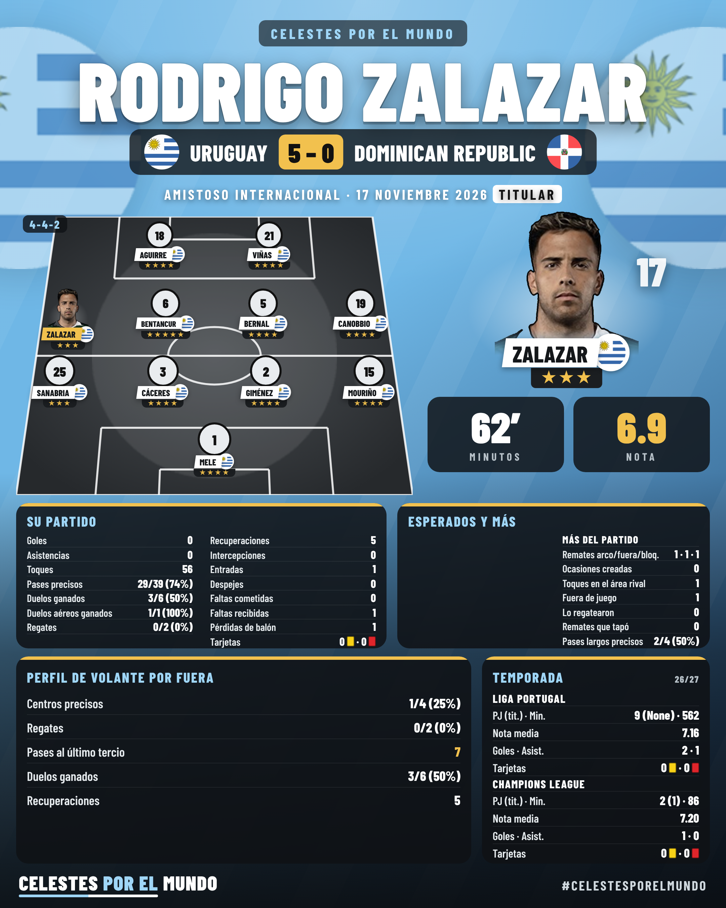
[Abrir la imagen en tamaño completo](https://github.com/tuscxm/celestes-por-el-mundo/blob/main/salida/png/R.%20Zalazar/2026-11-17%20%C2%B7%20Dominican%20Republic%20%C2%B7%20Amistoso%20Internacional/Zalazar_Uruguay-DominicanRepublic_2026-11-17.png)

Texto para el posteo:
```
🇺🇾 RODRIGO ZALAZAR · Uruguay 5-0 Dominican Republic
⏱ 62' · ⭐ 6.9

Jugó de volante por izquierda: 29/39 pases (74%), 3/6 duelos ganados, 5 recuperaciones y 7 pases al último tercio.

🧩 ¿Y en una Uruguay 3-5-2 con enganche?
Es el 10 que pide el sistema: 7 pases al último tercio y 1 toque en el área rival. Suelto detrás de dos puntas, con dos internos que lo cubren, Uruguay junta a los que definen.

Tres atrás, dos carrileros, dos internos, un 10 suelto y dos puntas. ¿Lo jugarías así? 👇
#CelestesPorElMundo #Uruguay #352
```

## Giménez · Uruguay 5-0 Dominican Republic
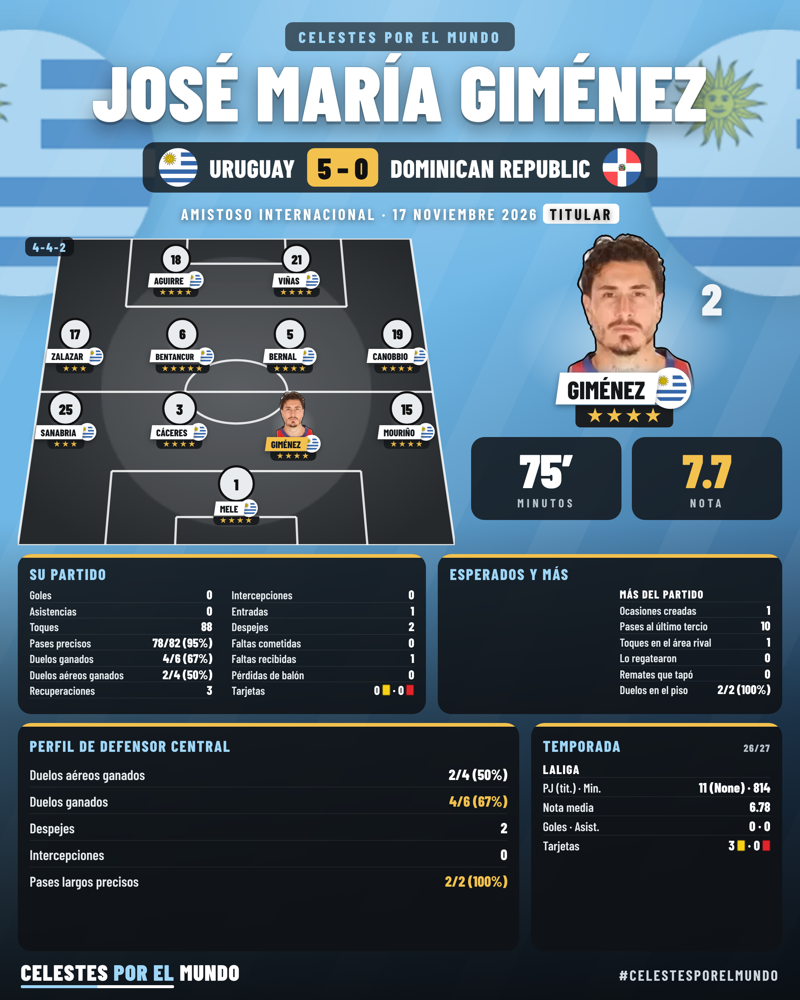
[Abrir la imagen en tamaño completo](https://github.com/tuscxm/celestes-por-el-mundo/blob/main/salida/png/J.%20M.%20Gim%C3%A9nez/2026-11-17%20%C2%B7%20Dominican%20Republic%20%C2%B7%20Amistoso%20Internacional/Gimenez_Uruguay-DominicanRepublic_2026-11-17.png)

Texto para el posteo:
```
🇺🇾 JOSÉ MARÍA GIMÉNEZ · Uruguay 5-0 Dominican Republic
⏱ 75' · ⭐ 7.7

Jugó de defensor central: 78/82 pases (95%), 4/6 duelos ganados, 3 recuperaciones y 10 pases al último tercio.

🧩 ¿Y en una Uruguay 3-5-2 con enganche?
Lo vemos de zaguero en la línea de tres: 78/82 pases (95%), 2/2 pases largos y 4/6 duelos ganados. Con tres atrás, un central que sale limpio le suma un pase para encontrar al enganche y deja a los carrileros libres para pasar.

Tres atrás, dos carrileros, dos internos, un 10 suelto y dos puntas. ¿Lo jugarías así? 👇
#CelestesPorElMundo #Uruguay #352
```

## R. Araújo · Uruguay 5-0 Dominican Republic
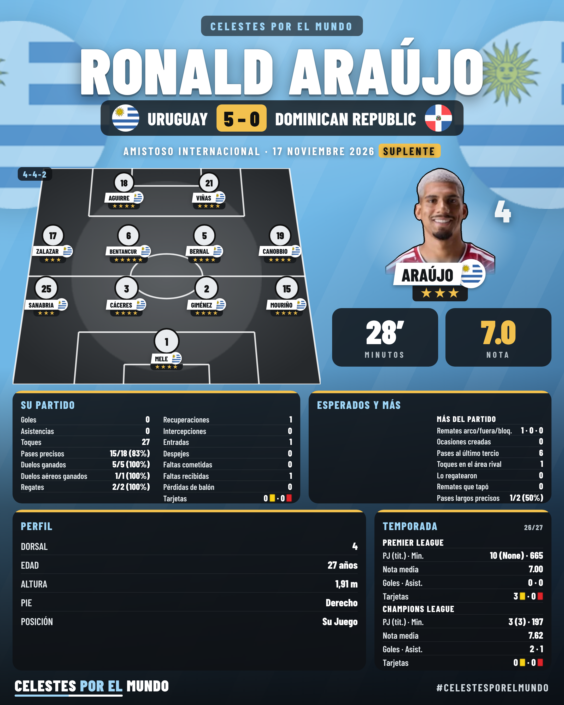
[Abrir la imagen en tamaño completo](https://github.com/tuscxm/celestes-por-el-mundo/blob/main/salida/png/R.%20Ara%C3%BAjo/2026-11-17%20%C2%B7%20Dominican%20Republic%20%C2%B7%20Amistoso%20Internacional/Araujo_Uruguay-DominicanRepublic_2026-11-17.png)

Texto para el posteo:
```
🇺🇾 RONALD ARAÚJO · Uruguay 5-0 Dominican Republic
⏱ 28' · ⭐ 7.0

Jugó de titular: 15/18 pases (83%), 5/5 duelos ganados, 1 recuperación y 6 pases al último tercio.

🧩 ¿Y en una Uruguay 3-5-2 con enganche?
Lo vemos de zaguero en la línea de tres: 15/18 pases (83%), 5/5 duelos ganados y 1/1 por arriba. Con tres atrás, un central que sale limpio le suma un pase para encontrar al enganche y deja a los carrileros libres para pasar.

Tres atrás, dos carrileros, dos internos, un 10 suelto y dos puntas. ¿Lo jugarías así? 👇
#CelestesPorElMundo #Uruguay #352
```

## J. M. Sanabria · Uruguay 5-0 Dominican Republic

[Abrir la imagen en tamaño completo](https://github.com/tuscxm/celestes-por-el-mundo/blob/main/salida/png/J.%20M.%20Sanabria/2026-11-17%20%C2%B7%20Dominican%20Republic%20%C2%B7%20Amistoso%20Internacional/Sanabria_Uruguay-DominicanRepublic_2026-11-17.png)

Texto para el posteo:
```
🇺🇾 JUAN MANUEL SANABRIA · Uruguay 5-0 Dominican Republic
⏱ 45' · ⭐ 6.9

Jugó de lateral izquierdo: 26/29 pases (90%), 6/7 duelos ganados, 1 recuperación y 1 pase al último tercio.

🧩 ¿Y en una Uruguay 3-5-2 con enganche?
Sería carrilero: 1 pase al último tercio y 1 recuperación. En el 3-5-2 toda la banda es suya, y con tres centrales atrás puede pasar sin dejar la espalda sola.

Tres atrás, dos carrileros, dos internos, un 10 suelto y dos puntas. ¿Lo jugarías así? 👇
#CelestesPorElMundo #Uruguay #352
```

## Canobbio · Uruguay 5-0 Dominican Republic
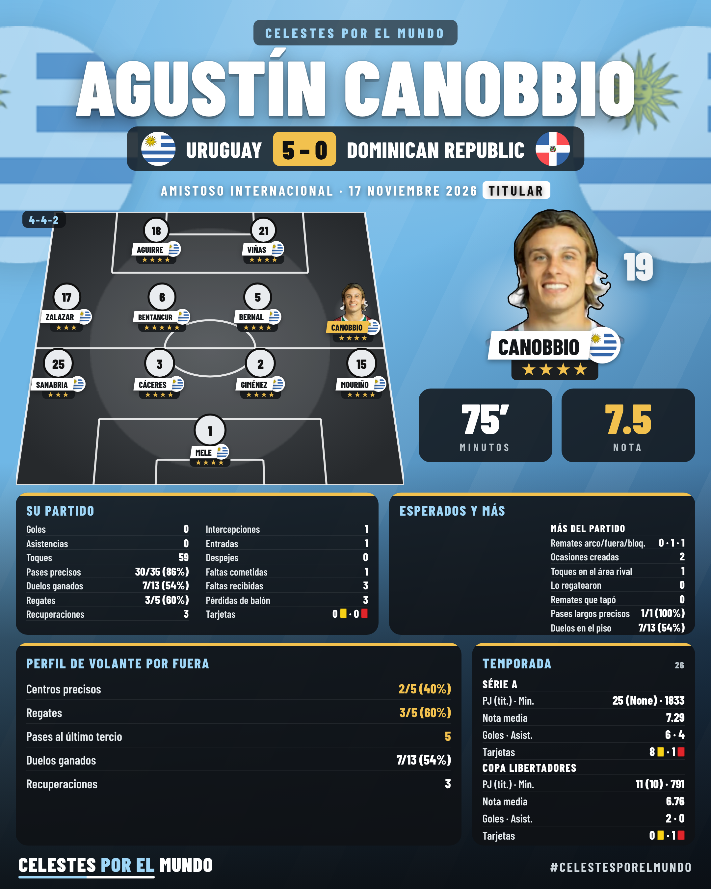
[Abrir la imagen en tamaño completo](https://github.com/tuscxm/celestes-por-el-mundo/blob/main/salida/png/A.%20Canobbio/2026-11-17%20%C2%B7%20Dominican%20Republic%20%C2%B7%20Amistoso%20Internacional/Canobbio_Uruguay-DominicanRepublic_2026-11-17.png)

Texto para el posteo:
```
🇺🇾 AGUSTÍN CANOBBIO · Uruguay 5-0 Dominican Republic
⏱ 75' · ⭐ 7.5

Jugó de volante por derecha: 30/35 pases (86%), 7/13 duelos ganados, 3 recuperaciones y 5 pases al último tercio.

🧩 ¿Y en una Uruguay 3-5-2 con enganche?
Sería carrilero: 5 pases al último tercio, 2/5 centros precisos y 3/5 regates. En el 3-5-2 toda la banda es suya, y con tres centrales atrás puede pasar sin dejar la espalda sola.

Tres atrás, dos carrileros, dos internos, un 10 suelto y dos puntas. ¿Lo jugarías así? 👇
#CelestesPorElMundo #Uruguay #352
```

## Darwin · Uruguay 5-0 Dominican Republic
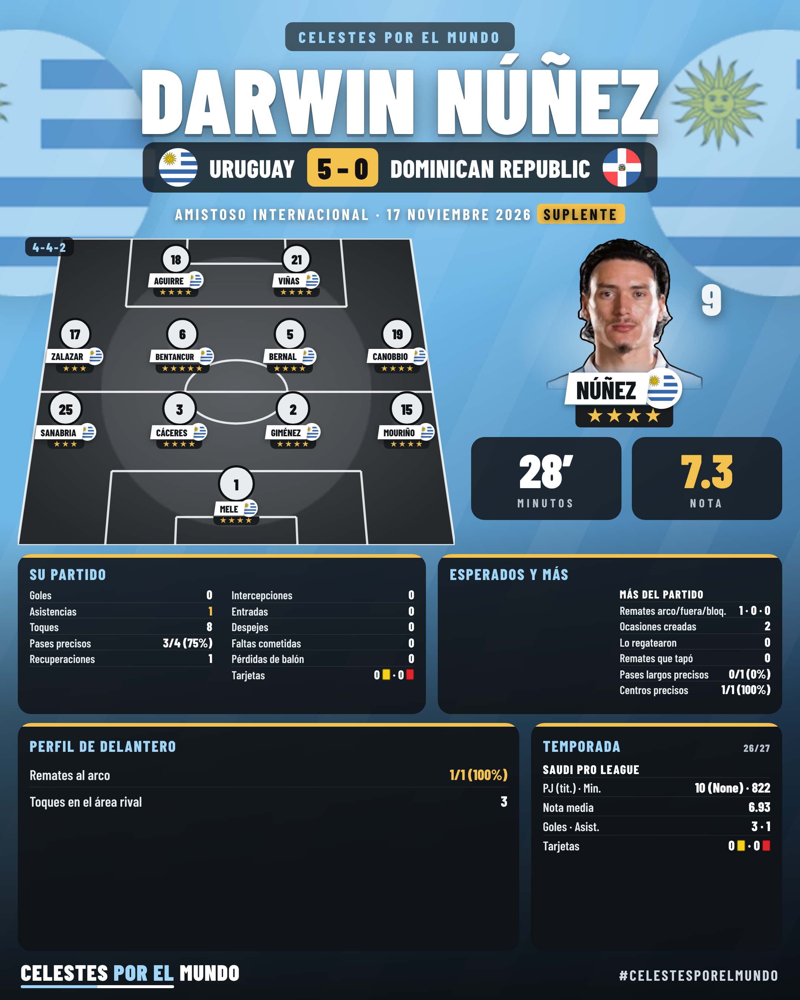
[Abrir la imagen en tamaño completo](https://github.com/tuscxm/celestes-por-el-mundo/blob/main/salida/png/D.%20N%C3%BA%C3%B1ez/2026-11-17%20%C2%B7%20Dominican%20Republic%20%C2%B7%20Amistoso%20Internacional/Nunez_Uruguay-DominicanRepublic_2026-11-17.png)

Texto para el posteo:
```
🇺🇾 DARWIN NÚÑEZ · Uruguay 5-0 Dominican Republic
⏱ 28' · ⭐ 7.3

Jugó de delantero: 1 recuperación y 2 ocasiones creadas.

🧩 ¿Y en una Uruguay 3-5-2 con enganche?
Sería uno de los dos de punta: 1 de 1 remates al arco y 3 toques en el área rival. Con un enganche que lo habilite y otro 9 al lado, deja de pelear solo contra los centrales.

Tres atrás, dos carrileros, dos internos, un 10 suelto y dos puntas. ¿Lo jugarías así? 👇
#CelestesPorElMundo #Uruguay #352
```

## Olivera · Uruguay 5-0 Dominican Republic
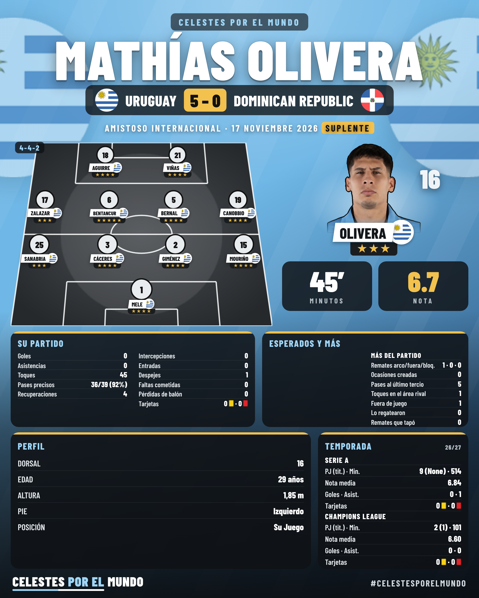
[Abrir la imagen en tamaño completo](https://github.com/tuscxm/celestes-por-el-mundo/blob/main/salida/png/M.%20Olivera/2026-11-17%20%C2%B7%20Dominican%20Republic%20%C2%B7%20Amistoso%20Internacional/Olivera_Uruguay-DominicanRepublic_2026-11-17.png)

Texto para el posteo:
```
🇺🇾 MATHÍAS OLIVERA · Uruguay 5-0 Dominican Republic
⏱ 45' · ⭐ 6.7

Jugó de titular: 36/39 pases (92%), 4 recuperaciones y 5 pases al último tercio.

🧩 ¿Y en una Uruguay 3-5-2 con enganche?
Lo vemos de zaguero en la línea de tres: 36/39 pases (92%), 4 recuperaciones y 1 despeje. Con tres atrás, un central que sale limpio le suma un pase para encontrar al enganche y deja a los carrileros libres para pasar.

Tres atrás, dos carrileros, dos internos, un 10 suelto y dos puntas. ¿Lo jugarías así? 👇
#CelestesPorElMundo #Uruguay #352
```

## Pellistri · Uruguay 5-0 Dominican Republic
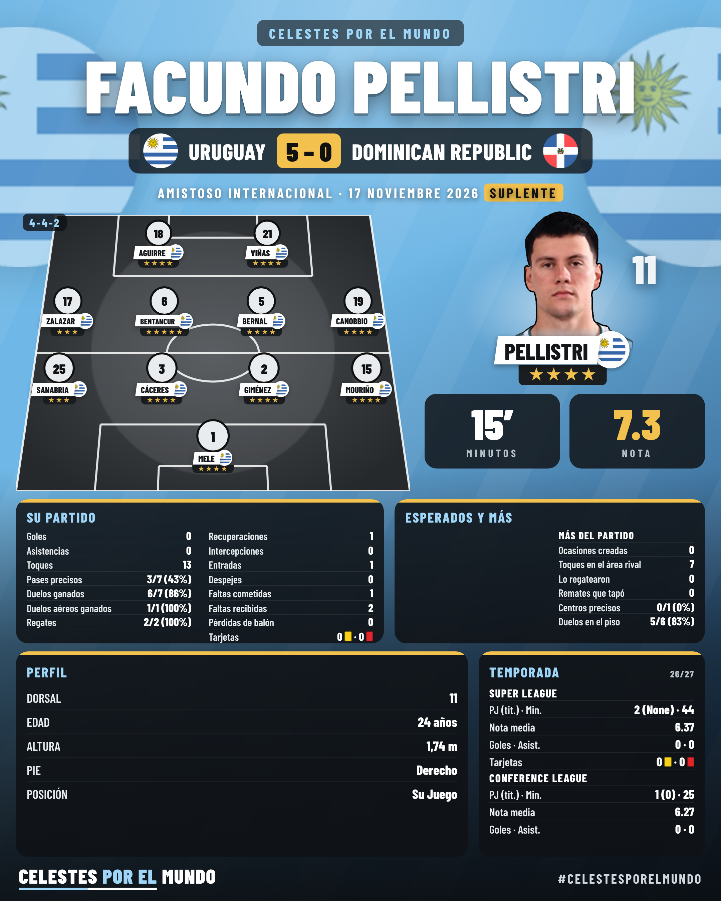
[Abrir la imagen en tamaño completo](https://github.com/tuscxm/celestes-por-el-mundo/blob/main/salida/png/F.%20Pellistri/2026-11-17%20%C2%B7%20Dominican%20Republic%20%C2%B7%20Amistoso%20Internacional/Pellistri_Uruguay-DominicanRepublic_2026-11-17.png)

Texto para el posteo:
```
🇺🇾 FACUNDO PELLISTRI · Uruguay 5-0 Dominican Republic
⏱ 15' · ⭐ 7.3

Jugó de titular: 6/7 duelos ganados y 1 recuperación.

🧩 ¿Y en una Uruguay 3-5-2 con enganche?
Sería carrilero: 2/2 regates y 1 recuperación. En el 3-5-2 toda la banda es suya, y con tres centrales atrás puede pasar sin dejar la espalda sola.

Tres atrás, dos carrileros, dos internos, un 10 suelto y dos puntas. ¿Lo jugarías así? 👇
#CelestesPorElMundo #Uruguay #352
```

## Damiani · Uruguay 5-0 Dominican Republic
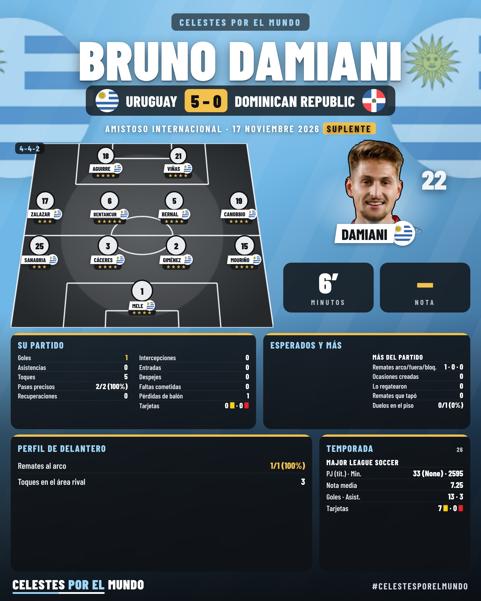
[Abrir la imagen en tamaño completo](https://github.com/tuscxm/celestes-por-el-mundo/blob/main/salida/png/B.%20Damiani/2026-11-17%20%C2%B7%20Dominican%20Republic%20%C2%B7%20Amistoso%20Internacional/Damiani_Uruguay-DominicanRepublic_2026-11-17.png)

Texto para el posteo:
```
🇺🇾 BRUNO DAMIANI · Uruguay 5-0 Dominican Republic
⏱ 6'

Jugó de delantero: 1 gol.

🧩 ¿Y en una Uruguay 3-5-2 con enganche?
Sería uno de los dos de punta: 1 gol, 1 de 1 remates al arco y 3 toques en el área rival. Con un enganche que lo habilite y otro 9 al lado, deja de pelear solo contra los centrales.

Tres atrás, dos carrileros, dos internos, un 10 suelto y dos puntas. ¿Lo jugarías así? 👇
#CelestesPorElMundo #Uruguay #352
```

## Aguirre · Uruguay 5-0 Dominican Republic
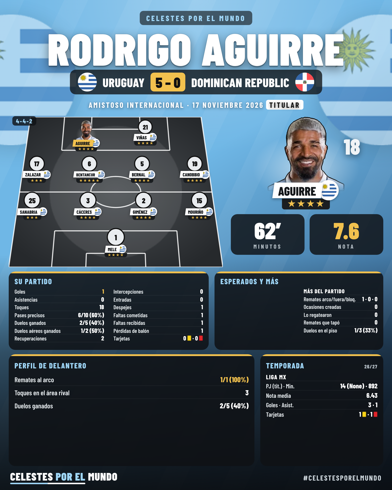
[Abrir la imagen en tamaño completo](https://github.com/tuscxm/celestes-por-el-mundo/blob/main/salida/png/R.%20Aguirre/2026-11-17%20%C2%B7%20Dominican%20Republic%20%C2%B7%20Amistoso%20Internacional/Aguirre_Uruguay-DominicanRepublic_2026-11-17.png)

Texto para el posteo:
```
🇺🇾 RODRIGO AGUIRRE · Uruguay 5-0 Dominican Republic
⏱ 62' · ⭐ 7.6

Jugó de delantero: 1 gol, 6/10 pases (60%) y 2 recuperaciones.

🧩 ¿Y en una Uruguay 3-5-2 con enganche?
Sería uno de los dos de punta: 1 gol, 1 de 1 remates al arco y 3 toques en el área rival. Con un enganche que lo habilite y otro 9 al lado, deja de pelear solo contra los centrales.

Tres atrás, dos carrileros, dos internos, un 10 suelto y dos puntas. ¿Lo jugarías así? 👇
#CelestesPorElMundo #Uruguay #352
```

## Viñas · Uruguay 5-0 Dominican Republic

[Abrir la imagen en tamaño completo](https://github.com/tuscxm/celestes-por-el-mundo/blob/main/salida/png/F.%20Vi%C3%B1as/2026-11-17%20%C2%B7%20Dominican%20Republic%20%C2%B7%20Amistoso%20Internacional/Vinas_Uruguay-DominicanRepublic_2026-11-17.png)

Texto para el posteo:
```
🇺🇾 FEDERICO VIÑAS · Uruguay 5-0 Dominican Republic
⏱ 75' · ⭐ 7.3

Jugó de delantero: 11/16 pases (69%), 8/11 duelos ganados, 3 recuperaciones y 2 pases al último tercio.

🧩 ¿Y en una Uruguay 3-5-2 con enganche?
Sería uno de los dos de punta: 8/11 duelos ganados. Con un enganche que lo habilite y otro 9 al lado, deja de pelear solo contra los centrales.

Tres atrás, dos carrileros, dos internos, un 10 suelto y dos puntas. ¿Lo jugarías así? 👇
#CelestesPorElMundo #Uruguay #352
```

---
En X se publican solas en unos minutos (menos las que la revisión ponga en *No publicar en X*); en Instagram no se publicó nada. Cerrá este aviso cuando la publiques o la descartes.
## Revisión visual
- Las 18 salieron con el respaldo automático (FotMob) porque SofaScore no respondió: sin mapa de calor, barra de dónde jugó ni SU ZONA (va el PERFIL solo), columna ESPERADOS vacía (sin xG/xA) y en la cancha solo aparece la cara del protagonista (el resto, número).
- En TODAS, en TEMPORADA la línea de la liga dice "PJ (tit.) · Min. N (None) · …": se imprime "None" en lugar de los partidos de titular.
- Bernal: TEMPORADA dice "SÉRIE A" (temporada "26") en vez de LaLiga (juega en el Real Betis; el 04/11 salía LALIGA). Dato equivocado (pasó lo mismo en la del 13/11 vs. Argentina).
- Suplentes sin puesto conocido (Valverde, R. Araújo, M. Olivera, Pellistri, J. M. Rodríguez): el texto del posteo dice "Jugó de titular:" aunque entraron desde el banco, no hay línea "🔁 Entró al …' por …", en la cancha no figura "⇄ ENTRA" y el PERFIL es el genérico con "POSICIÓN: Su Juego".
- Darwin: el texto del posteo no menciona la asistencia que sí figura en SU PARTIDO (detalle menor).
- Caras: bien recortadas y con contorno; escudos/bandera y colores celestes correctos; no aparece el nombre de ninguna fuente; no hubo tanda de penales ni tarjetas.
- Fuentes con error: SofaScore 403 en todos (y De la Cruz quedó en error: sin datos de ninguna fuente, BeSoccer devolvió 406 y no tiene URL); API-Football: el plan gratis no cubre la temporada; Understat: formato de página no reconocido; zerozero: HTTP 403; BeSoccer (WebFetch): HTTP 406 en todas las páginas, besoccer_hoy.json quedó vacío.

## No publicar en X
- Valverde_Uruguay-DominicanRepublic_2026-11-17: "(None)" en TEMPORADA; el texto dice "Jugó de titular" y fue suplente; PERFIL "Su Juego"
- Araujo_Uruguay-DominicanRepublic_2026-11-17: "(None)" en TEMPORADA; el texto dice "Jugó de titular" y fue suplente; PERFIL "Su Juego"
- Olivera_Uruguay-DominicanRepublic_2026-11-17: "(None)" en TEMPORADA; el texto dice "Jugó de titular" y fue suplente; PERFIL "Su Juego"
- Pellistri_Uruguay-DominicanRepublic_2026-11-17: "(None)" en TEMPORADA; el texto dice "Jugó de titular" y fue suplente; PERFIL "Su Juego"
- Rodriguez_Uruguay-DominicanRepublic_2026-11-17: "(None)" en TEMPORADA; el texto dice "Jugó de titular" y fue suplente; PERFIL "Su Juego"
- Bernal_Uruguay-DominicanRepublic_2026-11-17: "(None)" en TEMPORADA y la liga figura como "SÉRIE A" en vez de LaLiga
- Bentancur_Uruguay-DominicanRepublic_2026-11-17: "(None)" en TEMPORADA
- Caceres_Uruguay-DominicanRepublic_2026-11-17: "(None)" en TEMPORADA
- Canobbio_Uruguay-DominicanRepublic_2026-11-17: "(None)" en TEMPORADA
- Damiani_Uruguay-DominicanRepublic_2026-11-17: "(None)" en TEMPORADA
- Gimenez_Uruguay-DominicanRepublic_2026-11-17: "(None)" en TEMPORADA
- Mourino_Uruguay-DominicanRepublic_2026-11-17: "(None)" en TEMPORADA
- Nunez_Uruguay-DominicanRepublic_2026-11-17: "(None)" en TEMPORADA
- Sanabria_Uruguay-DominicanRepublic_2026-11-17: "(None)" en TEMPORADA
- Satriano_Uruguay-DominicanRepublic_2026-11-17: "(None)" en TEMPORADA
- Zalazar_Uruguay-DominicanRepublic_2026-11-17: "(None)" en TEMPORADA
- Aguirre_Uruguay-DominicanRepublic_2026-11-17: "(None)" en TEMPORADA
- Vinas_Uruguay-DominicanRepublic_2026-11-17: "(None)" en TEMPORADA
