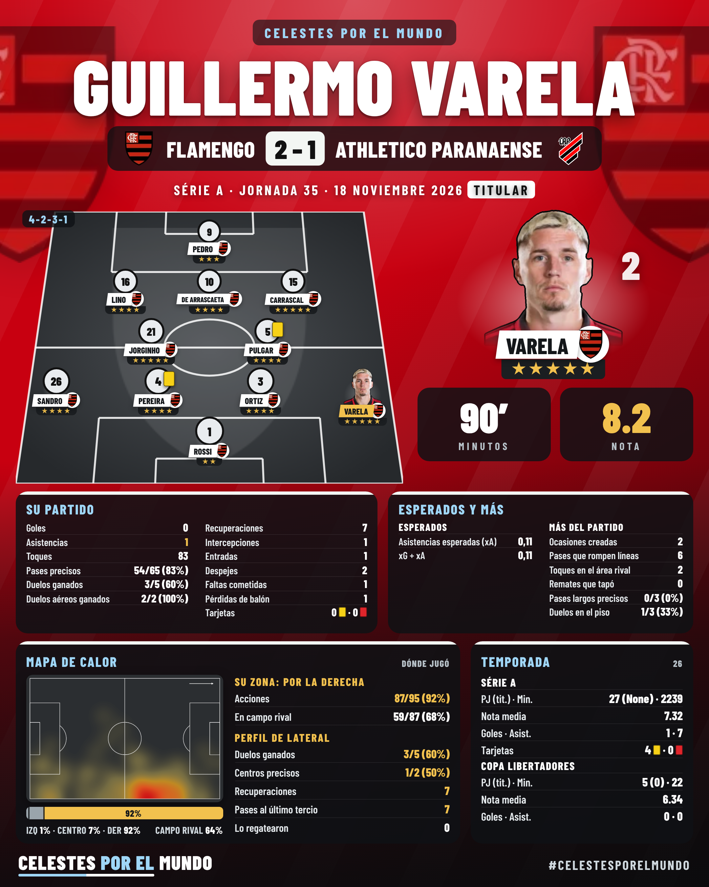
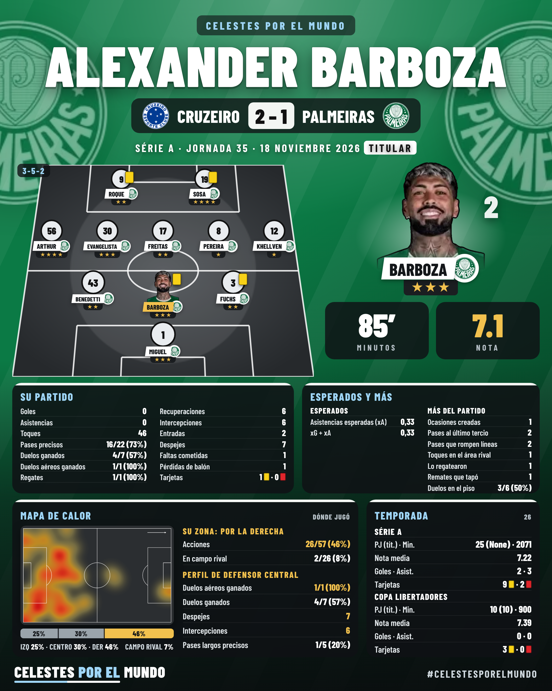
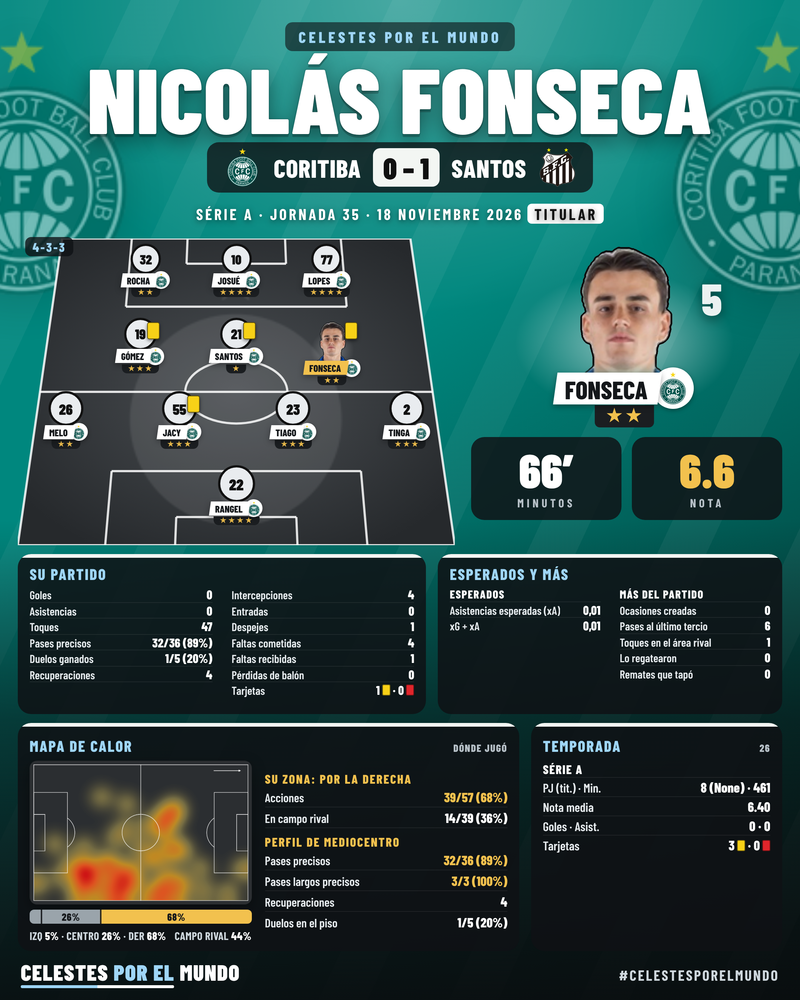
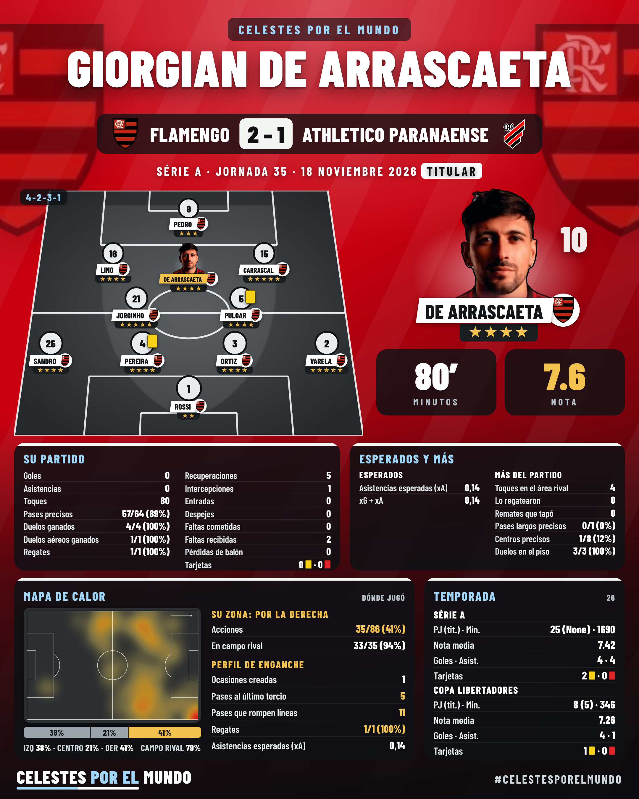

Varela jugó 90' (titular, nota 8.2) en Flamengo 2-1 Athletico Paranaense; Barboza jugó 85' (titular, nota 7.1) en Cruzeiro 2-1 Palmeiras; Fonseca jugó 66' (titular, nota 6.6) en Coritiba 0-1 Santos; Arrascaeta jugó 80' (titular, nota 7.6) en Flamengo

@tuscxm

## Quién jugó
- **Varela** jugó 90' (titular, nota 8.2, de lateral derecho) en Flamengo 2-1 Athletico Paranaense · Série A
- **Barboza** jugó 85' (titular, nota 7.1, de defensor central) en Cruzeiro 2-1 Palmeiras · Série A
- **Fonseca** jugó 66' (titular, nota 6.6, de mediocentro) en Coritiba 0-1 Santos · Série A
- **Arrascaeta** jugó 80' (titular, nota 7.6, de mediocentro) en Flamengo 2-1 Athletico Paranaense · Série A

## El resto
- Valverde: sin partido hoy ni ayer
- Bernal: sin partido hoy ni ayer
- Mouriño: sin partido hoy ni ayer
- M. Araújo: sin partido hoy ni ayer
- Á. Rodríguez: sin partido hoy ni ayer
- González: sin partido hoy ni ayer
- Cáceres: sin partido hoy ni ayer
- Petit: sin partido hoy ni ayer
- Bentancur: sin partido hoy ni ayer
- Satriano: sin partido hoy ni ayer
- Boselli: sin partido hoy ni ayer
- J. Rodríguez: sin partido hoy ni ayer
- Zalazar: sin partido hoy ni ayer
- Merentiel: sin partido hoy ni ayer
- Giménez: sin partido hoy ni ayer
- Amaro: sin partido hoy ni ayer
- R. Araújo: sin partido hoy ni ayer
- J. M. Sanabria: sin partido hoy ni ayer
- Ugarte: sin partido hoy ni ayer
- Canobbio: sin partido hoy ni ayer
- Darwin: sin partido hoy ni ayer
- F. Díaz: sin partido hoy ni ayer
- Torreira: sin partido hoy ni ayer
- Brizuela: sin partido hoy ni ayer
- Piquerez: sin partido hoy ni ayer
- Matturro: sin partido hoy ni ayer
- Olivera: sin partido hoy ni ayer
- Nández: sin partido hoy ni ayer
- Bueno: sin partido hoy ni ayer
- Pereira: sin partido hoy ni ayer
- Marichal: sin partido hoy ni ayer
- Olaza: sin partido hoy ni ayer
- E. Martínez: no jugó en Cruzeiro 2-1 Palmeiras (no entró)
- De la Cruz: ERROR al revisar (no se pudo consultar SofaScore) → `<HTTPError 403: 'Forbidden'>`
- Pellistri: sin partido hoy ni ayer
- Rossi: sin partido hoy ni ayer
- B. Rodríguez: sin partido hoy ni ayer
- Damiani: sin partido hoy ni ayer
- Aguirre: sin partido hoy ni ayer
- Viñas: sin partido hoy ni ayer

## Avisos
- Varela: SofaScore no respondió; fuentes: fotmob ok, besoccer ok, api_football sin datos: el plan gratis de API-Football no cubre esta temporada (plan: Free plans do not have access to this season, try from 2022 to 2024.), thesportsdb ok, understat sin datos: sin understat_equipo (Understat no cubre esa liga), zerozero error HTTP 403
- Varela: Armada con datos de respaldo (FotMob): hay menos estadísticas que de costumbre, revisala antes de publicar
- Barboza: SofaScore no respondió; fuentes: fotmob ok, besoccer ok, api_football sin datos: el plan gratis de API-Football no cubre esta temporada (plan: Free plans do not have access to this season, try from 2022 to 2024.), thesportsdb ok, understat sin datos: sin understat_equipo (Understat no cubre esa liga), zerozero error HTTP 403
- Barboza: Armada con datos de respaldo (FotMob): hay menos estadísticas que de costumbre, revisala antes de publicar
- Fonseca: SofaScore no respondió; fuentes: fotmob ok, besoccer ok, api_football sin datos: el plan gratis de API-Football no cubre esta temporada (plan: Free plans do not have access to this season, try from 2022 to 2024.), thesportsdb ok, understat sin datos: sin understat_equipo (Understat no cubre esa liga), zerozero error HTTP 403
- Fonseca: Armada con datos de respaldo (FotMob): hay menos estadísticas que de costumbre, revisala antes de publicar
- Arrascaeta: SofaScore no respondió; fuentes: fotmob ok, besoccer ok, api_football sin datos: el plan gratis de API-Football no cubre esta temporada (plan: Free plans do not have access to this season, try from 2022 to 2024.), thesportsdb ok, understat sin datos: sin understat_equipo (Understat no cubre esa liga), zerozero error HTTP 403
- Arrascaeta: Armada con datos de respaldo (FotMob): hay menos estadísticas que de costumbre, revisala antes de publicar

## Varela · Flamengo 2-1 Athletico Paranaense

[Abrir la imagen en tamaño completo](https://github.com/tuscxm/celestes-por-el-mundo/blob/main/salida/png/G.%20Varela/2026-11-18%20%C2%B7%20Athletico%20Paranaense%20%C2%B7%20S%C3%A9rie%20A/Varela_Flamengo-AthleticoParanaense_2026-11-18.png)

Texto para el posteo:
```
🇺🇾 GUILLERMO VARELA · Flamengo 2-1 Athletico Paranaense
⏱ 90' · ⭐ 8.2

Jugó de lateral derecho: 54/65 pases (83%), 3/5 duelos ganados, 7 recuperaciones y 7 pases al último tercio.

🧩 ¿Y en una Uruguay 3-5-2 con enganche?
Sería carrilero por derecha: 92% de sus acciones por la derecha, 64% en campo rival y 7 pases al último tercio. En el 3-5-2 toda la banda es suya, y con tres centrales atrás puede pasar sin dejar la espalda sola.

Tres atrás, dos carrileros, dos internos, un 10 suelto y dos puntas. ¿Lo jugarías así? 👇
#CelestesPorElMundo #Uruguay #Flamengo #352
```

## Barboza · Cruzeiro 2-1 Palmeiras

[Abrir la imagen en tamaño completo](https://github.com/tuscxm/celestes-por-el-mundo/blob/main/salida/png/A.%20Barboza/2026-11-18%20%C2%B7%20Cruzeiro%20%C2%B7%20S%C3%A9rie%20A/Barboza_Cruzeiro-Palmeiras_2026-11-18.png)

Texto para el posteo:
```
🇺🇾 ALEXANDER BARBOZA · Cruzeiro 2-1 Palmeiras
⏱ 85' · ⭐ 7.1

Jugó de defensor central: 46% de sus acciones por la derecha, 16/22 pases (73%), 4/7 duelos ganados y 6 recuperaciones.

🧩 ¿Y en una Uruguay 3-5-2 con enganche?
Lo vemos de zaguero por derecha en la línea de tres: 16/22 pases (73%), 4/7 duelos ganados y 1/1 por arriba. Con tres atrás, un central que sale limpio le suma un pase para encontrar al enganche y deja a los carrileros libres para pasar.

Tres atrás, dos carrileros, dos internos, un 10 suelto y dos puntas. ¿Lo jugarías así? 👇
#CelestesPorElMundo #Uruguay #Palmeiras #352
```

## Fonseca · Coritiba 0-1 Santos

[Abrir la imagen en tamaño completo](https://github.com/tuscxm/celestes-por-el-mundo/blob/main/salida/png/N.%20Fonseca/2026-11-18%20%C2%B7%20Santos%20%C2%B7%20S%C3%A9rie%20A/Fonseca_Coritiba-Santos_2026-11-18.png)

Texto para el posteo:
```
🇺🇾 NICOLÁS FONSECA · Coritiba 0-1 Santos
⏱ 66' · ⭐ 6.6

Jugó de mediocentro: 68% de sus acciones por la derecha, 32/36 pases (89%), 4 recuperaciones y 6 pases al último tercio.

🧩 ¿Y en una Uruguay 3-5-2 con enganche?
Sería uno de los dos internos: 32/36 pases (89%), 4 recuperaciones y 4 intercepciones. Es el que sostiene y hace circular para que el enganche reciba de frente.

Tres atrás, dos carrileros, dos internos, un 10 suelto y dos puntas. ¿Lo jugarías así? 👇
#CelestesPorElMundo #Uruguay #Coritiba #352
```

## Arrascaeta · Flamengo 2-1 Athletico Paranaense

[Abrir la imagen en tamaño completo](https://github.com/tuscxm/celestes-por-el-mundo/blob/main/salida/png/G.%20De%20Arrascaeta/2026-11-18%20%C2%B7%20Athletico%20Paranaense%20%C2%B7%20S%C3%A9rie%20A/DeArrascaeta_Flamengo-AthleticoParanaense_2026-11-18.png)

Texto para el posteo:
```
🇺🇾 GIORGIAN DE ARRASCAETA · Flamengo 2-1 Athletico Paranaense
⏱ 80' · ⭐ 7.6

Jugó de enganche: 41% de sus acciones por la derecha, 57/64 pases (89%), 4/4 duelos ganados y 5 recuperaciones.

🧩 ¿Y en una Uruguay 3-5-2 con enganche?
Es el 10 que pide el sistema: 1 ocasión creada, 5 pases al último tercio y 11 pases que rompieron líneas. Suelto detrás de dos puntas, con dos internos que lo cubren, Uruguay junta a los que definen.

Tres atrás, dos carrileros, dos internos, un 10 suelto y dos puntas. ¿Lo jugarías así? 👇
#CelestesPorElMundo #Uruguay #Flamengo #352
```

---
En X se publican solas en unos minutos (menos las que la revisión ponga en *No publicar en X*); en Instagram no se publicó nada. Cerrá este aviso cuando la publiques o la descartes.
## Revisión visual
- Fuentes: SofaScore respondió 403 a todos (las cuatro salieron con el respaldo automático de FotMob); API-Football: plan gratis sin la temporada; zerozero: HTTP 403; Understat no cubre el Brasileirão; BeSoccer respondió HTTP 406 a todas las páginas, así que besoccer_hoy.json quedó vacío.
- De la Cruz: ERROR sin resolver (SofaScore 403 y el respaldo de FotMob falló con `AttributeError: 'NoneType' object has no attribute 'get'`). No tiene URL de BeSoccer y BeSoccer igual no respondía: no se pudo saber si jugó en Flamengo 2-1 Athletico Paranaense.
- En las cuatro, en TEMPORADA la línea de la liga dice "PJ (tit.) · Min. N (None) · …" (se imprime "None" en lugar de los partidos de titular), igual que en las revisiones anteriores.
- Varela_Flamengo-AthleticoParanaense_2026-11-18: bien. Cara con contorno, resaltado en la cancha, PERFIL DE LATERAL, mapa acostado sin remates (no remató), TEMPORADA con Série A y Libertadores. Números coinciden con el posteo.
- DeArrascaeta_Flamengo-AthleticoParanaense_2026-11-18: bien. El resumen dice "de mediocentro" pero jugó en el medio de la línea de tres del 4-2-3-1: PERFIL DE ENGANCHE y "Jugó de enganche" en el posteo son correctos (detalle menor del título del aviso). Bordes de la cara grande algo suaves, con contorno.
- Barboza_Cruzeiro-Palmeiras_2026-11-18: bien. Central del medio de la línea de tres, PERFIL DE DEFENSOR CENTRAL, amarilla visible en cancha y SU PARTIDO; TEMPORADA con Série A y Libertadores. Números coinciden con el posteo.
- Fonseca_Coritiba-Santos_2026-11-18: bien. PERFIL DE MEDIOCENTRO, amarilla visible; TEMPORADA solo Série A (Coritiba no juega copa internacional). Números coinciden con el posteo.
- Ninguna dice el nombre de una fuente; no hubo tandas de penales.
