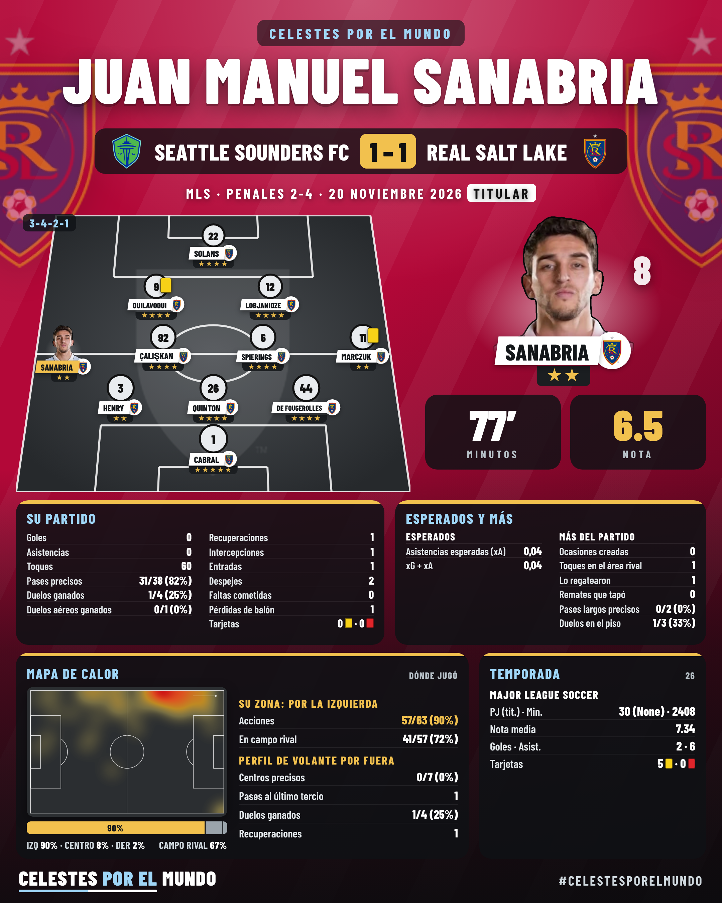
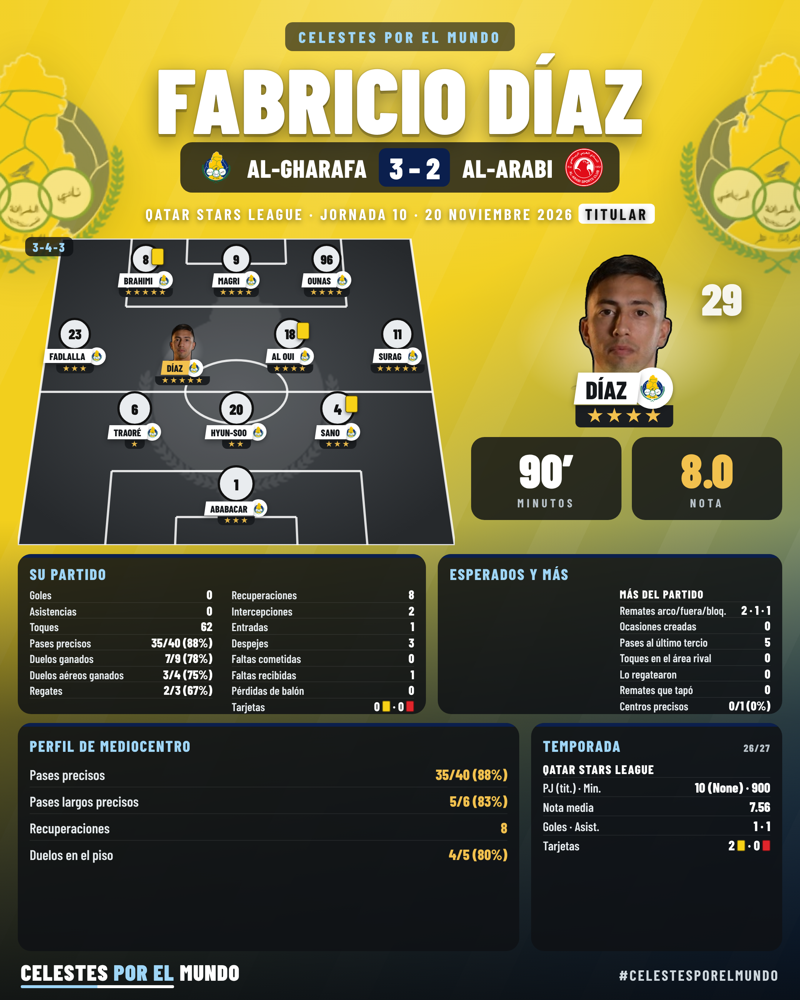
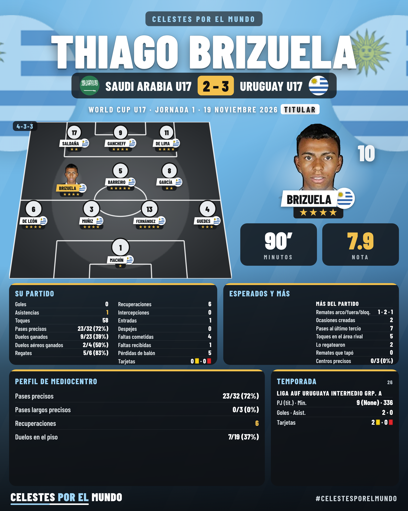
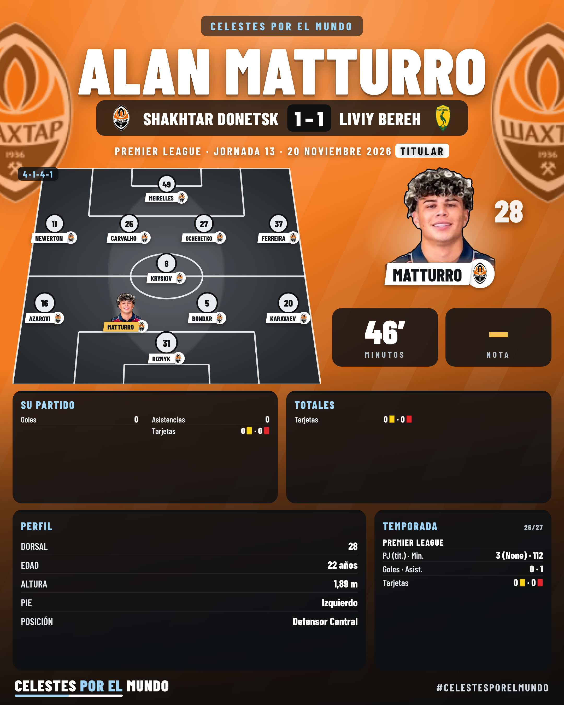

J. M. Sanabria jugó 77' (titular, nota 6.5) en Seattle Sounders FC 1-1 Real Salt Lake (2-4 en penales); F. Díaz jugó 90' (titular, nota 8.0) en Al-Gharafa 3-2 Al-Arabi; Brizuela jugó 90' (titular, nota 7.9) en Saudi Arabia U17 2-3 Uruguay U17; Mattur

@tuscxm

## Quién jugó
- **J. M. Sanabria** jugó 77' (titular, nota 6.5, de volante por izquierda) en Seattle Sounders FC 1-1 Real Salt Lake (2-4 en penales) · MLS
- **F. Díaz** jugó 90' (titular, nota 8.0, de mediocentro) en Al-Gharafa 3-2 Al-Arabi · Qatar Stars League
- **Brizuela** jugó 90' (titular, nota 7.9, de mediocentro) en Saudi Arabia U17 2-3 Uruguay U17 · World Cup U17
- **Matturro** jugó 46' (titular, de defensor central) en Shakhtar Donetsk 1-1 Liviy Bereh · Premier League

## El resto
- Valverde: sin partido hoy ni ayer
- Bernal: sin partido hoy ni ayer
- Mouriño: sin partido hoy ni ayer
- M. Araújo: sin partido hoy ni ayer
- Á. Rodríguez: sin partido hoy ni ayer
- González: sin partido hoy ni ayer
- Cáceres: sin partido hoy ni ayer
- Petit: sin partido hoy ni ayer
- Bentancur: sin partido hoy ni ayer
- Satriano: sin partido hoy ni ayer
- Boselli: sin partido hoy ni ayer
- J. Rodríguez: sin partido hoy ni ayer
- Zalazar: sin partido hoy ni ayer
- Merentiel: sin partido hoy ni ayer
- Giménez: sin partido hoy ni ayer
- Amaro: sin partido hoy ni ayer
- R. Araújo: sin partido hoy ni ayer
- Ugarte: sin partido hoy ni ayer
- Canobbio: sin partido hoy ni ayer
- Darwin: sin partido hoy ni ayer
- Torreira: sin partido hoy ni ayer
- Piquerez: sin partido hoy ni ayer
- Olivera: sin partido hoy ni ayer
- Varela: sin partido hoy ni ayer
- Nández: sin partido hoy ni ayer
- Bueno: sin partido hoy ni ayer
- Pereira: sin partido hoy ni ayer
- Marichal: sin partido hoy ni ayer
- Barboza: sin partido hoy ni ayer
- Olaza: sin partido hoy ni ayer
- Fonseca: sin partido hoy ni ayer
- E. Martínez: sin partido hoy ni ayer
- De la Cruz: ERROR al revisar (no se pudo consultar SofaScore) → `<HTTPError 403: 'Forbidden'>`
- Arrascaeta: sin partido hoy ni ayer
- Pellistri: sin partido hoy ni ayer
- Rossi: sin partido hoy ni ayer
- B. Rodríguez: sin partido hoy ni ayer
- Damiani: sin partido hoy ni ayer
- Aguirre: sin partido hoy ni ayer
- Viñas: sin partido hoy ni ayer

## Avisos
- J. M. Sanabria: SofaScore no respondió; fuentes: fotmob ok, besoccer ok, api_football sin datos: el plan gratis de API-Football no cubre esta temporada (plan: Free plans do not have access to this season, try from 2022 to 2024.), thesportsdb ok, understat sin datos: sin understat_equipo (Understat no cubre esa liga), zerozero error HTTP 403
- J. M. Sanabria: Hubo tanda de penales (2-4) y no pateó
- J. M. Sanabria: Armada con datos de respaldo (FotMob): hay menos estadísticas que de costumbre, revisala antes de publicar
- F. Díaz: SofaScore no respondió; fuentes: fotmob ok, besoccer ok, api_football sin datos: el plan gratis de API-Football no cubre esta temporada (plan: Free plans do not have access to this season, try from 2022 to 2024.), thesportsdb sin datos: no se encontró el equipo, understat sin datos: sin understat_equipo (Understat no cubre esa liga), zerozero error HTTP 403
- F. Díaz: No hay mapa de calor de este partido en el respaldo: se muestra el perfil
- F. Díaz: Armada con datos de respaldo (FotMob): hay menos estadísticas que de costumbre, revisala antes de publicar
- Brizuela: SofaScore no respondió; fuentes: fotmob ok, besoccer ok, api_football sin datos: el plan gratis de API-Football no cubre esta temporada (plan: Free plans do not have access to this season, try from 2022 to 2024.), thesportsdb sin datos: no se encontró el equipo, understat sin datos: sin understat_equipo (Understat no cubre esa liga), zerozero error HTTP 403
- Brizuela: No hay mapa de calor de este partido en el respaldo: se muestra el perfil
- Brizuela: Armada con datos de respaldo (FotMob): hay menos estadísticas que de costumbre, revisala antes de publicar
- Matturro: SofaScore no respondió; fuentes: fotmob ok, besoccer ok, api_football sin datos: el plan gratis de API-Football no cubre esta temporada (plan: Free plans do not have access to this season, try from 2022 to 2024.), thesportsdb ok, understat sin datos: sin understat_equipo (Understat no cubre esa liga), zerozero error HTTP 403
- Matturro: No hay mapa de calor de este partido en el respaldo: se muestra el perfil
- Matturro: Armada con datos de respaldo (FotMob): hay menos estadísticas que de costumbre, revisala antes de publicar

## J. M. Sanabria · Seattle Sounders FC 1-1 Real Salt Lake (2-4 en penales)

[Abrir la imagen en tamaño completo](https://github.com/tuscxm/celestes-por-el-mundo/blob/main/salida/png/J.%20M.%20Sanabria/2026-11-20%20%C2%B7%20Seattle%20Sounders%20FC%20%C2%B7%20Mls/Sanabria_SeattleSoundersFC-RealSaltLake_2026-11-20.png)

Texto para el posteo:
```
🇺🇾 JUAN MANUEL SANABRIA · Seattle Sounders FC 1-1 Real Salt Lake (2-4 en penales)
⏱ 77' · ⭐ 6.5

Jugó de volante por izquierda: 31/38 pases (82%), 1 recuperación y 1 pase al último tercio.

🧩 ¿Y en una Uruguay 3-5-2 con enganche?
Sería carrilero por izquierda: 90% de sus acciones por la izquierda, 67% en campo rival y 1 pase al último tercio. En el 3-5-2 toda la banda es suya, y con tres centrales atrás puede pasar sin dejar la espalda sola.

Tres atrás, dos carrileros, dos internos, un 10 suelto y dos puntas. ¿Lo jugarías así? 👇
#CelestesPorElMundo #Uruguay #RealSaltLake #352
```

## F. Díaz · Al-Gharafa 3-2 Al-Arabi

[Abrir la imagen en tamaño completo](https://github.com/tuscxm/celestes-por-el-mundo/blob/main/salida/png/F.%20D%C3%ADaz/2026-11-20%20%C2%B7%20Al-Arabi%20%C2%B7%20Qatar%20Stars%20League/Diaz_Al-Gharafa-Al-Arabi_2026-11-20.png)

Texto para el posteo:
```
🇺🇾 FABRICIO DÍAZ · Al-Gharafa 3-2 Al-Arabi
⏱ 90' · ⭐ 8.0

Jugó de mediocentro: 35/40 pases (88%), 7/9 duelos ganados, 8 recuperaciones y 5 pases al último tercio.

🧩 ¿Y en una Uruguay 3-5-2 con enganche?
Sería uno de los dos internos: 35/40 pases (88%), 8 recuperaciones y 7/9 duelos ganados. Es el que sostiene y hace circular para que el enganche reciba de frente.

Tres atrás, dos carrileros, dos internos, un 10 suelto y dos puntas. ¿Lo jugarías así? 👇
#CelestesPorElMundo #Uruguay #AlGharafa #352
```

## Brizuela · Saudi Arabia U17 2-3 Uruguay U17

[Abrir la imagen en tamaño completo](https://github.com/tuscxm/celestes-por-el-mundo/blob/main/salida/png/T.%20Brizuela/2026-11-19%20%C2%B7%20Saudi%20Arabia%20U17%20%C2%B7%20World%20Cup%20U17/Brizuela_SaudiArabiaU17-UruguayU17_2026-11-19.png)

Texto para el posteo:
```
🇺🇾 THIAGO BRIZUELA · Saudi Arabia U17 2-3 Uruguay U17
⏱ 90' · ⭐ 7.9

Jugó de mediocentro: 23/32 pases (72%), 6 recuperaciones, 7 pases al último tercio y 2 ocasiones creadas.

🧩 ¿Y en una Uruguay 3-5-2 con enganche?
Es el 10 que pide el sistema: 2 ocasiones creadas, 7 pases al último tercio y 5/6 regates. Suelto detrás de dos puntas, con dos internos que lo cubren, Uruguay junta a los que definen.

Tres atrás, dos carrileros, dos internos, un 10 suelto y dos puntas. ¿Lo jugarías así? 👇
#CelestesPorElMundo #Uruguay #352
```

## Matturro · Shakhtar Donetsk 1-1 Liviy Bereh

[Abrir la imagen en tamaño completo](https://github.com/tuscxm/celestes-por-el-mundo/blob/main/salida/png/A.%20Matturro/2026-11-20%20%C2%B7%20Liviy%20Bereh%20%C2%B7%20Premier%20League/Matturro_ShakhtarDonetsk-LiviyBereh_2026-11-20.png)

Texto para el posteo:
```
🇺🇾 ALAN MATTURRO · Shakhtar Donetsk 1-1 Liviy Bereh
⏱ 46'
#CelestesPorElMundo #Uruguay #ShakhtarDonetsk
```

---
En X se publican solas en unos minutos (menos las que la revisión ponga en *No publicar en X*); en Instagram no se publicó nada. Cerrá este aviso cuando la publiques o la descartes.
## Revisión visual
- Fuentes: SofaScore 403 en todos (salió todo por el respaldo automático); BeSoccer respondió HTTP 406 a WebFetch (besoccer_hoy.json quedó vacío); API-Football: plan gratis sin la temporada 2026; zerozero HTTP 403; TheSportsDB no encontró a Al-Gharafa ni a Uruguay U17.
- De la Cruz: quedó en error (SofaScore 403 y el respaldo tampoco respondió). No tiene URL de BeSoccer y BeSoccer igual respondió 406: no se pudo usar el respaldo con BeSoccer.
- En las cuatro, TEMPORADA dice "PJ (tit.) · Min. 10 (None) · 900" (y 30 (None), 9 (None), 3 (None)): se ve el texto "None" porque el respaldo no trae los partidos de titular.
- F. Díaz y Brizuela: la columna ESPERADOS quedó vacía (el respaldo no trajo xG ni xA); sin mapa de calor, se muestra el PERFIL de mediocentro.
- Brizuela: es un partido de la Sub-17 (Mundial Sub-17). El torneo y el rival quedaron en inglés ("WORLD CUP U17", "SAUDI ARABIA U17", "URUGUAY U17") en lugar de en español; la foto grande se ve de baja resolución.
- Matturro: salió con el diseño anterior (SU PARTIDO / TOTALES casi vacíos y PERFIL genérico) porque el respaldo no trajo estadísticas del jugador ni nota; sin nota ni estrellas en la cancha y el texto del posteo solo tiene los minutos.
- Sanabria: tanda de penales bien explicada (PENALES 2-4 bajo el marcador, "(2-4 en penales)" en el posteo, no pateó). Mapa, SU ZONA y PERFIL de volante por fuera coherentes.

## No publicar en X
- Diaz_Al-Gharafa-Al-Arabi_2026-11-20: TEMPORADA muestra "None" en PJ (tit.)
- Sanabria_SeattleSoundersFC-RealSaltLake_2026-11-20: TEMPORADA muestra "None" en PJ (tit.)
- Brizuela_SaudiArabiaU17-UruguayU17_2026-11-19: TEMPORADA muestra "None" en PJ (tit.); torneo y equipos en inglés
- Matturro_ShakhtarDonetsk-LiviyBereh_2026-11-20: TEMPORADA muestra "None"; sin nota ni estadísticas (diseño anterior casi vacío)
