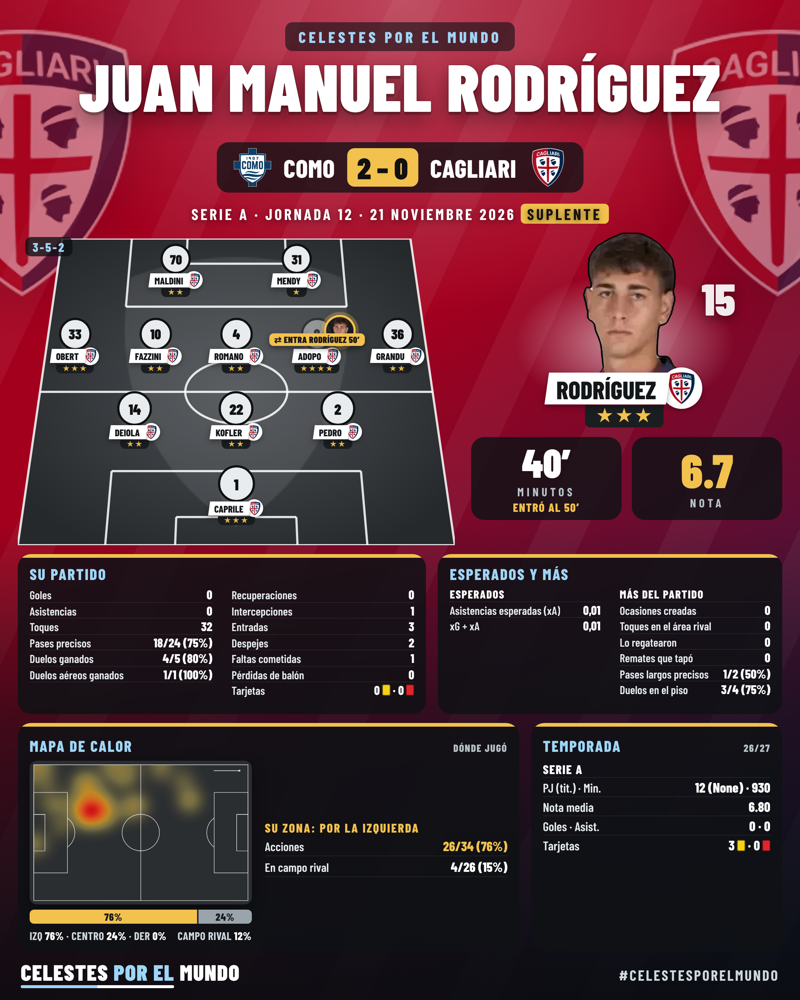
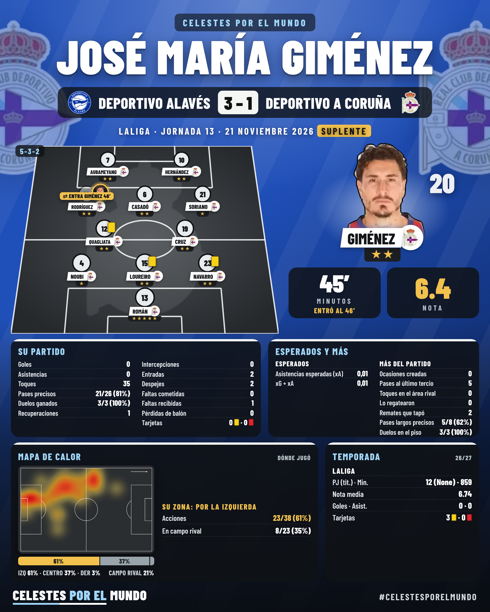
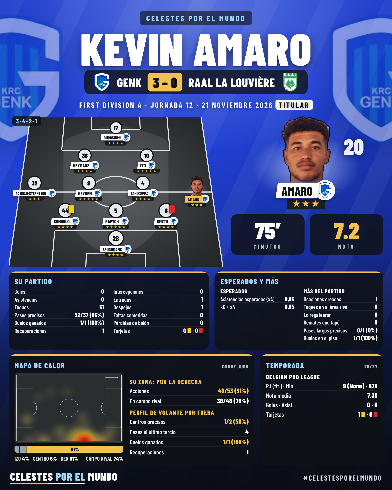
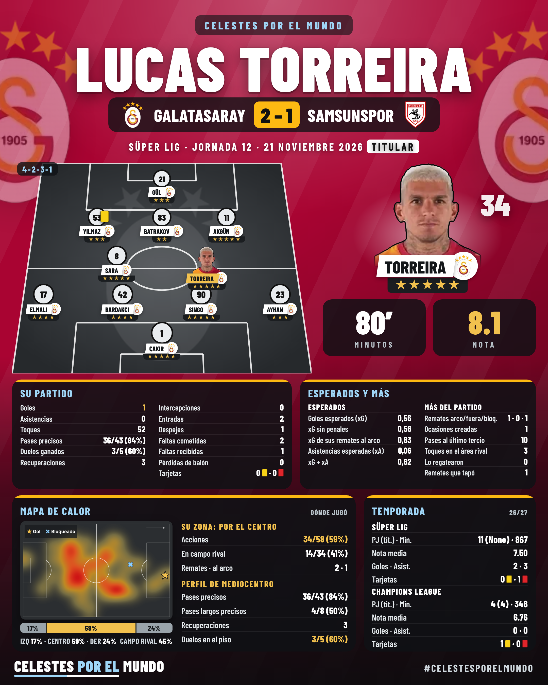
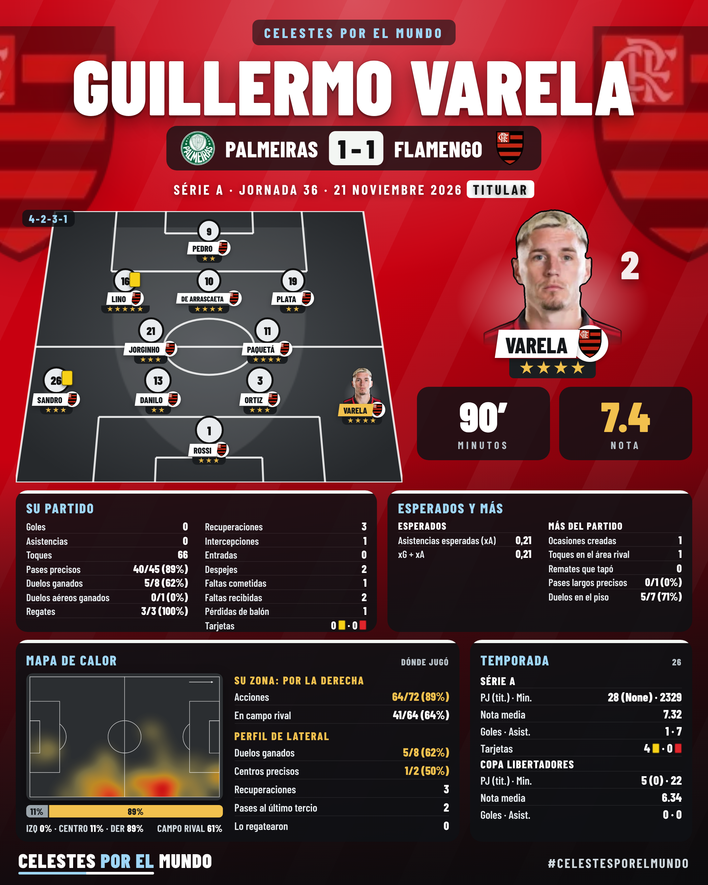
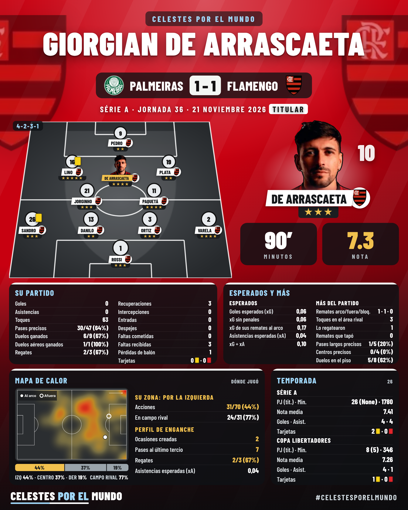
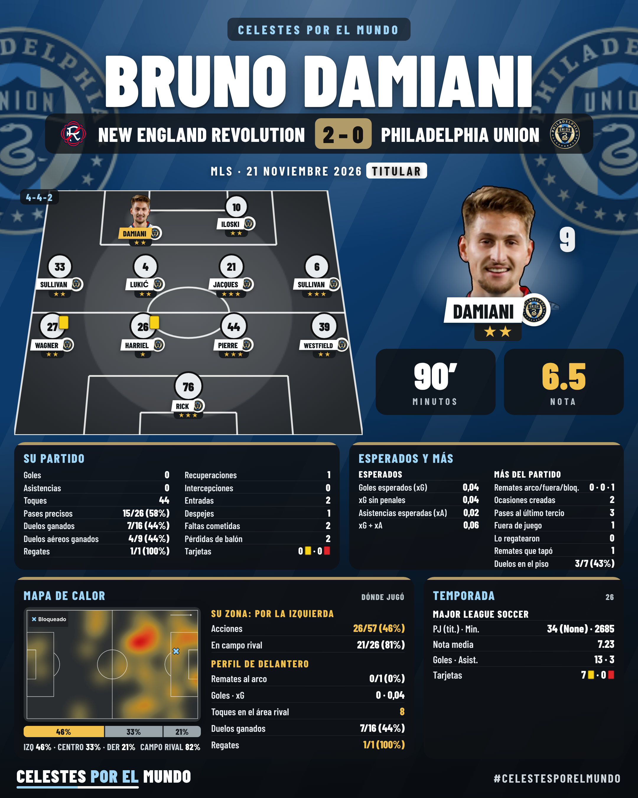

J. Rodríguez jugó 40' (suplente, nota 6.7) en Como 2-0 Cagliari; Giménez jugó 45' (suplente, nota 6.4) en Deportivo Alavés 3-1 Deportivo A Coruña; Amaro jugó 75' (titular, nota 7.2) en Genk 3-0 RAAL La Louvière; Torreira jugó 80' (titular, nota 8.1) 

@tuscxm

## Quién jugó
- **J. Rodríguez** jugó 40' (suplente, entró al 50' por Adopo, nota 6.7, su juego) en Como 2-0 Cagliari · Serie A
- **Giménez** jugó 45' (suplente, entró al 46' por Rodríguez, nota 6.4, su juego) en Deportivo Alavés 3-1 Deportivo A Coruña · LaLiga
- **Amaro** jugó 75' (titular, nota 7.2, de volante por derecha) en Genk 3-0 RAAL La Louvière · First Division A
- **Torreira** jugó 80' (titular, nota 8.1, de mediocentro) en Galatasaray 2-1 Samsunspor · Süper Lig
- **Varela** jugó 90' (titular, nota 7.4, de lateral derecho) en Palmeiras 1-1 Flamengo · Série A
- **Arrascaeta** jugó 90' (titular, nota 7.3, de mediocentro) en Palmeiras 1-1 Flamengo · Série A
- **Damiani** jugó 90' (titular, nota 6.5, de delantero) en New England Revolution 2-0 Philadelphia Union · MLS

## El resto
- Valverde: sin partido hoy ni ayer
- Bernal: no jugó en Sevilla 1-1 Real Betis (no entró)
- Mouriño: sin partido hoy ni ayer
- M. Araújo: sin partido hoy ni ayer
- Á. Rodríguez: sin partido hoy ni ayer
- González: sin partido hoy ni ayer
- Cáceres: sin partido hoy ni ayer
- Petit: no jugó en Real Sociedad B 0-3 Cádiz (no entró)
- Bentancur: no jugó en Tottenham Hotspur 2-0 Ipswich Town (no entró)
- Satriano: sin partido hoy ni ayer
- Boselli: sin partido hoy ni ayer
- Zalazar: sin partido hoy ni ayer
- Merentiel: sin partido hoy ni ayer
- R. Araújo: sin partido hoy ni ayer
- J. M. Sanabria: ya procesado · Seattle Sounders FC 1-1 Real Salt Lake
- Ugarte: sin partido hoy ni ayer
- Canobbio: sin partido hoy ni ayer
- Darwin: sin partido hoy ni ayer
- F. Díaz: ya procesado · Al-Gharafa 3-2 Al-Arabi
- Brizuela: sin partido hoy ni ayer
- Piquerez: no jugó en Palmeiras 1-1 Flamengo (no entró)
- Matturro: ya procesado · Shakhtar Donetsk 1-1 Liviy Bereh
- Olivera: sin partido hoy ni ayer
- Nández: sin partido hoy ni ayer
- Bueno: sin partido hoy ni ayer
- Pereira: sin partido hoy ni ayer
- Marichal: sin partido hoy ni ayer
- Barboza: sin partido hoy ni ayer
- Olaza: sin partido hoy ni ayer
- Fonseca: sin partido hoy ni ayer
- E. Martínez: no jugó en Palmeiras 1-1 Flamengo (no entró)
- De la Cruz: ERROR al revisar (no se pudo consultar SofaScore) → `<HTTPError 403: 'Forbidden'>`
- Pellistri: sin partido hoy ni ayer
- Rossi: sin partido hoy ni ayer
- B. Rodríguez: sin partido hoy ni ayer
- Aguirre: sin partido hoy ni ayer
- Viñas: sin partido hoy ni ayer

## Avisos
- J. Rodríguez: SofaScore no respondió; fuentes: fotmob ok, besoccer ok, api_football sin datos: el plan gratis de API-Football no cubre esta temporada (plan: Free plans do not have access to this season, try from 2022 to 2024.), thesportsdb ok, understat sin datos: formato de página no reconocido, zerozero error HTTP 403
- J. Rodríguez: No se pudo saber el puesto en el que jugó
- J. Rodríguez: Armada con datos de respaldo (FotMob): hay menos estadísticas que de costumbre, revisala antes de publicar
- Giménez: SofaScore no respondió; fuentes: fotmob ok, besoccer ok, api_football sin datos: el plan gratis de API-Football no cubre esta temporada (plan: Free plans do not have access to this season, try from 2022 to 2024.), thesportsdb ok, understat sin datos: sin understat_equipo (Understat no cubre esa liga), zerozero error HTTP 403
- Giménez: No se pudo saber el puesto en el que jugó
- Giménez: Armada con datos de respaldo (FotMob): hay menos estadísticas que de costumbre, revisala antes de publicar
- Amaro: SofaScore no respondió; fuentes: fotmob ok, besoccer ok, api_football sin datos: el plan gratis de API-Football no cubre esta temporada (plan: Free plans do not have access to this season, try from 2022 to 2024.), thesportsdb ok, understat sin datos: sin understat_equipo (Understat no cubre esa liga), zerozero error HTTP 403
- Amaro: Armada con datos de respaldo (FotMob): hay menos estadísticas que de costumbre, revisala antes de publicar
- Torreira: SofaScore no respondió; fuentes: fotmob ok, besoccer ok, api_football sin datos: el plan gratis de API-Football no cubre esta temporada (plan: Free plans do not have access to this season, try from 2022 to 2024.), thesportsdb ok, understat sin datos: sin understat_equipo (Understat no cubre esa liga), zerozero error HTTP 403
- Torreira: Armada con datos de respaldo (FotMob): hay menos estadísticas que de costumbre, revisala antes de publicar
- Varela: SofaScore no respondió; fuentes: fotmob ok, besoccer ok, api_football sin datos: el plan gratis de API-Football no cubre esta temporada (plan: Free plans do not have access to this season, try from 2022 to 2024.), thesportsdb ok, understat sin datos: sin understat_equipo (Understat no cubre esa liga), zerozero error HTTP 403
- Varela: Armada con datos de respaldo (FotMob): hay menos estadísticas que de costumbre, revisala antes de publicar
- Arrascaeta: SofaScore no respondió; fuentes: fotmob ok, besoccer ok, api_football sin datos: el plan gratis de API-Football no cubre esta temporada (plan: Free plans do not have access to this season, try from 2022 to 2024.), thesportsdb ok, understat sin datos: sin understat_equipo (Understat no cubre esa liga), zerozero error HTTP 403
- Arrascaeta: Armada con datos de respaldo (FotMob): hay menos estadísticas que de costumbre, revisala antes de publicar
- Damiani: SofaScore no respondió; fuentes: fotmob ok, besoccer ok, api_football sin datos: el plan gratis de API-Football no cubre esta temporada (plan: Free plans do not have access to this season, try from 2022 to 2024.), thesportsdb ok, understat sin datos: sin understat_equipo (Understat no cubre esa liga), zerozero error HTTP 403
- Damiani: Armada con datos de respaldo (FotMob): hay menos estadísticas que de costumbre, revisala antes de publicar

## J. Rodríguez · Como 2-0 Cagliari

[Abrir la imagen en tamaño completo](https://github.com/tuscxm/celestes-por-el-mundo/blob/main/salida/png/J.%20M.%20Rodr%C3%ADguez/2026-11-21%20%C2%B7%20Como%20%C2%B7%20Serie%20A/Rodriguez_Como-Cagliari_2026-11-21.png)

Texto para el posteo:
```
🇺🇾 JUAN MANUEL RODRÍGUEZ · Como 2-0 Cagliari
⏱ 40' · ⭐ 6.7
🔁 Entró al 50' por Adopo

Jugó de titular: 76% de sus acciones por la izquierda, 18/24 pases (75%) y 4/5 duelos ganados.

🧩 ¿Y en una Uruguay 3-5-2 con enganche?
Lo vemos de zaguero por izquierda en la línea de tres: 18/24 pases (75%), 4/5 duelos ganados y 1/1 por arriba. Con tres atrás, un central que sale limpio le suma un pase para encontrar al enganche y deja a los carrileros libres para pasar.

Tres atrás, dos carrileros, dos internos, un 10 suelto y dos puntas. ¿Lo jugarías así? 👇
#CelestesPorElMundo #Uruguay #Cagliari #352
```

## Giménez · Deportivo Alavés 3-1 Deportivo A Coruña

[Abrir la imagen en tamaño completo](https://github.com/tuscxm/celestes-por-el-mundo/blob/main/salida/png/J.%20M.%20Gim%C3%A9nez/2026-11-21%20%C2%B7%20Deportivo%20Alav%C3%A9s%20%C2%B7%20LaLiga/Gimenez_DeportivoAlaves-DeportivoACoruna_2026-11-21.png)

Texto para el posteo:
```
🇺🇾 JOSÉ MARÍA GIMÉNEZ · Deportivo Alavés 3-1 Deportivo A Coruña
⏱ 45' · ⭐ 6.4
🔁 Entró al 46' por Rodríguez

Jugó de titular: 61% de sus acciones por la izquierda, 21/26 pases (81%), 3/3 duelos ganados y 1 recuperación.

🧩 ¿Y en una Uruguay 3-5-2 con enganche?
Lo vemos de zaguero por izquierda en la línea de tres: 21/26 pases (81%), 5/8 pases largos y 3/3 duelos ganados. Con tres atrás, un central que sale limpio le suma un pase para encontrar al enganche y deja a los carrileros libres para pasar.

Tres atrás, dos carrileros, dos internos, un 10 suelto y dos puntas. ¿Lo jugarías así? 👇
#CelestesPorElMundo #Uruguay #DeportivodeLaCoruña #352
```

## Amaro · Genk 3-0 RAAL La Louvière

[Abrir la imagen en tamaño completo](https://github.com/tuscxm/celestes-por-el-mundo/blob/main/salida/png/K.%20Amaro/2026-11-21%20%C2%B7%20RAAL%20La%20Louvi%C3%A8re%20%C2%B7%20First%20Division%20A/Amaro_Genk-RAALLaLouvi%C3%A8re_2026-11-21.png)

Texto para el posteo:
```
🇺🇾 KEVIN AMARO · Genk 3-0 RAAL La Louvière
⏱ 75' · ⭐ 7.2

Jugó de volante por derecha: 32/37 pases (86%), 1/1 duelos ganados, 1 recuperación y 4 pases al último tercio.

🧩 ¿Y en una Uruguay 3-5-2 con enganche?
Sería carrilero por derecha: 91% de sus acciones por la derecha, 74% en campo rival y 4 pases al último tercio. En el 3-5-2 toda la banda es suya, y con tres centrales atrás puede pasar sin dejar la espalda sola.

Tres atrás, dos carrileros, dos internos, un 10 suelto y dos puntas. ¿Lo jugarías así? 👇
#CelestesPorElMundo #Uruguay #Genk #352
```

## Torreira · Galatasaray 2-1 Samsunspor

[Abrir la imagen en tamaño completo](https://github.com/tuscxm/celestes-por-el-mundo/blob/main/salida/png/L.%20Torreira/2026-11-21%20%C2%B7%20Samsunspor%20%C2%B7%20S%C3%BCper%20Lig/Torreira_Galatasaray-Samsunspor_2026-11-21.png)

Texto para el posteo:
```
🇺🇾 LUCAS TORREIRA · Galatasaray 2-1 Samsunspor
⏱ 80' · ⭐ 8.1

Jugó de mediocentro: 59% de sus acciones por el centro, 1 gol, 36/43 pases (84%) y 3/5 duelos ganados.

🧩 ¿Y en una Uruguay 3-5-2 con enganche?
Sería uno de los dos internos: 36/43 pases (84%), 3 recuperaciones y 3/5 duelos ganados. Es el que sostiene y hace circular para que el enganche reciba de frente.

Tres atrás, dos carrileros, dos internos, un 10 suelto y dos puntas. ¿Lo jugarías así? 👇
#CelestesPorElMundo #Uruguay #Galatasaray #352
```

## Varela · Palmeiras 1-1 Flamengo

[Abrir la imagen en tamaño completo](https://github.com/tuscxm/celestes-por-el-mundo/blob/main/salida/png/G.%20Varela/2026-11-21%20%C2%B7%20Palmeiras%20%C2%B7%20S%C3%A9rie%20A/Varela_Palmeiras-Flamengo_2026-11-21.png)

Texto para el posteo:
```
🇺🇾 GUILLERMO VARELA · Palmeiras 1-1 Flamengo
⏱ 90' · ⭐ 7.4

Jugó de lateral derecho: 40/45 pases (89%), 5/8 duelos ganados, 3 recuperaciones y 2 pases al último tercio.

🧩 ¿Y en una Uruguay 3-5-2 con enganche?
Sería carrilero por derecha: 89% de sus acciones por la derecha, 61% en campo rival y 2 pases al último tercio. En el 3-5-2 toda la banda es suya, y con tres centrales atrás puede pasar sin dejar la espalda sola.

Tres atrás, dos carrileros, dos internos, un 10 suelto y dos puntas. ¿Lo jugarías así? 👇
#CelestesPorElMundo #Uruguay #Flamengo #352
```

## Arrascaeta · Palmeiras 1-1 Flamengo

[Abrir la imagen en tamaño completo](https://github.com/tuscxm/celestes-por-el-mundo/blob/main/salida/png/G.%20De%20Arrascaeta/2026-11-21%20%C2%B7%20Palmeiras%20%C2%B7%20S%C3%A9rie%20A/DeArrascaeta_Palmeiras-Flamengo_2026-11-21.png)

Texto para el posteo:
```
🇺🇾 GIORGIAN DE ARRASCAETA · Palmeiras 1-1 Flamengo
⏱ 90' · ⭐ 7.3

Jugó de enganche: 44% de sus acciones por la izquierda, 30/47 pases (64%), 6/9 duelos ganados y 3 recuperaciones.

🧩 ¿Y en una Uruguay 3-5-2 con enganche?
Es el 10 que pide el sistema: 2 ocasiones creadas, 7 pases al último tercio y 2/3 regates. Suelto detrás de dos puntas, con dos internos que lo cubren, Uruguay junta a los que definen.

Tres atrás, dos carrileros, dos internos, un 10 suelto y dos puntas. ¿Lo jugarías así? 👇
#CelestesPorElMundo #Uruguay #Flamengo #352
```

## Damiani · New England Revolution 2-0 Philadelphia Union

[Abrir la imagen en tamaño completo](https://github.com/tuscxm/celestes-por-el-mundo/blob/main/salida/png/B.%20Damiani/2026-11-21%20%C2%B7%20New%20England%20Revolution%20%C2%B7%20Mls/Damiani_NewEnglandRevolution-PhiladelphiaUnion_2026-11-21.png)

Texto para el posteo:
```
🇺🇾 BRUNO DAMIANI · New England Revolution 2-0 Philadelphia Union
⏱ 90' · ⭐ 6.5

Jugó de delantero: 46% de sus acciones por la izquierda, 15/26 pases (58%), 1 recuperación y 3 pases al último tercio.

🧩 ¿Y en una Uruguay 3-5-2 con enganche?
Sería uno de los dos de punta: 8 toques en el área rival y 1/1 regates. Con un enganche que lo habilite y otro 9 al lado, deja de pelear solo contra los centrales.

Tres atrás, dos carrileros, dos internos, un 10 suelto y dos puntas. ¿Lo jugarías así? 👇
#CelestesPorElMundo #Uruguay #PhiladelphiaUnion #352
```

---
En X se publican solas en unos minutos (menos las que la revisión ponga en *No publicar en X*); en Instagram no se publicó nada. Cerrá este aviso cuando la publiques o la descartes.
## Revisión visual
- Fuentes: SofaScore respondió 403 a todos (las siete salieron con el respaldo automático de FotMob); BeSoccer respondió HTTP 406 a WebFetch (besoccer_hoy.json quedó vacío); API-Football: plan gratis sin la temporada 2026; zerozero HTTP 403; Understat: formato de página no reconocido.
- De la Cruz: sigue en ERROR (SofaScore 403 y el respaldo de FotMob falló con `AttributeError: 'NoneType' object has no attribute 'get'`). No tiene URL de BeSoccer y BeSoccer igual respondía 406: no se pudo saber si jugó en Palmeiras 1-1 Flamengo.
- En las siete, en TEMPORADA la línea de la liga dice "PJ (tit.) · Min. N (None) · …": se imprime "None" en lugar de los partidos de titular (el respaldo no los trae).
- J. M. Rodríguez y Giménez: entraron de suplentes, pero el texto del posteo dice "Jugó de titular: …" (no se pudo saber el puesto). Además falta el PERFIL (queda un hueco en la tarjeta del mapa) y ESPERADOS solo trae xA.
- Giménez: el dibujo dice 5-3-2 pero la cancha muestra las líneas 3-2-3-2 (Rodríguez, a quien reemplazó, aparece en la línea de volantes).
- Amaro, Torreira, Varela, Arrascaeta y Damiani: bien (caras con contorno, jugador resaltado, mapa acostado con remates cuando los hubo, SU ZONA y PERFIL acordes al puesto, números iguales en la infografía y el posteo). Arrascaeta: el resumen dice "de mediocentro" pero jugó de enganche en el 4-2-3-1; PERFIL DE ENGANCHE y el posteo son correctos. Amaro: TEMPORADA dice "BELGIAN PRO LEAGUE" en inglés y solo la liga.
- Ninguna dice el nombre de una fuente; no hubo tandas de penales.

## No publicar en X
- Rodriguez_Como-Cagliari_2026-11-21: el posteo dice "Jugó de titular" (entró de suplente); sin PERFIL; TEMPORADA muestra "None"
- Gimenez_DeportivoAlaves-DeportivoACoruna_2026-11-21: el posteo dice "Jugó de titular" (entró de suplente); sin PERFIL; TEMPORADA muestra "None"
- Amaro_Genk-RAALLaLouvière_2026-11-21: TEMPORADA muestra "None" en PJ (tit.)
- Torreira_Galatasaray-Samsunspor_2026-11-21: TEMPORADA muestra "None" en PJ (tit.)
- Varela_Palmeiras-Flamengo_2026-11-21: TEMPORADA muestra "None" en PJ (tit.)
- DeArrascaeta_Palmeiras-Flamengo_2026-11-21: TEMPORADA muestra "None" en PJ (tit.)
- Damiani_NewEnglandRevolution-PhiladelphiaUnion_2026-11-21: TEMPORADA muestra "None" en PJ (tit.)
