Valverde jugó 33' (suplente, nota 6.6) en Real Madrid 2-1 Celta Vigo; Mouriño jugó 4' (suplente) en Barcelona 3-2 Villarreal; González jugó 1' (suplente) en Racing Santander 3-2 Real Sociedad; Zalazar jugó 21' (suplente) en Sporting CP 4-0 União Serr

@tuscxm

## Quién jugó
- **Valverde** jugó 33' (suplente, entró al 57' por Silva, nota 6.6, su juego) en Real Madrid 2-1 Celta Vigo · LaLiga
- **Mouriño** jugó 4' (suplente, entró al 86' por Mikautadze, su juego) en Barcelona 3-2 Villarreal · LaLiga
- **González** jugó 1' (suplente, entró al 90+2' por Vicente, su juego) en Racing Santander 3-2 Real Sociedad · LaLiga
- **Zalazar** jugó 21' (suplente, su juego) en Sporting CP 4-0 União Serra · Taça de Portugal
- **Merentiel** jugó 64' (titular, nota 8.0, de delantero) en Atlético-MG 0-2 Boca Juniors · Copa Sudamericana
- **R. Araújo** jugó 85' (titular, nota 7.5, de lateral derecho) en Liverpool 4-0 Manchester United · Premier League
- **Olivera** jugó 32' (suplente, entró al 58' por Marín, nota 6.9, su juego) en Napoli 1-0 Torino · Serie A
- **Bueno** jugó 90' (titular, nota 6.4, de defensor central) en Tigres 1-0 CF América · Liga MX
- **Olaza** jugó 90' (titular, nota 7.6, de lateral izquierdo) en Dynamo Moscow 1-1 FC Krasnodar · Premier League
- **Rossi** jugó 45' (titular, nota 6.3, de mediocentro) en Pumas 0-2 Monterrey · Liga MX
- **Aguirre** jugó 19' (suplente, entró al 71' por Lainez, nota 6.4, de delantero) en Tigres 1-0 CF América · Liga MX
- **Viñas** jugó 59' (titular, nota 5.9, de volante por derecha) en Pachuca 2-0 Toluca · Liga MX

## El resto
- Bernal: no jugó en Sevilla 1-1 Real Betis (no entró)
- M. Araújo: sin partido hoy ni ayer
- Á. Rodríguez: sin partido hoy ni ayer
- Cáceres: no jugó en Real Madrid 2-1 Celta Vigo (no entró)
- Petit: no jugó en Real Sociedad B 0-3 Cádiz (no entró)
- Bentancur: no jugó en Tottenham Hotspur 2-0 Ipswich Town (no entró)
- Satriano: sin partido hoy ni ayer
- Boselli: sin partido hoy ni ayer
- J. Rodríguez: ya procesado · Como 2-0 Cagliari
- Giménez: ya procesado · Deportivo Alavés 3-1 Deportivo A Coruña
- Amaro: ya procesado · Genk 3-0 RAAL La Louvière
- J. M. Sanabria: sin partido hoy ni ayer
- Ugarte: sin partido hoy ni ayer
- Canobbio: sin partido hoy ni ayer
- Darwin: sin partido hoy ni ayer
- F. Díaz: sin partido hoy ni ayer
- Torreira: ya procesado · Galatasaray 2-1 Samsunspor
- Brizuela: sin partido hoy ni ayer
- Piquerez: no jugó en Palmeiras 1-1 Flamengo (no entró)
- Matturro: sin partido hoy ni ayer
- Varela: ya procesado · Palmeiras 1-1 Flamengo
- Nández: sin partido hoy ni ayer
- Pereira: sin partido hoy ni ayer
- Marichal: no jugó en Dynamo Moscow 1-1 FC Krasnodar (no entró)
- Barboza: sin partido hoy ni ayer
- Fonseca: sin partido hoy ni ayer
- E. Martínez: no jugó en Palmeiras 1-1 Flamengo (no entró)
- De la Cruz: ERROR al revisar (no se pudo consultar SofaScore) → `<HTTPError 403: 'Forbidden'>`
- Arrascaeta: ya procesado · Palmeiras 1-1 Flamengo
- Pellistri: no jugó en Panathinaikos 2-0 OFI Crete (no entró)
- B. Rodríguez: sin partido hoy ni ayer
- Damiani: ya procesado · New England Revolution 2-0 Philadelphia Union

## Avisos
- Valverde: SofaScore no respondió; fuentes: fotmob ok, besoccer ok, api_football sin datos: el plan gratis de API-Football no cubre esta temporada (plan: Free plans do not have access to this season, try from 2022 to 2024.), thesportsdb ok, understat sin datos: formato de página no reconocido, zerozero error HTTP 403
- Valverde: No se pudo saber el puesto en el que jugó
- Valverde: Armada con datos de respaldo (FotMob): hay menos estadísticas que de costumbre, revisala antes de publicar
- Mouriño: SofaScore no respondió; fuentes: fotmob ok, besoccer ok, api_football sin datos: el plan gratis de API-Football no cubre esta temporada (plan: Free plans do not have access to this season, try from 2022 to 2024.), thesportsdb ok, understat sin datos: formato de página no reconocido, zerozero error HTTP 403
- Mouriño: No se pudo saber el puesto en el que jugó
- Mouriño: Armada con datos de respaldo (FotMob): hay menos estadísticas que de costumbre, revisala antes de publicar
- González: SofaScore no respondió; fuentes: fotmob ok, besoccer ok, api_football sin datos: el plan gratis de API-Football no cubre esta temporada (plan: Free plans do not have access to this season, try from 2022 to 2024.), thesportsdb ok, understat sin datos: sin understat_equipo (Understat no cubre esa liga), zerozero error HTTP 403
- González: No hay mapa de calor de este partido en el respaldo: se muestra el perfil
- González: No se pudo saber el puesto en el que jugó
- González: Armada con datos de respaldo (FotMob): hay menos estadísticas que de costumbre, revisala antes de publicar
- Zalazar: SofaScore no respondió; fuentes: fotmob ok, besoccer ok, api_football sin datos: el plan gratis de API-Football no cubre esta temporada (plan: Free plans do not have access to this season, try from 2022 to 2024.), thesportsdb ok, understat sin datos: sin understat_equipo (Understat no cubre esa liga), zerozero error HTTP 403
- Zalazar: Sin remates en el respaldo: TOTALES va sin lo de ataque
- Zalazar: No hay mapa de calor de este partido en el respaldo: se muestra el perfil
- Zalazar: No se pudo saber el puesto en el que jugó
- Zalazar: Armada con datos de respaldo (FotMob): hay menos estadísticas que de costumbre, revisala antes de publicar
- Zalazar: Sin alineación en el respaldo: la cancha va vacía
- Merentiel: SofaScore no respondió; fuentes: fotmob ok, besoccer ok, api_football sin datos: el plan gratis de API-Football no cubre esta temporada (plan: Free plans do not have access to this season, try from 2022 to 2024.), thesportsdb ok, understat sin datos: sin understat_equipo (Understat no cubre esa liga), zerozero error HTTP 403
- Merentiel: No hay mapa de calor de este partido en el respaldo: se muestra el perfil
- Merentiel: Armada con datos de respaldo (FotMob): hay menos estadísticas que de costumbre, revisala antes de publicar
- R. Araújo: SofaScore no respondió; fuentes: fotmob ok, besoccer ok, api_football sin datos: el plan gratis de API-Football no cubre esta temporada (plan: Free plans do not have access to this season, try from 2022 to 2024.), thesportsdb error HTTP 429, understat sin datos: formato de página no reconocido, zerozero error HTTP 403
- R. Araújo: Armada con datos de respaldo (FotMob): hay menos estadísticas que de costumbre, revisala antes de publicar
- Olivera: SofaScore no respondió; fuentes: fotmob ok, besoccer ok, api_football sin datos: el plan gratis de API-Football no cubre esta temporada (plan: Free plans do not have access to this season, try from 2022 to 2024.), thesportsdb ok, understat sin datos: formato de página no reconocido, zerozero error HTTP 403
- Olivera: No se pudo saber el puesto en el que jugó
- Olivera: Armada con datos de respaldo (FotMob): hay menos estadísticas que de costumbre, revisala antes de publicar
- Bueno: SofaScore no respondió; fuentes: fotmob ok, besoccer ok, api_football sin datos: el plan gratis de API-Football no cubre esta temporada (plan: Free plans do not have access to this season, try from 2022 to 2024.), thesportsdb error HTTP 429, understat sin datos: sin understat_equipo (Understat no cubre esa liga), zerozero error HTTP 403
- Bueno: Armada con datos de respaldo (FotMob): hay menos estadísticas que de costumbre, revisala antes de publicar
- Olaza: SofaScore no respondió; fuentes: fotmob ok, besoccer ok, api_football sin datos: el plan gratis de API-Football no cubre esta temporada (plan: Free plans do not have access to this season, try from 2022 to 2024.), thesportsdb error HTTP 429, understat sin datos: sin understat_equipo (Understat no cubre esa liga), zerozero error HTTP 403
- Olaza: Armada con datos de respaldo (FotMob): hay menos estadísticas que de costumbre, revisala antes de publicar
- Rossi: SofaScore no respondió; fuentes: fotmob ok, besoccer ok, api_football sin datos: el plan gratis de API-Football no cubre esta temporada (plan: Free plans do not have access to this season, try from 2022 to 2024.), thesportsdb error HTTP 429, understat sin datos: sin understat_equipo (Understat no cubre esa liga), zerozero error HTTP 403
- Rossi: Armada con datos de respaldo (FotMob): hay menos estadísticas que de costumbre, revisala antes de publicar
- Aguirre: SofaScore no respondió; fuentes: fotmob ok, besoccer ok, api_football sin datos: el plan gratis de API-Football no cubre esta temporada (plan: Free plans do not have access to this season, try from 2022 to 2024.), thesportsdb error HTTP 429, understat sin datos: sin understat_equipo (Understat no cubre esa liga), zerozero error HTTP 403
- Aguirre: Entró de suplente: el puesto (delantero) es su puesto habitual, no se sabe dónde entró
- Aguirre: Armada con datos de respaldo (FotMob): hay menos estadísticas que de costumbre, revisala antes de publicar
- Viñas: SofaScore no respondió; fuentes: fotmob ok, besoccer ok, api_football sin datos: el plan gratis de API-Football no cubre esta temporada (plan: Free plans do not have access to this season, try from 2022 to 2024.), thesportsdb ok, understat sin datos: sin understat_equipo (Understat no cubre esa liga), zerozero error HTTP 403
- Viñas: Armada con datos de respaldo (FotMob): hay menos estadísticas que de costumbre, revisala antes de publicar

## Valverde · Real Madrid 2-1 Celta Vigo
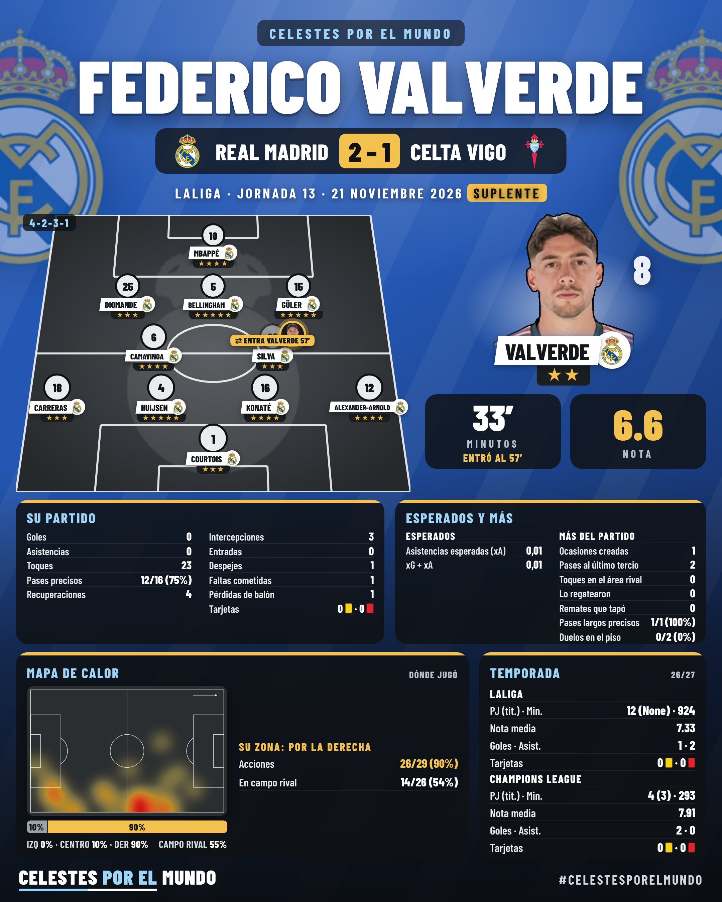
[Abrir la imagen en tamaño completo](https://github.com/tuscxm/celestes-por-el-mundo/blob/main/salida/png/F.%20Valverde/2026-11-21%20%C2%B7%20Celta%20Vigo%20%C2%B7%20LaLiga/Valverde_RealMadrid-CeltaVigo_2026-11-21.png)

Texto para el posteo:
```
🇺🇾 FEDERICO VALVERDE · Real Madrid 2-1 Celta Vigo
⏱ 33' · ⭐ 6.6
🔁 Entró al 57' por Silva

Jugó de titular: 12/16 pases (75%), 4 recuperaciones, 2 pases al último tercio y 1 ocasión creada.

🧩 ¿Y en una Uruguay 3-5-2 con enganche?
Sería carrilero por derecha: 90% de sus acciones por la derecha, 55% en campo rival y 2 pases al último tercio. En el 3-5-2 toda la banda es suya, y con tres centrales atrás puede pasar sin dejar la espalda sola.

Tres atrás, dos carrileros, dos internos, un 10 suelto y dos puntas. ¿Lo jugarías así? 👇
#CelestesPorElMundo #Uruguay #RealMadrid #352
```

## Mouriño · Barcelona 3-2 Villarreal
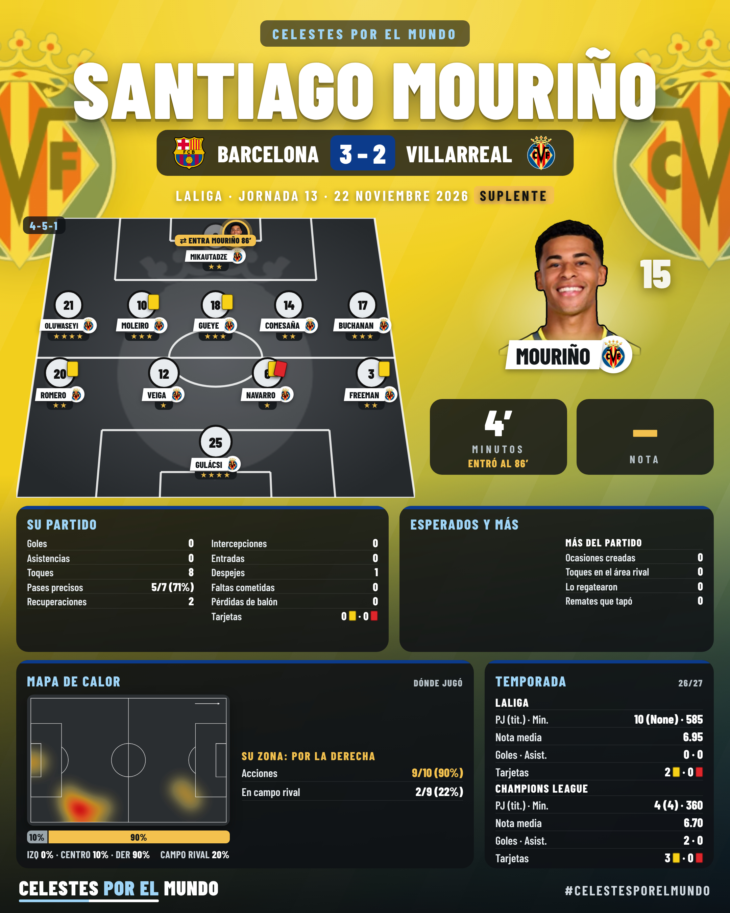
[Abrir la imagen en tamaño completo](https://github.com/tuscxm/celestes-por-el-mundo/blob/main/salida/png/S.%20Mouri%C3%B1o/2026-11-22%20%C2%B7%20Barcelona%20%C2%B7%20LaLiga/Mourino_Barcelona-Villarreal_2026-11-22.png)

Texto para el posteo:
```
🇺🇾 SANTIAGO MOURIÑO · Barcelona 3-2 Villarreal
⏱ 4'
🔁 Entró al 86' por Mikautadze

Jugó de titular: 90% de sus acciones por la derecha y 2 recuperaciones.

🧩 ¿Y en una Uruguay 3-5-2 con enganche?
Lo vemos de zaguero por derecha en la línea de tres: 2 recuperaciones y 1 despeje. Con tres atrás, un central que sale limpio le suma un pase para encontrar al enganche y deja a los carrileros libres para pasar.

Tres atrás, dos carrileros, dos internos, un 10 suelto y dos puntas. ¿Lo jugarías así? 👇
#CelestesPorElMundo #Uruguay #Villarreal #352
```

## González · Racing Santander 3-2 Real Sociedad
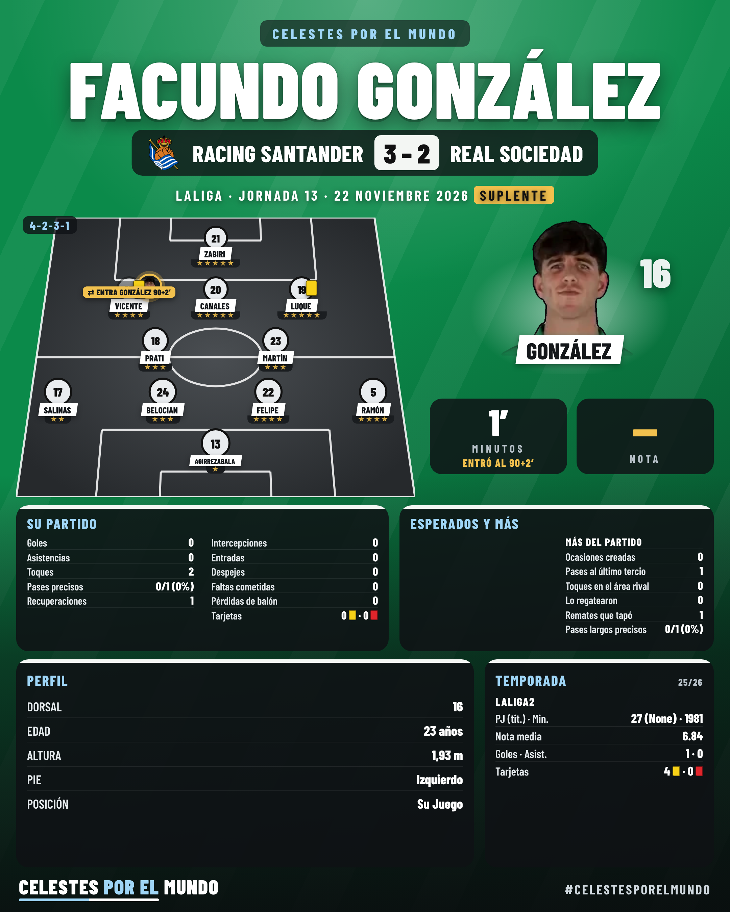
[Abrir la imagen en tamaño completo](https://github.com/tuscxm/celestes-por-el-mundo/blob/main/salida/png/F.%20Gonz%C3%A1lez/2026-11-22%20%C2%B7%20Racing%20Santander-Real%20Sociedad%20%C2%B7%20LaLiga/Gonzalez_RacingSantander-RealSociedad_2026-11-22.png)

Texto para el posteo:
```
🇺🇾 FACUNDO GONZÁLEZ · Racing Santander 3-2 Real Sociedad
⏱ 1'
🔁 Entró al 90+2' por Vicente

Jugó de titular: 1 recuperación y 1 pase al último tercio.

🧩 ¿Y en una Uruguay 3-5-2 con enganche?
Lo vemos de zaguero en la línea de tres: 1 recuperación. Con tres atrás, un central que sale limpio le suma un pase para encontrar al enganche y deja a los carrileros libres para pasar.

Tres atrás, dos carrileros, dos internos, un 10 suelto y dos puntas. ¿Lo jugarías así? 👇
#CelestesPorElMundo #Uruguay #RacingdeSantander #352
```

## Zalazar · Sporting CP 4-0 União Serra
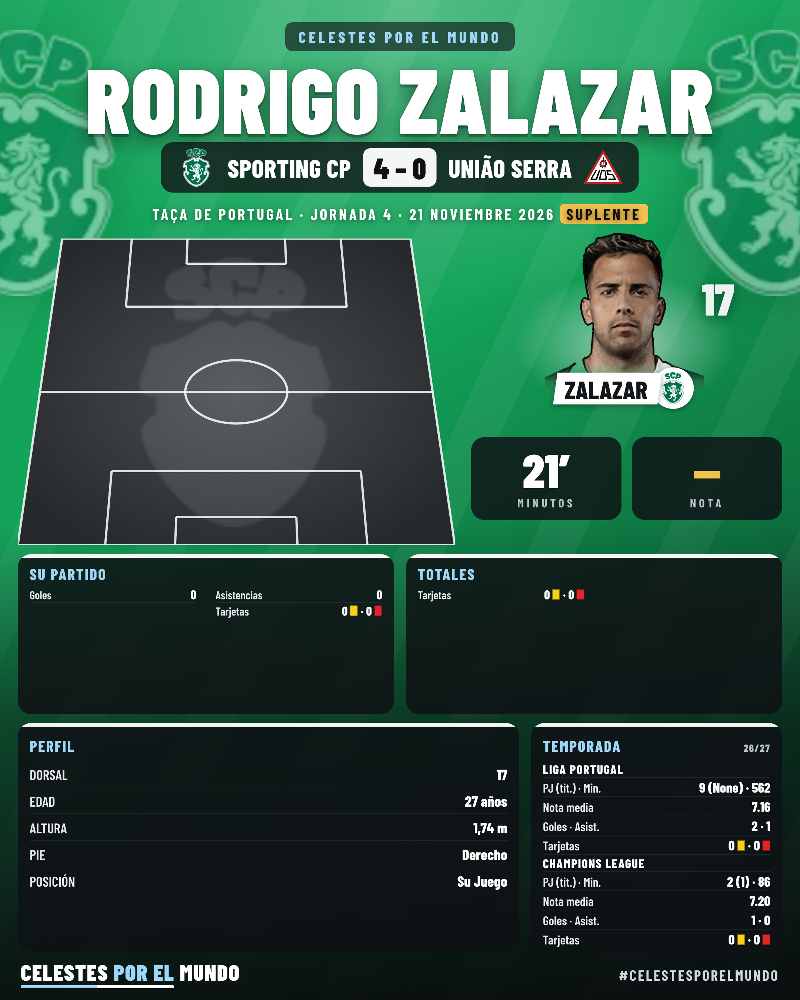
[Abrir la imagen en tamaño completo](https://github.com/tuscxm/celestes-por-el-mundo/blob/main/salida/png/R.%20Zalazar/2026-11-21%20%C2%B7%20Uni%C3%A3o%20Serra%20%C2%B7%20Ta%C3%A7a%20De%20Portugal/Zalazar_SportingCP-Uni%C3%A3oSerra_2026-11-21.png)

Texto para el posteo:
```
🇺🇾 RODRIGO ZALAZAR · Sporting CP 4-0 União Serra
⏱ 21'
#CelestesPorElMundo #Uruguay #SportingCP
```

## Merentiel · Atlético-MG 0-2 Boca Juniors
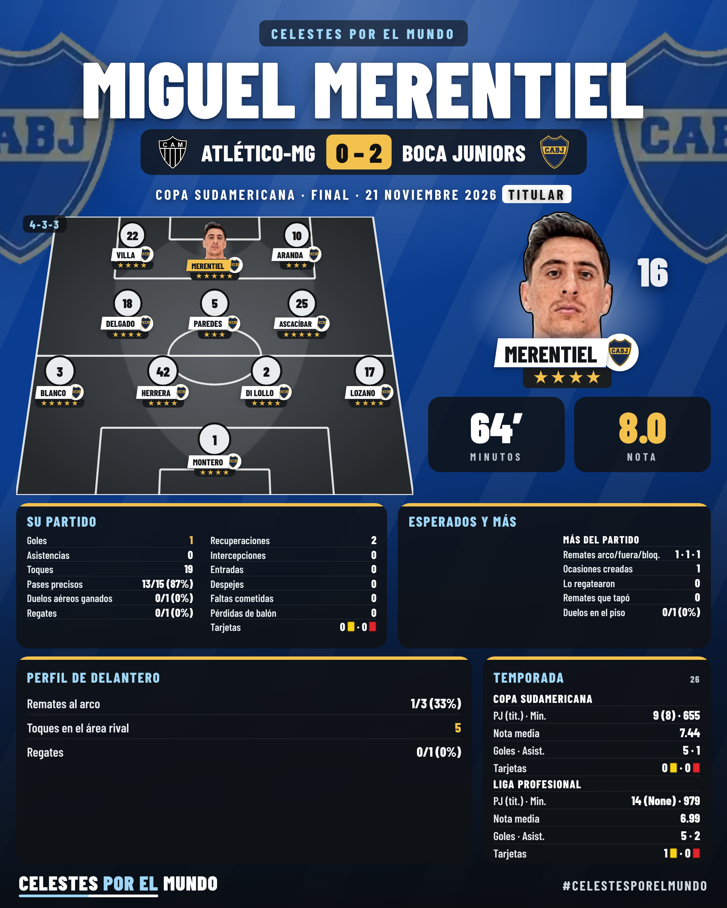
[Abrir la imagen en tamaño completo](https://github.com/tuscxm/celestes-por-el-mundo/blob/main/salida/png/M.%20Merentiel/2026-11-21%20%C2%B7%20Atl%C3%A9tico-MG%20%C2%B7%20Copa%20Sudamericana/Merentiel_Atletico-MG-BocaJuniors_2026-11-21.png)

Texto para el posteo:
```
🇺🇾 MIGUEL MERENTIEL · Atlético-MG 0-2 Boca Juniors
⏱ 64' · ⭐ 8.0

Jugó de delantero: 1 gol, 13/15 pases (87%), 2 recuperaciones y 1 ocasión creada.

🧩 ¿Y en una Uruguay 3-5-2 con enganche?
Sería uno de los dos de punta: 1 gol, 1 de 3 remates al arco y 5 toques en el área rival. Con un enganche que lo habilite y otro 9 al lado, deja de pelear solo contra los centrales.

Tres atrás, dos carrileros, dos internos, un 10 suelto y dos puntas. ¿Lo jugarías así? 👇
#CelestesPorElMundo #Uruguay #BocaJuniors #352
```

## R. Araújo · Liverpool 4-0 Manchester United
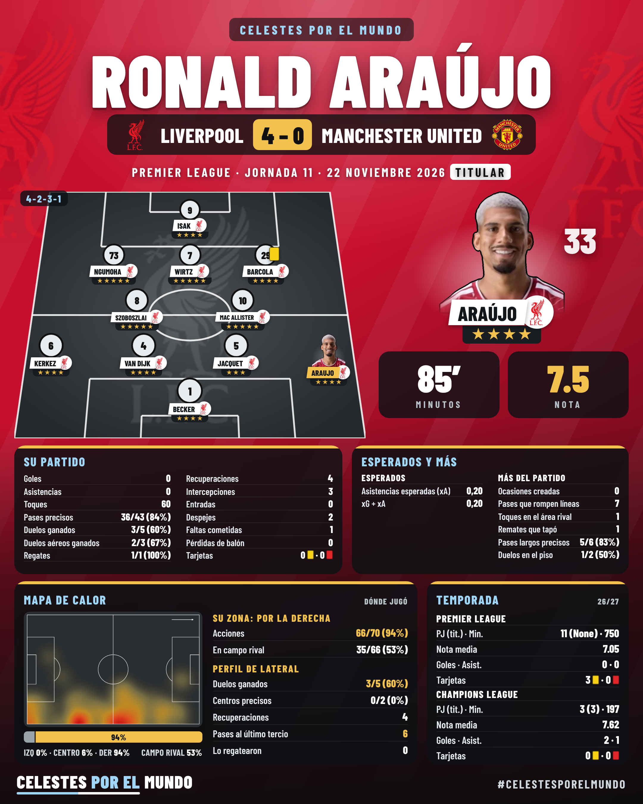
[Abrir la imagen en tamaño completo](https://github.com/tuscxm/celestes-por-el-mundo/blob/main/salida/png/R.%20Ara%C3%BAjo/2026-11-22%20%C2%B7%20Manchester%20United%20%C2%B7%20Premier%20League/Araujo_Liverpool-ManchesterUnited_2026-11-22.png)

Texto para el posteo:
```
🇺🇾 RONALD ARAÚJO · Liverpool 4-0 Manchester United
⏱ 85' · ⭐ 7.5

Jugó de lateral derecho: 94% de sus acciones por la derecha, 36/43 pases (84%), 3/5 duelos ganados y 4 recuperaciones.

🧩 ¿Y en una Uruguay 3-5-2 con enganche?
Lo vemos de zaguero por derecha en la línea de tres: 36/43 pases (84%), 5/6 pases largos y 3/5 duelos ganados. Con tres atrás, un central que sale limpio le suma un pase para encontrar al enganche y deja a los carrileros libres para pasar.

Tres atrás, dos carrileros, dos internos, un 10 suelto y dos puntas. ¿Lo jugarías así? 👇
#CelestesPorElMundo #Uruguay #Liverpool #352
```

## Olivera · Napoli 1-0 Torino
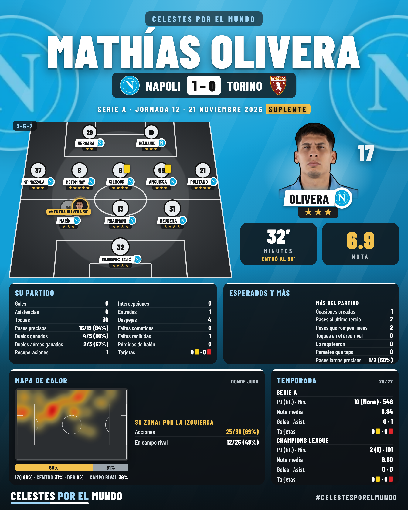
[Abrir la imagen en tamaño completo](https://github.com/tuscxm/celestes-por-el-mundo/blob/main/salida/png/M.%20Olivera/2026-11-21%20%C2%B7%20Torino%20%C2%B7%20Serie%20A/Olivera_Napoli-Torino_2026-11-21.png)

Texto para el posteo:
```
🇺🇾 MATHÍAS OLIVERA · Napoli 1-0 Torino
⏱ 32' · ⭐ 6.9
🔁 Entró al 58' por Marín

Jugó de titular: 69% de sus acciones por la izquierda, 16/19 pases (84%), 4/5 duelos ganados y 1 recuperación.

🧩 ¿Y en una Uruguay 3-5-2 con enganche?
Lo vemos de zaguero por izquierda en la línea de tres: 16/19 pases (84%), 4/5 duelos ganados y 2/3 por arriba. Con tres atrás, un central que sale limpio le suma un pase para encontrar al enganche y deja a los carrileros libres para pasar.

Tres atrás, dos carrileros, dos internos, un 10 suelto y dos puntas. ¿Lo jugarías así? 👇
#CelestesPorElMundo #Uruguay #Napoli #352
```

## Bueno · Tigres 1-0 CF América
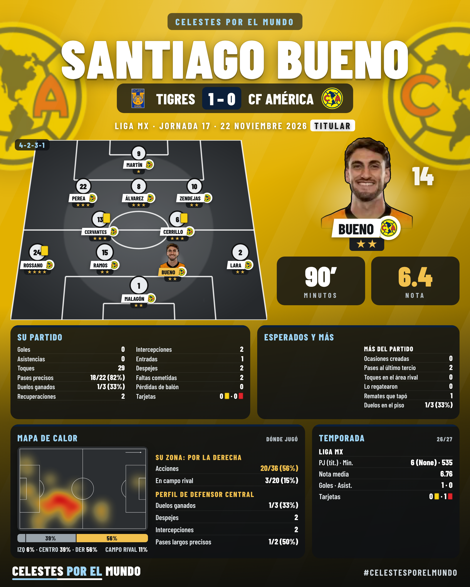
[Abrir la imagen en tamaño completo](https://github.com/tuscxm/celestes-por-el-mundo/blob/main/salida/png/S.%20Bueno/2026-11-22%20%C2%B7%20Tigres%20%C2%B7%20Liga%20Mx/Bueno_Tigres-CFAmerica_2026-11-22.png)

Texto para el posteo:
```
🇺🇾 SANTIAGO BUENO · Tigres 1-0 CF América
⏱ 90' · ⭐ 6.4

Jugó de defensor central: 56% de sus acciones por la derecha, 18/22 pases (82%), 2 recuperaciones y 2 pases al último tercio.

🧩 ¿Y en una Uruguay 3-5-2 con enganche?
Lo vemos de zaguero por derecha en la línea de tres: 18/22 pases (82%), 2 intercepciones y 2 recuperaciones. Con tres atrás, un central que sale limpio le suma un pase para encontrar al enganche y deja a los carrileros libres para pasar.

Tres atrás, dos carrileros, dos internos, un 10 suelto y dos puntas. ¿Lo jugarías así? 👇
#CelestesPorElMundo #Uruguay #ClubAmérica #352
```

## Olaza · Dynamo Moscow 1-1 FC Krasnodar
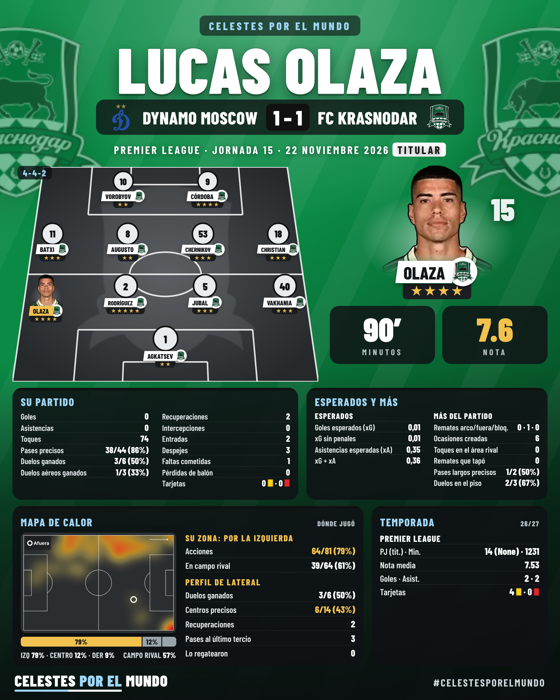
[Abrir la imagen en tamaño completo](https://github.com/tuscxm/celestes-por-el-mundo/blob/main/salida/png/L.%20Olaza/2026-11-22%20%C2%B7%20Dynamo%20Moscow%20%C2%B7%20Premier%20League/Olaza_DynamoMoscow-FCKrasnodar_2026-11-22.png)

Texto para el posteo:
```
🇺🇾 LUCAS OLAZA · Dynamo Moscow 1-1 FC Krasnodar
⏱ 90' · ⭐ 7.6

Jugó de lateral izquierdo: 38/44 pases (86%), 3/6 duelos ganados, 2 recuperaciones y 3 pases al último tercio.

🧩 ¿Y en una Uruguay 3-5-2 con enganche?
Sería carrilero por izquierda: 79% de sus acciones por la izquierda, 57% en campo rival y 3 pases al último tercio. En el 3-5-2 toda la banda es suya, y con tres centrales atrás puede pasar sin dejar la espalda sola.

Tres atrás, dos carrileros, dos internos, un 10 suelto y dos puntas. ¿Lo jugarías así? 👇
#CelestesPorElMundo #Uruguay #FCKrasnodar #352
```

## Rossi · Pumas 0-2 Monterrey
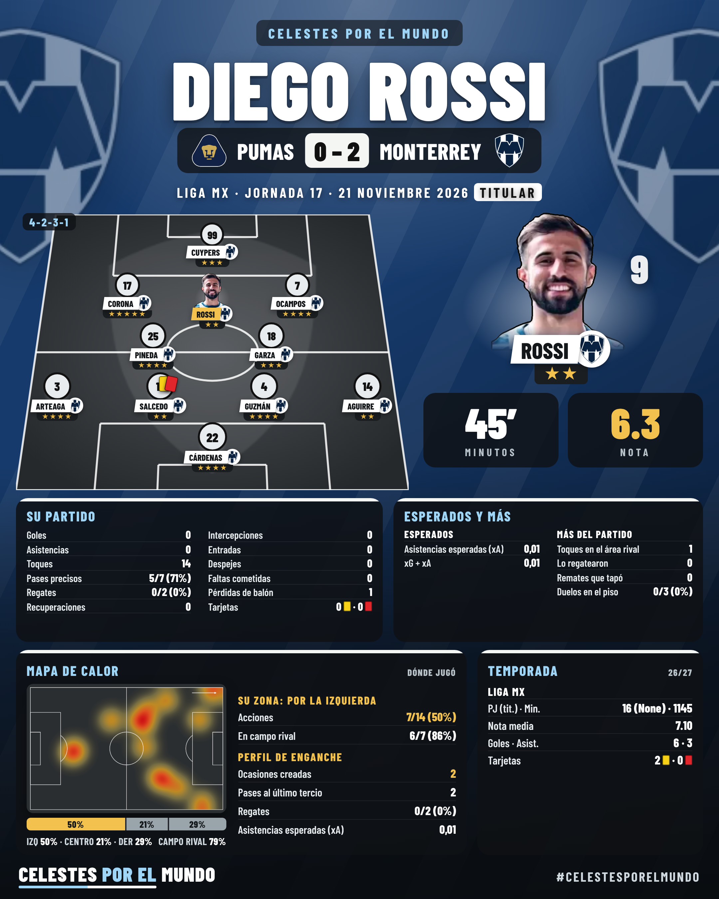
[Abrir la imagen en tamaño completo](https://github.com/tuscxm/celestes-por-el-mundo/blob/main/salida/png/D.%20Rossi/2026-11-21%20%C2%B7%20Pumas%20%C2%B7%20Liga%20Mx/Rossi_Pumas-Monterrey_2026-11-21.png)

Texto para el posteo:
```
🇺🇾 DIEGO ROSSI · Pumas 0-2 Monterrey
⏱ 45' · ⭐ 6.3

Jugó de enganche: 50% de sus acciones por la izquierda, 2 pases al último tercio y 2 ocasiones creadas.

🧩 ¿Y en una Uruguay 3-5-2 con enganche?
Sería uno de los dos de punta: 1 toque en el área rival. Con un enganche que lo habilite y otro 9 al lado, deja de pelear solo contra los centrales.

Tres atrás, dos carrileros, dos internos, un 10 suelto y dos puntas. ¿Lo jugarías así? 👇
#CelestesPorElMundo #Uruguay #CFMonterrey #352
```

## Aguirre · Tigres 1-0 CF América
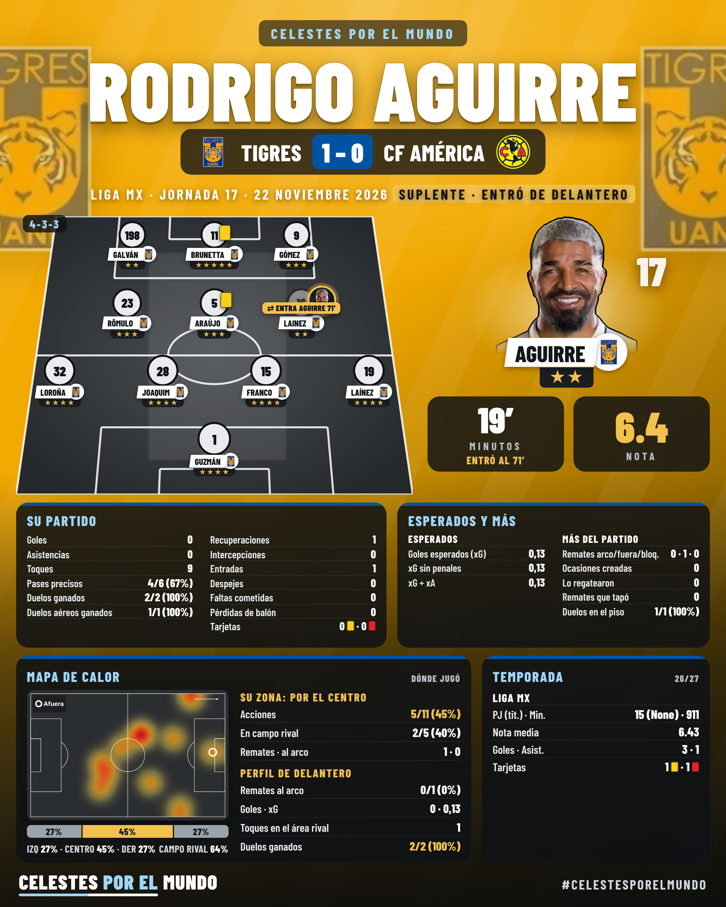
[Abrir la imagen en tamaño completo](https://github.com/tuscxm/celestes-por-el-mundo/blob/main/salida/png/R.%20Aguirre/2026-11-22%20%C2%B7%20CF%20Am%C3%A9rica%20%C2%B7%20Liga%20Mx/Aguirre_Tigres-CFAmerica_2026-11-22.png)

Texto para el posteo:
```
🇺🇾 RODRIGO AGUIRRE · Tigres 1-0 CF América
⏱ 19' · ⭐ 6.4
🔁 Entró al 71' por Lainez, como delantero

Jugó de delantero: 45% de sus acciones por el centro, 2/2 duelos ganados y 1 recuperación.

🧩 ¿Y en una Uruguay 3-5-2 con enganche?
Sería uno de los dos de punta: 1 toque en el área rival y 2/2 duelos ganados. Con un enganche que lo habilite y otro 9 al lado, deja de pelear solo contra los centrales.

Tres atrás, dos carrileros, dos internos, un 10 suelto y dos puntas. ¿Lo jugarías así? 👇
#CelestesPorElMundo #Uruguay #TigresUANL #352
```

## Viñas · Pachuca 2-0 Toluca
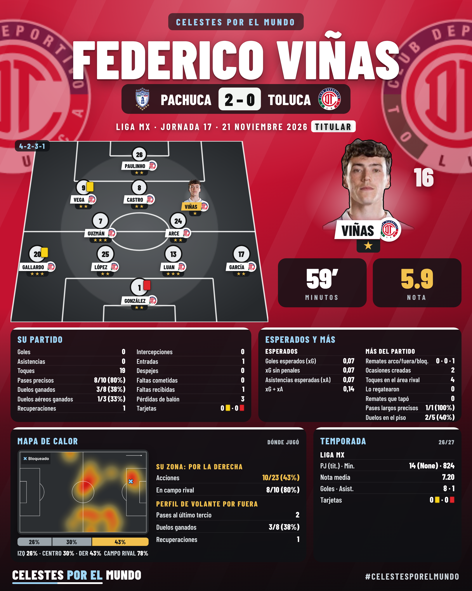
[Abrir la imagen en tamaño completo](https://github.com/tuscxm/celestes-por-el-mundo/blob/main/salida/png/F.%20Vi%C3%B1as/2026-11-21%20%C2%B7%20Pachuca%20%C2%B7%20Liga%20Mx/Vinas_Pachuca-Toluca_2026-11-21.png)

Texto para el posteo:
```
🇺🇾 FEDERICO VIÑAS · Pachuca 2-0 Toluca
⏱ 59' · ⭐ 5.9

Jugó de volante por derecha: 43% de sus acciones por la derecha, 8/10 pases (80%), 1 recuperación y 2 pases al último tercio.

🧩 ¿Y en una Uruguay 3-5-2 con enganche?
Sería uno de los dos de punta: 4 toques en el área rival. Con un enganche que lo habilite y otro 9 al lado, deja de pelear solo contra los centrales.

Tres atrás, dos carrileros, dos internos, un 10 suelto y dos puntas. ¿Lo jugarías así? 👇
#CelestesPorElMundo #Uruguay #Toluca #352
```

---
En X se publican solas en unos minutos (menos las que la revisión ponga en *No publicar en X*); en Instagram no se publicó nada. Cerrá este aviso cuando la publiques o la descartes.
## Revisión visual
- Fuentes: SofaScore respondió 403 a todos (las doce salieron con el respaldo automático de FotMob); BeSoccer respondió HTTP 406 a WebFetch (besoccer_hoy.json quedó vacío); API-Football: plan gratis sin la temporada 2026; zerozero HTTP 403; TheSportsDB HTTP 429 en varios; Understat: formato de página no reconocido.
- De la Cruz: sigue en ERROR (SofaScore 403 y el respaldo tampoco respondió). No tiene URL de BeSoccer y BeSoccer igual respondía 406: no se pudo usar el respaldo con BeSoccer.
- En las doce, en TEMPORADA la línea de la liga dice "PJ (tit.) · Min. N (None) · …": se imprime "None" en lugar de los partidos de titular (el respaldo no los trae).
- Valverde, Mouriño, F. González y M. Olivera: entraron de suplentes y el texto del posteo dice "Jugó de titular: …" (no se pudo saber el puesto). Valverde, Mouriño y Olivera quedan sin PERFIL (hueco en la tarjeta del mapa); González con el PERFIL genérico ("POSICIÓN: Su Juego") y sin mapa.
- F. González: en el marcador el escudo de la izquierda (al lado de RACING SANTANDER) es el de la Real Sociedad y al lado de REAL SOCIEDAD no hay escudo. Además TEMPORADA dice "LALIGA2 · 25/26" (temporada pasada) en vez de la de LaLiga 26/27. Mouriño y González: sin nota (1' y 4').
- Zalazar: salió con el diseño anterior (SU PARTIDO / TOTALES casi vacíos, PERFIL genérico "Su Juego", cancha vacía) porque el respaldo no trajo alineación ni estadísticas del jugador ni nota; el posteo solo tiene los minutos. Dice "JORNADA 4" en un partido de copa.
- Merentiel: sin mapa de calor (se muestra el PERFIL DE DELANTERO a lo ancho); ESPERADOS vacío. Gol, 8.0 y números coinciden con el posteo. TEMPORADA con Sudamericana (primero) y Liga Profesional, bien.
- Rossi: el resumen dice "de mediocentro" pero jugó en el medio de la línea de tres del 4-2-3-1: PERFIL DE ENGANCHE y "Jugó de enganche" en el posteo son correctos.
- Olaza: la liga rusa figura como "PREMIER LEAGUE" (detalle menor, puede confundirse con la inglesa).
- R. Araújo, Bueno, Olaza, Rossi, Aguirre y Viñas: caras con contorno, jugador resaltado, mapa acostado con remates cuando los hubo, SU ZONA y PERFIL acordes al puesto, tarjetas visibles en la cancha (roja del arquero González de Toluca, de Salcedo de Monterrey y de Navarro del Villarreal), números iguales en la infografía y el posteo.
- Ninguna dice el nombre de una fuente; no hubo tandas de penales.

## No publicar en X
- Valverde_RealMadrid-CeltaVigo_2026-11-21: el posteo dice "Jugó de titular" (entró de suplente); sin PERFIL; TEMPORADA muestra "None"
- Mourino_Barcelona-Villarreal_2026-11-22: el posteo dice "Jugó de titular" (entró de suplente); sin PERFIL; TEMPORADA muestra "None"
- Gonzalez_RacingSantander-RealSociedad_2026-11-22: escudo de la Real Sociedad al lado de Racing y sin escudo del rival; posteo dice "Jugó de titular" (fue suplente); TEMPORADA de 25/26 con "None"
- Olivera_Napoli-Torino_2026-11-21: el posteo dice "Jugó de titular" (entró de suplente); sin PERFIL; TEMPORADA muestra "None"
- Zalazar_SportingCP-UniãoSerra_2026-11-21: diseño anterior casi vacío (sin alineación, sin estadísticas ni nota); TEMPORADA muestra "None"
- Merentiel_Atletico-MG-BocaJuniors_2026-11-21: TEMPORADA muestra "None" en PJ (tit.)
- Araujo_Liverpool-ManchesterUnited_2026-11-22: TEMPORADA muestra "None" en PJ (tit.)
- Bueno_Tigres-CFAmerica_2026-11-22: TEMPORADA muestra "None" en PJ (tit.)
- Olaza_DynamoMoscow-FCKrasnodar_2026-11-22: TEMPORADA muestra "None" en PJ (tit.)
- Rossi_Pumas-Monterrey_2026-11-21: TEMPORADA muestra "None" en PJ (tit.)
- Aguirre_Tigres-CFAmerica_2026-11-22: TEMPORADA muestra "None" en PJ (tit.)
- Vinas_Pachuca-Toluca_2026-11-21: TEMPORADA muestra "None" en PJ (tit.)
