Valverde jugó 33' (suplente, nota 6.6) en Real Madrid 2-1 Celta Vigo; Mouriño jugó 4' (suplente) en Barcelona 3-2 Villarreal; González jugó 1' (suplente) en Racing Santander 3-2 Real Sociedad; Satriano jugó 45' (suplente, nota 5.9) en Getafe 0-3 Atlé

@tuscxm

## Quién jugó
- **Valverde** jugó 33' (suplente, entró al 57' por Silva, nota 6.6, su juego) en Real Madrid 2-1 Celta Vigo · LaLiga
- **Mouriño** jugó 4' (suplente, entró al 86' por Mikautadze, su juego) en Barcelona 3-2 Villarreal · LaLiga
- **González** jugó 1' (suplente, entró al 90+2' por Vicente, su juego) en Racing Santander 3-2 Real Sociedad · LaLiga
- **Satriano** jugó 45' (suplente, entró al 46' por Valou, nota 5.9, de delantero) en Getafe 0-3 Atlético Madrid · LaLiga
- **J. Rodríguez** jugó 40' (suplente, entró al 50' por Adopo, nota 6.7, su juego) en Como 2-0 Cagliari · Serie A
- **Zalazar** jugó 21' (suplente, su juego) en Sporting CP 4-0 União Serra · Taça de Portugal
- **Merentiel** jugó 64' (titular, nota 8.0, de delantero) en Atlético-MG 0-2 Boca Juniors · Copa Sudamericana
- **Giménez** jugó 45' (suplente, entró al 46' por Rodríguez, nota 6.4, su juego) en Deportivo Alavés 3-1 Deportivo A Coruña · LaLiga
- **Amaro** jugó 75' (titular, nota 7.2, de volante por derecha) en Genk 3-0 RAAL La Louvière · First Division A
- **R. Araújo** jugó 85' (titular, nota 7.5, de lateral derecho) en Liverpool 4-0 Manchester United · Premier League
- **J. M. Sanabria** jugó 77' (titular, nota 6.5, de volante por izquierda) en Seattle Sounders FC 1-1 Real Salt Lake (2-4 en penales) · MLS
- **F. Díaz** jugó 90' (titular, nota 8.1, de mediocentro) en Al-Gharafa 3-2 Al-Arabi · Qatar Stars League
- **Torreira** jugó 80' (titular, nota 8.1, de mediocentro) en Galatasaray 2-1 Samsunspor · Süper Lig
- **Brizuela** jugó 90' (titular, nota 7.9, de mediocentro) en Saudi Arabia U17 2-3 Uruguay U17 · World Cup U17
- **Matturro** jugó 46' (titular, de defensor central) en Shakhtar Donetsk 1-1 Liviy Bereh · Premier League
- **Olivera** jugó 32' (suplente, entró al 58' por Marín, nota 6.9, su juego) en Napoli 1-0 Torino · Serie A
- **Varela** jugó 90' (titular, nota 7.6, de lateral derecho) en Palmeiras 1-1 Flamengo · Série A
- **Bueno** jugó 90' (titular, nota 6.4, de defensor central) en Tigres 1-0 CF América · Liga MX
- **Olaza** jugó 90' (titular, nota 7.6, de lateral izquierdo) en Dynamo Moscow 1-1 FC Krasnodar · Premier League
- **Arrascaeta** jugó 90' (titular, nota 7.2, de mediocentro) en Palmeiras 1-1 Flamengo · Série A
- **Rossi** jugó 45' (titular, nota 6.4, de mediocentro) en Pumas 0-2 Monterrey · Liga MX
- **Damiani** jugó 90' (titular, nota 6.5, de delantero) en New England Revolution 2-0 Philadelphia Union · MLS
- **Aguirre** jugó 19' (suplente, entró al 71' por Lainez, nota 6.4, de delantero) en Tigres 1-0 CF América · Liga MX
- **Viñas** jugó 59' (titular, nota 5.9, de volante por derecha) en Pachuca 2-0 Toluca · Liga MX

## El resto
- Bernal: no jugó en Sevilla 1-1 Real Betis (no entró)
- M. Araújo: sin partido hoy ni ayer
- Á. Rodríguez: sin partido hoy ni ayer
- Cáceres: no jugó en Real Madrid 2-1 Celta Vigo (no entró)
- Petit: no jugó en Real Sociedad B 0-3 Cádiz (no entró)
- Bentancur: no jugó en Tottenham Hotspur 2-0 Ipswich Town (no entró)
- Boselli: sin partido hoy ni ayer
- Ugarte: sin partido hoy ni ayer
- Canobbio: sin partido hoy ni ayer
- Darwin: sin partido hoy ni ayer
- Piquerez: no jugó en Palmeiras 1-1 Flamengo (no entró)
- Nández: sin partido hoy ni ayer
- Pereira: sin partido hoy ni ayer
- Marichal: no jugó en Dynamo Moscow 1-1 FC Krasnodar (no entró)
- Barboza: sin partido hoy ni ayer
- Fonseca: sin partido hoy ni ayer
- E. Martínez: no jugó en Palmeiras 1-1 Flamengo (no entró)
- De la Cruz: ERROR al revisar (no se pudo consultar SofaScore) → `<HTTPError 403: 'Forbidden'>`
- Pellistri: no jugó en Panathinaikos 2-0 OFI Crete (no entró)
- B. Rodríguez: sin partido hoy ni ayer

## Avisos
- Valverde: SofaScore no respondió; fuentes: fotmob ok, besoccer ok, api_football sin datos: el plan gratis de API-Football no cubre esta temporada (plan: Free plans do not have access to this season, try from 2022 to 2024.), thesportsdb ok, understat sin datos: formato de página no reconocido, zerozero error HTTP 403
- Valverde: No se pudo saber el puesto en el que jugó
- Valverde: Armada con datos de respaldo (FotMob): hay menos estadísticas que de costumbre, revisala antes de publicar
- Mouriño: SofaScore no respondió; fuentes: fotmob ok, besoccer ok, api_football sin datos: el plan gratis de API-Football no cubre esta temporada (plan: Free plans do not have access to this season, try from 2022 to 2024.), thesportsdb ok, understat sin datos: formato de página no reconocido, zerozero error HTTP 403
- Mouriño: No se pudo saber el puesto en el que jugó
- Mouriño: Armada con datos de respaldo (FotMob): hay menos estadísticas que de costumbre, revisala antes de publicar
- González: SofaScore no respondió; fuentes: fotmob ok, besoccer ok, api_football sin datos: el plan gratis de API-Football no cubre esta temporada (plan: Free plans do not have access to this season, try from 2022 to 2024.), thesportsdb ok, understat sin datos: sin understat_equipo (Understat no cubre esa liga), zerozero error HTTP 403
- González: No hay mapa de calor de este partido en el respaldo: se muestra el perfil
- González: No se pudo saber el puesto en el que jugó
- González: Armada con datos de respaldo (FotMob): hay menos estadísticas que de costumbre, revisala antes de publicar
- Satriano: SofaScore no respondió; fuentes: fotmob ok, besoccer ok, api_football sin datos: el plan gratis de API-Football no cubre esta temporada (plan: Free plans do not have access to this season, try from 2022 to 2024.), thesportsdb ok, understat sin datos: formato de página no reconocido, zerozero error HTTP 403
- Satriano: Entró de suplente: el puesto (delantero) es su puesto habitual, no se sabe dónde entró
- Satriano: Armada con datos de respaldo (FotMob): hay menos estadísticas que de costumbre, revisala antes de publicar
- J. Rodríguez: SofaScore no respondió; fuentes: fotmob ok, besoccer ok, api_football sin datos: el plan gratis de API-Football no cubre esta temporada (plan: Free plans do not have access to this season, try from 2022 to 2024.), thesportsdb ok, understat sin datos: formato de página no reconocido, zerozero error HTTP 403
- J. Rodríguez: No se pudo saber el puesto en el que jugó
- J. Rodríguez: Armada con datos de respaldo (FotMob): hay menos estadísticas que de costumbre, revisala antes de publicar
- Zalazar: SofaScore no respondió; fuentes: fotmob ok, besoccer ok, api_football sin datos: el plan gratis de API-Football no cubre esta temporada (plan: Free plans do not have access to this season, try from 2022 to 2024.), thesportsdb ok, understat sin datos: sin understat_equipo (Understat no cubre esa liga), zerozero error HTTP 403
- Zalazar: Sin remates en el respaldo: TOTALES va sin lo de ataque
- Zalazar: No hay mapa de calor de este partido en el respaldo: se muestra el perfil
- Zalazar: No se pudo saber el puesto en el que jugó
- Zalazar: Armada con datos de respaldo (FotMob): hay menos estadísticas que de costumbre, revisala antes de publicar
- Zalazar: Sin alineación en el respaldo: la cancha va vacía
- Merentiel: SofaScore no respondió; fuentes: fotmob ok, besoccer ok, api_football sin datos: el plan gratis de API-Football no cubre esta temporada (plan: Free plans do not have access to this season, try from 2022 to 2024.), thesportsdb ok, understat sin datos: sin understat_equipo (Understat no cubre esa liga), zerozero error HTTP 403
- Merentiel: No hay mapa de calor de este partido en el respaldo: se muestra el perfil
- Merentiel: Armada con datos de respaldo (FotMob): hay menos estadísticas que de costumbre, revisala antes de publicar
- Giménez: SofaScore no respondió; fuentes: fotmob ok, besoccer ok, api_football sin datos: el plan gratis de API-Football no cubre esta temporada (plan: Free plans do not have access to this season, try from 2022 to 2024.), thesportsdb ok, understat sin datos: sin understat_equipo (Understat no cubre esa liga), zerozero error HTTP 403
- Giménez: No se pudo saber el puesto en el que jugó
- Giménez: Armada con datos de respaldo (FotMob): hay menos estadísticas que de costumbre, revisala antes de publicar
- Amaro: SofaScore no respondió; fuentes: fotmob ok, besoccer ok, api_football sin datos: el plan gratis de API-Football no cubre esta temporada (plan: Free plans do not have access to this season, try from 2022 to 2024.), thesportsdb ok, understat sin datos: sin understat_equipo (Understat no cubre esa liga), zerozero error HTTP 403
- Amaro: Armada con datos de respaldo (FotMob): hay menos estadísticas que de costumbre, revisala antes de publicar
- R. Araújo: SofaScore no respondió; fuentes: fotmob ok, besoccer ok, api_football sin datos: el plan gratis de API-Football no cubre esta temporada (plan: Free plans do not have access to this season, try from 2022 to 2024.), thesportsdb ok, understat sin datos: formato de página no reconocido, zerozero error HTTP 403
- R. Araújo: Armada con datos de respaldo (FotMob): hay menos estadísticas que de costumbre, revisala antes de publicar
- J. M. Sanabria: SofaScore no respondió; fuentes: fotmob ok, besoccer ok, api_football sin datos: el plan gratis de API-Football no cubre esta temporada (plan: Free plans do not have access to this season, try from 2022 to 2024.), thesportsdb error HTTP 429, understat sin datos: sin understat_equipo (Understat no cubre esa liga), zerozero error HTTP 403
- J. M. Sanabria: Hubo tanda de penales (2-4) y no pateó
- J. M. Sanabria: Armada con datos de respaldo (FotMob): hay menos estadísticas que de costumbre, revisala antes de publicar
- F. Díaz: SofaScore no respondió; fuentes: fotmob ok, besoccer ok, api_football sin datos: el plan gratis de API-Football no cubre esta temporada (plan: Free plans do not have access to this season, try from 2022 to 2024.), thesportsdb error HTTP 429, understat sin datos: sin understat_equipo (Understat no cubre esa liga), zerozero error HTTP 403
- F. Díaz: No hay mapa de calor de este partido en el respaldo: se muestra el perfil
- F. Díaz: Armada con datos de respaldo (FotMob): hay menos estadísticas que de costumbre, revisala antes de publicar
- Torreira: SofaScore no respondió; fuentes: fotmob ok, besoccer ok, api_football sin datos: el plan gratis de API-Football no cubre esta temporada (plan: Free plans do not have access to this season, try from 2022 to 2024.), thesportsdb ok, understat sin datos: sin understat_equipo (Understat no cubre esa liga), zerozero error HTTP 403
- Torreira: Armada con datos de respaldo (FotMob): hay menos estadísticas que de costumbre, revisala antes de publicar
- Brizuela: SofaScore no respondió; fuentes: fotmob ok, besoccer ok, api_football sin datos: el plan gratis de API-Football no cubre esta temporada (plan: Free plans do not have access to this season, try from 2022 to 2024.), thesportsdb sin datos: no se encontró el equipo, understat sin datos: sin understat_equipo (Understat no cubre esa liga), zerozero error HTTP 403
- Brizuela: No hay mapa de calor de este partido en el respaldo: se muestra el perfil
- Brizuela: Armada con datos de respaldo (FotMob): hay menos estadísticas que de costumbre, revisala antes de publicar
- Matturro: SofaScore no respondió; fuentes: fotmob ok, besoccer ok, api_football sin datos: el plan gratis de API-Football no cubre esta temporada (plan: Free plans do not have access to this season, try from 2022 to 2024.), thesportsdb ok, understat sin datos: sin understat_equipo (Understat no cubre esa liga), zerozero error HTTP 403
- Matturro: No hay mapa de calor de este partido en el respaldo: se muestra el perfil
- Matturro: Armada con datos de respaldo (FotMob): hay menos estadísticas que de costumbre, revisala antes de publicar
- Olivera: SofaScore no respondió; fuentes: fotmob ok, besoccer ok, api_football sin datos: el plan gratis de API-Football no cubre esta temporada (plan: Free plans do not have access to this season, try from 2022 to 2024.), thesportsdb error HTTP 429, understat sin datos: formato de página no reconocido, zerozero error HTTP 403
- Olivera: No se pudo saber el puesto en el que jugó
- Olivera: Armada con datos de respaldo (FotMob): hay menos estadísticas que de costumbre, revisala antes de publicar
- Varela: SofaScore no respondió; fuentes: fotmob ok, besoccer ok, api_football sin datos: el plan gratis de API-Football no cubre esta temporada (plan: Free plans do not have access to this season, try from 2022 to 2024.), thesportsdb ok, understat sin datos: sin understat_equipo (Understat no cubre esa liga), zerozero error HTTP 403
- Varela: Armada con datos de respaldo (FotMob): hay menos estadísticas que de costumbre, revisala antes de publicar
- Bueno: SofaScore no respondió; fuentes: fotmob ok, besoccer ok, api_football sin datos: el plan gratis de API-Football no cubre esta temporada (plan: Free plans do not have access to this season, try from 2022 to 2024.), thesportsdb ok, understat sin datos: sin understat_equipo (Understat no cubre esa liga), zerozero error HTTP 403
- Bueno: Armada con datos de respaldo (FotMob): hay menos estadísticas que de costumbre, revisala antes de publicar
- Olaza: SofaScore no respondió; fuentes: fotmob ok, besoccer ok, api_football sin datos: el plan gratis de API-Football no cubre esta temporada (plan: Free plans do not have access to this season, try from 2022 to 2024.), thesportsdb ok, understat sin datos: sin understat_equipo (Understat no cubre esa liga), zerozero error HTTP 403
- Olaza: Armada con datos de respaldo (FotMob): hay menos estadísticas que de costumbre, revisala antes de publicar
- Arrascaeta: SofaScore no respondió; fuentes: fotmob ok, besoccer ok, api_football sin datos: el plan gratis de API-Football no cubre esta temporada (plan: Free plans do not have access to this season, try from 2022 to 2024.), thesportsdb ok, understat sin datos: sin understat_equipo (Understat no cubre esa liga), zerozero error HTTP 403
- Arrascaeta: Armada con datos de respaldo (FotMob): hay menos estadísticas que de costumbre, revisala antes de publicar
- Rossi: SofaScore no respondió; fuentes: fotmob ok, besoccer ok, api_football sin datos: el plan gratis de API-Football no cubre esta temporada (plan: Free plans do not have access to this season, try from 2022 to 2024.), thesportsdb ok, understat sin datos: sin understat_equipo (Understat no cubre esa liga), zerozero error HTTP 403
- Rossi: Armada con datos de respaldo (FotMob): hay menos estadísticas que de costumbre, revisala antes de publicar
- Damiani: SofaScore no respondió; fuentes: fotmob ok, besoccer ok, api_football sin datos: el plan gratis de API-Football no cubre esta temporada (plan: Free plans do not have access to this season, try from 2022 to 2024.), thesportsdb ok, understat sin datos: sin understat_equipo (Understat no cubre esa liga), zerozero error HTTP 403
- Damiani: Armada con datos de respaldo (FotMob): hay menos estadísticas que de costumbre, revisala antes de publicar
- Aguirre: SofaScore no respondió; fuentes: fotmob ok, besoccer ok, api_football sin datos: el plan gratis de API-Football no cubre esta temporada (plan: Free plans do not have access to this season, try from 2022 to 2024.), thesportsdb ok, understat sin datos: sin understat_equipo (Understat no cubre esa liga), zerozero error HTTP 403
- Aguirre: Entró de suplente: el puesto (delantero) es su puesto habitual, no se sabe dónde entró
- Aguirre: Armada con datos de respaldo (FotMob): hay menos estadísticas que de costumbre, revisala antes de publicar
- Viñas: SofaScore no respondió; fuentes: fotmob ok, besoccer ok, api_football sin datos: el plan gratis de API-Football no cubre esta temporada (plan: Free plans do not have access to this season, try from 2022 to 2024.), thesportsdb ok, understat sin datos: sin understat_equipo (Understat no cubre esa liga), zerozero error HTTP 403
- Viñas: Armada con datos de respaldo (FotMob): hay menos estadísticas que de costumbre, revisala antes de publicar

## Valverde · Real Madrid 2-1 Celta Vigo
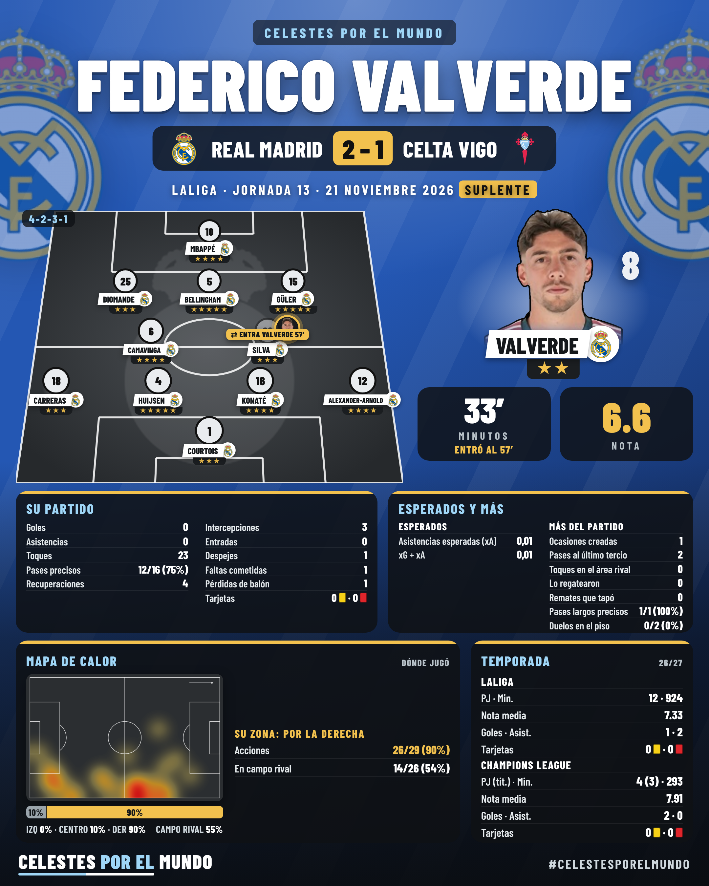
[Abrir la imagen en tamaño completo](https://github.com/tuscxm/celestes-por-el-mundo/blob/main/salida/png/F.%20Valverde/2026-11-21%20%C2%B7%20Celta%20Vigo%20%C2%B7%20LaLiga/Valverde_RealMadrid-CeltaVigo_2026-11-21.png)

Texto para el posteo:
```
🇺🇾 FEDERICO VALVERDE · Real Madrid 2-1 Celta Vigo
⏱ 33' · ⭐ 6.6
🔁 Entró al 57' por Silva

En su partido: 12/16 pases (75%), 4 recuperaciones, 2 pases al último tercio y 1 ocasión creada.

🧩 ¿Y en una Uruguay 3-5-2 con enganche?
Sería carrilero por derecha: 90% de sus acciones por la derecha, 55% en campo rival y 2 pases al último tercio. En el 3-5-2 toda la banda es suya, y con tres centrales atrás puede pasar sin dejar la espalda sola.

Tres atrás, dos carrileros, dos internos, un 10 suelto y dos puntas. ¿Lo jugarías así? 👇
#CelestesPorElMundo #Uruguay #RealMadrid #352
```

## Mouriño · Barcelona 3-2 Villarreal
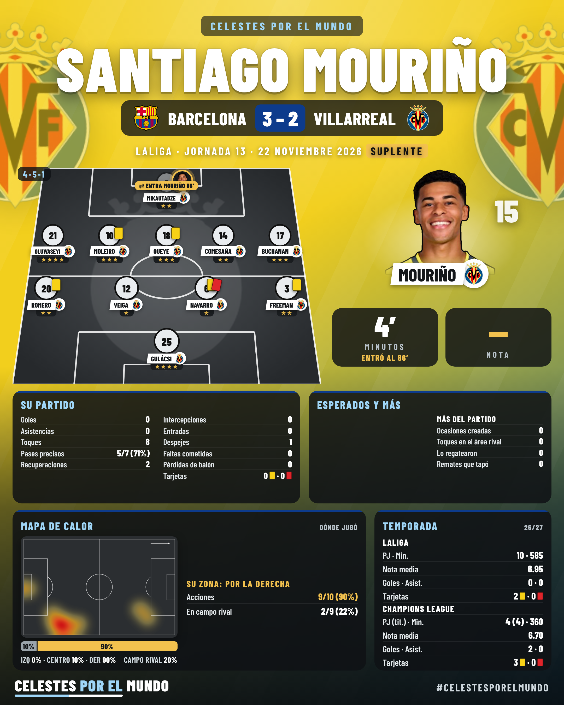
[Abrir la imagen en tamaño completo](https://github.com/tuscxm/celestes-por-el-mundo/blob/main/salida/png/S.%20Mouri%C3%B1o/2026-11-22%20%C2%B7%20Barcelona%20%C2%B7%20LaLiga/Mourino_Barcelona-Villarreal_2026-11-22.png)

Texto para el posteo:
```
🇺🇾 SANTIAGO MOURIÑO · Barcelona 3-2 Villarreal
⏱ 4'
🔁 Entró al 86' por Mikautadze

En su partido: 90% de sus acciones por la derecha y 2 recuperaciones.

🧩 ¿Y en una Uruguay 3-5-2 con enganche?
Lo vemos de zaguero por derecha en la línea de tres: 2 recuperaciones y 1 despeje. Con tres atrás, un central que sale limpio le suma un pase para encontrar al enganche y deja a los carrileros libres para pasar.

Tres atrás, dos carrileros, dos internos, un 10 suelto y dos puntas. ¿Lo jugarías así? 👇
#CelestesPorElMundo #Uruguay #Villarreal #352
```

## González · Racing Santander 3-2 Real Sociedad
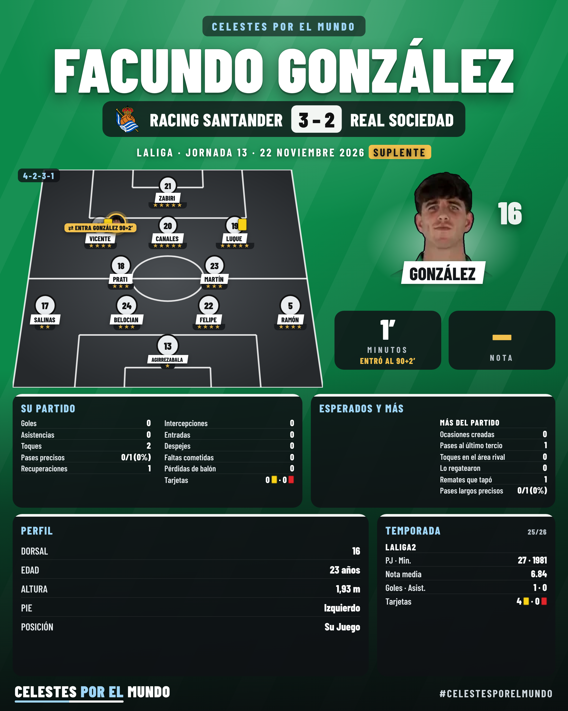
[Abrir la imagen en tamaño completo](https://github.com/tuscxm/celestes-por-el-mundo/blob/main/salida/png/F.%20Gonz%C3%A1lez/2026-11-22%20%C2%B7%20Racing%20Santander-Real%20Sociedad%20%C2%B7%20LaLiga/Gonzalez_RacingSantander-RealSociedad_2026-11-22.png)

Texto para el posteo:
```
🇺🇾 FACUNDO GONZÁLEZ · Racing Santander 3-2 Real Sociedad
⏱ 1'
🔁 Entró al 90+2' por Vicente

En su partido: 1 recuperación y 1 pase al último tercio.

🧩 ¿Y en una Uruguay 3-5-2 con enganche?
Lo vemos de zaguero en la línea de tres: 1 recuperación. Con tres atrás, un central que sale limpio le suma un pase para encontrar al enganche y deja a los carrileros libres para pasar.

Tres atrás, dos carrileros, dos internos, un 10 suelto y dos puntas. ¿Lo jugarías así? 👇
#CelestesPorElMundo #Uruguay #RacingdeSantander #352
```

## Satriano · Getafe 0-3 Atlético Madrid
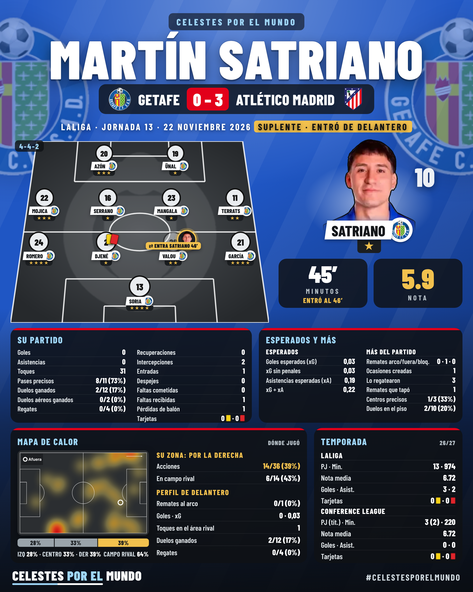
[Abrir la imagen en tamaño completo](https://github.com/tuscxm/celestes-por-el-mundo/blob/main/salida/png/M.%20Satriano/2026-11-22%20%C2%B7%20Atl%C3%A9tico%20Madrid%20%C2%B7%20LaLiga/Satriano_Getafe-AtleticoMadrid_2026-11-22.png)

Texto para el posteo:
```
🇺🇾 MARTÍN SATRIANO · Getafe 0-3 Atlético Madrid
⏱ 45' · ⭐ 5.9
🔁 Entró al 46' por Valou, como delantero

Jugó de delantero: 39% de sus acciones por la derecha, 8/11 pases (73%) y 1 ocasión creada.

🧩 ¿Y en una Uruguay 3-5-2 con enganche?
Sería uno de los dos de punta: 1 toque en el área rival. Con un enganche que lo habilite y otro 9 al lado, deja de pelear solo contra los centrales.

Tres atrás, dos carrileros, dos internos, un 10 suelto y dos puntas. ¿Lo jugarías así? 👇
#CelestesPorElMundo #Uruguay #Getafe #352
```

## J. Rodríguez · Como 2-0 Cagliari
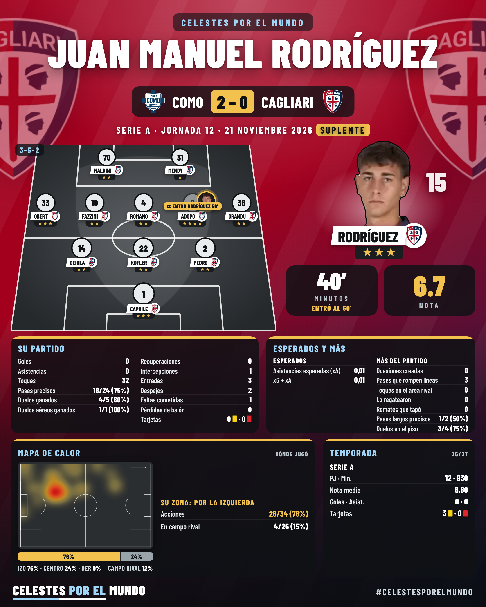
[Abrir la imagen en tamaño completo](https://github.com/tuscxm/celestes-por-el-mundo/blob/main/salida/png/J.%20M.%20Rodr%C3%ADguez/2026-11-21%20%C2%B7%20Como%20%C2%B7%20Serie%20A/Rodriguez_Como-Cagliari_2026-11-21.png)

Texto para el posteo:
```
🇺🇾 JUAN MANUEL RODRÍGUEZ · Como 2-0 Cagliari
⏱ 40' · ⭐ 6.7
🔁 Entró al 50' por Adopo

En su partido: 76% de sus acciones por la izquierda, 18/24 pases (75%) y 4/5 duelos ganados.

🧩 ¿Y en una Uruguay 3-5-2 con enganche?
Lo vemos de zaguero por izquierda en la línea de tres: 18/24 pases (75%), 4/5 duelos ganados y 1/1 por arriba. Con tres atrás, un central que sale limpio le suma un pase para encontrar al enganche y deja a los carrileros libres para pasar.

Tres atrás, dos carrileros, dos internos, un 10 suelto y dos puntas. ¿Lo jugarías así? 👇
#CelestesPorElMundo #Uruguay #Cagliari #352
```

## Zalazar · Sporting CP 4-0 União Serra
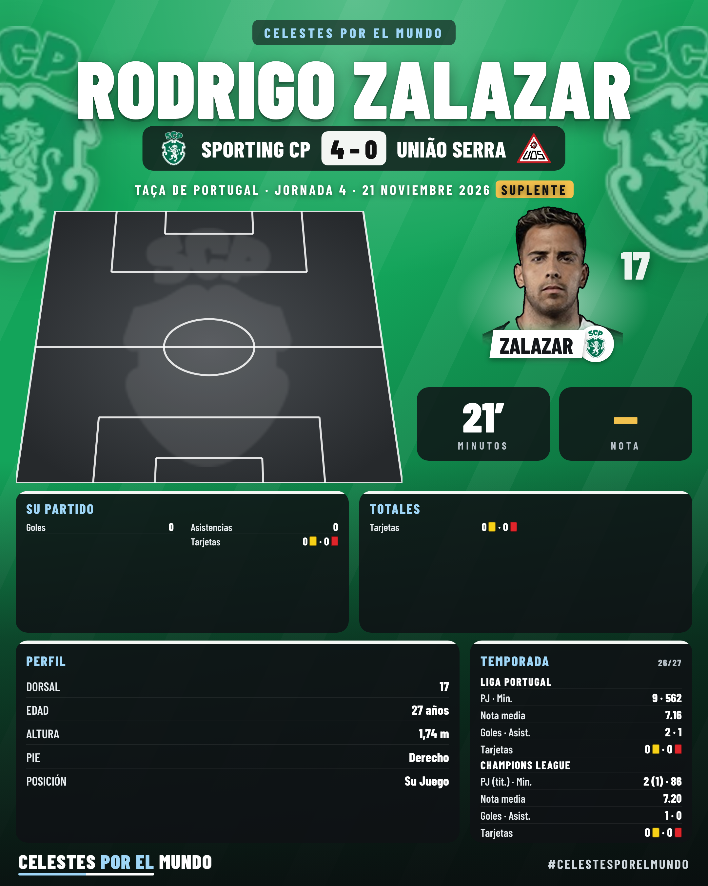
[Abrir la imagen en tamaño completo](https://github.com/tuscxm/celestes-por-el-mundo/blob/main/salida/png/R.%20Zalazar/2026-11-21%20%C2%B7%20Uni%C3%A3o%20Serra%20%C2%B7%20Ta%C3%A7a%20De%20Portugal/Zalazar_SportingCP-Uni%C3%A3oSerra_2026-11-21.png)

Texto para el posteo:
```
🇺🇾 RODRIGO ZALAZAR · Sporting CP 4-0 União Serra
⏱ 21'
#CelestesPorElMundo #Uruguay #SportingCP
```

## Merentiel · Atlético-MG 0-2 Boca Juniors
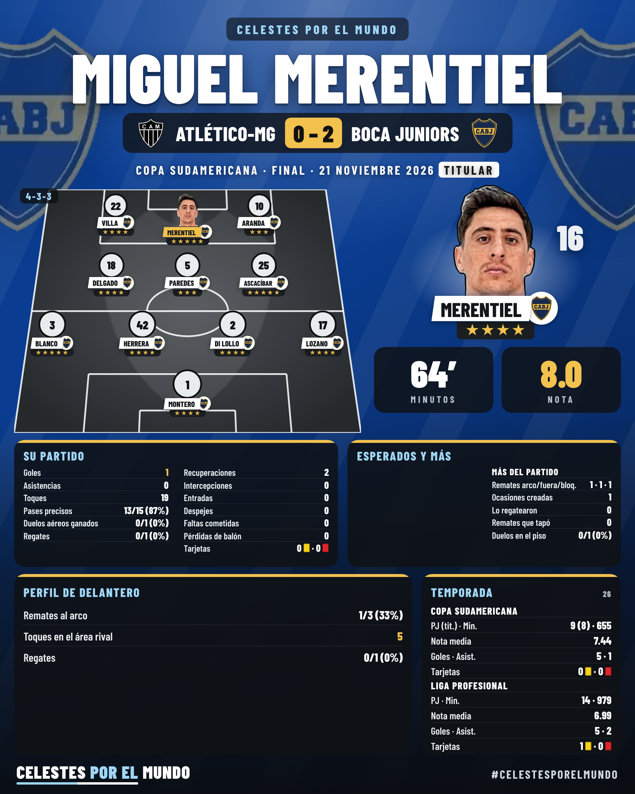
[Abrir la imagen en tamaño completo](https://github.com/tuscxm/celestes-por-el-mundo/blob/main/salida/png/M.%20Merentiel/2026-11-21%20%C2%B7%20Atl%C3%A9tico-MG%20%C2%B7%20Copa%20Sudamericana/Merentiel_Atletico-MG-BocaJuniors_2026-11-21.png)

Texto para el posteo:
```
🇺🇾 MIGUEL MERENTIEL · Atlético-MG 0-2 Boca Juniors
⏱ 64' · ⭐ 8.0

Jugó de delantero: 1 gol, 13/15 pases (87%), 2 recuperaciones y 1 ocasión creada.

🧩 ¿Y en una Uruguay 3-5-2 con enganche?
Sería uno de los dos de punta: 1 gol, 1 de 3 remates al arco y 5 toques en el área rival. Con un enganche que lo habilite y otro 9 al lado, deja de pelear solo contra los centrales.

Tres atrás, dos carrileros, dos internos, un 10 suelto y dos puntas. ¿Lo jugarías así? 👇
#CelestesPorElMundo #Uruguay #BocaJuniors #352
```

## Giménez · Deportivo Alavés 3-1 Deportivo A Coruña
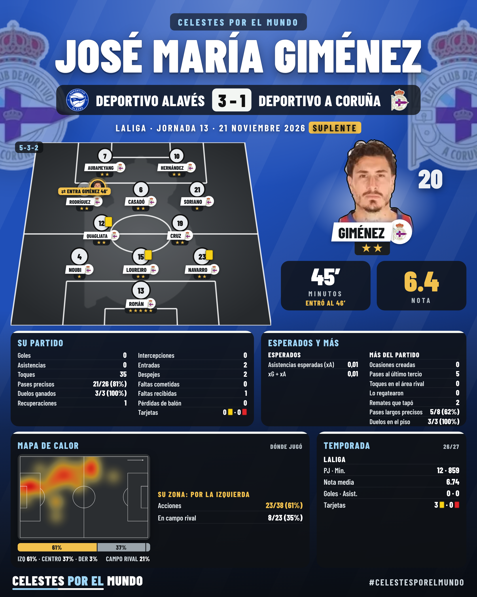
[Abrir la imagen en tamaño completo](https://github.com/tuscxm/celestes-por-el-mundo/blob/main/salida/png/J.%20M.%20Gim%C3%A9nez/2026-11-21%20%C2%B7%20Deportivo%20Alav%C3%A9s%20%C2%B7%20LaLiga/Gimenez_DeportivoAlaves-DeportivoACoruna_2026-11-21.png)

Texto para el posteo:
```
🇺🇾 JOSÉ MARÍA GIMÉNEZ · Deportivo Alavés 3-1 Deportivo A Coruña
⏱ 45' · ⭐ 6.4
🔁 Entró al 46' por Rodríguez

En su partido: 61% de sus acciones por la izquierda, 21/26 pases (81%), 3/3 duelos ganados y 1 recuperación.

🧩 ¿Y en una Uruguay 3-5-2 con enganche?
Lo vemos de zaguero por izquierda en la línea de tres: 21/26 pases (81%), 5/8 pases largos y 3/3 duelos ganados. Con tres atrás, un central que sale limpio le suma un pase para encontrar al enganche y deja a los carrileros libres para pasar.

Tres atrás, dos carrileros, dos internos, un 10 suelto y dos puntas. ¿Lo jugarías así? 👇
#CelestesPorElMundo #Uruguay #DeportivodeLaCoruña #352
```

## Amaro · Genk 3-0 RAAL La Louvière
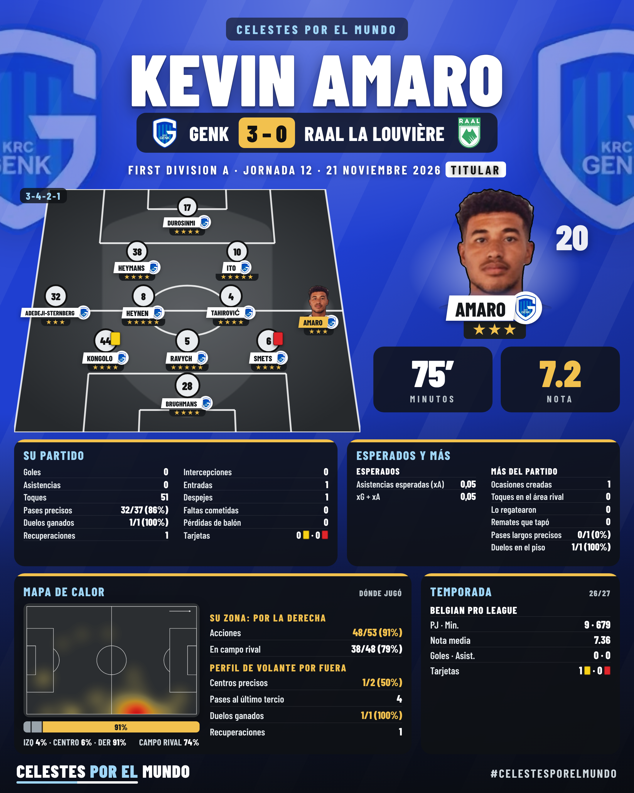
[Abrir la imagen en tamaño completo](https://github.com/tuscxm/celestes-por-el-mundo/blob/main/salida/png/K.%20Amaro/2026-11-21%20%C2%B7%20RAAL%20La%20Louvi%C3%A8re%20%C2%B7%20First%20Division%20A/Amaro_Genk-RAALLaLouvi%C3%A8re_2026-11-21.png)

Texto para el posteo:
```
🇺🇾 KEVIN AMARO · Genk 3-0 RAAL La Louvière
⏱ 75' · ⭐ 7.2

Jugó de volante por derecha: 32/37 pases (86%), 1/1 duelos ganados, 1 recuperación y 4 pases al último tercio.

🧩 ¿Y en una Uruguay 3-5-2 con enganche?
Sería carrilero por derecha: 91% de sus acciones por la derecha, 74% en campo rival y 4 pases al último tercio. En el 3-5-2 toda la banda es suya, y con tres centrales atrás puede pasar sin dejar la espalda sola.

Tres atrás, dos carrileros, dos internos, un 10 suelto y dos puntas. ¿Lo jugarías así? 👇
#CelestesPorElMundo #Uruguay #Genk #352
```

## R. Araújo · Liverpool 4-0 Manchester United
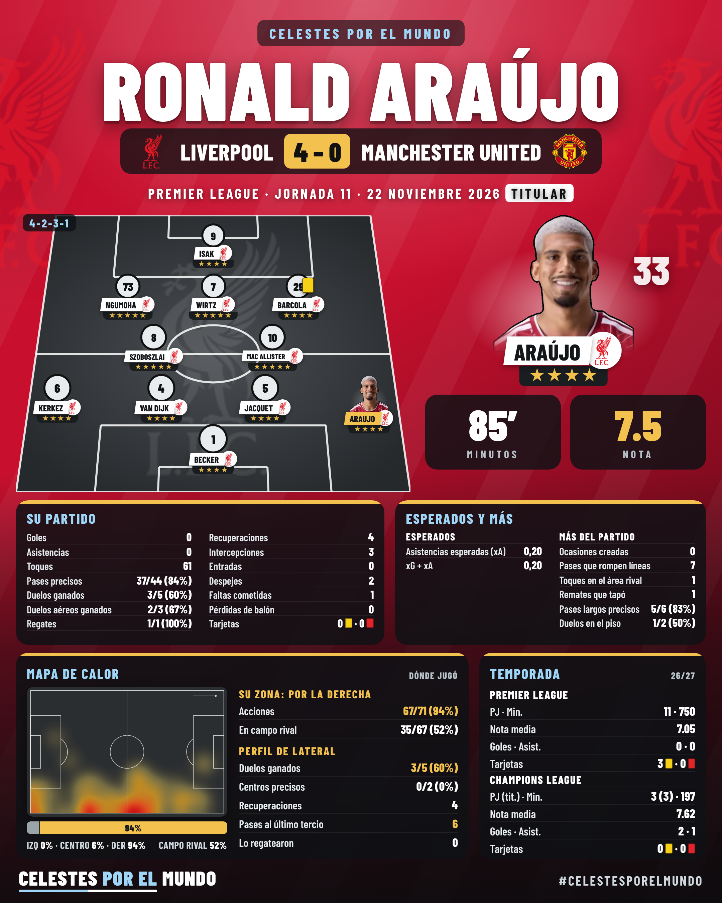
[Abrir la imagen en tamaño completo](https://github.com/tuscxm/celestes-por-el-mundo/blob/main/salida/png/R.%20Ara%C3%BAjo/2026-11-22%20%C2%B7%20Manchester%20United%20%C2%B7%20Premier%20League/Araujo_Liverpool-ManchesterUnited_2026-11-22.png)

Texto para el posteo:
```
🇺🇾 RONALD ARAÚJO · Liverpool 4-0 Manchester United
⏱ 85' · ⭐ 7.5

Jugó de lateral derecho: 94% de sus acciones por la derecha, 37/44 pases (84%), 3/5 duelos ganados y 4 recuperaciones.

🧩 ¿Y en una Uruguay 3-5-2 con enganche?
Lo vemos de zaguero por derecha en la línea de tres: 37/44 pases (84%), 5/6 pases largos y 3/5 duelos ganados. Con tres atrás, un central que sale limpio le suma un pase para encontrar al enganche y deja a los carrileros libres para pasar.

Tres atrás, dos carrileros, dos internos, un 10 suelto y dos puntas. ¿Lo jugarías así? 👇
#CelestesPorElMundo #Uruguay #Liverpool #352
```

## J. M. Sanabria · Seattle Sounders FC 1-1 Real Salt Lake (2-4 en penales)
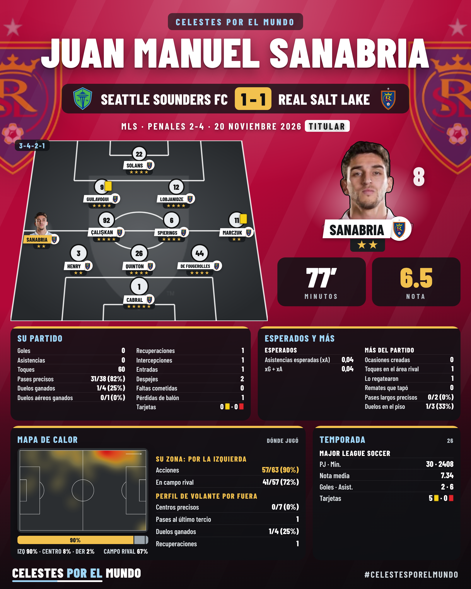
[Abrir la imagen en tamaño completo](https://github.com/tuscxm/celestes-por-el-mundo/blob/main/salida/png/J.%20M.%20Sanabria/2026-11-20%20%C2%B7%20Seattle%20Sounders%20FC%20%C2%B7%20Mls/Sanabria_SeattleSoundersFC-RealSaltLake_2026-11-20.png)

Texto para el posteo:
```
🇺🇾 JUAN MANUEL SANABRIA · Seattle Sounders FC 1-1 Real Salt Lake (2-4 en penales)
⏱ 77' · ⭐ 6.5

Jugó de volante por izquierda: 31/38 pases (82%), 1 recuperación y 1 pase al último tercio.

🧩 ¿Y en una Uruguay 3-5-2 con enganche?
Sería carrilero por izquierda: 90% de sus acciones por la izquierda, 67% en campo rival y 1 pase al último tercio. En el 3-5-2 toda la banda es suya, y con tres centrales atrás puede pasar sin dejar la espalda sola.

Tres atrás, dos carrileros, dos internos, un 10 suelto y dos puntas. ¿Lo jugarías así? 👇
#CelestesPorElMundo #Uruguay #RealSaltLake #352
```

## F. Díaz · Al-Gharafa 3-2 Al-Arabi
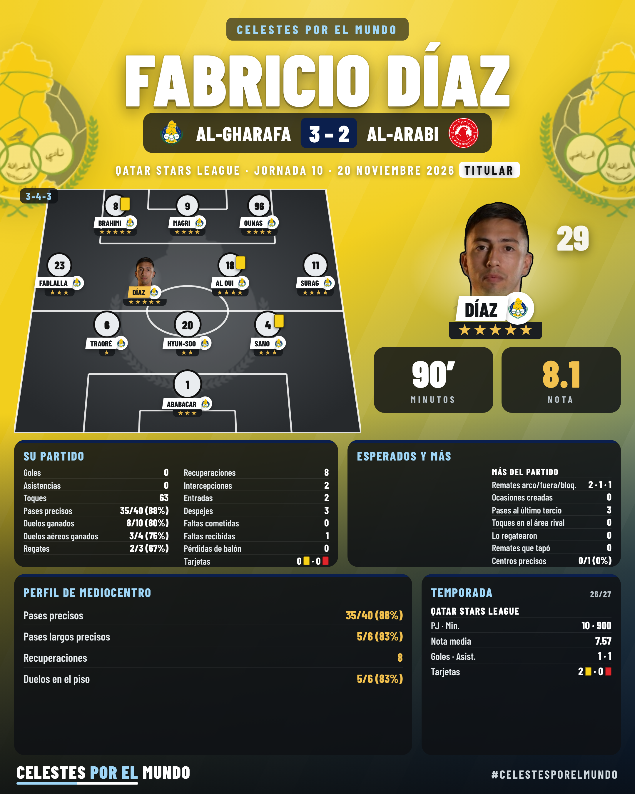
[Abrir la imagen en tamaño completo](https://github.com/tuscxm/celestes-por-el-mundo/blob/main/salida/png/F.%20D%C3%ADaz/2026-11-20%20%C2%B7%20Al-Arabi%20%C2%B7%20Qatar%20Stars%20League/Diaz_Al-Gharafa-Al-Arabi_2026-11-20.png)

Texto para el posteo:
```
🇺🇾 FABRICIO DÍAZ · Al-Gharafa 3-2 Al-Arabi
⏱ 90' · ⭐ 8.1

Jugó de mediocentro: 35/40 pases (88%), 8/10 duelos ganados, 8 recuperaciones y 3 pases al último tercio.

🧩 ¿Y en una Uruguay 3-5-2 con enganche?
Sería uno de los dos internos: 35/40 pases (88%), 8 recuperaciones y 8/10 duelos ganados. Es el que sostiene y hace circular para que el enganche reciba de frente.

Tres atrás, dos carrileros, dos internos, un 10 suelto y dos puntas. ¿Lo jugarías así? 👇
#CelestesPorElMundo #Uruguay #AlGharafa #352
```

## Torreira · Galatasaray 2-1 Samsunspor
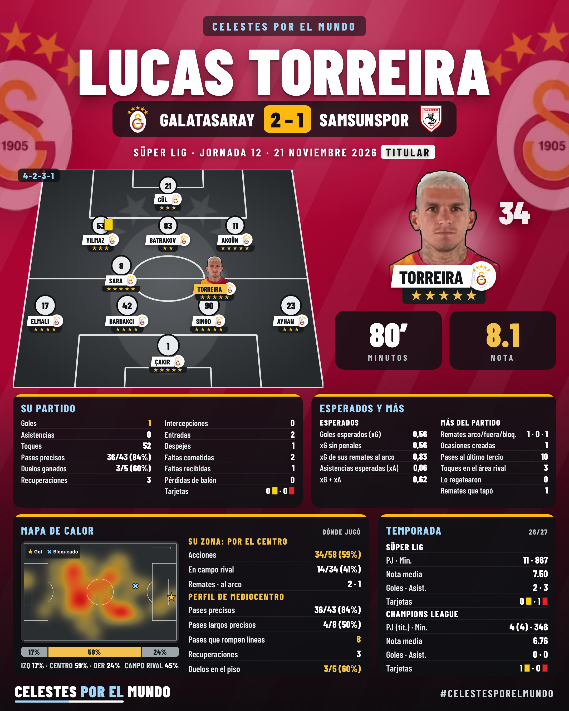
[Abrir la imagen en tamaño completo](https://github.com/tuscxm/celestes-por-el-mundo/blob/main/salida/png/L.%20Torreira/2026-11-21%20%C2%B7%20Samsunspor%20%C2%B7%20S%C3%BCper%20Lig/Torreira_Galatasaray-Samsunspor_2026-11-21.png)

Texto para el posteo:
```
🇺🇾 LUCAS TORREIRA · Galatasaray 2-1 Samsunspor
⏱ 80' · ⭐ 8.1

Jugó de mediocentro: 59% de sus acciones por el centro, 1 gol, 36/43 pases (84%) y 3/5 duelos ganados.

🧩 ¿Y en una Uruguay 3-5-2 con enganche?
Sería uno de los dos internos: 36/43 pases (84%), 8 pases que rompieron líneas y 3 recuperaciones. Es el que sostiene y hace circular para que el enganche reciba de frente.

Tres atrás, dos carrileros, dos internos, un 10 suelto y dos puntas. ¿Lo jugarías así? 👇
#CelestesPorElMundo #Uruguay #Galatasaray #352
```

## Brizuela · Saudi Arabia U17 2-3 Uruguay U17
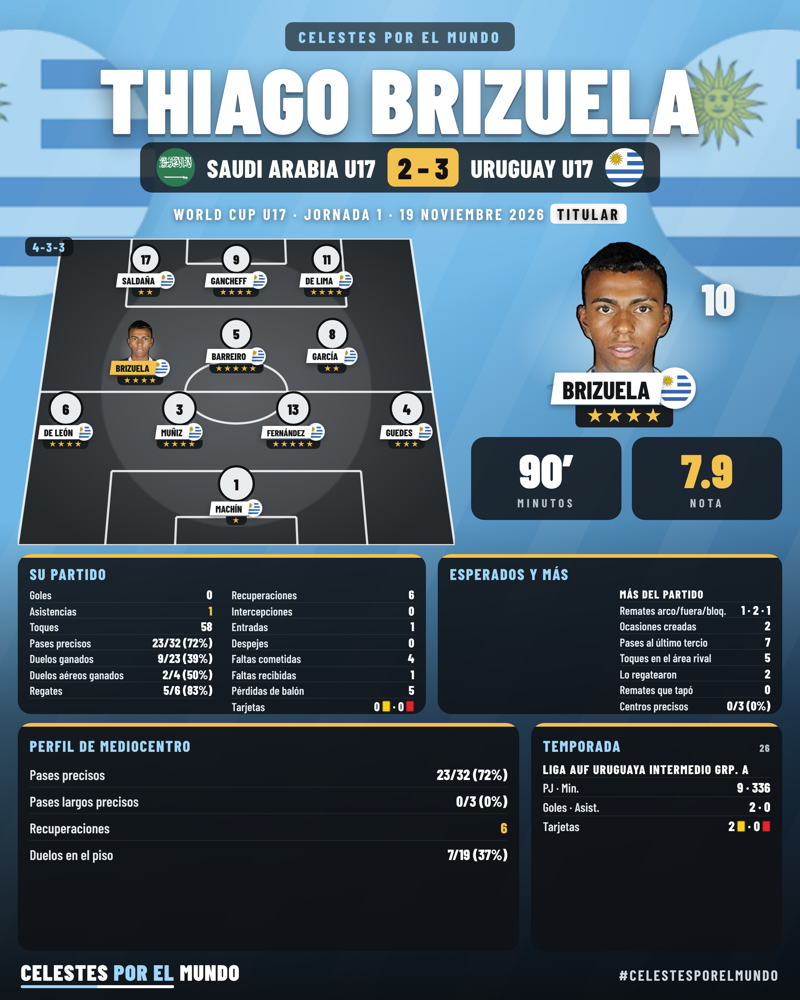
[Abrir la imagen en tamaño completo](https://github.com/tuscxm/celestes-por-el-mundo/blob/main/salida/png/T.%20Brizuela/2026-11-19%20%C2%B7%20Saudi%20Arabia%20U17%20%C2%B7%20World%20Cup%20U17/Brizuela_SaudiArabiaU17-UruguayU17_2026-11-19.png)

Texto para el posteo:
```
🇺🇾 THIAGO BRIZUELA · Saudi Arabia U17 2-3 Uruguay U17
⏱ 90' · ⭐ 7.9

Jugó de mediocentro: 23/32 pases (72%), 6 recuperaciones, 7 pases al último tercio y 2 ocasiones creadas.

🧩 ¿Y en una Uruguay 3-5-2 con enganche?
Es el 10 que pide el sistema: 2 ocasiones creadas, 7 pases al último tercio y 5/6 regates. Suelto detrás de dos puntas, con dos internos que lo cubren, Uruguay junta a los que definen.

Tres atrás, dos carrileros, dos internos, un 10 suelto y dos puntas. ¿Lo jugarías así? 👇
#CelestesPorElMundo #Uruguay #352
```

## Matturro · Shakhtar Donetsk 1-1 Liviy Bereh
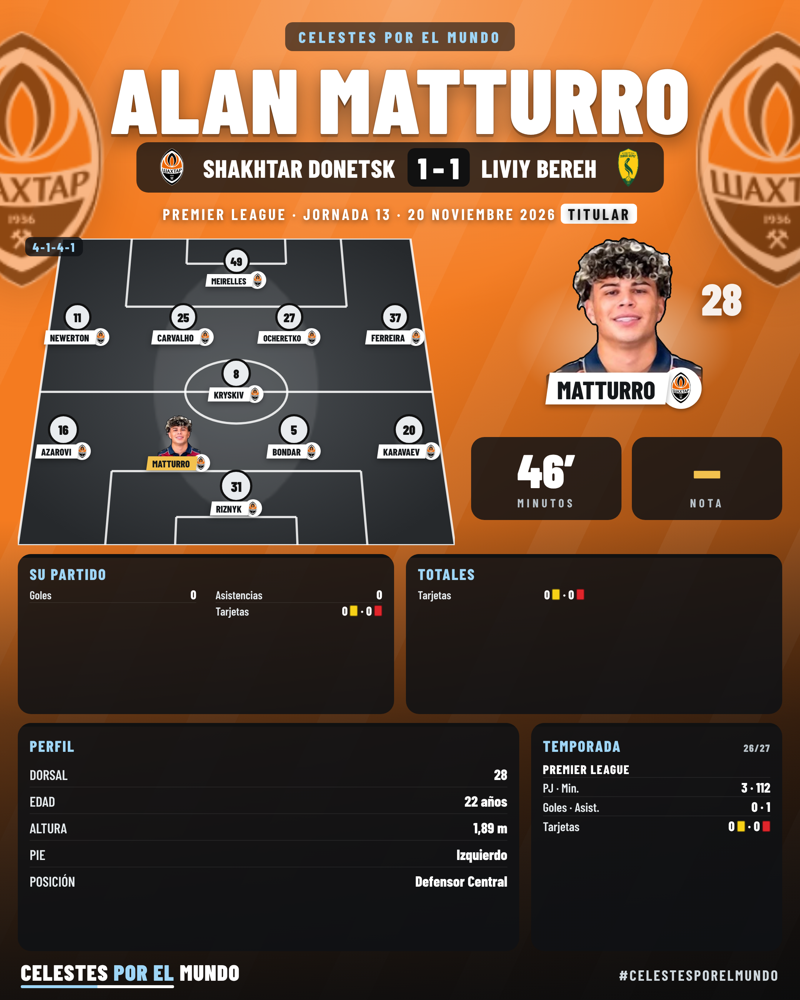
[Abrir la imagen en tamaño completo](https://github.com/tuscxm/celestes-por-el-mundo/blob/main/salida/png/A.%20Matturro/2026-11-20%20%C2%B7%20Liviy%20Bereh%20%C2%B7%20Premier%20League/Matturro_ShakhtarDonetsk-LiviyBereh_2026-11-20.png)

Texto para el posteo:
```
🇺🇾 ALAN MATTURRO · Shakhtar Donetsk 1-1 Liviy Bereh
⏱ 46'
#CelestesPorElMundo #Uruguay #ShakhtarDonetsk
```

## Olivera · Napoli 1-0 Torino
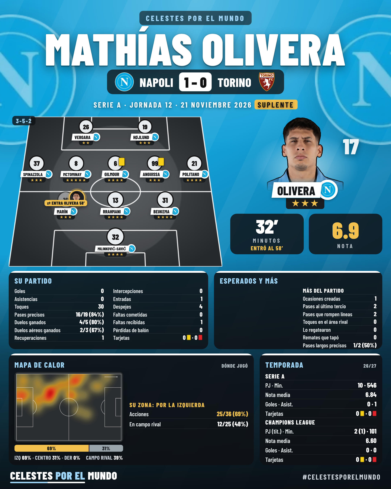
[Abrir la imagen en tamaño completo](https://github.com/tuscxm/celestes-por-el-mundo/blob/main/salida/png/M.%20Olivera/2026-11-21%20%C2%B7%20Torino%20%C2%B7%20Serie%20A/Olivera_Napoli-Torino_2026-11-21.png)

Texto para el posteo:
```
🇺🇾 MATHÍAS OLIVERA · Napoli 1-0 Torino
⏱ 32' · ⭐ 6.9
🔁 Entró al 58' por Marín

En su partido: 69% de sus acciones por la izquierda, 16/19 pases (84%), 4/5 duelos ganados y 1 recuperación.

🧩 ¿Y en una Uruguay 3-5-2 con enganche?
Lo vemos de zaguero por izquierda en la línea de tres: 16/19 pases (84%), 4/5 duelos ganados y 2/3 por arriba. Con tres atrás, un central que sale limpio le suma un pase para encontrar al enganche y deja a los carrileros libres para pasar.

Tres atrás, dos carrileros, dos internos, un 10 suelto y dos puntas. ¿Lo jugarías así? 👇
#CelestesPorElMundo #Uruguay #Napoli #352
```

## Varela · Palmeiras 1-1 Flamengo
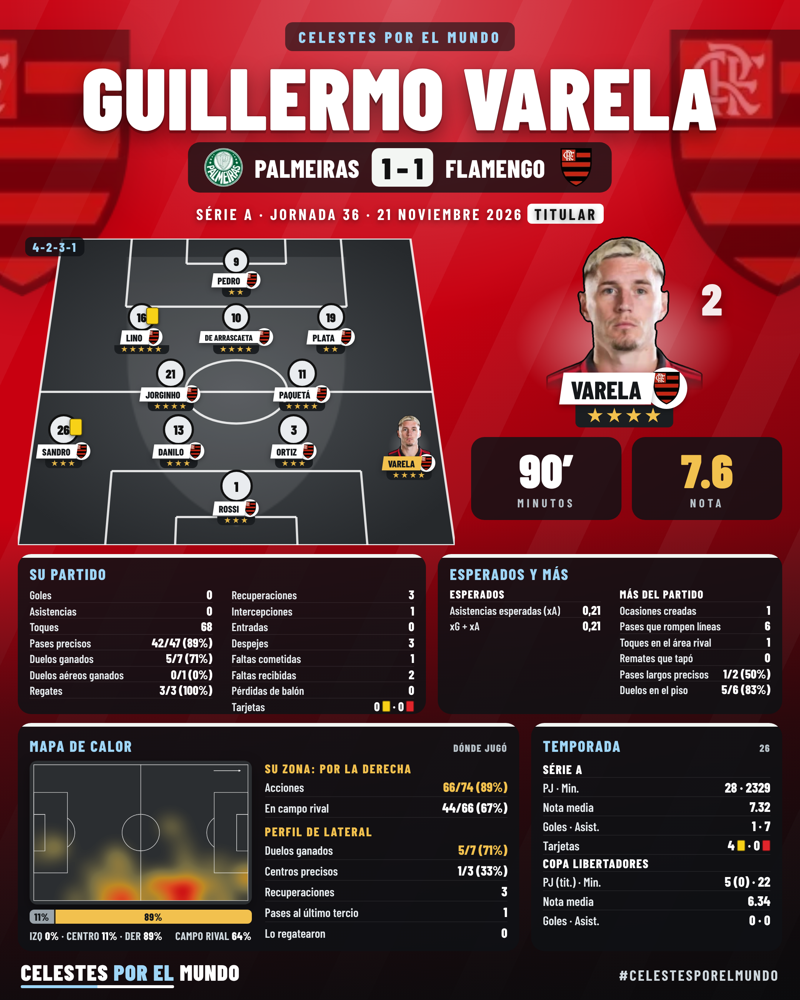
[Abrir la imagen en tamaño completo](https://github.com/tuscxm/celestes-por-el-mundo/blob/main/salida/png/G.%20Varela/2026-11-21%20%C2%B7%20Palmeiras%20%C2%B7%20S%C3%A9rie%20A/Varela_Palmeiras-Flamengo_2026-11-21.png)

Texto para el posteo:
```
🇺🇾 GUILLERMO VARELA · Palmeiras 1-1 Flamengo
⏱ 90' · ⭐ 7.6

Jugó de lateral derecho: 42/47 pases (89%), 5/7 duelos ganados, 3 recuperaciones y 1 pase al último tercio.

🧩 ¿Y en una Uruguay 3-5-2 con enganche?
Sería carrilero por derecha: 89% de sus acciones por la derecha, 64% en campo rival y 1 pase al último tercio. En el 3-5-2 toda la banda es suya, y con tres centrales atrás puede pasar sin dejar la espalda sola.

Tres atrás, dos carrileros, dos internos, un 10 suelto y dos puntas. ¿Lo jugarías así? 👇
#CelestesPorElMundo #Uruguay #Flamengo #352
```

## Bueno · Tigres 1-0 CF América
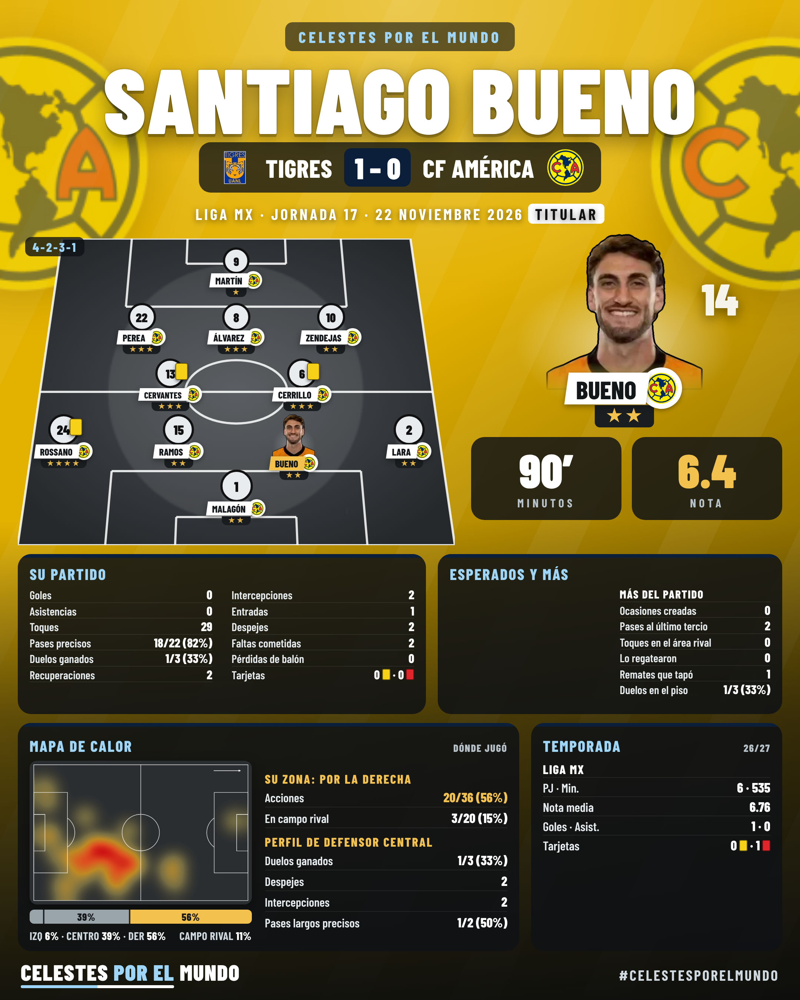
[Abrir la imagen en tamaño completo](https://github.com/tuscxm/celestes-por-el-mundo/blob/main/salida/png/S.%20Bueno/2026-11-22%20%C2%B7%20Tigres%20%C2%B7%20Liga%20Mx/Bueno_Tigres-CFAmerica_2026-11-22.png)

Texto para el posteo:
```
🇺🇾 SANTIAGO BUENO · Tigres 1-0 CF América
⏱ 90' · ⭐ 6.4

Jugó de defensor central: 56% de sus acciones por la derecha, 18/22 pases (82%), 2 recuperaciones y 2 pases al último tercio.

🧩 ¿Y en una Uruguay 3-5-2 con enganche?
Lo vemos de zaguero por derecha en la línea de tres: 18/22 pases (82%), 2 intercepciones y 2 recuperaciones. Con tres atrás, un central que sale limpio le suma un pase para encontrar al enganche y deja a los carrileros libres para pasar.

Tres atrás, dos carrileros, dos internos, un 10 suelto y dos puntas. ¿Lo jugarías así? 👇
#CelestesPorElMundo #Uruguay #ClubAmérica #352
```

## Olaza · Dynamo Moscow 1-1 FC Krasnodar
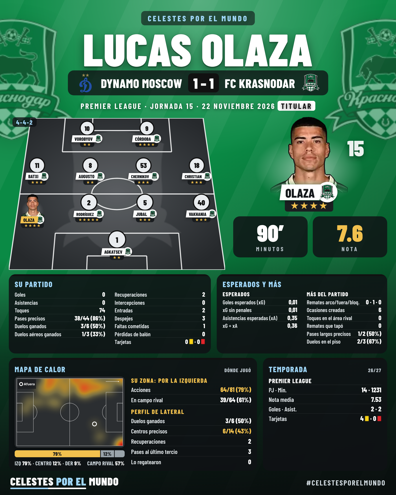
[Abrir la imagen en tamaño completo](https://github.com/tuscxm/celestes-por-el-mundo/blob/main/salida/png/L.%20Olaza/2026-11-22%20%C2%B7%20Dynamo%20Moscow%20%C2%B7%20Premier%20League/Olaza_DynamoMoscow-FCKrasnodar_2026-11-22.png)

Texto para el posteo:
```
🇺🇾 LUCAS OLAZA · Dynamo Moscow 1-1 FC Krasnodar
⏱ 90' · ⭐ 7.6

Jugó de lateral izquierdo: 38/44 pases (86%), 3/6 duelos ganados, 2 recuperaciones y 3 pases al último tercio.

🧩 ¿Y en una Uruguay 3-5-2 con enganche?
Sería carrilero por izquierda: 79% de sus acciones por la izquierda, 57% en campo rival y 3 pases al último tercio. En el 3-5-2 toda la banda es suya, y con tres centrales atrás puede pasar sin dejar la espalda sola.

Tres atrás, dos carrileros, dos internos, un 10 suelto y dos puntas. ¿Lo jugarías así? 👇
#CelestesPorElMundo #Uruguay #FCKrasnodar #352
```

## Arrascaeta · Palmeiras 1-1 Flamengo
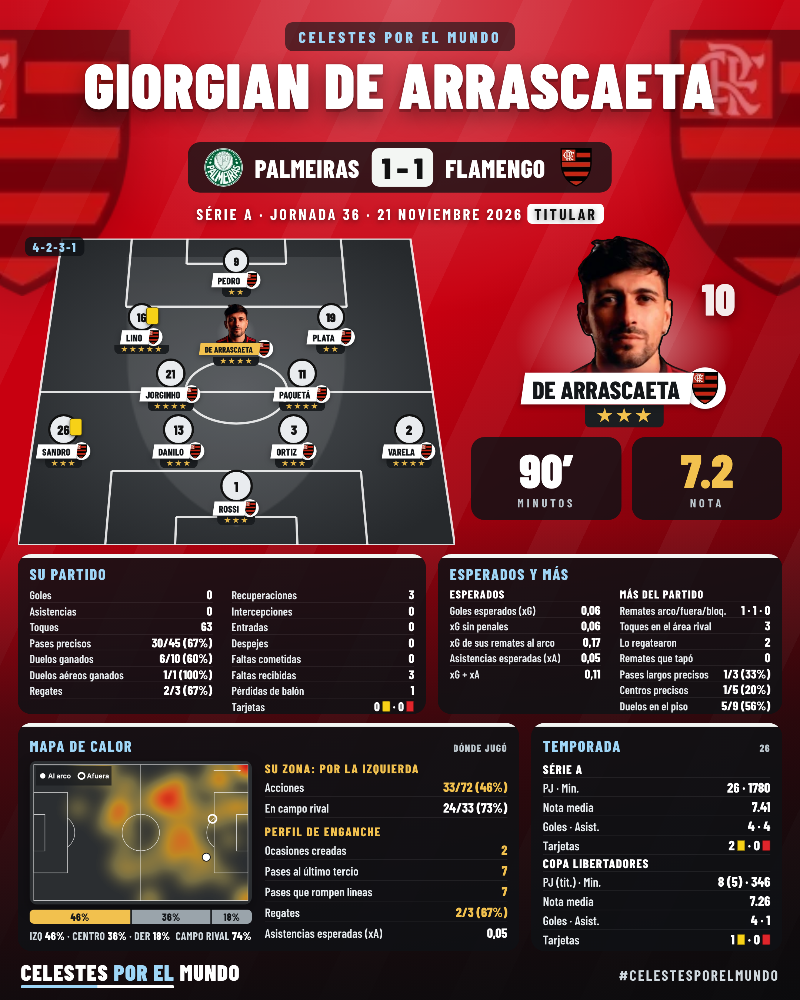
[Abrir la imagen en tamaño completo](https://github.com/tuscxm/celestes-por-el-mundo/blob/main/salida/png/G.%20De%20Arrascaeta/2026-11-21%20%C2%B7%20Palmeiras%20%C2%B7%20S%C3%A9rie%20A/DeArrascaeta_Palmeiras-Flamengo_2026-11-21.png)

Texto para el posteo:
```
🇺🇾 GIORGIAN DE ARRASCAETA · Palmeiras 1-1 Flamengo
⏱ 90' · ⭐ 7.2

Jugó de enganche: 46% de sus acciones por la izquierda, 30/45 pases (67%), 6/10 duelos ganados y 3 recuperaciones.

🧩 ¿Y en una Uruguay 3-5-2 con enganche?
Es el 10 que pide el sistema: 2 ocasiones creadas, 7 pases al último tercio y 7 pases que rompieron líneas. Suelto detrás de dos puntas, con dos internos que lo cubren, Uruguay junta a los que definen.

Tres atrás, dos carrileros, dos internos, un 10 suelto y dos puntas. ¿Lo jugarías así? 👇
#CelestesPorElMundo #Uruguay #Flamengo #352
```

## Rossi · Pumas 0-2 Monterrey
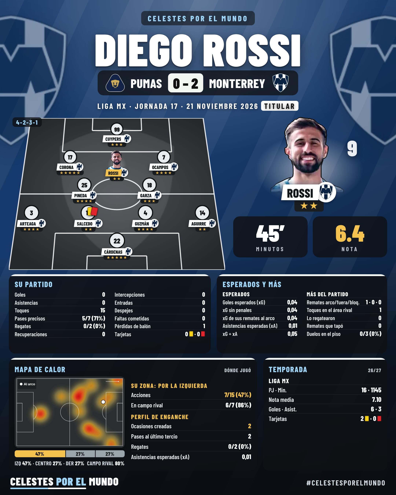
[Abrir la imagen en tamaño completo](https://github.com/tuscxm/celestes-por-el-mundo/blob/main/salida/png/D.%20Rossi/2026-11-21%20%C2%B7%20Pumas%20%C2%B7%20Liga%20Mx/Rossi_Pumas-Monterrey_2026-11-21.png)

Texto para el posteo:
```
🇺🇾 DIEGO ROSSI · Pumas 0-2 Monterrey
⏱ 45' · ⭐ 6.4

Jugó de enganche: 47% de sus acciones por la izquierda, 2 pases al último tercio y 2 ocasiones creadas.

🧩 ¿Y en una Uruguay 3-5-2 con enganche?
Sería uno de los dos de punta: 1 de 1 remates al arco y 1 toque en el área rival. Con un enganche que lo habilite y otro 9 al lado, deja de pelear solo contra los centrales.

Tres atrás, dos carrileros, dos internos, un 10 suelto y dos puntas. ¿Lo jugarías así? 👇
#CelestesPorElMundo #Uruguay #CFMonterrey #352
```

## Damiani · New England Revolution 2-0 Philadelphia Union
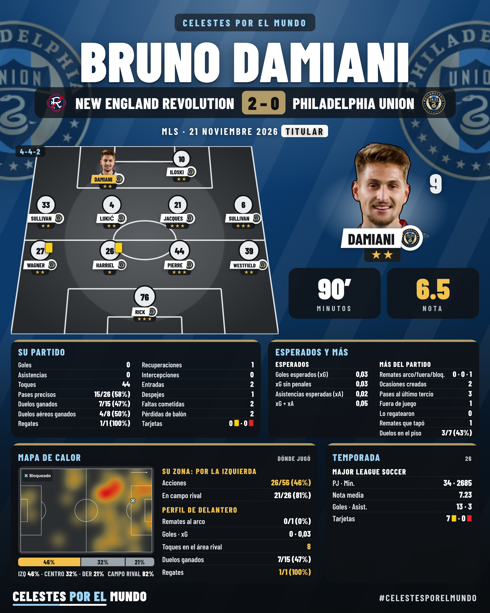
[Abrir la imagen en tamaño completo](https://github.com/tuscxm/celestes-por-el-mundo/blob/main/salida/png/B.%20Damiani/2026-11-21%20%C2%B7%20New%20England%20Revolution%20%C2%B7%20Mls/Damiani_NewEnglandRevolution-PhiladelphiaUnion_2026-11-21.png)

Texto para el posteo:
```
🇺🇾 BRUNO DAMIANI · New England Revolution 2-0 Philadelphia Union
⏱ 90' · ⭐ 6.5

Jugó de delantero: 46% de sus acciones por la izquierda, 15/26 pases (58%), 1 recuperación y 3 pases al último tercio.

🧩 ¿Y en una Uruguay 3-5-2 con enganche?
Sería uno de los dos de punta: 8 toques en el área rival y 1/1 regates. Con un enganche que lo habilite y otro 9 al lado, deja de pelear solo contra los centrales.

Tres atrás, dos carrileros, dos internos, un 10 suelto y dos puntas. ¿Lo jugarías así? 👇
#CelestesPorElMundo #Uruguay #PhiladelphiaUnion #352
```

## Aguirre · Tigres 1-0 CF América
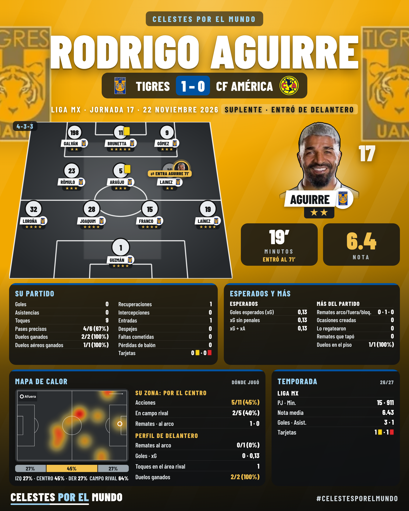
[Abrir la imagen en tamaño completo](https://github.com/tuscxm/celestes-por-el-mundo/blob/main/salida/png/R.%20Aguirre/2026-11-22%20%C2%B7%20CF%20Am%C3%A9rica%20%C2%B7%20Liga%20Mx/Aguirre_Tigres-CFAmerica_2026-11-22.png)

Texto para el posteo:
```
🇺🇾 RODRIGO AGUIRRE · Tigres 1-0 CF América
⏱ 19' · ⭐ 6.4
🔁 Entró al 71' por Lainez, como delantero

Jugó de delantero: 45% de sus acciones por el centro, 2/2 duelos ganados y 1 recuperación.

🧩 ¿Y en una Uruguay 3-5-2 con enganche?
Sería uno de los dos de punta: 1 toque en el área rival y 2/2 duelos ganados. Con un enganche que lo habilite y otro 9 al lado, deja de pelear solo contra los centrales.

Tres atrás, dos carrileros, dos internos, un 10 suelto y dos puntas. ¿Lo jugarías así? 👇
#CelestesPorElMundo #Uruguay #TigresUANL #352
```

## Viñas · Pachuca 2-0 Toluca
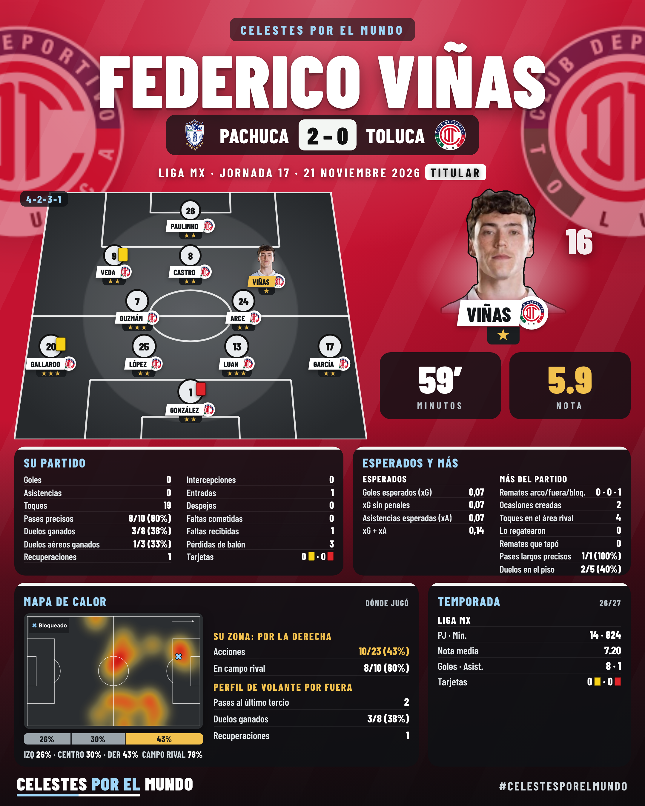
[Abrir la imagen en tamaño completo](https://github.com/tuscxm/celestes-por-el-mundo/blob/main/salida/png/F.%20Vi%C3%B1as/2026-11-21%20%C2%B7%20Pachuca%20%C2%B7%20Liga%20Mx/Vinas_Pachuca-Toluca_2026-11-21.png)

Texto para el posteo:
```
🇺🇾 FEDERICO VIÑAS · Pachuca 2-0 Toluca
⏱ 59' · ⭐ 5.9

Jugó de volante por derecha: 43% de sus acciones por la derecha, 8/10 pases (80%), 1 recuperación y 2 pases al último tercio.

🧩 ¿Y en una Uruguay 3-5-2 con enganche?
Sería uno de los dos de punta: 4 toques en el área rival. Con un enganche que lo habilite y otro 9 al lado, deja de pelear solo contra los centrales.

Tres atrás, dos carrileros, dos internos, un 10 suelto y dos puntas. ¿Lo jugarías así? 👇
#CelestesPorElMundo #Uruguay #Toluca #352
```

---
En X se publican solas en unos minutos (menos las que la revisión ponga en *No publicar en X*); en Instagram no se publicó nada. Cerrá este aviso cuando la publiques o la descartes.
## Revisión visual
- Rearmadas a mano el 22/11 (con el usuario): las 23 infografías del 19 al 22 que habían quedado en "No publicar en X" por el "None" de TEMPORADA y el "Jugó de titular" de los suplentes. Las dos cosas se arreglaron en `respaldo_auto.py` y `abajo_puesto.py`. Satriano (Getafe 0-3 Atlético Madrid, de hoy) es nueva.
- Fuentes: SofaScore 403 en todos (todo salió por el respaldo automático de FotMob); BeSoccer no se consultó (venía respondiendo 406); API-Football: plan gratis sin la temporada 2026; zerozero HTTP 403; TheSportsDB HTTP 429 en algunos; Understat: formato no reconocido o no cubre la liga.
- Ya no aparece "None" en TEMPORADA (si falta el dato de titular va "PJ · Min.") y los suplentes sin puesto conocido dicen "En su partido: …" en vez de "Jugó de titular".
- Suplentes sin puesto conocido (Valverde, Mouriño, J. M. Rodríguez, Giménez, Olivera): sin PERFIL (queda un espacio vacío al lado del mapa), porque FotMob no dice en qué puesto entraron. Detalle menor.
- Sin mapa de calor (va el PERFIL a lo ancho): Merentiel, F. Díaz y Brizuela.
- Giménez: el dibujo dice 5-3-2 y la cancha muestra 3-2-3-2. Olaza: la liga rusa figura como "PREMIER LEAGUE". Amaro: "FIRST DIVISION A" y "BELGIAN PRO LEAGUE" en inglés. Detalles menores.
- Sanabria: tanda de penales bien explicada (PENALES 2-4, no pateó). Rojas visibles en la cancha (Navarro, Djené, Salcedo, González de Toluca).
- En el resto: caras con contorno, escudos y colores correctos, números iguales en la infografía y el posteo, y ninguna dice el nombre de una fuente.

## No publicar en X
- Gonzalez_RacingSantander-RealSociedad_2026-11-22: al lado de Racing Santander va el escudo de la Real Sociedad y al lado de la Real Sociedad no hay escudo; TEMPORADA de la temporada pasada (LALIGA2 25/26); PERFIL genérico "Su Juego"
- Zalazar_SportingCP-UniãoSerra_2026-11-21: casi vacía (el respaldo no trajo alineación, estadísticas ni nota)
- Matturro_ShakhtarDonetsk-LiviyBereh_2026-11-20: casi vacía (el respaldo no trajo estadísticas ni nota)
- Brizuela_SaudiArabiaU17-UruguayU17_2026-11-19: partido de la selección Sub-17 con el torneo y los equipos en inglés ("WORLD CUP U17", "SAUDI ARABIA U17", "URUGUAY U17")
