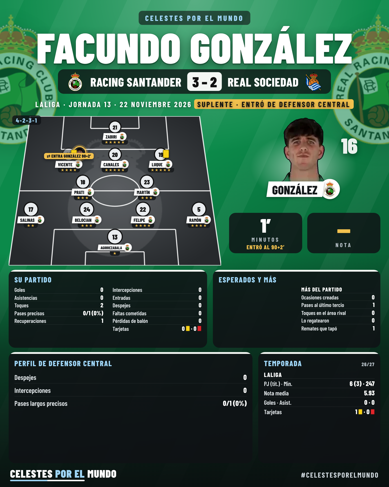
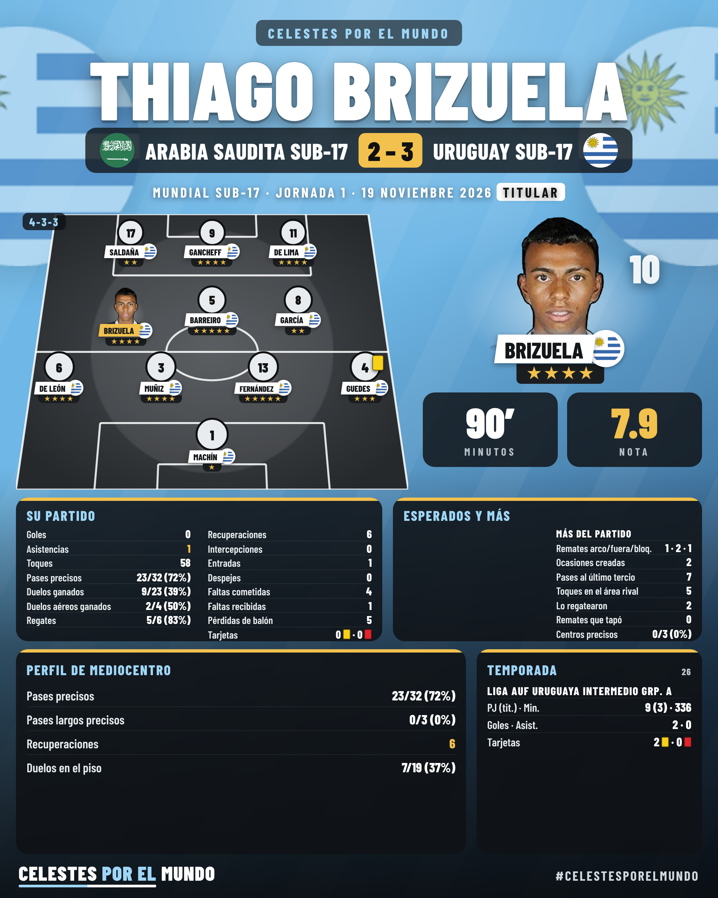
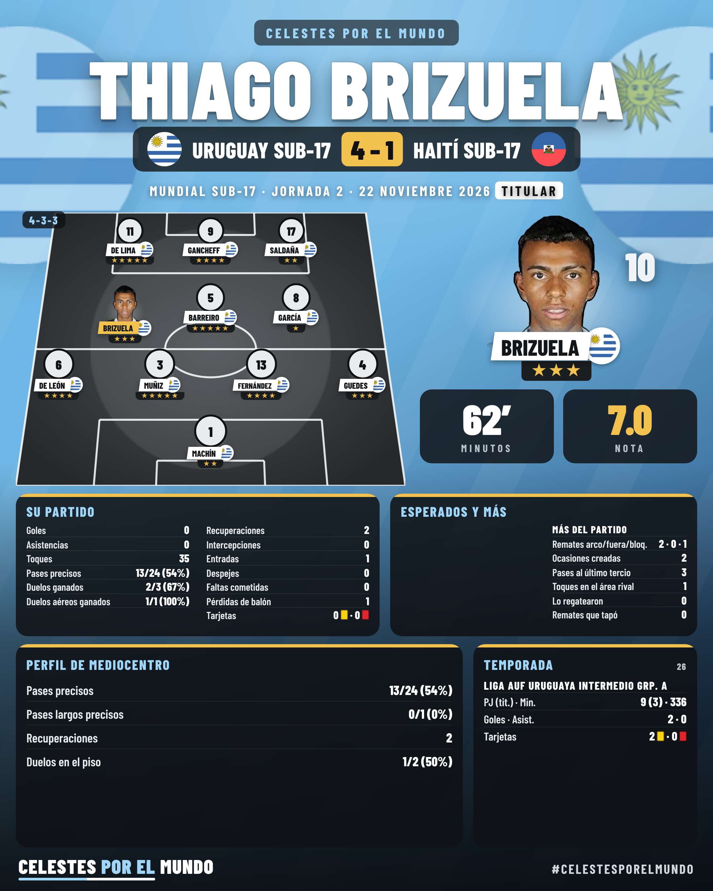
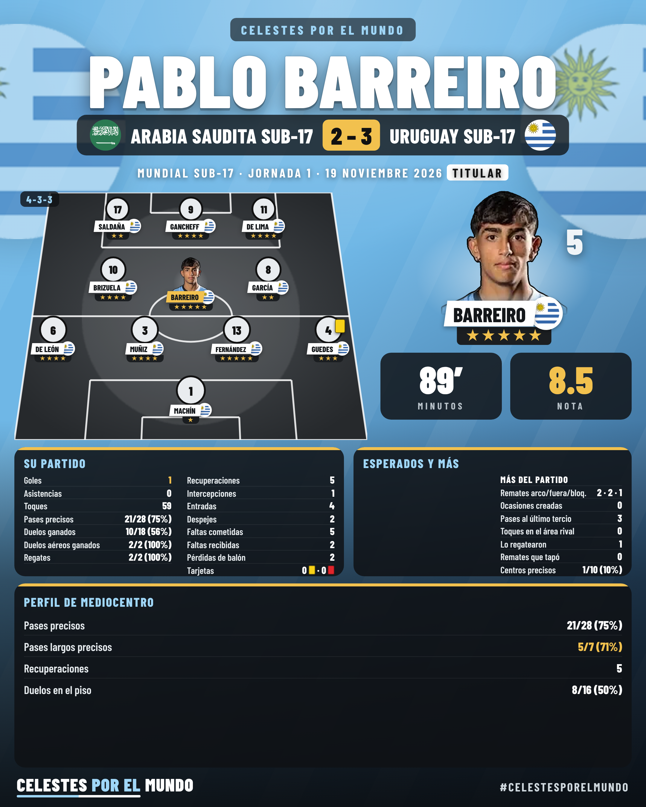
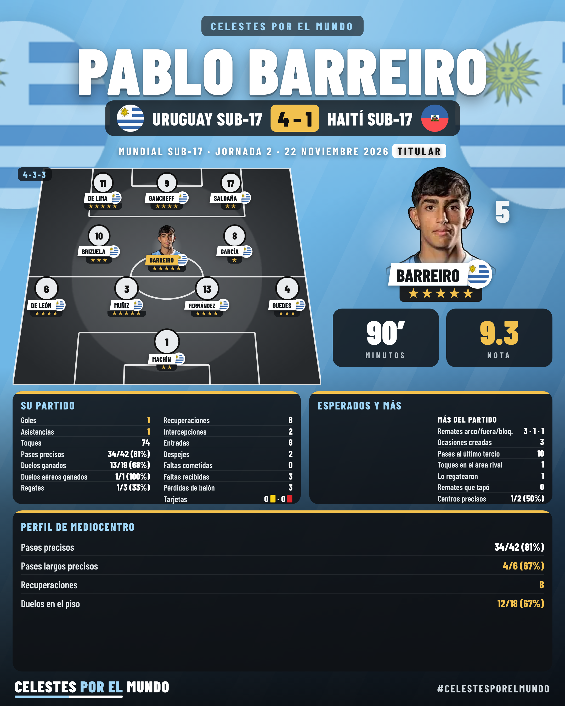

González jugó 1' (suplente) en Racing Santander 3-2 Real Sociedad; Brizuela jugó 90' (titular, nota 7.9) en Arabia Saudita Sub-17 2-3 Uruguay Sub-17; Brizuela jugó 62' (titular, nota 7.0) en Uruguay Sub-17 4-1 Haití Sub-17; Barreiro jugó 89' (titular

@tuscxm

## Quién jugó
- **González** jugó 1' (suplente, entró al 90+2' por Vicente, de defensor central) en Racing Santander 3-2 Real Sociedad · LaLiga
- **Brizuela** jugó 90' (titular, nota 7.9, de mediocentro) en Arabia Saudita Sub-17 2-3 Uruguay Sub-17 · Mundial Sub-17
- **Brizuela** jugó 62' (titular, nota 7.0, de mediocentro) en Uruguay Sub-17 4-1 Haití Sub-17 · Mundial Sub-17
- **Barreiro** jugó 89' (titular, nota 8.5, de mediocentro) en Arabia Saudita Sub-17 2-3 Uruguay Sub-17 · Mundial Sub-17
- **Barreiro** jugó 90' (titular, nota 9.3, de mediocentro) en Uruguay Sub-17 4-1 Haití Sub-17 · Mundial Sub-17

## Avisos
- González: SofaScore no respondió; fuentes: fotmob ok, besoccer ok, api_football error: RuntimeError: API-Football: access: Your account is suspended, check on https://dashboard.api-football.com., thesportsdb ok, understat sin datos: sin understat_equipo (Understat no cubre esa liga), zerozero error HTTP 403
- González: Entró de suplente: el puesto (defensor central) es su puesto habitual, no se sabe dónde entró
- González: No hay mapa de calor de este partido en el respaldo: se muestra el perfil
- González: Armada con datos de respaldo (FotMob): hay menos estadísticas que de costumbre, revisala antes de publicar
- Brizuela: SofaScore no respondió; fuentes: fotmob ok, besoccer ok, api_football error: RuntimeError: API-Football: access: Your account is suspended, check on https://dashboard.api-football.com., thesportsdb sin datos: no se encontró el equipo, understat sin datos: sin understat_equipo (Understat no cubre esa liga), zerozero error HTTP 403
- Brizuela: No hay mapa de calor de este partido en el respaldo: se muestra el perfil
- Brizuela: Armada con datos de respaldo (FotMob): hay menos estadísticas que de costumbre, revisala antes de publicar
- Brizuela: SofaScore no respondió; fuentes: fotmob ok, besoccer ok, api_football error: RuntimeError: API-Football: access: Your account is suspended, check on https://dashboard.api-football.com., thesportsdb sin datos: no se encontró el equipo, understat sin datos: sin understat_equipo (Understat no cubre esa liga), zerozero error HTTP 403
- Brizuela: No hay mapa de calor de este partido en el respaldo: se muestra el perfil
- Brizuela: Armada con datos de respaldo (FotMob): hay menos estadísticas que de costumbre, revisala antes de publicar
- Barreiro: SofaScore no respondió; fuentes: fotmob ok, besoccer ok, api_football error: RuntimeError: API-Football: access: Your account is suspended, check on https://dashboard.api-football.com., thesportsdb sin datos: no se encontró el equipo, understat sin datos: sin understat_equipo (Understat no cubre esa liga), zerozero error HTTP 403
- Barreiro: No hay mapa de calor de este partido en el respaldo: se muestra el perfil
- Barreiro: Armada con datos de respaldo (FotMob): hay menos estadísticas que de costumbre, revisala antes de publicar
- Barreiro: SofaScore no respondió; fuentes: fotmob ok, besoccer ok, api_football error: RuntimeError: API-Football: access: Your account is suspended, check on https://dashboard.api-football.com., thesportsdb sin datos: no se encontró el equipo, understat sin datos: sin understat_equipo (Understat no cubre esa liga), zerozero error HTTP 403
- Barreiro: No hay mapa de calor de este partido en el respaldo: se muestra el perfil
- Barreiro: Armada con datos de respaldo (FotMob): hay menos estadísticas que de costumbre, revisala antes de publicar

## González · Racing Santander 3-2 Real Sociedad

[Abrir la imagen en tamaño completo](https://github.com/tuscxm/celestes-por-el-mundo/blob/main/salida/png/F.%20Gonz%C3%A1lez/2026-11-22%20%C2%B7%20Real%20Sociedad%20%C2%B7%20LaLiga/Gonzalez_RacingSantander-RealSociedad_2026-11-22.png)

Texto para el posteo:
```
🇺🇾 FACUNDO GONZÁLEZ · Racing Santander 3-2 Real Sociedad
⏱ 1'
🔁 Entró al 90+2' por Vicente, como defensor central

Jugó de defensor central: 1 recuperación y 1 pase al último tercio.

🧩 ¿Y en una Uruguay 3-5-2 con enganche?
Lo vemos de zaguero en la línea de tres: 1 recuperación. Con tres atrás, un central que sale limpio le suma un pase para encontrar al enganche y deja a los carrileros libres para pasar.

Tres atrás, dos carrileros, dos internos, un 10 suelto y dos puntas. ¿Lo jugarías así? 👇
#CelestesPorElMundo #Uruguay #RacingdeSantander #352
```

## Brizuela · Arabia Saudita Sub-17 2-3 Uruguay Sub-17

[Abrir la imagen en tamaño completo](https://github.com/tuscxm/celestes-por-el-mundo/blob/main/salida/png/T.%20Brizuela/2026-11-19%20%C2%B7%20Arabia%20Saudita%20Sub-17%20%C2%B7%20Mundial%20Sub-17/Brizuela_ArabiaSauditaSub17-UruguaySub17_2026-11-19.png)

Texto para el posteo:
```
🇺🇾 THIAGO BRIZUELA · Arabia Saudita Sub-17 2-3 Uruguay Sub-17
⏱ 90' · ⭐ 7.9

Jugó de mediocentro: 23/32 pases (72%), 6 recuperaciones, 7 pases al último tercio y 2 ocasiones creadas.

🧩 ¿Y en una Uruguay 3-5-2 con enganche?
Es el 10 que pide el sistema: 2 ocasiones creadas, 7 pases al último tercio y 5/6 regates. Suelto detrás de dos puntas, con dos internos que lo cubren, Uruguay junta a los que definen.

Tres atrás, dos carrileros, dos internos, un 10 suelto y dos puntas. ¿Lo jugarías así? 👇
#CelestesPorElMundo #Uruguay #352
```

## Brizuela · Uruguay Sub-17 4-1 Haití Sub-17

[Abrir la imagen en tamaño completo](https://github.com/tuscxm/celestes-por-el-mundo/blob/main/salida/png/T.%20Brizuela/2026-11-22%20%C2%B7%20Hait%C3%AD%20Sub-17%20%C2%B7%20Mundial%20Sub-17/Brizuela_UruguaySub17-HaitiSub17_2026-11-22.png)

Texto para el posteo:
```
🇺🇾 THIAGO BRIZUELA · Uruguay Sub-17 4-1 Haití Sub-17
⏱ 62' · ⭐ 7.0

Jugó de mediocentro: 13/24 pases (54%), 2/3 duelos ganados, 2 recuperaciones y 3 pases al último tercio.

🧩 ¿Y en una Uruguay 3-5-2 con enganche?
Es el 10 que pide el sistema: 2 ocasiones creadas, 3 pases al último tercio y 1 toque en el área rival. Suelto detrás de dos puntas, con dos internos que lo cubren, Uruguay junta a los que definen.

Tres atrás, dos carrileros, dos internos, un 10 suelto y dos puntas. ¿Lo jugarías así? 👇
#CelestesPorElMundo #Uruguay #352
```

## Barreiro · Arabia Saudita Sub-17 2-3 Uruguay Sub-17

[Abrir la imagen en tamaño completo](https://github.com/tuscxm/celestes-por-el-mundo/blob/main/salida/png/P.%20Barreiro/2026-11-19%20%C2%B7%20Arabia%20Saudita%20Sub-17%20%C2%B7%20Mundial%20Sub-17/Barreiro_ArabiaSauditaSub17-UruguaySub17_2026-11-19.png)

Texto para el posteo:
```
🇺🇾 PABLO BARREIRO · Arabia Saudita Sub-17 2-3 Uruguay Sub-17
⏱ 89' · ⭐ 8.5

Jugó de mediocentro: 1 gol, 21/28 pases (75%), 10/18 duelos ganados y 5 recuperaciones.

🧩 ¿Y en una Uruguay 3-5-2 con enganche?
Sería uno de los dos internos: 21/28 pases (75%), 5 recuperaciones y 10/18 duelos ganados. Es el que sostiene y hace circular para que el enganche reciba de frente.

Tres atrás, dos carrileros, dos internos, un 10 suelto y dos puntas. ¿Lo jugarías así? 👇
#CelestesPorElMundo #Uruguay #352
```

## Barreiro · Uruguay Sub-17 4-1 Haití Sub-17

[Abrir la imagen en tamaño completo](https://github.com/tuscxm/celestes-por-el-mundo/blob/main/salida/png/P.%20Barreiro/2026-11-22%20%C2%B7%20Hait%C3%AD%20Sub-17%20%C2%B7%20Mundial%20Sub-17/Barreiro_UruguaySub17-HaitiSub17_2026-11-22.png)

Texto para el posteo:
```
🇺🇾 PABLO BARREIRO · Uruguay Sub-17 4-1 Haití Sub-17
⏱ 90' · ⭐ 9.3

Jugó de mediocentro: 1 gol, 34/42 pases (81%), 13/19 duelos ganados y 8 recuperaciones.

🧩 ¿Y en una Uruguay 3-5-2 con enganche?
Sería uno de los dos internos: 34/42 pases (81%), 8 recuperaciones y 13/19 duelos ganados. Es el que sostiene y hace circular para que el enganche reciba de frente.

Tres atrás, dos carrileros, dos internos, un 10 suelto y dos puntas. ¿Lo jugarías así? 👇
#CelestesPorElMundo #Uruguay #352
```

---
En X se publican solas en unos minutos (menos las que la revisión ponga en *No publicar en X*); en Instagram no se publicó nada. Cerrá este aviso cuando la publiques o la descartes.
## Revisión visual
- Rearmadas a mano el 22/11 (con el usuario), después de arreglar el respaldo de FotMob: F. González (antes frenada por escudos cruzados y temporada vieja) y Brizuela del 19/11 (antes frenada por el torneo y los equipos en inglés). Nuevas: Brizuela vs. Haití (22/11) y Pablo Barreiro, que se sumó hoy (19/11 y 22/11).
- Arreglos del respaldo: el lado de su equipo sale de FotMob (no de comparar nombres), la TEMPORADA usa la liga de la temporada actual y vuelve a mostrar los partidos de titular, el escudo del club se baja de FotMob si falta, los suplentes llevan el PERFIL de su puesto habitual (con aviso), y las selecciones juveniles van en español ("Arabia Saudita Sub-17", "Mundial Sub-17"). Los partidos de la Sub-17 se buscan también en el calendario del equipo (FotMob no los cuelga de la ficha de Barreiro).
- F. González: escudos en su lugar (Racing a la izquierda, Real Sociedad a la derecha), TEMPORADA LaLiga 26/27 6 (3) · 247. Entró al 90+2': el puesto (defensor central) es su puesto habitual.
- Barreiro: sin TEMPORADA (FotMob no tiene estadísticas de temporada suyas) y sin mapa de calor (FotMob no tiene mapa de los partidos del Mundial Sub-17); va el PERFIL DE MEDIOCENTRO a lo ancho. El texto del posteo no menciona la asistencia de Barreiro ante Haití (sí está en SU PARTIDO). Detalle menor.
- Fuentes: SofaScore 403 en todos; API-Football ahora responde "Your account is suspended" (el contador de hoy marca 8 pedidos); zerozero HTTP 403; TheSportsDB no encontró a las selecciones Sub-17; Understat no cubre esas ligas.
- Caras con contorno, escudos y banderas correctos, números iguales en la infografía y en el posteo; ninguna dice el nombre de una fuente; no hubo tandas de penales.
