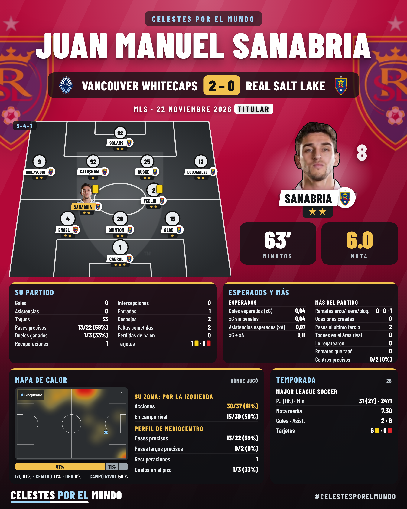
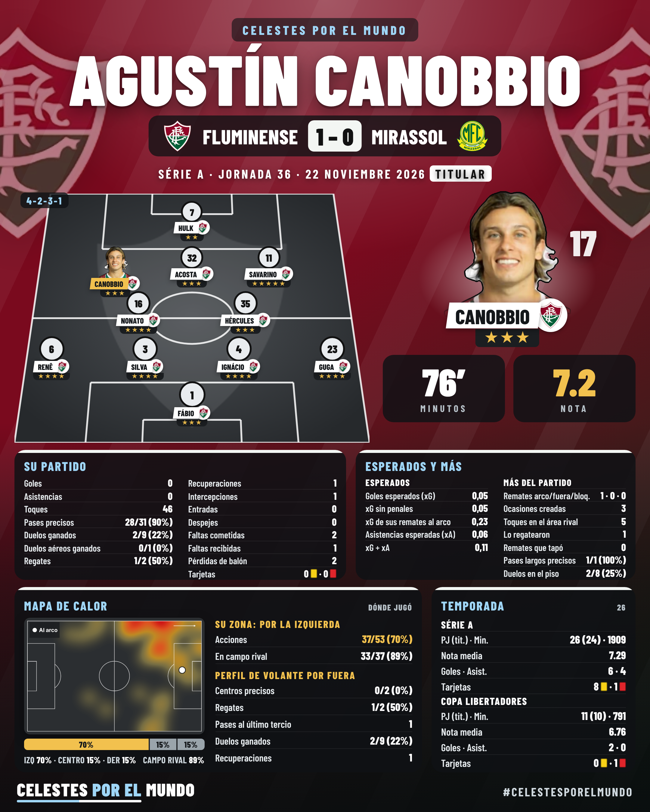

J. M. Sanabria jugó 63' (titular, nota 6.0) en Vancouver Whitecaps 2-0 Real Salt Lake; Canobbio jugó 76' (titular, nota 7.2) en Fluminense 1-0 Mirassol; infografías listas

@tuscxm

## Quién jugó
- **J. M. Sanabria** jugó 63' (titular, nota 6.0, de mediocentro) en Vancouver Whitecaps 2-0 Real Salt Lake · MLS
- **Canobbio** jugó 76' (titular, nota 7.2, de volante por izquierda) en Fluminense 1-0 Mirassol · Série A

## El resto
- Valverde: sin partido hoy ni ayer
- Bernal: sin partido hoy ni ayer
- Mouriño: ya procesado · Barcelona 3-2 Villarreal
- M. Araújo: sin partido hoy ni ayer
- Á. Rodríguez: sin partido hoy ni ayer
- González: ya procesado · Racing Santander 3-2 Real Sociedad
- Cáceres: sin partido hoy ni ayer
- Petit: sin partido hoy ni ayer
- Bentancur: sin partido hoy ni ayer
- Satriano: ya procesado · Getafe 0-3 Atlético Madrid
- Boselli: sin partido hoy ni ayer
- J. Rodríguez: sin partido hoy ni ayer
- Zalazar: sin partido hoy ni ayer
- Merentiel: sin partido hoy ni ayer
- Giménez: sin partido hoy ni ayer
- Amaro: sin partido hoy ni ayer
- R. Araújo: ya procesado · Liverpool 4-0 Manchester United
- Ugarte: sin partido hoy ni ayer
- Darwin: sin partido hoy ni ayer
- F. Díaz: sin partido hoy ni ayer
- Torreira: sin partido hoy ni ayer
- Brizuela: ya procesado · Uruguay U17 4-1 Haiti U17
- Barreiro: ya procesado · Uruguay U17 4-1 Haiti U17
- Piquerez: sin partido hoy ni ayer
- Matturro: sin partido hoy ni ayer
- Olivera: sin partido hoy ni ayer
- Varela: sin partido hoy ni ayer
- Nández: sin partido hoy ni ayer
- Bueno: ya procesado · Tigres 1-0 CF América
- Pereira: sin partido hoy ni ayer
- Marichal: no jugó en Dynamo Moscow 1-1 FC Krasnodar (no entró)
- Barboza: sin partido hoy ni ayer
- Olaza: ya procesado · Dynamo Moscow 1-1 FC Krasnodar
- Fonseca: sin partido hoy ni ayer
- E. Martínez: sin partido hoy ni ayer
- De la Cruz: sin partido hoy ni ayer
- Arrascaeta: sin partido hoy ni ayer
- Pellistri: no jugó en Panathinaikos 2-0 OFI Crete (no entró)
- Rossi: sin partido hoy ni ayer
- B. Rodríguez: sin partido hoy ni ayer
- Damiani: sin partido hoy ni ayer
- Aguirre: ya procesado · Tigres 1-0 CF América
- Viñas: sin partido hoy ni ayer

## Avisos
- J. M. Sanabria: SofaScore no respondió; fuentes: fotmob ok, besoccer ok, api_football sin datos: el plan gratis de API-Football no cubre esta temporada (plan: Free plans do not have access to this season, try from 2022 to 2024.), thesportsdb ok, understat sin datos: sin understat_equipo (Understat no cubre esa liga), zerozero error HTTP 403
- J. M. Sanabria: Armada con datos de respaldo (FotMob): hay menos estadísticas que de costumbre, revisala antes de publicar
- Canobbio: SofaScore no respondió; fuentes: fotmob ok, besoccer ok, api_football sin datos: el plan gratis de API-Football no cubre esta temporada (plan: Free plans do not have access to this season, try from 2022 to 2024.), thesportsdb ok, understat sin datos: sin understat_equipo (Understat no cubre esa liga), zerozero error HTTP 403
- Canobbio: Armada con datos de respaldo (FotMob): hay menos estadísticas que de costumbre, revisala antes de publicar

## J. M. Sanabria · Vancouver Whitecaps 2-0 Real Salt Lake

[Abrir la imagen en tamaño completo](https://github.com/tuscxm/celestes-por-el-mundo/blob/main/salida/png/J.%20M.%20Sanabria/2026-11-22%20%C2%B7%20Vancouver%20Whitecaps%20%C2%B7%20Mls/Sanabria_VancouverWhitecaps-RealSaltLake_2026-11-22.png)

Texto para el posteo:
```
🇺🇾 JUAN MANUEL SANABRIA · Vancouver Whitecaps 2-0 Real Salt Lake
⏱ 63' · ⭐ 6.0

Jugó de mediocentro: 13/22 pases (59%), 1 recuperación y 2 pases al último tercio.

🧩 ¿Y en una Uruguay 3-5-2 con enganche?
Sería carrilero por izquierda: 81% de sus acciones por la izquierda, 59% en campo rival y 2 pases al último tercio. En el 3-5-2 toda la banda es suya, y con tres centrales atrás puede pasar sin dejar la espalda sola.

Tres atrás, dos carrileros, dos internos, un 10 suelto y dos puntas. ¿Lo jugarías así? 👇
#CelestesPorElMundo #Uruguay #RealSaltLake #352
```

## Canobbio · Fluminense 1-0 Mirassol

[Abrir la imagen en tamaño completo](https://github.com/tuscxm/celestes-por-el-mundo/blob/main/salida/png/A.%20Canobbio/2026-11-22%20%C2%B7%20Mirassol%20%C2%B7%20S%C3%A9rie%20A/Canobbio_Fluminense-Mirassol_2026-11-22.png)

Texto para el posteo:
```
🇺🇾 AGUSTÍN CANOBBIO · Fluminense 1-0 Mirassol
⏱ 76' · ⭐ 7.2

Jugó de volante por izquierda: 28/31 pases (90%), 1 recuperación, 1 pase al último tercio y 3 ocasiones creadas.

🧩 ¿Y en una Uruguay 3-5-2 con enganche?
Sería carrilero por izquierda: 70% de sus acciones por la izquierda, 89% en campo rival y 1 pase al último tercio. En el 3-5-2 toda la banda es suya, y con tres centrales atrás puede pasar sin dejar la espalda sola.

Tres atrás, dos carrileros, dos internos, un 10 suelto y dos puntas. ¿Lo jugarías así? 👇
#CelestesPorElMundo #Uruguay #Fluminense #352
```

---
En X se publican solas en unos minutos (menos las que la revisión ponga en *No publicar en X*); en Instagram no se publicó nada. Cerrá este aviso cuando la publiques o la descartes.
## Revisión visual
- Fuentes con error: SofaScore no respondió (se usó el respaldo con FotMob); BeSoccer devolvió HTTP 406 a todas las páginas de jugadores (besoccer_hoy.json quedó vacío); API-Football sin la temporada en el plan gratis; zerozero HTTP 403; Understat no cubre MLS ni Brasil.
- Canobbio_Fluminense-Mirassol_2026-11-22: la cara grande quedó mal recortada: manchas blancas del fondo a los costados del pelo (a la altura de las orejas). El resto está bien: escudos en su lugar, TEMPORADA con Série A y Libertadores, SU PARTIDO / ESPERADOS / PERFIL de volante por fuera coherentes con el texto.
- Canobbio_Fluminense-Mirassol_2026-11-22 (menor): el posteo dice "Sería carrilero por izquierda" porque ese partido jugó por la izquierda; en el 3-5-2 de la cuenta (rol_352) es carrilero por derecha.
- Sanabria_VancouverWhitecaps-RealSaltLake_2026-11-22: la formación dice 5-4-1 pero la cancha la dibuja como 3-2-4-1: Sanabria y Yedlin (los carrileros de la línea de 5) aparecen como pareja en el medio, y por eso el puesto y el PERFIL dicen "mediocentro", aunque el 81 % de sus acciones fueron por la izquierda. Puesto y PERFIL probablemente equivocados (lo más probable es que haya jugado de carrilero o lateral izquierdo). Cara, escudos y números están bien y coinciden con el texto.

## No publicar en X
- Canobbio_Fluminense-Mirassol_2026-11-22: cara mal recortada (manchas blancas del fondo junto al pelo)
- Sanabria_VancouverWhitecaps-RealSaltLake_2026-11-22: puesto y PERFIL de mediocentro que no corresponden (5-4-1 dibujado como 3-2-4-1, jugó de carrilero por izquierda)
