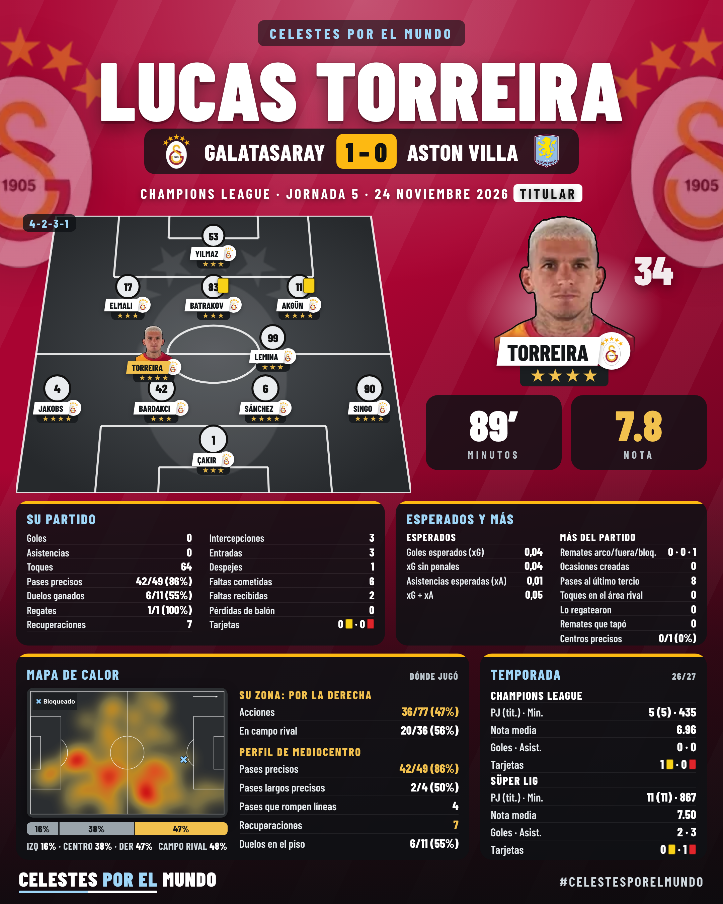

Torreira jugó 89' (titular, nota 7.8) en Galatasaray 1-0 Aston Villa; infografía lista

@tuscxm

## Quién jugó
- **Torreira** jugó 89' (titular, nota 7.8, de mediocentro) en Galatasaray 1-0 Aston Villa · Champions League

## El resto
- Valverde: sin partido hoy ni ayer
- Bernal: sin partido hoy ni ayer
- Mouriño: sin partido hoy ni ayer
- M. Araújo: sin partido hoy ni ayer
- Á. Rodríguez: sin partido hoy ni ayer
- González: sin partido hoy ni ayer
- Cáceres: sin partido hoy ni ayer
- Petit: sin partido hoy ni ayer
- Bentancur: sin partido hoy ni ayer
- Satriano: sin partido hoy ni ayer
- Boselli: sin partido hoy ni ayer
- J. Rodríguez: sin partido hoy ni ayer
- Zalazar: sin partido hoy ni ayer
- Merentiel: sin partido hoy ni ayer
- Giménez: sin partido hoy ni ayer
- Amaro: sin partido hoy ni ayer
- R. Araújo: sin partido hoy ni ayer
- J. M. Sanabria: sin partido hoy ni ayer
- Ugarte: sin partido hoy ni ayer
- Canobbio: sin partido hoy ni ayer
- Darwin: sin partido hoy ni ayer
- F. Díaz: sin partido hoy ni ayer
- Brizuela: sin partido hoy ni ayer
- Barreiro: sin partido hoy ni ayer
- Piquerez: sin partido hoy ni ayer
- Matturro: sin partido hoy ni ayer
- Olivera: sin partido hoy ni ayer
- Varela: sin partido hoy ni ayer
- Nández: sin partido hoy ni ayer
- Bueno: sin partido hoy ni ayer
- Pereira: sin partido hoy ni ayer
- Marichal: sin partido hoy ni ayer
- Barboza: sin partido hoy ni ayer
- Olaza: sin partido hoy ni ayer
- Fonseca: sin partido hoy ni ayer
- E. Martínez: sin partido hoy ni ayer
- De la Cruz: sin partido hoy ni ayer
- Arrascaeta: sin partido hoy ni ayer
- Pellistri: sin partido hoy ni ayer
- Rossi: sin partido hoy ni ayer
- B. Rodríguez: sin partido hoy ni ayer
- Damiani: sin partido hoy ni ayer
- Aguirre: sin partido hoy ni ayer
- Viñas: sin partido hoy ni ayer

## Avisos
- Torreira: SofaScore no respondió; fuentes: fotmob ok, besoccer ok, api_football sin datos: el plan gratis de API-Football no cubre esta temporada (plan: Free plans do not have access to this season, try from 2022 to 2024.), thesportsdb ok, understat sin datos: sin understat_equipo (Understat no cubre esa liga), zerozero error HTTP 403
- Torreira: Armada con datos de respaldo (FotMob): hay menos estadísticas que de costumbre, revisala antes de publicar

## Torreira · Galatasaray 1-0 Aston Villa

[Abrir la imagen en tamaño completo](https://github.com/tuscxm/celestes-por-el-mundo/blob/main/salida/png/L.%20Torreira/2026-11-24%20%C2%B7%20Aston%20Villa%20%C2%B7%20Champions%20League/Torreira_Galatasaray-AstonVilla_2026-11-24.png)

Texto para el posteo:
```
🇺🇾 LUCAS TORREIRA · Galatasaray 1-0 Aston Villa
⏱ 89' · ⭐ 7.8

Jugó de mediocentro: 47% de sus acciones por la derecha, 42/49 pases (86%), 6/11 duelos ganados y 7 recuperaciones.

🧩 ¿Y en una Uruguay 3-5-2 con enganche?
Sería uno de los dos internos: 42/49 pases (86%), 4 pases que rompieron líneas y 7 recuperaciones. Es el que sostiene y hace circular para que el enganche reciba de frente.

Tres atrás, dos carrileros, dos internos, un 10 suelto y dos puntas. ¿Lo jugarías así? 👇
#CelestesPorElMundo #Uruguay #Galatasaray #352
```

---
En X se publican solas en unos minutos (menos las que la revisión ponga en *No publicar en X*); en Instagram no se publicó nada. Cerrá este aviso cuando la publiques o la descartes.
## Revisión visual
- Torreira_Galatasaray-AstonVilla_2026-11-24: cara bien recortada con contorno negro, escudos correctos (Galatasaray local, Aston Villa visita), jugador resaltado en la cancha, PERFIL de mediocentro acorde, TEMPORADA con Champions y Süper Lig, números del texto coinciden con la infografía. Salió con el diseño nuevo (por puesto).
- Detalle menor: en la cancha Torreira aparece del lado izquierdo del doble cinco, pero el mapa de calor dice que el 47% de sus acciones fueron por la derecha (puede ser el orden del once que da la fuente). No impide publicar.
- Fuentes: SofaScore no respondió (se armó con el respaldo automático); zerozero HTTP 403; API-Football sin datos (el plan gratis no cubre esta temporada); BeSoccer devolvió HTTP 406 en las páginas de jugadores (besoccer_hoy.json quedó vacío).
