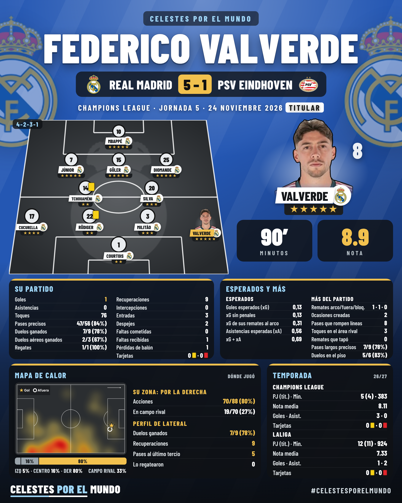
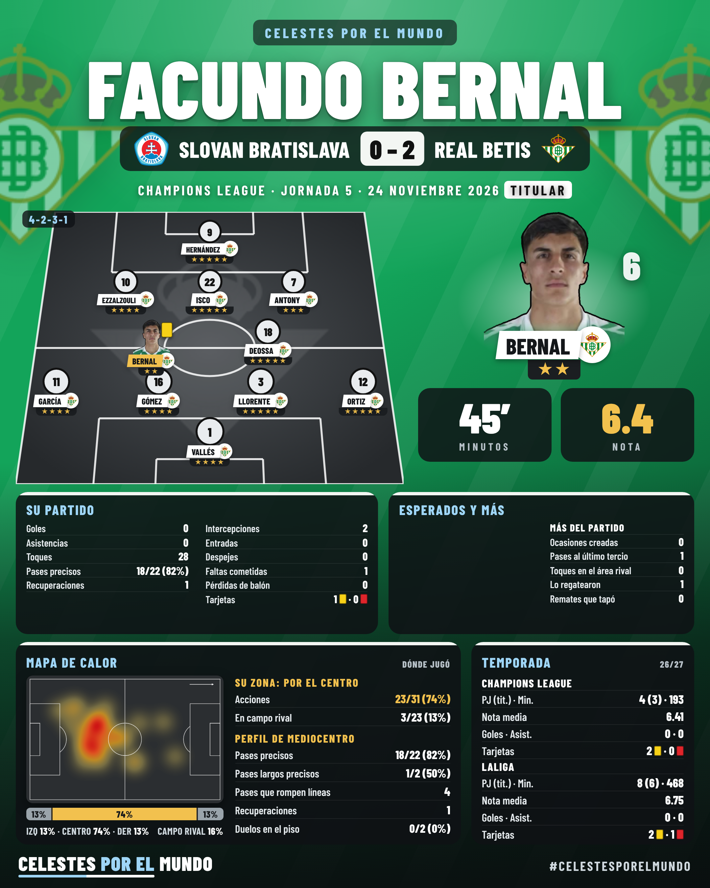
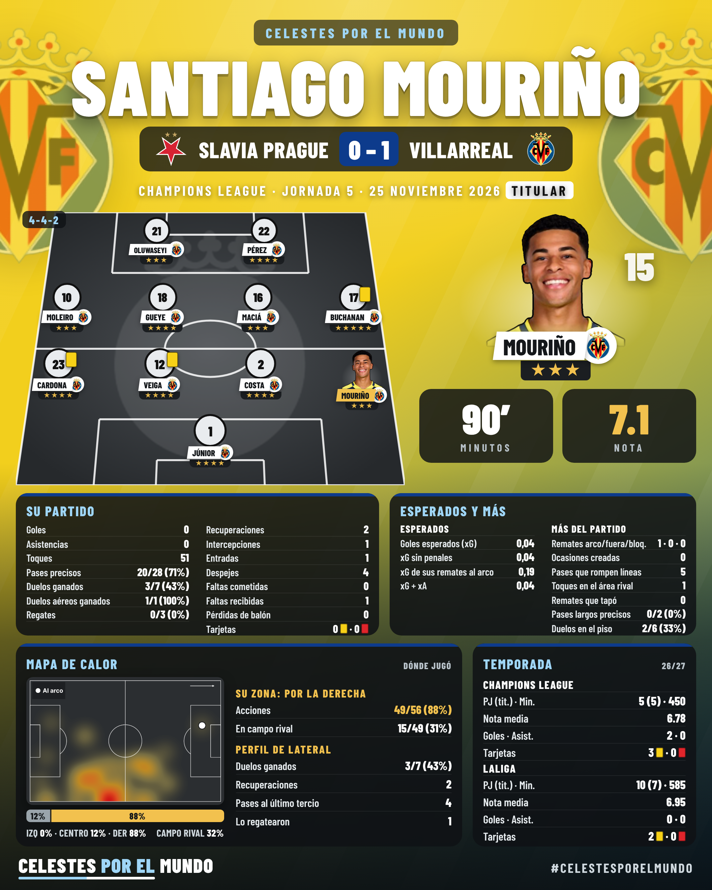
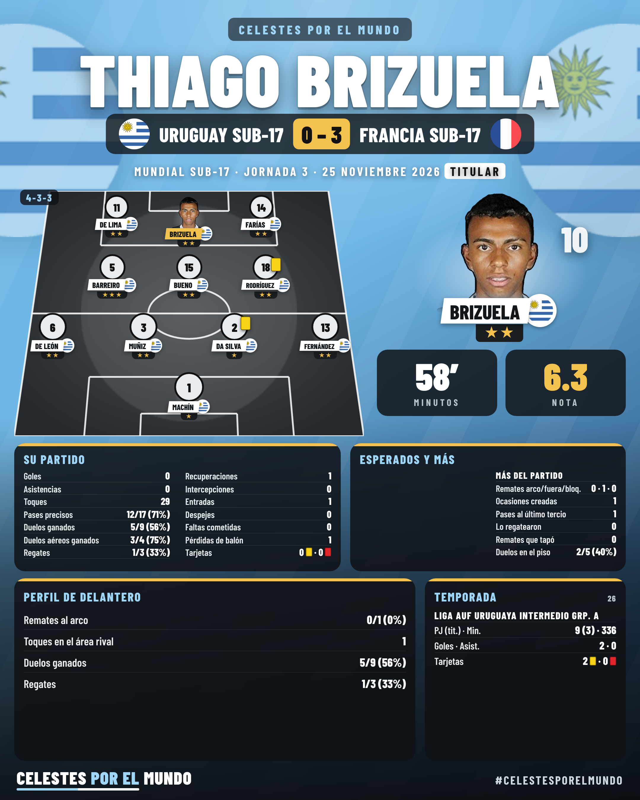
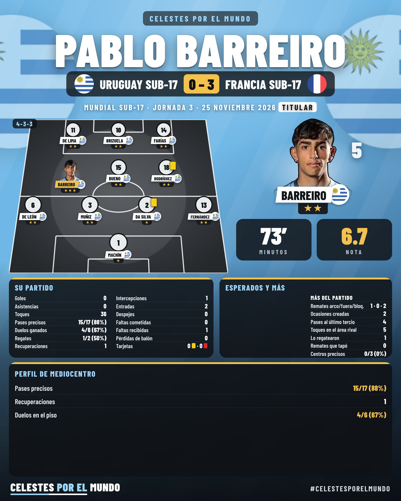
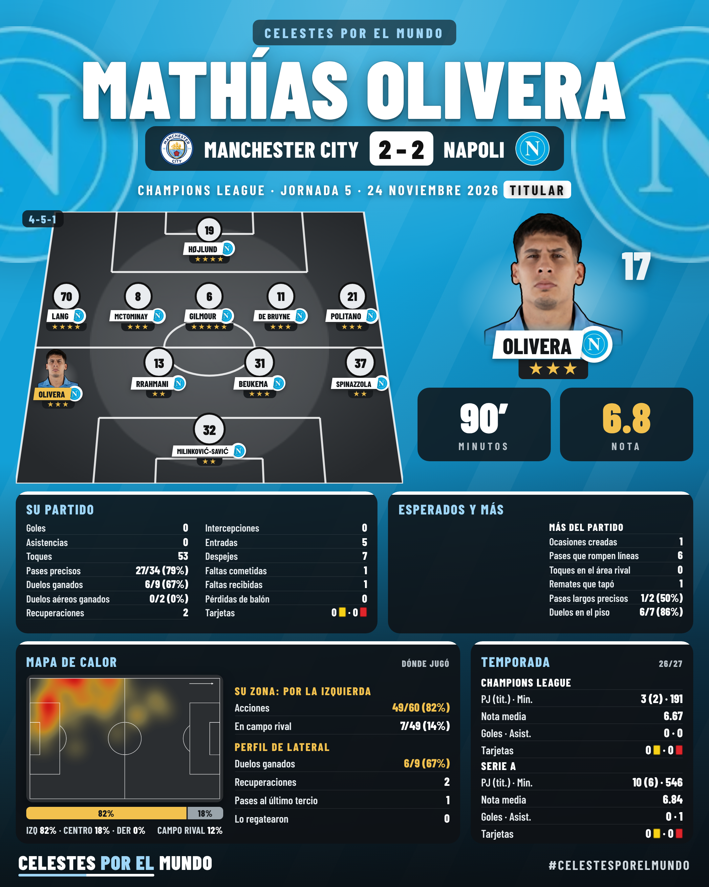
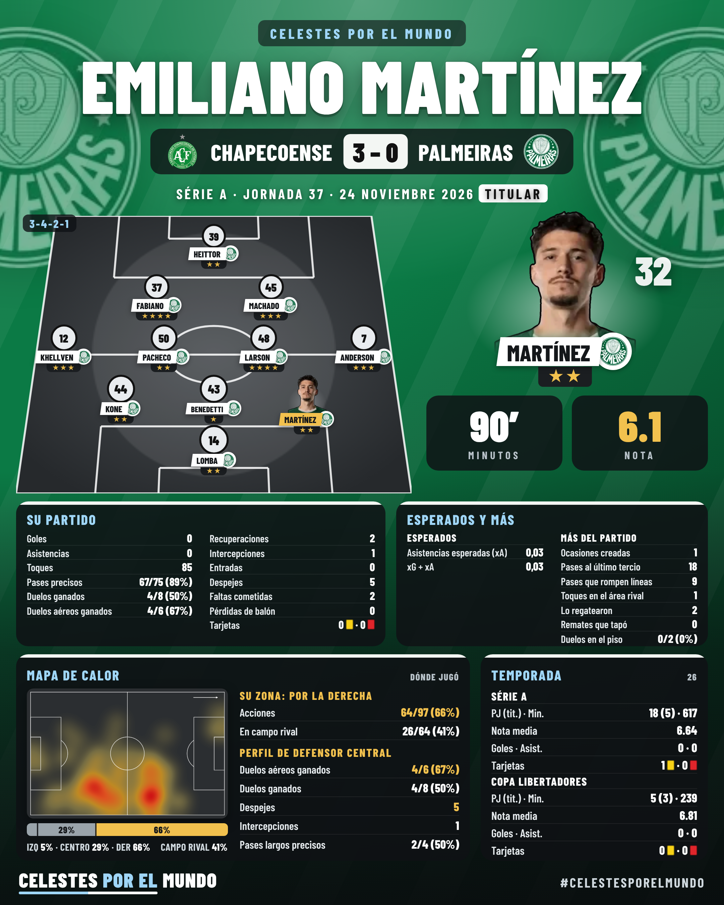

Valverde jugó 90' (titular, nota 8.9) en Real Madrid 5-1 PSV Eindhoven; Bernal jugó 45' (titular, nota 6.4) en Slovan Bratislava 0-2 Real Betis; Mouriño jugó 90' (titular, nota 7.1) en Slavia Prague 0-1 Villarreal; Brizuela jugó 58' (titular, nota 6.

@tuscxm

## Quién jugó
- **Valverde** jugó 90' (titular, nota 8.9, de lateral derecho) en Real Madrid 5-1 PSV Eindhoven · Champions League
- **Bernal** jugó 45' (titular, nota 6.4, de mediocentro) en Slovan Bratislava 0-2 Real Betis · Champions League
- **Mouriño** jugó 90' (titular, nota 7.1, de lateral derecho) en Slavia Prague 0-1 Villarreal · Champions League
- **Brizuela** jugó 58' (titular, nota 6.3, de delantero) en Uruguay Sub-17 0-3 Francia Sub-17 · Mundial Sub-17
- **Barreiro** jugó 73' (titular, nota 6.7, de mediocentro) en Uruguay Sub-17 0-3 Francia Sub-17 · Mundial Sub-17
- **Olivera** jugó 90' (titular, nota 6.8, de lateral izquierdo) en Manchester City 2-2 Napoli · Champions League
- **E. Martínez** jugó 90' (titular, nota 6.1, de defensor central) en Chapecoense 3-0 Palmeiras · Série A

## El resto
- M. Araújo: sin partido hoy ni ayer
- Á. Rodríguez: sin partido hoy ni ayer
- González: sin partido hoy ni ayer
- Cáceres: sin partido hoy ni ayer
- Petit: sin partido hoy ni ayer
- Bentancur: sin partido hoy ni ayer
- Satriano: sin partido hoy ni ayer
- Boselli: sin partido hoy ni ayer
- J. Rodríguez: sin partido hoy ni ayer
- Zalazar: sin partido hoy ni ayer
- Merentiel: sin partido hoy ni ayer
- Giménez: sin partido hoy ni ayer
- Amaro: sin partido hoy ni ayer
- R. Araújo: sin partido hoy ni ayer
- J. M. Sanabria: sin partido hoy ni ayer
- Ugarte: sin partido hoy ni ayer
- Canobbio: sin partido hoy ni ayer
- Darwin: sin partido hoy ni ayer
- F. Díaz: sin partido hoy ni ayer
- Torreira: ya procesado · Galatasaray 1-0 Aston Villa
- Piquerez: sin partido hoy ni ayer
- Matturro: sin partido hoy ni ayer
- Varela: sin partido hoy ni ayer
- Nández: sin partido hoy ni ayer
- Bueno: sin partido hoy ni ayer
- Pereira: sin partido hoy ni ayer
- Marichal: sin partido hoy ni ayer
- Barboza: sin partido hoy ni ayer
- Olaza: sin partido hoy ni ayer
- Fonseca: sin partido hoy ni ayer
- De la Cruz: sin partido hoy ni ayer
- Arrascaeta: sin partido hoy ni ayer
- Pellistri: sin partido hoy ni ayer
- Rossi: sin partido hoy ni ayer
- B. Rodríguez: sin partido hoy ni ayer
- Damiani: sin partido hoy ni ayer
- Aguirre: sin partido hoy ni ayer
- Viñas: sin partido hoy ni ayer

## Avisos
- Valverde: SofaScore no respondió; fuentes: fotmob ok, besoccer ok, api_football sin datos: el plan gratis de API-Football no cubre esta temporada (plan: Free plans do not have access to this season, try from 2022 to 2024.), thesportsdb ok, understat sin datos: formato de página no reconocido, zerozero error HTTP 403
- Valverde: Armada con datos de respaldo (FotMob): hay menos estadísticas que de costumbre, revisala antes de publicar
- Bernal: SofaScore no respondió; fuentes: fotmob ok, besoccer ok, api_football sin datos: el plan gratis de API-Football no cubre esta temporada (plan: Free plans do not have access to this season, try from 2022 to 2024.), thesportsdb ok, understat sin datos: formato de página no reconocido, zerozero error HTTP 403
- Bernal: Armada con datos de respaldo (FotMob): hay menos estadísticas que de costumbre, revisala antes de publicar
- Mouriño: SofaScore no respondió; fuentes: fotmob ok, besoccer ok, api_football sin datos: el plan gratis de API-Football no cubre esta temporada (plan: Free plans do not have access to this season, try from 2022 to 2024.), thesportsdb ok, understat sin datos: formato de página no reconocido, zerozero error HTTP 403
- Mouriño: Armada con datos de respaldo (FotMob): hay menos estadísticas que de costumbre, revisala antes de publicar
- Brizuela: SofaScore no respondió; fuentes: fotmob ok, besoccer ok, api_football sin datos: el plan gratis de API-Football no cubre esta temporada (plan: Free plans do not have access to this season, try from 2022 to 2024.), thesportsdb sin datos: no se encontró el equipo, understat sin datos: sin understat_equipo (Understat no cubre esa liga), zerozero error HTTP 403
- Brizuela: No hay mapa de calor de este partido en el respaldo: se muestra el perfil
- Brizuela: Armada con datos de respaldo (FotMob): hay menos estadísticas que de costumbre, revisala antes de publicar
- Barreiro: SofaScore no respondió; fuentes: fotmob ok, besoccer ok, api_football sin datos: el plan gratis de API-Football no cubre esta temporada (plan: Free plans do not have access to this season, try from 2022 to 2024.), thesportsdb sin datos: no se encontró el equipo, understat sin datos: sin understat_equipo (Understat no cubre esa liga), zerozero error HTTP 403
- Barreiro: No hay mapa de calor de este partido en el respaldo: se muestra el perfil
- Barreiro: Armada con datos de respaldo (FotMob): hay menos estadísticas que de costumbre, revisala antes de publicar
- Olivera: SofaScore no respondió; fuentes: fotmob ok, besoccer ok, api_football sin datos: el plan gratis de API-Football no cubre esta temporada (plan: Free plans do not have access to this season, try from 2022 to 2024.), thesportsdb error HTTP 429, understat sin datos: formato de página no reconocido, zerozero error HTTP 403
- Olivera: Armada con datos de respaldo (FotMob): hay menos estadísticas que de costumbre, revisala antes de publicar
- E. Martínez: SofaScore no respondió; fuentes: fotmob ok, besoccer ok, api_football sin datos: el plan gratis de API-Football no cubre esta temporada (plan: Free plans do not have access to this season, try from 2022 to 2024.), thesportsdb ok, understat sin datos: sin understat_equipo (Understat no cubre esa liga), zerozero error HTTP 403
- E. Martínez: Armada con datos de respaldo (FotMob): hay menos estadísticas que de costumbre, revisala antes de publicar

## Valverde · Real Madrid 5-1 PSV Eindhoven

[Abrir la imagen en tamaño completo](https://github.com/tuscxm/celestes-por-el-mundo/blob/main/salida/png/F.%20Valverde/2026-11-24%20%C2%B7%20PSV%20Eindhoven%20%C2%B7%20Champions%20League/Valverde_RealMadrid-PSVEindhoven_2026-11-24.png)

Texto para el posteo:
```
🇺🇾 FEDERICO VALVERDE · Real Madrid 5-1 PSV Eindhoven
⏱ 90' · ⭐ 8.9

Jugó de lateral derecho: 1 gol, 47/56 pases (84%), 7/9 duelos ganados y 9 recuperaciones.

🧩 ¿Y en una Uruguay 3-5-2 con enganche?
Sería carrilero por derecha: 80% de sus acciones por la derecha, 5 pases al último tercio y 1/1 regates. En el 3-5-2 toda la banda es suya, y con tres centrales atrás puede pasar sin dejar la espalda sola.

Tres atrás, dos carrileros, dos internos, un 10 suelto y dos puntas. ¿Lo jugarías así? 👇
#CelestesPorElMundo #Uruguay #RealMadrid #352
```

## Bernal · Slovan Bratislava 0-2 Real Betis

[Abrir la imagen en tamaño completo](https://github.com/tuscxm/celestes-por-el-mundo/blob/main/salida/png/F.%20Bernal/2026-11-24%20%C2%B7%20Slovan%20Bratislava%20%C2%B7%20Champions%20League/Bernal_SlovanBratislava-RealBetis_2026-11-24.png)

Texto para el posteo:
```
🇺🇾 FACUNDO BERNAL · Slovan Bratislava 0-2 Real Betis
⏱ 45' · ⭐ 6.4

Jugó de mediocentro: 74% de sus acciones por el centro, 18/22 pases (82%), 1 recuperación y 1 pase al último tercio.

🧩 ¿Y en una Uruguay 3-5-2 con enganche?
Sería uno de los dos internos: 18/22 pases (82%), 4 pases que rompieron líneas y 1 recuperación. Es el que sostiene y hace circular para que el enganche reciba de frente.

Tres atrás, dos carrileros, dos internos, un 10 suelto y dos puntas. ¿Lo jugarías así? 👇
#CelestesPorElMundo #Uruguay #RealBetis #352
```

## Mouriño · Slavia Prague 0-1 Villarreal

[Abrir la imagen en tamaño completo](https://github.com/tuscxm/celestes-por-el-mundo/blob/main/salida/png/S.%20Mouri%C3%B1o/2026-11-25%20%C2%B7%20Slavia%20Prague%20%C2%B7%20Champions%20League/Mourino_SlaviaPrague-Villarreal_2026-11-25.png)

Texto para el posteo:
```
🇺🇾 SANTIAGO MOURIÑO · Slavia Prague 0-1 Villarreal
⏱ 90' · ⭐ 7.1

Jugó de lateral derecho: 88% de sus acciones por la derecha, 20/28 pases (71%), 2 recuperaciones y 4 pases al último tercio.

🧩 ¿Y en una Uruguay 3-5-2 con enganche?
Lo vemos de zaguero por derecha en la línea de tres: 20/28 pases (71%), 1/1 por arriba y 1 intercepción. Con tres atrás, un central que sale limpio le suma un pase para encontrar al enganche y deja a los carrileros libres para pasar.

Tres atrás, dos carrileros, dos internos, un 10 suelto y dos puntas. ¿Lo jugarías así? 👇
#CelestesPorElMundo #Uruguay #Villarreal #352
```

## Brizuela · Uruguay Sub-17 0-3 Francia Sub-17

[Abrir la imagen en tamaño completo](https://github.com/tuscxm/celestes-por-el-mundo/blob/main/salida/png/T.%20Brizuela/2026-11-25%20%C2%B7%20Francia%20Sub-17%20%C2%B7%20Mundial%20Sub-17/Brizuela_UruguaySub17-FranciaSub17_2026-11-25.png)

Texto para el posteo:
```
🇺🇾 THIAGO BRIZUELA · Uruguay Sub-17 0-3 Francia Sub-17
⏱ 58' · ⭐ 6.3

Jugó de delantero: 12/17 pases (71%), 5/9 duelos ganados, 1 recuperación y 1 pase al último tercio.

🧩 ¿Y en una Uruguay 3-5-2 con enganche?
Es el 10 que pide el sistema: 1 ocasión creada, 1 pase al último tercio y 1/3 regates. Suelto detrás de dos puntas, con dos internos que lo cubren, Uruguay junta a los que definen.

Tres atrás, dos carrileros, dos internos, un 10 suelto y dos puntas. ¿Lo jugarías así? 👇
#CelestesPorElMundo #Uruguay #352
```

## Barreiro · Uruguay Sub-17 0-3 Francia Sub-17

[Abrir la imagen en tamaño completo](https://github.com/tuscxm/celestes-por-el-mundo/blob/main/salida/png/P.%20Barreiro/2026-11-25%20%C2%B7%20Francia%20Sub-17%20%C2%B7%20Mundial%20Sub-17/Barreiro_UruguaySub17-FranciaSub17_2026-11-25.png)

Texto para el posteo:
```
🇺🇾 PABLO BARREIRO · Uruguay Sub-17 0-3 Francia Sub-17
⏱ 73' · ⭐ 6.7

Jugó de mediocentro: 15/17 pases (88%), 4/6 duelos ganados, 1 recuperación y 4 pases al último tercio.

🧩 ¿Y en una Uruguay 3-5-2 con enganche?
Sería uno de los dos internos: 15/17 pases (88%), 1 recuperación y 4/6 duelos ganados. Es el que sostiene y hace circular para que el enganche reciba de frente.

Tres atrás, dos carrileros, dos internos, un 10 suelto y dos puntas. ¿Lo jugarías así? 👇
#CelestesPorElMundo #Uruguay #352
```

## Olivera · Manchester City 2-2 Napoli

[Abrir la imagen en tamaño completo](https://github.com/tuscxm/celestes-por-el-mundo/blob/main/salida/png/M.%20Olivera/2026-11-24%20%C2%B7%20Manchester%20City%20%C2%B7%20Champions%20League/Olivera_ManchesterCity-Napoli_2026-11-24.png)

Texto para el posteo:
```
🇺🇾 MATHÍAS OLIVERA · Manchester City 2-2 Napoli
⏱ 90' · ⭐ 6.8

Jugó de lateral izquierdo: 82% de sus acciones por la izquierda, 27/34 pases (79%), 6/9 duelos ganados y 2 recuperaciones.

🧩 ¿Y en una Uruguay 3-5-2 con enganche?
Lo vemos de zaguero por izquierda en la línea de tres: 27/34 pases (79%), 6/9 duelos ganados y 2 recuperaciones. Con tres atrás, un central que sale limpio le suma un pase para encontrar al enganche y deja a los carrileros libres para pasar.

Tres atrás, dos carrileros, dos internos, un 10 suelto y dos puntas. ¿Lo jugarías así? 👇
#CelestesPorElMundo #Uruguay #Napoli #352
```

## E. Martínez · Chapecoense 3-0 Palmeiras

[Abrir la imagen en tamaño completo](https://github.com/tuscxm/celestes-por-el-mundo/blob/main/salida/png/E.%20Mart%C3%ADnez/2026-11-24%20%C2%B7%20Chapecoense%20%C2%B7%20S%C3%A9rie%20A/Martinez_Chapecoense-Palmeiras_2026-11-24.png)

Texto para el posteo:
```
🇺🇾 EMILIANO MARTÍNEZ · Chapecoense 3-0 Palmeiras
⏱ 90' · ⭐ 6.1

Jugó de defensor central: 66% de sus acciones por la derecha, 67/75 pases (89%), 4/8 duelos ganados y 2 recuperaciones.

🧩 ¿Y en una Uruguay 3-5-2 con enganche?
Sería uno de los dos internos: 67/75 pases (89%), 9 pases que rompieron líneas y 2 recuperaciones. Es el que sostiene y hace circular para que el enganche reciba de frente.

Tres atrás, dos carrileros, dos internos, un 10 suelto y dos puntas. ¿Lo jugarías así? 👇
#CelestesPorElMundo #Uruguay #Palmeiras #352
```

---
En X se publican solas en unos minutos (menos las que la revisión ponga en *No publicar en X*); en Instagram no se publicó nada. Cerrá este aviso cuando la publiques o la descartes.
## Revisión visual
- Las 7 salieron con la parte de abajo por puesto (ninguna con el diseño anterior). Caras con contorno negro y bien recortadas, escudos bien ubicados (local a la izquierda), jugador resaltado en la cancha, colores del club correctos (celestes en las de Uruguay Sub-17). No hay textos cortados ni nombres de fuentes. Los números coinciden con el texto del posteo. No hubo tanda de penales.
- Bernal, Olivera, Brizuela y Barreiro: la columna ESPERADOS queda vacía porque el respaldo no trajo xG/xA del jugador, y queda un hueco a la izquierda de "MÁS DEL PARTIDO" (es estético, no hay error).
- Brizuela y Barreiro (Mundial Sub-17): no hay mapa de calor de este partido en el respaldo, así que en su lugar va un PERFIL grande. A Barreiro no le salió TEMPORADA y el recuadro del perfil queda con mucho espacio vacío.
- E. Martínez jugó de defensor central (línea de 3) y en el texto del 3-5-2 aparece como interno: es lo que dice su `rol_352`, no un error.
- Fuentes: SofaScore no respondió en ningún partido (todo se armó con el respaldo de FotMob). API-Football: el plan gratis no cubre la temporada. zerozero: HTTP 403. Understat: formato de página no reconocido. TheSportsDB: HTTP 429 en el partido de Olivera. BeSoccer: las páginas de partidos devolvieron HTTP 406, así que besoccer_hoy.json quedó vacío (aunque el resumen marque "besoccer ok", no aportó datos).
