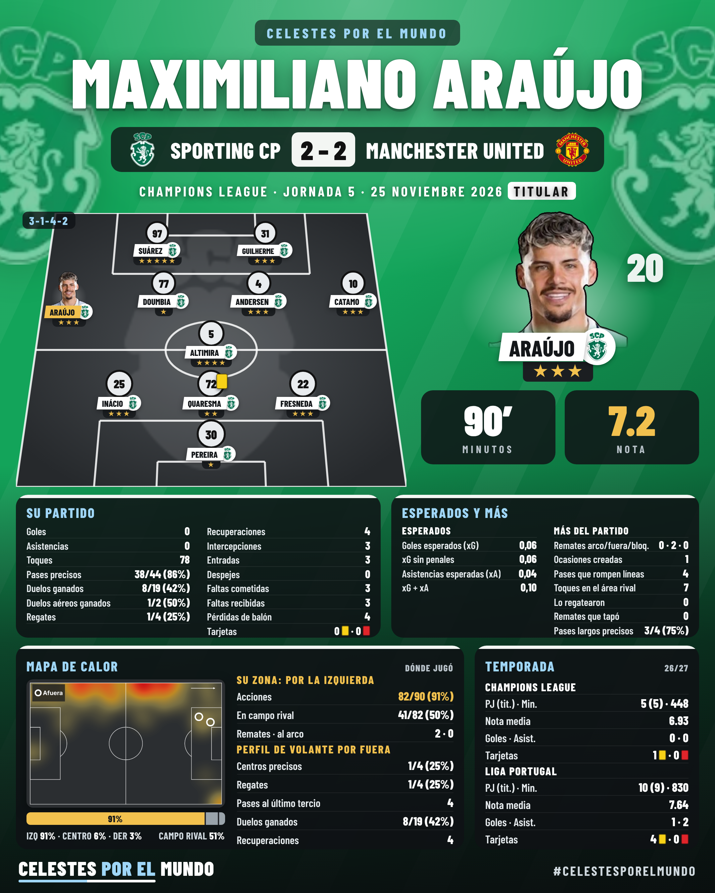
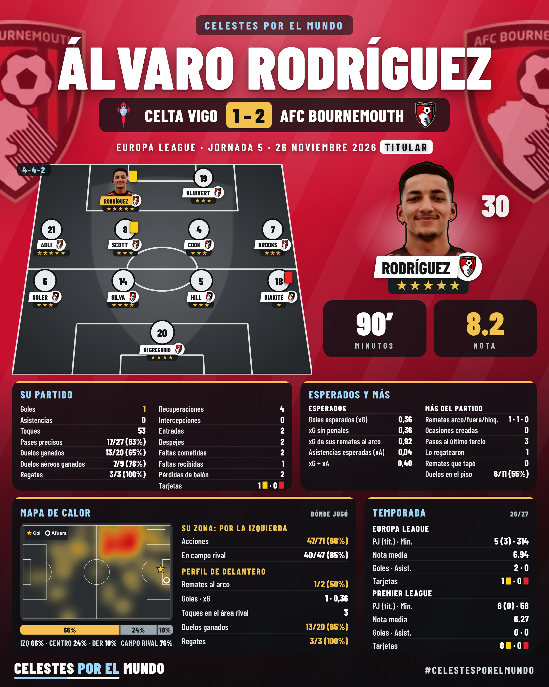
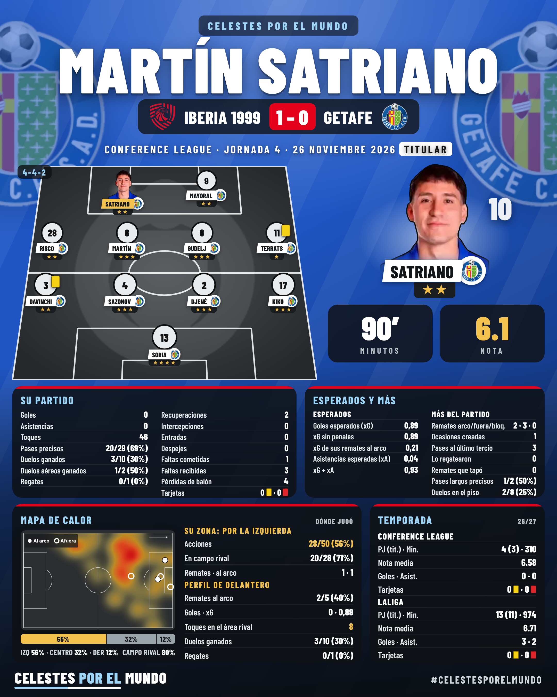
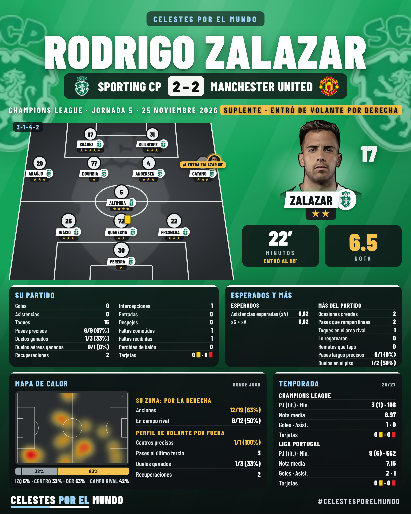
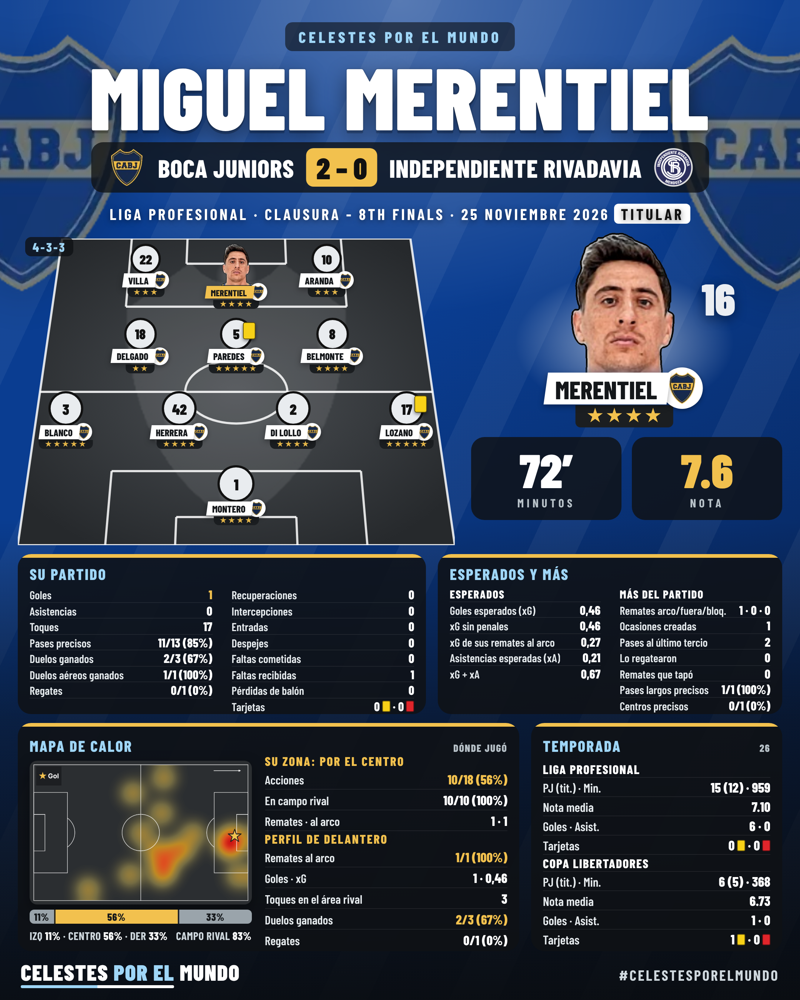
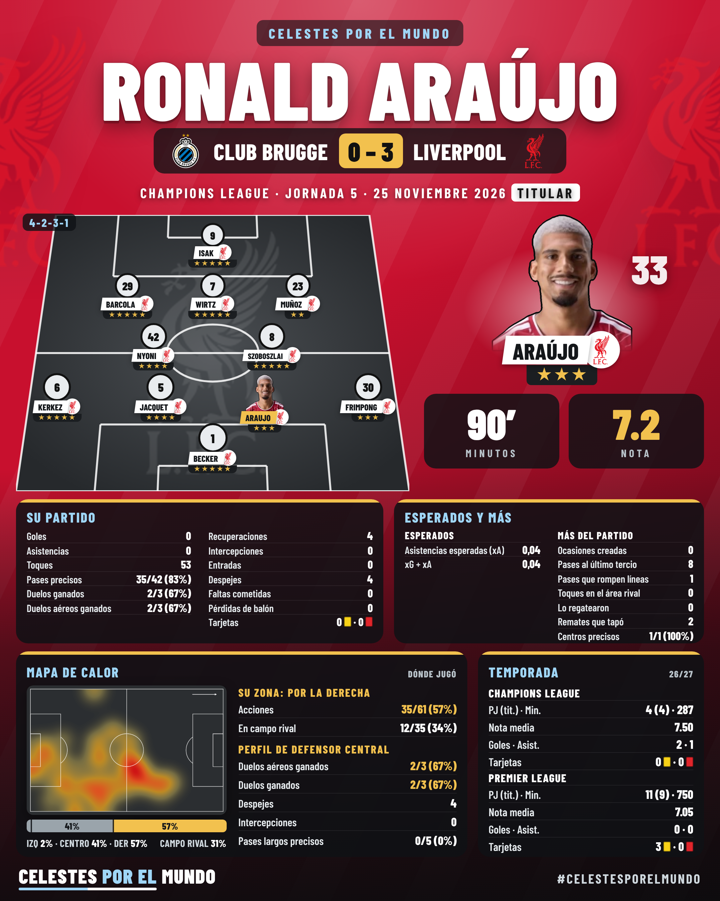
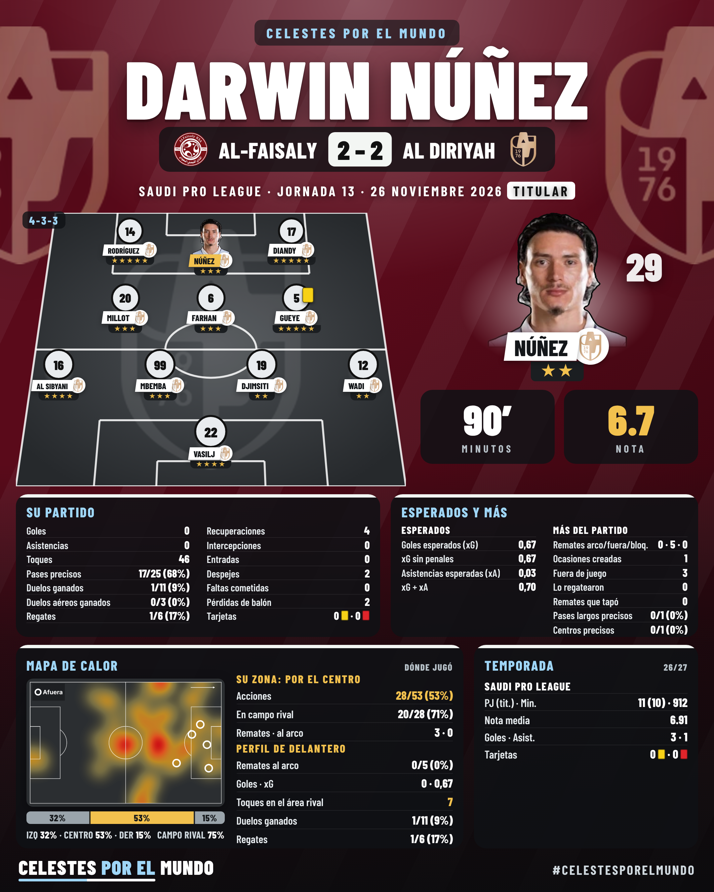
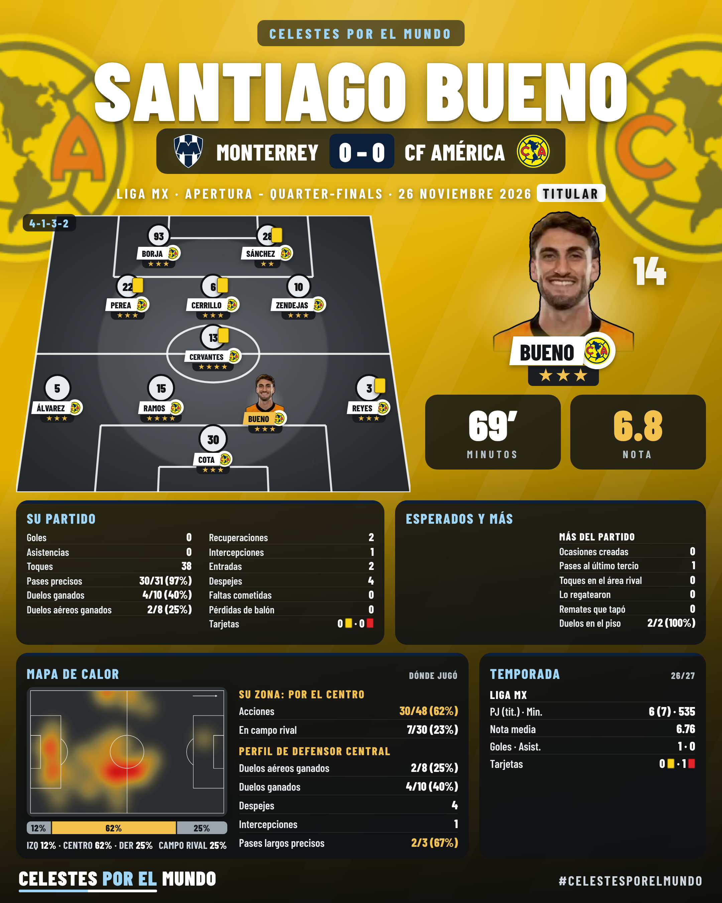
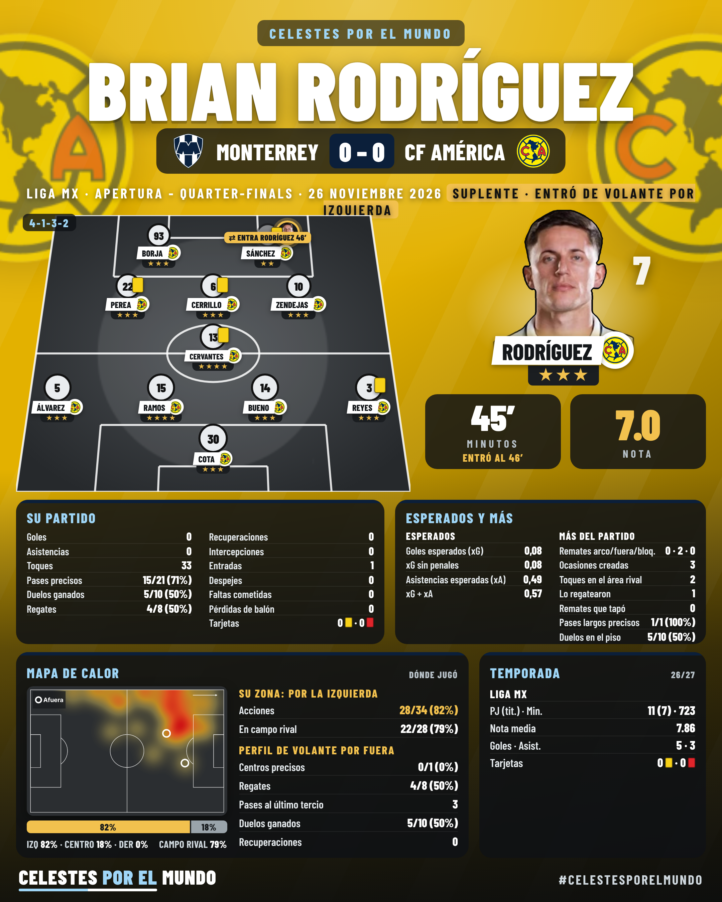
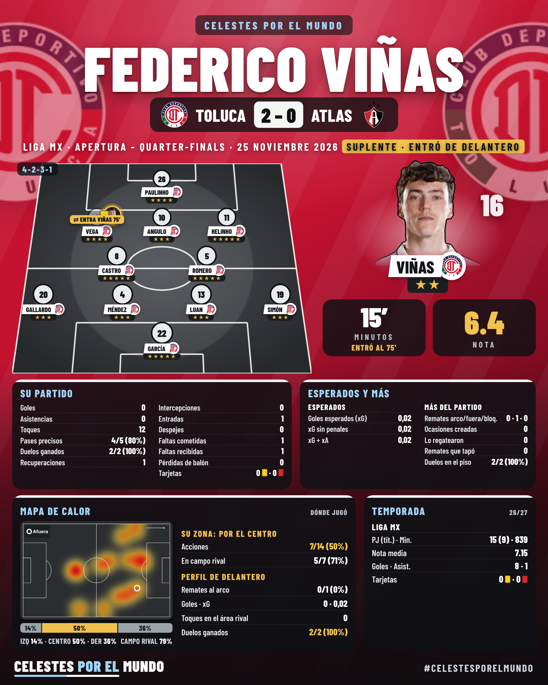

M. Araújo jugó 90' (titular, nota 7.2) en Sporting CP 2-2 Manchester United; Á. Rodríguez jugó 90' (titular, nota 8.2) en Celta Vigo 1-2 AFC Bournemouth; Satriano jugó 90' (titular, nota 6.1) en Iberia 1999 1-0 Getafe; Zalazar jugó 22' (suplente, not

@tuscxm

## Quién jugó
- **M. Araújo** jugó 90' (titular, nota 7.2, de volante por izquierda) en Sporting CP 2-2 Manchester United · Champions League
- **Á. Rodríguez** jugó 90' (titular, nota 8.2, de delantero) en Celta Vigo 1-2 AFC Bournemouth · Europa League
- **Satriano** jugó 90' (titular, nota 6.1, de delantero) en Iberia 1999 1-0 Getafe · Conference League
- **Zalazar** jugó 22' (suplente, entró al 68' por Catamo, nota 6.5, de volante por derecha) en Sporting CP 2-2 Manchester United · Champions League
- **Merentiel** jugó 72' (titular, nota 7.6, de delantero) en Boca Juniors 2-0 Independiente Rivadavia · Liga Profesional
- **R. Araújo** jugó 90' (titular, nota 7.2, de defensor central) en Club Brugge 0-3 Liverpool · Champions League
- **Darwin** jugó 90' (titular, nota 6.7, de delantero) en Al-Faisaly 2-2 Al Diriyah · Saudi Pro League
- **Bueno** jugó 69' (titular, nota 6.8, de defensor central) en Monterrey 0-0 CF América · Liga MX
- **B. Rodríguez** jugó 45' (suplente, entró al 46' por Sánchez, nota 7.0, de volante por izquierda) en Monterrey 0-0 CF América · Liga MX
- **Viñas** jugó 15' (suplente, entró al 75' por Vega, nota 6.4, de delantero) en Toluca 2-0 Atlas · Liga MX

## El resto
- Valverde: sin partido hoy ni ayer
- Bernal: sin partido hoy ni ayer
- Mouriño: ya procesado · Slavia Prague 0-1 Villarreal
- González: sin partido hoy ni ayer
- Cáceres: no jugó en Celta Vigo 1-2 AFC Bournemouth (no entró)
- Petit: sin partido hoy ni ayer
- Bentancur: sin partido hoy ni ayer
- Boselli: sin partido hoy ni ayer
- J. Rodríguez: sin partido hoy ni ayer
- Giménez: sin partido hoy ni ayer
- Amaro: sin partido hoy ni ayer
- J. M. Sanabria: sin partido hoy ni ayer
- Ugarte: sin partido hoy ni ayer
- Canobbio: sin partido hoy ni ayer
- F. Díaz: sin partido hoy ni ayer
- Torreira: sin partido hoy ni ayer
- Brizuela: ya procesado · Uruguay U17 0-3 France U17
- Barreiro: ya procesado · Uruguay U17 0-3 France U17
- Piquerez: sin partido hoy ni ayer
- Matturro: sin partido hoy ni ayer
- Olivera: sin partido hoy ni ayer
- Varela: sin partido hoy ni ayer
- Nández: sin partido hoy ni ayer
- Pereira: sin partido hoy ni ayer
- Marichal: sin partido hoy ni ayer
- Barboza: sin partido hoy ni ayer
- Olaza: sin partido hoy ni ayer
- Fonseca: sin partido hoy ni ayer
- E. Martínez: sin partido hoy ni ayer
- De la Cruz: sin partido hoy ni ayer
- Arrascaeta: sin partido hoy ni ayer
- Pellistri: sin partido hoy ni ayer
- Rossi: sin partido hoy ni ayer
- Damiani: sin partido hoy ni ayer
- Aguirre: sin partido hoy ni ayer

## Avisos
- M. Araújo: SofaScore no respondió; fuentes: fotmob ok, besoccer ok, api_football sin datos: el plan gratis de API-Football no cubre esta temporada (plan: Free plans do not have access to this season, try from 2022 to 2024.), thesportsdb ok, understat sin datos: sin understat_equipo (Understat no cubre esa liga), zerozero error HTTP 403
- M. Araújo: Armada con datos de respaldo (FotMob): hay menos estadísticas que de costumbre, revisala antes de publicar
- Á. Rodríguez: SofaScore no respondió; fuentes: fotmob ok, besoccer ok, api_football sin datos: el plan gratis de API-Football no cubre esta temporada (plan: Free plans do not have access to this season, try from 2022 to 2024.), thesportsdb ok, understat sin datos: formato de página no reconocido, zerozero error HTTP 403
- Á. Rodríguez: Armada con datos de respaldo (FotMob): hay menos estadísticas que de costumbre, revisala antes de publicar
- Satriano: SofaScore no respondió; fuentes: fotmob ok, besoccer ok, api_football sin datos: el plan gratis de API-Football no cubre esta temporada (plan: Free plans do not have access to this season, try from 2022 to 2024.), thesportsdb ok, understat sin datos: formato de página no reconocido, zerozero error HTTP 403
- Satriano: Armada con datos de respaldo (FotMob): hay menos estadísticas que de costumbre, revisala antes de publicar
- Zalazar: SofaScore no respondió; fuentes: fotmob ok, besoccer ok, api_football sin datos: el plan gratis de API-Football no cubre esta temporada (plan: Free plans do not have access to this season, try from 2022 to 2024.), thesportsdb ok, understat sin datos: sin understat_equipo (Understat no cubre esa liga), zerozero error HTTP 403
- Zalazar: Entró de suplente: el puesto (volante por derecha) es su puesto habitual, no se sabe dónde entró
- Zalazar: Armada con datos de respaldo (FotMob): hay menos estadísticas que de costumbre, revisala antes de publicar
- Merentiel: SofaScore no respondió; fuentes: fotmob ok, besoccer ok, api_football sin datos: el plan gratis de API-Football no cubre esta temporada (plan: Free plans do not have access to this season, try from 2022 to 2024.), thesportsdb ok, understat sin datos: sin understat_equipo (Understat no cubre esa liga), zerozero error HTTP 403
- Merentiel: Armada con datos de respaldo (FotMob): hay menos estadísticas que de costumbre, revisala antes de publicar
- R. Araújo: SofaScore no respondió; fuentes: fotmob ok, besoccer ok, api_football sin datos: el plan gratis de API-Football no cubre esta temporada (plan: Free plans do not have access to this season, try from 2022 to 2024.), thesportsdb ok, understat sin datos: formato de página no reconocido, zerozero error HTTP 403
- R. Araújo: Armada con datos de respaldo (FotMob): hay menos estadísticas que de costumbre, revisala antes de publicar
- Darwin: SofaScore no respondió; fuentes: fotmob ok, besoccer ok, api_football sin datos: el plan gratis de API-Football no cubre esta temporada (plan: Free plans do not have access to this season, try from 2022 to 2024.), thesportsdb ok, understat sin datos: sin understat_equipo (Understat no cubre esa liga), zerozero error HTTP 403
- Darwin: Armada con datos de respaldo (FotMob): hay menos estadísticas que de costumbre, revisala antes de publicar
- Bueno: SofaScore no respondió; fuentes: fotmob ok, besoccer ok, api_football sin datos: el plan gratis de API-Football no cubre esta temporada (plan: Free plans do not have access to this season, try from 2022 to 2024.), thesportsdb ok, understat sin datos: sin understat_equipo (Understat no cubre esa liga), zerozero error HTTP 403
- Bueno: Armada con datos de respaldo (FotMob): hay menos estadísticas que de costumbre, revisala antes de publicar
- B. Rodríguez: SofaScore no respondió; fuentes: fotmob ok, besoccer ok, api_football sin datos: el plan gratis de API-Football no cubre esta temporada (plan: Free plans do not have access to this season, try from 2022 to 2024.), thesportsdb error HTTP 429, understat sin datos: sin understat_equipo (Understat no cubre esa liga), zerozero error HTTP 403
- B. Rodríguez: Entró de suplente: el puesto (volante por izquierda) es su puesto habitual, no se sabe dónde entró
- B. Rodríguez: Armada con datos de respaldo (FotMob): hay menos estadísticas que de costumbre, revisala antes de publicar
- Viñas: SofaScore no respondió; fuentes: fotmob ok, besoccer ok, api_football sin datos: el plan gratis de API-Football no cubre esta temporada (plan: Free plans do not have access to this season, try from 2022 to 2024.), thesportsdb ok, understat sin datos: sin understat_equipo (Understat no cubre esa liga), zerozero error HTTP 403
- Viñas: Entró de suplente: el puesto (delantero) es su puesto habitual, no se sabe dónde entró
- Viñas: Armada con datos de respaldo (FotMob): hay menos estadísticas que de costumbre, revisala antes de publicar

## M. Araújo · Sporting CP 2-2 Manchester United

[Abrir la imagen en tamaño completo](https://github.com/tuscxm/celestes-por-el-mundo/blob/main/salida/png/M.%20Ara%C3%BAjo/2026-11-25%20%C2%B7%20Manchester%20United%20%C2%B7%20Champions%20League/Araujo_SportingCP-ManchesterUnited_2026-11-25.png)

Texto para el posteo:
```
🇺🇾 MAXIMILIANO ARAÚJO · Sporting CP 2-2 Manchester United
⏱ 90' · ⭐ 7.2

Jugó de volante por izquierda: 38/44 pases (86%), 4 recuperaciones, 4 pases al último tercio y 1 ocasión creada.

🧩 ¿Y en una Uruguay 3-5-2 con enganche?
Sería carrilero por izquierda: 91% de sus acciones por la izquierda, 51% en campo rival y 4 pases al último tercio. En el 3-5-2 toda la banda es suya, y con tres centrales atrás puede pasar sin dejar la espalda sola.

Tres atrás, dos carrileros, dos internos, un 10 suelto y dos puntas. ¿Lo jugarías así? 👇
#CelestesPorElMundo #Uruguay #SportingCP #352
```

## Á. Rodríguez · Celta Vigo 1-2 AFC Bournemouth

[Abrir la imagen en tamaño completo](https://github.com/tuscxm/celestes-por-el-mundo/blob/main/salida/png/%C3%81.%20Rodr%C3%ADguez/2026-11-26%20%C2%B7%20Celta%20Vigo%20%C2%B7%20Europa%20League/Rodriguez_CeltaVigo-AFCBournemouth_2026-11-26.png)

Texto para el posteo:
```
🇺🇾 ÁLVARO RODRÍGUEZ · Celta Vigo 1-2 AFC Bournemouth
⏱ 90' · ⭐ 8.2

Jugó de delantero: 66% de sus acciones por la izquierda, 1 gol, 17/27 pases (63%) y 13/20 duelos ganados.

🧩 ¿Y en una Uruguay 3-5-2 con enganche?
Sería uno de los dos de punta: 1 gol, 1 de 2 remates al arco y 3 toques en el área rival. Con un enganche que lo habilite y otro 9 al lado, deja de pelear solo contra los centrales.

Tres atrás, dos carrileros, dos internos, un 10 suelto y dos puntas. ¿Lo jugarías así? 👇
#CelestesPorElMundo #Uruguay #Bournemouth #352
```

## Satriano · Iberia 1999 1-0 Getafe

[Abrir la imagen en tamaño completo](https://github.com/tuscxm/celestes-por-el-mundo/blob/main/salida/png/M.%20Satriano/2026-11-26%20%C2%B7%20Iberia%201999%20%C2%B7%20Conference%20League/Satriano_Iberia1999-Getafe_2026-11-26.png)

Texto para el posteo:
```
🇺🇾 MARTÍN SATRIANO · Iberia 1999 1-0 Getafe
⏱ 90' · ⭐ 6.1

Jugó de delantero: 56% de sus acciones por la izquierda, 20/29 pases (69%), 2 recuperaciones y 3 pases al último tercio.

🧩 ¿Y en una Uruguay 3-5-2 con enganche?
Sería uno de los dos de punta: 2 de 5 remates al arco y 8 toques en el área rival. Con un enganche que lo habilite y otro 9 al lado, deja de pelear solo contra los centrales.

Tres atrás, dos carrileros, dos internos, un 10 suelto y dos puntas. ¿Lo jugarías así? 👇
#CelestesPorElMundo #Uruguay #Getafe #352
```

## Zalazar · Sporting CP 2-2 Manchester United

[Abrir la imagen en tamaño completo](https://github.com/tuscxm/celestes-por-el-mundo/blob/main/salida/png/R.%20Zalazar/2026-11-25%20%C2%B7%20Manchester%20United%20%C2%B7%20Champions%20League/Zalazar_SportingCP-ManchesterUnited_2026-11-25.png)

Texto para el posteo:
```
🇺🇾 RODRIGO ZALAZAR · Sporting CP 2-2 Manchester United
⏱ 22' · ⭐ 6.5
🔁 Entró al 68' por Catamo, como volante por derecha

Jugó de volante por derecha: 63% de sus acciones por la derecha, 2 recuperaciones, 3 pases al último tercio y 2 ocasiones creadas.

🧩 ¿Y en una Uruguay 3-5-2 con enganche?
Es el 10 que pide el sistema: 2 ocasiones creadas, 3 pases al último tercio y 2 pases que rompieron líneas. Suelto detrás de dos puntas, con dos internos que lo cubren, Uruguay junta a los que definen.

Tres atrás, dos carrileros, dos internos, un 10 suelto y dos puntas. ¿Lo jugarías así? 👇
#CelestesPorElMundo #Uruguay #SportingCP #352
```

## Merentiel · Boca Juniors 2-0 Independiente Rivadavia

[Abrir la imagen en tamaño completo](https://github.com/tuscxm/celestes-por-el-mundo/blob/main/salida/png/M.%20Merentiel/2026-11-25%20%C2%B7%20Independiente%20Rivadavia%20%C2%B7%20Liga%20Profesional/Merentiel_BocaJuniors-IndependienteRivadavia_2026-11-25.png)

Texto para el posteo:
```
🇺🇾 MIGUEL MERENTIEL · Boca Juniors 2-0 Independiente Rivadavia
⏱ 72' · ⭐ 7.6

Jugó de delantero: 56% de sus acciones por el centro, 1 gol, 11/13 pases (85%) y 2/3 duelos ganados.

🧩 ¿Y en una Uruguay 3-5-2 con enganche?
Sería uno de los dos de punta: 1 gol, 1 de 1 remates al arco y 3 toques en el área rival. Con un enganche que lo habilite y otro 9 al lado, deja de pelear solo contra los centrales.

Tres atrás, dos carrileros, dos internos, un 10 suelto y dos puntas. ¿Lo jugarías así? 👇
#CelestesPorElMundo #Uruguay #BocaJuniors #352
```

## R. Araújo · Club Brugge 0-3 Liverpool

[Abrir la imagen en tamaño completo](https://github.com/tuscxm/celestes-por-el-mundo/blob/main/salida/png/R.%20Ara%C3%BAjo/2026-11-25%20%C2%B7%20Club%20Brugge%20%C2%B7%20Champions%20League/Araujo_ClubBrugge-Liverpool_2026-11-25.png)

Texto para el posteo:
```
🇺🇾 RONALD ARAÚJO · Club Brugge 0-3 Liverpool
⏱ 90' · ⭐ 7.2

Jugó de defensor central: 57% de sus acciones por la derecha, 35/42 pases (83%), 2/3 duelos ganados y 4 recuperaciones.

🧩 ¿Y en una Uruguay 3-5-2 con enganche?
Lo vemos de zaguero por derecha en la línea de tres: 35/42 pases (83%), 2/3 duelos ganados y 2/3 por arriba. Con tres atrás, un central que sale limpio le suma un pase para encontrar al enganche y deja a los carrileros libres para pasar.

Tres atrás, dos carrileros, dos internos, un 10 suelto y dos puntas. ¿Lo jugarías así? 👇
#CelestesPorElMundo #Uruguay #Liverpool #352
```

## Darwin · Al-Faisaly 2-2 Al Diriyah

[Abrir la imagen en tamaño completo](https://github.com/tuscxm/celestes-por-el-mundo/blob/main/salida/png/D.%20N%C3%BA%C3%B1ez/2026-11-26%20%C2%B7%20Al-Faisaly%20%C2%B7%20Saudi%20Pro%20League/Nunez_Al-Faisaly-AlDiriyah_2026-11-26.png)

Texto para el posteo:
```
🇺🇾 DARWIN NÚÑEZ · Al-Faisaly 2-2 Al Diriyah
⏱ 90' · ⭐ 6.7

Jugó de delantero: 53% de sus acciones por el centro, 17/25 pases (68%), 4 recuperaciones y 1 ocasión creada.

🧩 ¿Y en una Uruguay 3-5-2 con enganche?
Sería uno de los dos de punta: 7 toques en el área rival y 1/6 regates. Con un enganche que lo habilite y otro 9 al lado, deja de pelear solo contra los centrales.

Tres atrás, dos carrileros, dos internos, un 10 suelto y dos puntas. ¿Lo jugarías así? 👇
#CelestesPorElMundo #Uruguay #Diriyah #352
```

## Bueno · Monterrey 0-0 CF América

[Abrir la imagen en tamaño completo](https://github.com/tuscxm/celestes-por-el-mundo/blob/main/salida/png/S.%20Bueno/2026-11-26%20%C2%B7%20Monterrey%20%C2%B7%20Liga%20Mx/Bueno_Monterrey-CFAmerica_2026-11-26.png)

Texto para el posteo:
```
🇺🇾 SANTIAGO BUENO · Monterrey 0-0 CF América
⏱ 69' · ⭐ 6.8

Jugó de defensor central: 62% de sus acciones por el centro, 30/31 pases (97%), 2 recuperaciones y 1 pase al último tercio.

🧩 ¿Y en una Uruguay 3-5-2 con enganche?
Lo vemos de zaguero en la línea de tres: 30/31 pases (97%), 2/3 pases largos y 1 intercepción. Con tres atrás, un central que sale limpio le suma un pase para encontrar al enganche y deja a los carrileros libres para pasar.

Tres atrás, dos carrileros, dos internos, un 10 suelto y dos puntas. ¿Lo jugarías así? 👇
#CelestesPorElMundo #Uruguay #ClubAmérica #352
```

## B. Rodríguez · Monterrey 0-0 CF América

[Abrir la imagen en tamaño completo](https://github.com/tuscxm/celestes-por-el-mundo/blob/main/salida/png/B.%20Rodr%C3%ADguez/2026-11-26%20%C2%B7%20Monterrey%20%C2%B7%20Liga%20Mx/Rodriguez_Monterrey-CFAmerica_2026-11-26.png)

Texto para el posteo:
```
🇺🇾 BRIAN RODRÍGUEZ · Monterrey 0-0 CF América
⏱ 45' · ⭐ 7.0
🔁 Entró al 46' por Sánchez, como volante por izquierda

Jugó de volante por izquierda: 15/21 pases (71%), 5/10 duelos ganados, 3 pases al último tercio y 3 ocasiones creadas.

🧩 ¿Y en una Uruguay 3-5-2 con enganche?
Sería carrilero por izquierda: 82% de sus acciones por la izquierda, 79% en campo rival y 3 pases al último tercio. En el 3-5-2 toda la banda es suya, y con tres centrales atrás puede pasar sin dejar la espalda sola.

Tres atrás, dos carrileros, dos internos, un 10 suelto y dos puntas. ¿Lo jugarías así? 👇
#CelestesPorElMundo #Uruguay #ClubAmérica #352
```

## Viñas · Toluca 2-0 Atlas

[Abrir la imagen en tamaño completo](https://github.com/tuscxm/celestes-por-el-mundo/blob/main/salida/png/F.%20Vi%C3%B1as/2026-11-25%20%C2%B7%20Atlas%20%C2%B7%20Liga%20Mx/Vinas_Toluca-Atlas_2026-11-25.png)

Texto para el posteo:
```
🇺🇾 FEDERICO VIÑAS · Toluca 2-0 Atlas
⏱ 15' · ⭐ 6.4
🔁 Entró al 75' por Vega, como delantero

Jugó de delantero: 50% de sus acciones por el centro, 2/2 duelos ganados y 1 recuperación.

🧩 ¿Y en una Uruguay 3-5-2 con enganche?
Sería uno de los dos de punta: 2/2 duelos ganados. Con un enganche que lo habilite y otro 9 al lado, deja de pelear solo contra los centrales.

Tres atrás, dos carrileros, dos internos, un 10 suelto y dos puntas. ¿Lo jugarías así? 👇
#CelestesPorElMundo #Uruguay #Toluca #352
```

---
En X se publican solas en unos minutos (menos las que la revisión ponga en *No publicar en X*); en Instagram no se publicó nada. Cerrá este aviso cuando la publiques o la descartes.
## Revisión visual
- BeSoccer no respondió hoy (HTTP 406 en todas las páginas de partidos): besoccer_hoy.json quedó vacío.
- Fuentes con error: SofaScore no respondió (todas armadas con el respaldo de FotMob); API-Football sin la temporada en el plan gratis; zerozero HTTP 403; Understat "formato de página no reconocido"; TheSportsDB HTTP 429 en un pedido.
- Todas salieron con la parte de abajo por puesto (ninguna con el diseño anterior). Caras con contorno negro y bien recortadas, escudos correctos, jugador resaltado en la cancha, remates dentro del mapa.
- B. Rodríguez (Monterrey 0-0 CF América): la etiqueta "SUPLENTE · ENTRÓ DE VOLANTE POR IZQUIERDA" no entra en la línea y "IZQUIERDA" queda cortado en un segundo renglón encima de la cancha.
- Bueno (Monterrey 0-0 CF América): en TEMPORADA dice "PJ (tit.) 6 (7)": más partidos de titular que jugados, los números no cierran. ESPERADOS queda vacío (sin xG/xA del partido).
- Merentiel ("CLAUSURA - 8TH FINALS"), Bueno, B. Rodríguez y Viñas ("APERTURA - QUARTER-FINALS"): la fase del torneo quedó en inglés (detalle menor).
- D. Rossi figura "sin partido en esas fechas" aunque Monterrey jugó (Monterrey 0-0 CF América, 26/11): revisar si no fue convocado o si falta el partido en la fuente.
- Ningún partido se definió por penales.

## No publicar en X
- Rodriguez_Monterrey-CFAmerica_2026-11-26: etiqueta de suplente cortada y encimada sobre la cancha
- Bueno_Monterrey-CFAmerica_2026-11-26: TEMPORADA con más partidos de titular (7) que jugados (6)
