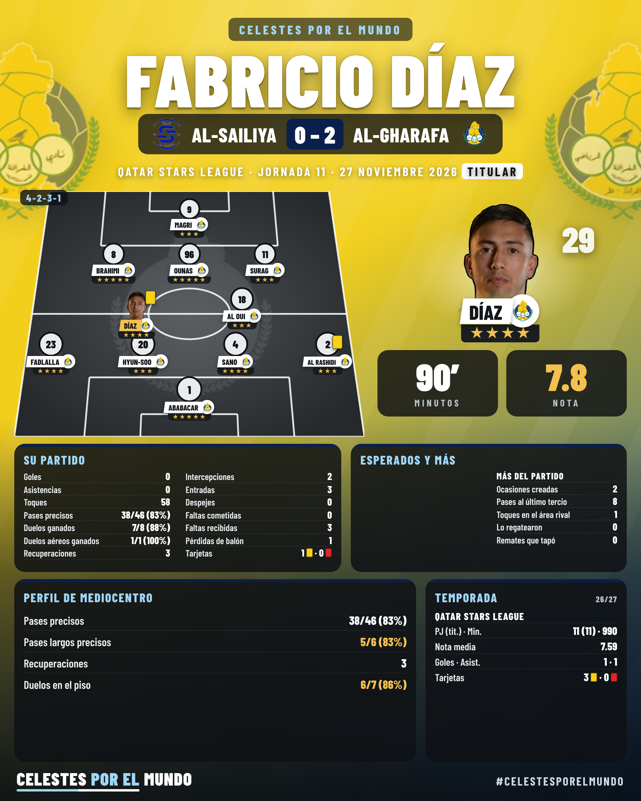
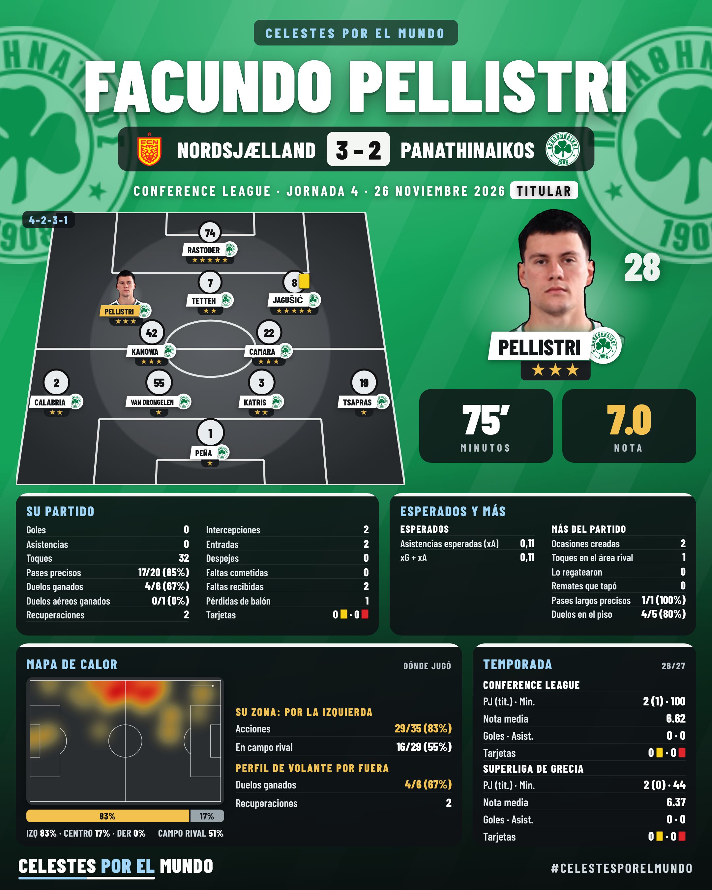

F. Díaz jugó 90' (titular, nota 7.8) en Al-Sailiya 0-2 Al-Gharafa; Pellistri jugó 75' (titular, nota 7.0) en Nordsjælland 3-2 Panathinaikos; infografías listas

@tuscxm

## Quién jugó
- **F. Díaz** jugó 90' (titular, nota 7.8, de mediocentro) en Al-Sailiya 0-2 Al-Gharafa · Qatar Stars League
- **Pellistri** jugó 75' (titular, nota 7.0, de volante por izquierda) en Nordsjælland 3-2 Panathinaikos · Conference League

## El resto
- Valverde: sin partido hoy ni ayer
- Bernal: sin partido hoy ni ayer
- Mouriño: sin partido hoy ni ayer
- M. Araújo: sin partido hoy ni ayer
- Á. Rodríguez: ya procesado · Celta Vigo 1-2 AFC Bournemouth
- González: sin partido hoy ni ayer
- Cáceres: no jugó en Celta Vigo 1-2 AFC Bournemouth (no entró)
- Petit: sin partido hoy ni ayer
- Bentancur: sin partido hoy ni ayer
- Satriano: ya procesado · Iberia 1999 1-0 Getafe
- Boselli: sin partido hoy ni ayer
- J. Rodríguez: sin partido hoy ni ayer
- Zalazar: sin partido hoy ni ayer
- Merentiel: sin partido hoy ni ayer
- Giménez: sin partido hoy ni ayer
- Amaro: sin partido hoy ni ayer
- R. Araújo: sin partido hoy ni ayer
- J. M. Sanabria: sin partido hoy ni ayer
- Ugarte: sin partido hoy ni ayer
- Canobbio: sin partido hoy ni ayer
- Darwin: ya procesado · Al-Faisaly 2-2 Al Diriyah
- Torreira: sin partido hoy ni ayer
- Brizuela: sin partido hoy ni ayer
- Barreiro: sin partido hoy ni ayer
- Piquerez: sin partido hoy ni ayer
- Matturro: sin partido hoy ni ayer
- Olivera: sin partido hoy ni ayer
- Varela: sin partido hoy ni ayer
- Nández: sin partido hoy ni ayer
- Bueno: ya procesado · Monterrey 0-0 CF América
- Pereira: sin partido hoy ni ayer
- Marichal: sin partido hoy ni ayer
- Barboza: sin partido hoy ni ayer
- Olaza: sin partido hoy ni ayer
- Fonseca: sin partido hoy ni ayer
- E. Martínez: sin partido hoy ni ayer
- De la Cruz: sin partido hoy ni ayer
- Arrascaeta: sin partido hoy ni ayer
- Rossi: sin partido hoy ni ayer
- B. Rodríguez: ya procesado · Monterrey 0-0 CF América
- Damiani: sin partido hoy ni ayer
- Aguirre: sin partido hoy ni ayer
- Viñas: sin partido hoy ni ayer

## Avisos
- F. Díaz: SofaScore no respondió; fuentes: fotmob ok, besoccer ok, api_football sin datos: el plan gratis de API-Football no cubre esta temporada (plan: Free plans do not have access to this season, try from 2022 to 2024.), thesportsdb sin datos: no se encontró el equipo, understat sin datos: sin understat_equipo (Understat no cubre esa liga), zerozero error HTTP 403
- F. Díaz: No hay mapa de calor de este partido en el respaldo: se muestra el perfil
- F. Díaz: Armada con datos de respaldo (FotMob): hay menos estadísticas que de costumbre, revisala antes de publicar
- Pellistri: SofaScore no respondió; fuentes: fotmob ok, besoccer ok, api_football sin datos: el plan gratis de API-Football no cubre esta temporada (plan: Free plans do not have access to this season, try from 2022 to 2024.), thesportsdb ok, understat sin datos: sin understat_equipo (Understat no cubre esa liga), zerozero error HTTP 403
- Pellistri: Armada con datos de respaldo (FotMob): hay menos estadísticas que de costumbre, revisala antes de publicar

## F. Díaz · Al-Sailiya 0-2 Al-Gharafa

[Abrir la imagen en tamaño completo](https://github.com/tuscxm/celestes-por-el-mundo/blob/main/salida/png/F.%20D%C3%ADaz/2026-11-27%20%C2%B7%20Al-Sailiya%20%C2%B7%20Qatar%20Stars%20League/Diaz_Al-Sailiya-Al-Gharafa_2026-11-27.png)

Texto para el posteo:
```
🇺🇾 FABRICIO DÍAZ · Al-Sailiya 0-2 Al-Gharafa
⏱ 90' · ⭐ 7.8

Jugó de mediocentro: 38/46 pases (83%), 7/8 duelos ganados, 3 recuperaciones y 8 pases al último tercio.

🧩 ¿Y en una Uruguay 3-5-2 con enganche?
Sería uno de los dos internos: 38/46 pases (83%), 3 recuperaciones y 7/8 duelos ganados. Es el que sostiene y hace circular para que el enganche reciba de frente.

Tres atrás, dos carrileros, dos internos, un 10 suelto y dos puntas. ¿Lo jugarías así? 👇
#CelestesPorElMundo #Uruguay #AlGharafa #352
```

## Pellistri · Nordsjælland 3-2 Panathinaikos

[Abrir la imagen en tamaño completo](https://github.com/tuscxm/celestes-por-el-mundo/blob/main/salida/png/F.%20Pellistri/2026-11-26%20%C2%B7%20Nordsj%C3%A6lland%20%C2%B7%20Conference%20League/Pellistri_Nordsj%C3%A6lland-Panathinaikos_2026-11-26.png)

Texto para el posteo:
```
🇺🇾 FACUNDO PELLISTRI · Nordsjælland 3-2 Panathinaikos
⏱ 75' · ⭐ 7.0

Jugó de volante por izquierda: 17/20 pases (85%), 4/6 duelos ganados, 2 recuperaciones y 2 ocasiones creadas.

🧩 ¿Y en una Uruguay 3-5-2 con enganche?
Sería carrilero por izquierda: 83% de sus acciones por la izquierda, 51% en campo rival y 2 recuperaciones. En el 3-5-2 toda la banda es suya, y con tres centrales atrás puede pasar sin dejar la espalda sola.

Tres atrás, dos carrileros, dos internos, un 10 suelto y dos puntas. ¿Lo jugarías así? 👇
#CelestesPorElMundo #Uruguay #Panathinaikos #352
```

---
En X se publican solas en unos minutos (menos las que la revisión ponga en *No publicar en X*); en Instagram no se publicó nada. Cerrá este aviso cuando la publiques o la descartes.
## Revisión visual
- Fuentes: BeSoccer no respondió a la lectura diaria (HTTP 406 en todas las páginas), así que besoccer_hoy.json quedó vacío. SofaScore no respondió (las dos salieron con el respaldo automático de FotMob). API-Football: el plan gratis no cubre esta temporada. zerozero: HTTP 403. TheSportsDB no encontró al Al-Gharafa. Understat no cubre esas ligas.
- Diaz_Al-Sailiya-Al-Gharafa_2026-11-27: no hay mapa de calor del partido, así que la fila de abajo muestra solo el PERFIL DE MEDIOCENTRO, y la columna ESPERADOS quedó vacía (no hay xG ni xA). Caras, escudos, amarilla (cancha, SU PARTIDO y TEMPORADA) y números coinciden con el texto. Sin cortes ni textos encimados.
- Pellistri_Nordsjælland-Panathinaikos_2026-11-26: está bien (mapa acostado sin remates, barra IZQ 83%, SU ZONA por la izquierda, perfil de volante por fuera y TEMPORADA con Conference y Superliga). El texto del 3-5-2 lo pone de carrilero por izquierda (donde jugó este partido); en rol_352 figura por derecha. Detalle menor. Conviene revisar la Superliga de TEMPORADA: dice 2 partidos (0 de titular) y 44', pocos para esta altura de la temporada.
